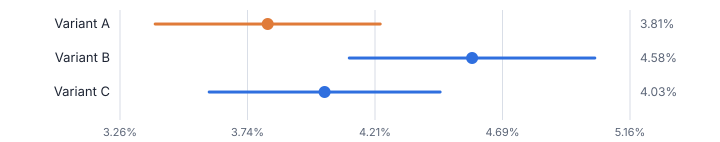
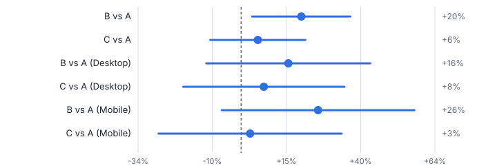
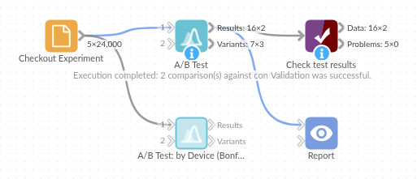

# A/B Test

*Omniscope custom block · Analytics*

**Did the new version really win, or was it luck? Significance, lift, confidence intervals and a plain-English verdict for every variant, plus the sample size you would need.**

**Python** · pandas, numpy · nothing extra to install

## The problem it solves

Experiments are run everywhere now: website checkouts, email subject lines, pricing pages, store layouts, call scripts. The hard part is not running them but reading them: a variant that is 5% ahead after a week may be noise, and slicing the result by device or region makes false winners very likely.

A/B Test applies the standard tests (two-proportion z-test for rates, Welch's t-test for means), shows the uncertainty as a confidence interval, corrects for multiple comparisons on request, and writes the conclusion in a sentence anyone can read.

- **+20%** conversion lift for variant B
- **p = 0.016** B vs A: significant at 95%
- **p = 0.49** C vs A: not significant
- The statistics are built into the script, so nothing extra is installed

### How it works

- Connect one row per visitor (variant and outcome) or one row per variant (visitors and conversions).
- Choose conversion rate or mean, the control variant and the confidence level.
- Each other variant is compared with the control: difference, relative lift, confidence interval, p-value and a verdict.
- If the result is not significant, the block estimates how many visitors per variant would be needed to confirm an effect of the size observed.
- Optionally test per segment (device, country, channel), with a Bonferroni correction to keep false positives in check.

## What goes in

### Checkout experiment, one row per visitor

24,000 synthetic visitors split evenly across A (control), B and C, with device and order value.

| Visitor ID | Variant | Device | Converted | Order Value |
|---|---|---|---|---|
| V06415 | B | Desktop | Yes | 28.05 |
| V13524 | A | Mobile | No | 0.0 |
| V08375 | C | Desktop | No | 0.0 |
| V05257 | B | Desktop | No | 0.0 |
| V04406 | B | Desktop | No | 0.0 |
| V00293 | A | Desktop | No | 0.0 |

*24,000 rows in the sample file.*

## The options

| Option | Demo setting | What it does |
|---|---|---|
| Data layout | `One row per visitor / observation` | Raw rows with one outcome each, or a summary with trials and successes per variant. |
| Variant field | `Variant` | Field naming the variant, such as A / B or Control / New checkout. |
| Outcome field (one row per visitor) | `Converted` | Converted (Yes / No, 1 / 0, true / false) for rates; a number for means. |
| Compare | `Conversion rate (proportion)` | A rate (converted or not) is tested with a z-test; a mean with Welch's t-test. |
| Control variant | `A` | Value of the variant field for the control. Leave empty to use the first in alphabetical order. |
| Confidence level | `0.95` | 0.95 means a 5% chance of calling a difference that is really chance. |

## What comes out

### Test results

| Variant | Control | Control Size | Variant Size | Control Conversion Rate | Variant Conversion Rate | Relative Lift | Difference CI Low | Difference CI High | P Value | Significant | Sample Size Needed Per Variant |
|---|---|---|---|---|---|---|---|---|---|---|---|
| B | A | 8000 | 8000 | 0.03812 | 0.04575 | 0.2 | 0.00141 | 0.01384 | 0.01613 | Yes | 10845 |
| C | A | 8000 | 8000 | 0.03812 | 0.04025 | 0.05574 | -0.00389 | 0.00814 | 0.4885 | No | 130886 |

### Verdicts

| Variant | Verdict |
|---|---|
| B | B converts 20.0% better than A (p = 0.0161): significant at 95%. |
| C | No significant difference between C and A (p = 0.489). Roughly 130,886 per variant would be needed to confirm a difference this size. |

### Variant statistics

| Variant | Is Control | Sample Size | Conversion Rate | Standard Deviation | CI Low | CI High |
|---|---|---|---|---|---|---|
| A | Yes | 8000 | 0.03812 | 0.1915 | 0.03393 | 0.04232 |
| B | No | 8000 | 0.04575 | 0.209 | 0.04117 | 0.05033 |
| C | No | 8000 | 0.04025 | 0.1966 | 0.03594 | 0.04456 |

### Same test per device, with Bonferroni correction

Split by device (four comparisons with the control), even B's real lift is no longer significant: segment results need more data, and the correction says so.

| Device | Variant | Relative Lift | P Value | Significant | Verdict |
|---|---|---|---|---|---|
| Desktop | B | 0.157 | 0.1501 | No | No significant difference between B and A (p = 0.15). Roughly 19,372 per variant would be needed to confirm a difference this size. |
| Desktop | C | 0.0756 | 0.4803 | No | No significant difference between C and A (p = 0.48). Roughly 80,591 per variant would be needed to confirm a difference this size. |
| Mobile | B | 0.2556 | 0.0458 | No | No significant difference between B and A (p = 0.0458). Roughly 12,294 per variant would be needed to confirm a difference this size. |
| Mobile | C | 0.0301 | 0.8047 | No | No significant difference between C and A (p = 0.805). Roughly 802,561 per variant would be needed to confirm a difference this size. |

*Variant conversion rates with 95% confidence intervals (synthetic data).*

*Relative lift vs control: intervals crossing the dashed zero line are not significant.*

## Where it pays off

### E-commerce: Checkout and landing page tests

Read website experiments straight from raw session data in Omniscope, with the verdict and confidence interval ready for the weekly trading meeting.

### Marketing: Email and campaign tests

Compare subject lines, offers or creative on open, click or conversion rates, and know when a test needs more sends before calling a winner.

### Retail and hospitality: Store and menu trials

Compare average basket or spend per visit between trial and control stores with Welch's t-test, per region if needed.

### Financial services and utilities: Contact centre scripts

Test retention or sales scripts on conversion and average order value, with the correction for testing several scripts at once.

*Use cases describe typical scenarios and are illustrative.*

## Why do this in Omniscope

- **Verdict beside the raw sessions.** The test reads one row per visitor from the experiment export, and the verdicts and intervals land in a Report table that the trading meeting opens without anyone redoing a calculation.
- **Textbook statistics, checked.** The tests compare the z-test with a worked textbook example and Welch's t-test with SciPy, and confirm that per-visitor and per-variant data give the same answer; a daily scheduled run applies exactly those tests to each day's sessions.
- **Your team's decision rule.** The verdict wording and the Bonferroni correction are written out in the block's script; change them if your team reports results differently or prefers another correction.

## How it fits into an Omniscope workflow

Sessions (Database / File) → **A/B Test** → Report

Connect raw experiment data straight from the database or web analytics export; no pre-aggregation needed. For very large logs, aggregate to one row per variant and use that layout.

Show the Test results output in a Report table, and the Variant statistics output as a chart; schedule the workflow to refresh the verdict daily while the test runs.

## In one step

One block for proportions and means, with lift, intervals, required sample size and verdicts.

## Try it

1. Open the demo project (`demo.iox` on the demo server, or import `demo.ioz` from this folder): 24,000 visitors in a checkout experiment with three variants.
2. The question: B is ahead, C is slightly ahead too; which would you ship?
3. Open the A/B Test block: variant field, outcome Converted, control A. Run it.
4. Read the verdicts: B converts 20% better, significant; C's difference could be chance, and the block says roughly 130,886 visitors per variant would be needed to confirm it.
5. Open the second block, per device with Bonferroni correction: nothing is significant per device. That is the classic trap of slicing experiments, explained by the tool itself.

## Running in Omniscope

*The demo project's workflow: the sample data, the block, and a Validate data check on its output.*

<!--language-->
## Language and libraries

Python. It uses pandas and numpy, plus the Python standard library (math).

pandas and numpy are part of Omniscope's Docker Python image, and the block was run in both host mode and Docker mode on an Omniscope server, with the same results. It needs nothing else installed.
<!--/language-->

## Tested

The demo workflow ran without errors on an Omniscope server, for both the overall test (2 records in Test results, 3 in Variant statistics) and the per-device test (4 and 6). Automated tests cover normal data, empty input, wrong types and large input.
