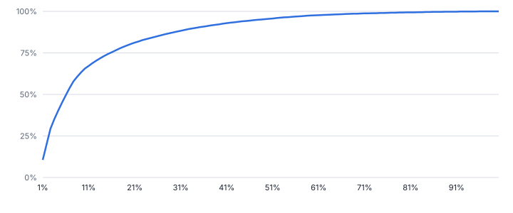
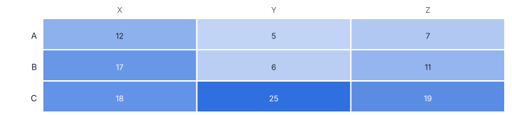
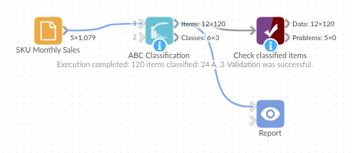

# ABC Classification

*Omniscope custom block · Analytics*

**Which few products make most of the money, and which of those sell steadily? ABC classes by cumulative value and XYZ classes by demand variability, from raw sales lines.**

**Python** · pandas, numpy · nothing extra to install

## The problem it solves

Inventory, purchasing and account teams cannot give every item the same attention. ABC analysis ranks items by value and splits them where the cumulative share crosses 80% and 95%, so planners focus on the vital few. XYZ analysis adds how predictable each item's demand is.

Doing it by hand means aggregating, sorting, running totals, thresholds and, for XYZ, a period-by-item matrix with zero-filled months and a coefficient of variation. This block does all of it from the sales lines.

- **24 of 120** SKUs are class A
- **80%** of sales value from class A
- **62** class C SKUs make only 5% of value
- **12** AX SKUs: high value and steady, ideal for automated replenishment

### How it works

- Choose the item and value fields; sales lines are summed per item. Optionally classify within groups such as warehouse.
- Items are ranked by value; an item's class is set by where its cumulative share starts, so the item that crosses 80% is still A.
- Add a date field for XYZ: demand per week, month or quarter (missing periods count as zero), coefficient of variation, X / Y / Z class and the combined class.
- The class summary gives item and value shares and a suggested policy per class.

## What goes in

### SKU monthly sales

1,079 synthetic monthly sales lines for 120 SKUs over 12 months (months with no sales are simply absent).

| Month | SKU | Category | Units | Sales Value |
|---|---|---|---|---|
| 2024-11-01 | SKU-0001 | Electrical | 22 | 1668.04 |
| 2024-12-01 | SKU-0001 | Electrical | 23 | 1743.86 |
| 2025-01-01 | SKU-0001 | Electrical | 34 | 2577.88 |
| 2025-02-01 | SKU-0001 | Electrical | 28 | 2122.96 |
| 2025-03-01 | SKU-0001 | Electrical | 23 | 1743.86 |
| 2025-04-01 | SKU-0001 | Electrical | 27 | 2047.14 |

*1,079 rows in the sample file.*

## The options

| Option | Demo setting | What it does |
|---|---|---|
| Item field | `SKU` | Product, SKU, customer or supplier. |
| Value field | `Sales Value` | Value to rank by, such as sales value or margin. Summed per item. |
| Date field (enables XYZ) | `Month` | Date of each sales line; demand is summed per period. |
| Demand field for XYZ | `Units` | Quantity to measure variability on, such as Units. Leave empty to use the value field. |
| A class up to | `0.8` | Cumulative share of value covered by class A. |
| B class up to | `0.95` | Cumulative share covered by classes A and B together. |
| Period | `Month` | Period that demand is summed over before its variability (CV) is measured. |

## What comes out

### Classified items (top 8)

| SKU | Total Value | Value Share | Cumulative Share | Rank | ABC Class | Average Per Period | Coefficient Of Variation | XYZ Class | ABC-XYZ |
|---|---|---|---|---|---|---|---|---|---|
| SKU-0100 | 345,833.84 | 0.106 | 0.106 | 1 | A | 1,195.33 | 0.026 | X | AX |
| SKU-0065 | 308,434.14 | 0.094 | 0.2 | 2 | A | 333.50 | 2.237 | Z | AZ |
| SKU-0113 | 305,015.49 | 0.093 | 0.293 | 3 | A | 324.25 | 0.04 | X | AX |
| SKU-0090 | 188,490.72 | 0.058 | 0.35 | 4 | A | 212.67 | 0.082 | X | AX |
| SKU-0091 | 164,427.90 | 0.05 | 0.401 | 5 | A | 184.92 | 0.628 | Y | AY |
| SKU-0097 | 159,529.48 | 0.049 | 0.449 | 6 | A | 196.83 | 0.07 | X | AX |
| SKU-0120 | 149,374.98 | 0.046 | 0.495 | 7 | A | 204.50 | 0.068 | X | AX |
| SKU-0093 | 141,667.44 | 0.043 | 0.538 | 8 | A | 220.58 | 0.083 | X | AX |

### Class summary

| ABC Class | Items | Value | Share Of Items | Share Of Value | Suggested Policy |
|---|---|---|---|---|---|
| A | 24 | 2,632,773.95 | 0.2 | 0.804 | Tight control: review often, forecast carefully, high service level. |
| B | 34 | 483,036.65 | 0.283 | 0.147 | Moderate control: periodic review. |
| C | 62 | 160,439.54 | 0.517 | 0.049 | Simple rules: bulk ordering, low review effort. |

*A small share of SKUs makes most of the sales value (synthetic data).*

*ABC by XYZ: AX items suit automated replenishment; CZ items are candidates for make-to-order or delisting.*

## Where it pays off

### Retail and wholesale: Range and replenishment policy

Set review frequency, safety stock and service levels by ABC-XYZ class, and spot erratic low-value lines for range rationalisation.

### Manufacturing: Spare parts and materials

Classify spares by consumption value and demand pattern to decide what to stock, what to order on demand and what to review weekly.

### Procurement: Supplier spend

ABC on spend per supplier shows the few suppliers that deserve strategic management and the long tail to consolidate.

### B2B sales: Customer tiers

ABC on revenue per customer, within each region, gives account managers a clear priority list.

*Use cases describe typical scenarios and are illustrative.*

## Why do this in Omniscope

- **Classes straight from sales lines.** The block sums the lines per SKU itself, so it reads from the sales database directly, and its classes join back to the item master in the same workflow that feeds the planning report.
- **The same cut-offs every month.** Classes are recalculated from the lines on each run, the tests pin the rule that the SKU crossing 80% stays in A, and a Validate data rule can confirm that no SKU is left without a class.
- **Policies you can rewrite.** The XYZ limits are options, and the suggested policy for each class is a line of text in the Python script inside the block; replace it with your own replenishment rules.

## How it fits into an Omniscope workflow

Sales lines (Database) → **ABC Classification** → Join (item master) → Report

Feed sales lines directly; no need to aggregate first. Join the classes back to the item master for planning parameters.

Show the class summary and ABC-XYZ matrix in a Report; schedule monthly so classes stay current.

## In one step

A complete ABC-XYZ analysis without the multi-step workflow; Tile's equal-sum method covers simple Pareto bands, this block adds class thresholds and XYZ.

## Try it

1. Open the demo project (`demo.iox` on the demo server, or import `demo.ioz` from this folder): a year of monthly sales lines for 120 SKUs.
2. The question: which items deserve a planner's attention every week?
3. Open ABC Classification: item SKU, value Sales Value, date Month and demand Units for XYZ. Run it.
4. Look at the class summary: 24 SKUs are A and make 80% of value.
5. Look at the ABC-XYZ matrix: AX items to automate, AZ items to watch closely, CZ items to question.

## Running in Omniscope

*The demo project's workflow: the sample data, the block, and a Validate data check on its output.*

<!--language-->
## Language and libraries

Python. It uses pandas and numpy.

pandas and numpy are part of Omniscope's Docker Python image, and the block was run in both host mode and Docker mode on an Omniscope server, with the same results. It needs nothing else installed.
<!--/language-->

## Tested

Run on an Omniscope server, the demo workflow finished without errors (120 records in Classified items and 3 in Class summary). Automated tests also cover normal data, empty input, wrong types and large input.
