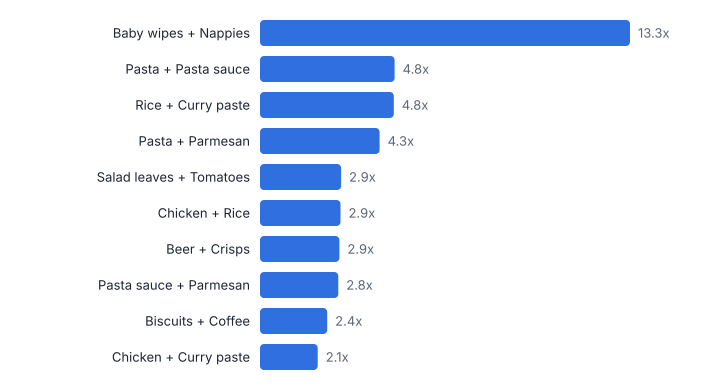
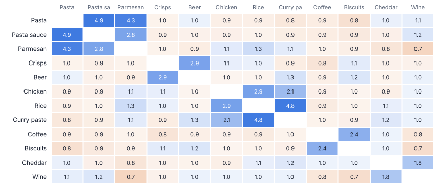
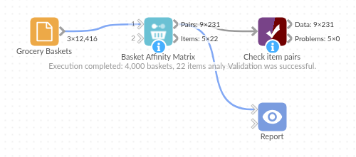

# Basket Affinity Matrix

*Omniscope custom block · Analytics*

**Which products sell together, and how much more than chance? Every pair's support, confidence and lift from basket data, with each product's strongest partners.**

**Python** · pandas, numpy · nothing extra to install

## The problem it solves

Range, layout, bundling and cross-sell decisions all depend on what customers buy together. Raw co-occurrence counts mislead: milk appears with everything simply because it is in most baskets. Lift corrects for that by comparing each pair with what independence would predict.

Basket Affinity Matrix computes the full set of pair metrics for the most common items in one pass, and summarises each item's strongest partners, a view that is quick to read and easy to chart.

- **4,000** baskets analysed
- **231** item pairs measured
- **13.3x** Baby wipes with Nappies: strongest affinity
- **1 million** lines processed in the automated tests

### How it works

- Choose the basket (order) field and the item (product) field; duplicate lines in a basket count once.
- The most frequent items (50 by default, each in at least 5 baskets) are compared pairwise.
- For each pair: baskets with both, support, confidence both ways, lift, Jaccard and an association label.
- The item summary lists each item's baskets, support and top partners by lift.

## What goes in

### Grocery basket lines

12,416 synthetic lines from 4,000 baskets over 22 products, with planted affinities (nappies and wipes, pasta and sauce, crisps and beer) and one avoidance (cat food and ice cream).

| Basket ID | Item | Store |
|---|---|---|
| B00001 | Bananas | S2 |
| B00001 | Ice cream | S2 |
| B00002 | Milk | S3 |
| B00003 | Bananas | S4 |
| B00003 | Cheddar | S4 |
| B00003 | Coffee | S4 |
| B00003 | Ice cream | S4 |
| B00003 | Milk | S4 |

*12,416 rows in the sample file.*

## The options

| Option | Demo setting | What it does |
|---|---|---|
| Basket / order ID | `Basket ID` | Identifies a basket: rows with the same value were bought together. |
| Item / product | `Item` | The item in each row, such as a product name or SKU. |
| Most frequent items to include | `50` | Only this many of the most often bought items are paired, which keeps the output readable. |
| Minimum baskets per pair | `3` | Pairs seen together fewer times are left out. |

## What comes out

### Item pairs (top 10 by lift)

| Item A | Item B | Baskets With Both | Support | Confidence A to B | Confidence B to A | Lift | Jaccard | Association |
|---|---|---|---|---|---|---|---|---|
| Baby wipes | Nappies | 100 | 0.025 | 0.546 | 0.61 | 13.33 | 0.405 | Strong positive |
| Pasta | Pasta sauce | 239 | 0.06 | 0.509 | 0.57 | 4.855 | 0.368 | Strong positive |
| Rice | Curry paste | 179 | 0.045 | 0.338 | 0.637 | 4.817 | 0.284 | Strong positive |
| Pasta | Parmesan | 125 | 0.031 | 0.266 | 0.506 | 4.307 | 0.211 | Strong positive |
| Salad leaves | Tomatoes | 288 | 0.072 | 0.455 | 0.462 | 2.917 | 0.297 | Strong positive |
| Chicken | Rice | 228 | 0.057 | 0.384 | 0.431 | 2.902 | 0.255 | Strong positive |
| Beer | Crisps | 263 | 0.066 | 0.424 | 0.444 | 2.857 | 0.277 | Strong positive |
| Pasta sauce | Parmesan | 73 | 0.018 | 0.174 | 0.296 | 2.821 | 0.123 | Strong positive |
| Biscuits | Coffee | 207 | 0.052 | 0.306 | 0.408 | 2.416 | 0.212 | Strong positive |
| Chicken | Curry paste | 87 | 0.022 | 0.146 | 0.31 | 2.085 | 0.11 | Strong positive |

### Item summary

| Item | Baskets | Support | Top Partners (by lift) | Pairs Found |
|---|---|---|---|---|
| Milk | 1606 | 0.402 | Pasta (1.0x) | 21 |
| Bread | 1146 | 0.286 | Cheddar (1.7x), Salad leaves (1.1x), Rice (1.1x) | 21 |
| Bananas | 848 | 0.212 | Parmesan (1.2x), Ice cream (1.1x), Tomatoes (1.1x) | 21 |
| Cheddar | 741 | 0.185 | Wine (1.8x), Bread (1.7x), Ice cream (1.2x) | 21 |
| Eggs | 720 | 0.18 | Ice cream (1.2x), Pasta (1.1x), Parmesan (1.1x) | 21 |
| Biscuits | 676 | 0.169 | Coffee (2.4x), Beer (1.2x), Crisps (1.1x) | 21 |
| Salad leaves | 633 | 0.158 | Tomatoes (2.9x), Nappies (1.3x), Coffee (1.2x) | 21 |
| Tomatoes | 624 | 0.156 | Salad leaves (2.9x), Curry paste (1.2x), Crisps (1.1x) | 21 |
| Beer | 621 | 0.155 | Crisps (2.9x), Curry paste (1.3x), Nappies (1.3x) | 21 |
| Chicken | 594 | 0.148 | Rice (2.9x), Curry paste (2.1x), Parmesan (1.1x) | 21 |

*Pairs bought together far more often than chance (synthetic data).*

*Lift matrix: blue pairs sell together, orange pairs are bought apart.*

## Where it pays off

### Grocery and convenience: Layout and adjacency

Place high-lift pairs near each other, or deliberately apart to pull shoppers through the store.

### E-commerce: Cross-sell and bundles

"Frequently bought together" suggestions and bundle candidates from the strongest partners per product.

### Hospitality: Menu engineering

Which starters, sides and drinks go with which mains, to design set menus and upsell prompts.

### B2B distribution: Account-based selling

Products customers usually order together, to spot gaps in an account's basket.

*Use cases describe typical scenarios and are illustrative.*

## Why do this in Omniscope

- **Affinities per store or season.** Put a Record filter on a store or period ahead of the block and the matrix is recomputed for that slice, in the same workflow that reads the order lines and draws the heat map.
- **Metrics you can check by hand.** Duplicate lines in a basket count once, the tests recompute support, confidence and lift by hand on small baskets, and the block handled a million lines in testing.
- **Labels set to your categories.** The 50-item limit and the 5-basket minimum are options, and the lift levels behind "Strong positive" (1.5) and "Positive" (1.1) sit in the script if your category managers draw the line elsewhere.

## How it fits into an Omniscope workflow

Order lines (Database) → **Basket Affinity Matrix** → Report

Feed order lines directly. Filter on a store or period first to compare affinities between formats or seasons.

Show the pairs as a heat map or network in a Report; use the native Basket Analysis block when you need multi-item rules.

Because the pair table is ordinary Omniscope data, selecting a product in the heat map filters the rest of the Report, and a store or period filter upstream re-runs the matrix for that slice.

## In one step

The all-pairs affinity matrix with lift, confidence and Jaccard, in a long table that charts directly.

## Try it

1. Open the demo project (`demo.iox` on the demo server, or import `demo.ioz` from this folder): 4,000 grocery baskets, one row per basket and item.
2. The question: which products should sit together, and which bundles would make sense?
3. Open Basket Affinity Matrix: basket ID and item. Run it.
4. Look at the top pairs: Baby wipes and Nappies at 13.3x, then pasta with sauce and crisps with beer. A lift of 13.3x means the pair occurs 13.3 times as often as it would if the two items were independent.
5. Look at the item summary for one product and the heat map: a cross-sell list and a layout guide from one block.

## Running in Omniscope

*The demo project's workflow: the sample data, the block, and a Validate data check on its output.*

<!--language-->
## Language and libraries

Python. It uses pandas and numpy.

pandas and numpy are part of Omniscope's Docker Python image, and the block was run in both host mode and Docker mode on an Omniscope server, with the same results. It needs nothing else installed.
<!--/language-->

## Tested

The demo workflow runs without errors on an Omniscope server and produces 231 records in Item pairs and 22 in Item summary. Its automated tests cover normal data, empty input, wrong types and large input.
