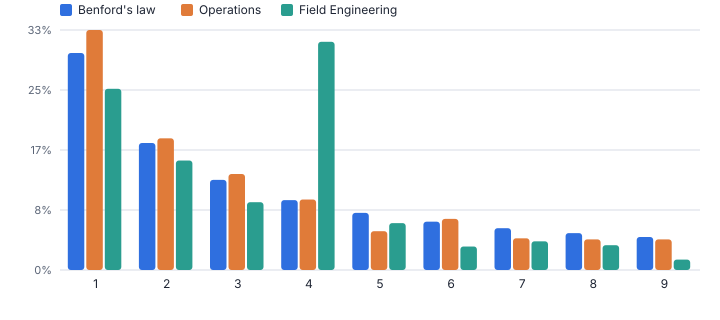
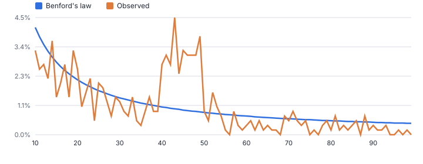
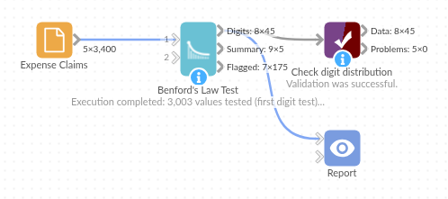

# Benford's Law Test

*Omniscope custom block · Analytics*

**A classic forensic test in one block: check whether invoices, expenses or claims follow Benford's law, per department, supplier or employee, and get the records worth a second look.**

**Python** · pandas, numpy · nothing extra to install

## The problem it solves

Auditors and fraud teams use Benford's law as a quick, objective screen: in natural sets of amounts about 30% start with the digit 1 and fewer than 5% with 9. People inventing or adjusting numbers, for example keeping expense claims just under a receipt threshold, leave a fingerprint in the digits.

Running the test properly needs digit extraction, expected proportions, z-statistics with continuity correction, chi-square and MAD conformity bands, per group. This block does all of it and lists the records behind any suspicious digits. As with any screening test, a flag is a reason to look, not proof of wrongdoing.

- **3,003** claims tested across 5 departments
- **1** department fails the test
- **0.049** MAD for Field Engineering (about 0.010 expected if it conformed)
- **175** claims flagged for follow-up

### How it works

- Choose the amount field and, optionally, the groups to test separately (department, supplier, employee).
- Pick the test: first digit, first two digits (sharper, needs more data) or second digit.
- Per digit you get observed and expected shares and a z-statistic; per group, chi-square, p-value, MAD and a conformity verdict using Nigrini's bands.
- A group is called nonconforming only when its MAD is in the nonconformity band and the chi-square is significant, so small groups are not over-flagged.
- The flagged-records output lists the input rows carrying the over-represented digits of nonconforming groups.

## What goes in

### Expense claims

3,400 synthetic claims. In Field Engineering, many claims were deliberately set just below a £50 receipt threshold.

| Claim ID | Department | Employee | Category | Amount |
|---|---|---|---|---|
| EXP-02040 | Operations | E123 | Meals | 25.16 |
| EXP-01365 | Marketing | E146 | Hotel | 8.49 |
| EXP-02665 | Finance | E155 | Supplies | 34.11 |
| EXP-01516 | Marketing | E150 | Meals | 6.36 |
| EXP-02039 | Operations | E152 | Supplies | 52.91 |
| EXP-00251 | Sales | E113 | Meals | 66.47 |

*3,400 rows in the sample file.*

## The options

| Option | Demo setting | What it does |
|---|---|---|
| Amount field | `Amount` | The amounts to test, such as invoice or expense values. |
| Test separately for each (optional) | `Department` | For example Department, Supplier or Employee. |
| Test | `First digit (1-9)` | Which digits to compare with Benford's law. First two digits is the finer test usually used in audit. |
| Ignore amounts below | `10.0` | Small amounts distort first-digit tests; 10 is the usual floor. |
| Significance for nonconformity | `0.01` | A group is only called nonconforming when its MAD is in the nonconformity band and the chi-square p-value is below this. |

## What comes out

### Conformity summary

| Department | Values Tested | Chi-Square | Degrees Of Freedom | P Value | MAD | Expected MAD If Conforming | Conformity | Over-represented Digits |
|---|---|---|---|---|---|---|---|---|
| Field Engineering | 553 | 314.85 | 8 | 0 | 0.0488 | 0.01 | Nonconformity | 4 |
| Finance | 351 | 15.07 | 8 | 0.0578 | 0.0168 | 0.0125 | Nonconformity on MAD only (chi-square not significant) |  |
| Marketing | 611 | 15.15 | 8 | 0.0563 | 0.0128 | 0.0095 | Marginally acceptable conformity | 2 |
| Operations | 706 | 12.44 | 8 | 0.1325 | 0.0114 | 0.0088 | Acceptable conformity |  |
| Sales | 782 | 17.76 | 8 | 0.0231 | 0.0119 | 0.0084 | Acceptable conformity | 1 |

### Digit distribution: Field Engineering

| Department | Digit | Count | Observed Share | Expected Share | Difference | Z Statistic | Flag |
|---|---|---|---|---|---|---|---|
| Field Engineering | 1 | 139 | 0.2514 | 0.301 | -0.0497 | 2.5 | Under-represented |
| Field Engineering | 2 | 84 | 0.1519 | 0.1761 | -0.0242 | 1.438 |  |
| Field Engineering | 3 | 52 | 0.094 | 0.1249 | -0.0309 | 2.134 | Under-represented |
| Field Engineering | 4 | 175 | 0.3165 | 0.0969 | 0.2195 | 17.38 | Over-represented |
| Field Engineering | 5 | 36 | 0.0651 | 0.0792 | -0.0141 | 1.148 |  |
| Field Engineering | 6 | 18 | 0.0325 | 0.0669 | -0.0344 | 3.151 | Under-represented |
| Field Engineering | 7 | 22 | 0.0398 | 0.058 | -0.0182 | 1.741 |  |
| Field Engineering | 8 | 19 | 0.0344 | 0.0512 | -0.0168 | 1.696 |  |
| Field Engineering | 9 | 8 | 0.0145 | 0.0458 | -0.0313 | 3.42 | Under-represented |

### Flagged records

| Claim ID | Department | Employee | Category | Amount | Tested Digits | Reason |
|---|---|---|---|---|---|---|
| EXP-02929 | Field Engineering | E104 | Meals | 48.77 | 4 | Digits over-represented in a nonconforming group |
| EXP-03023 | Field Engineering | E154 | Meals | 482.50 | 4 | Digits over-represented in a nonconforming group |
| EXP-02801 | Field Engineering | E103 | Meals | 41.44 | 4 | Digits over-represented in a nonconforming group |
| EXP-02932 | Field Engineering | E110 | Travel | 40.15 | 4 | Digits over-represented in a nonconforming group |
| EXP-02954 | Field Engineering | E108 | Hotel | 49.66 | 4 | Digits over-represented in a nonconforming group |
| EXP-02818 | Field Engineering | E141 | Travel | 44.81 | 4 | Digits over-represented in a nonconforming group |

*Operations follows Benford's law closely; Field Engineering has far too many amounts starting with 4 (synthetic data).*

*The first-two-digits test pinpoints it: amounts from 40 to 49, just under the £50 threshold.*

## Where it pays off

### Internal audit: Expenses and purchase cards

Screen claims per employee or cost centre each month and route nonconforming groups, with the specific claims, to the audit team.

### Procurement: Supplier invoices

Test invoice amounts per supplier: split invoices kept under approval limits and invented invoices both distort the digits.

### Insurance: Claims screening

A cheap first filter for claims fraud by adjuster, region or claim type, ahead of more expensive models.

### Public sector and data quality: Reported figures

Check returns submitted by many units (for example grant claims or statistics) for fabricated or mis-keyed figures.

*Use cases describe typical scenarios and are illustrative.*

## Why do this in Omniscope

- **Flagged claims delivered to audit.** The test, the Report and an Email output step sit in one workflow, so each month the audit team receives the specific claims behind a nonconforming department, not only a chart.
- **A cautious, repeatable screen.** A group is called nonconforming only when MAD and chi-square agree, the chi-square is checked against SciPy in the tests, and the same settings run against every month's claims.
- **Bands visible in the code.** Nigrini's MAD bands for each test type are listed at the top of the block's script; tighten them there if your audit policy asks for it.

## How it fits into an Omniscope workflow

Expense claims (Database) → **Benford's Law Test** → Report → Email output (flagged records)

Feed the raw transaction amounts; choose groups that make sense for accountability (employee, supplier, approver).

Show the conformity summary and digit chart in a Report; schedule the workflow monthly and email the flagged-records output to the audit team.

## In one step

Digit tests, conformity statistics and flagged records come out together, with no workflow to build.

## Try it

1. Open the demo project (`demo.iox` on the demo server, or import `demo.ioz` from this folder): 3,400 expense claims across five departments.
2. Benford's law says that in many real sets of amounts about 30% start with 1 and under 5% with 9.
3. Open the block: amount field, test per Department, first digit. Run it.
4. Look at the summary: no other department is called nonconforming (Finance is outside the bands on MAD alone, without a significant chi-square); Field Engineering's MAD is 0.049, far above the 0.010 expected, with p < 0.001.
5. Look at the digit chart (too many 4s), switch to the first-two-digits test (40 to 49: just under the £50 receipt limit), then the flagged records list.

## Running in Omniscope

*The demo project's workflow: the sample data, the block, and a Validate data check on its output.*

<!--language-->
## Language and libraries

Python. It uses pandas and numpy, plus the Python standard library (math).

pandas and numpy are part of Omniscope's Docker Python image, and the block was run in both host mode and Docker mode on an Omniscope server, with the same results. It needs nothing else installed.
<!--/language-->

## Tested

The demo workflow runs without errors on an Omniscope server and produces 45 records in Digit distribution, 5 in Conformity summary and 175 in Flagged records. Its automated tests cover normal data, empty input, wrong types and large input.
