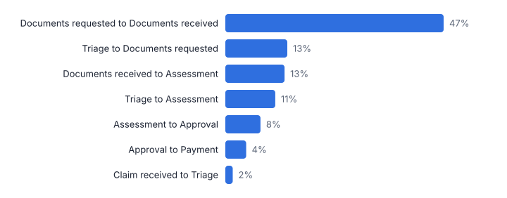
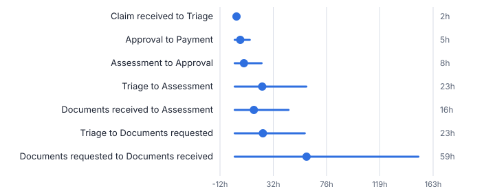
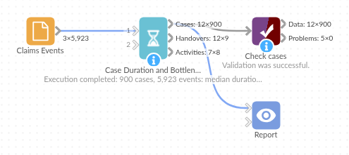

# Case Duration and Bottlenecks

*Omniscope custom block · Analytics*

**From an event log to cycle times, rework and the handovers where work waits longest, ranked by total delay.**

**Python** · pandas, numpy · nothing extra to install

## The problem it solves

Operational systems log every step of a claim, order or application, but the questions are about flow: how long do cases take, where do they wait, and how often does work loop back. Answering them means ordering events per case, pairing each step with the next and summarising the gaps.

This block does that from a plain event log in any order: per-case durations and rework, per-handover waiting times ranked by total delay, and activity statistics.

- **900** claims (synthetic)
- **100 h** median claim duration
- **47%** of all waiting is documents requested to documents received
- **186 h vs 82 h** median duration with and without rework (170 claims reworked)

### How it works

- Connect an event log with case, activity and timestamp fields; the order of the rows does not matter.
- Choose hours or days, and how many steps of each route to show.
- Outputs: cases, handovers (ranked by total waiting) and activities.

## What goes in

### Claims events

5,923 synthetic events for 900 claims, shuffled.

| Claim ID | Activity | Timestamp |
|---|---|---|
| CLM-70046 | Claim received | 2025-09-17 19:00 |
| CLM-70396 | Claim received | 2025-10-10 01:00 |
| CLM-70621 | Approval | 2025-09-12 16:10 |
| CLM-70806 | Claim received | 2025-09-21 10:00 |
| CLM-70227 | Triage | 2025-10-22 20:45 |
| CLM-70460 | Assessment | 2025-09-20 16:39 |

*5,923 rows in the sample file.*

## The options

| Option | Demo setting | What it does |
|---|---|---|
| Case field | `Claim ID` | Identifies a case, such as a claim, ticket or order number. |
| Activity field | `Activity` | The name of the step recorded in each event. |
| Timestamp field | `Timestamp` | When the event happened; orders the events within each case. |
| Durations in | `Hours` | Unit for durations and waiting times. |

## What comes out

### Handovers, most total waiting first

| From Activity | To Activity | Handovers | Cases | Median Hours | Average Hours | 90th Percentile Hours | Total Hours | Share Of All Waiting | Rank By Total | Rank By Median | Repeat Of Same Activity |
|---|---|---|---|---|---|---|---|---|---|---|---|
| Documents requested | Documents received | 670 | 571 | 59.06 | 75.81 | 151.09 | 50,789.80 | 0.47 | 1 | 1 | No |
| Triage | Documents requested | 500 | 500 | 23.16 | 28.8 | 57.61 | 14,400.83 | 0.13 | 2 | 2 | No |
| Documents received | Assessment | 670 | 571 | 15.8 | 20.62 | 44.34 | 13,813.93 | 0.13 | 3 | 4 | No |
| Triage | Assessment | 400 | 400 | 22.59 | 29.08 | 58.86 | 11,631.28 | 0.11 | 4 | 3 | No |
| Assessment | Approval | 813 | 813 | 7.55 | 10.01 | 22.09 | 8,138.97 | 0.08 | 5 | 5 | No |
| Approval | Payment | 813 | 813 | 4.55 | 5.97 | 12.41 | 4,854.80 | 0.05 | 6 | 8 | No |
| Claim received | Triage | 900 | 900 | 1.52 | 1.88 | 3.95 | 1,695.98 | 0.02 | 7 | 9 | No |
| Assessment | Documents requested | 170 | 170 | 6.51 | 9.12 | 19.5 | 1,549.58 | 0.01 | 8 | 7 | No |

### Slowest cases

| Claim ID | Start | End | Duration (Hours) | Steps | Distinct Activities | Rework Steps | First Activity | Last Activity | Route | Variant Rank | Slowest 10% |
|---|---|---|---|---|---|---|---|---|---|---|---|
| CLM-70525 | 2025-10-24 10:00 | 2025-11-22 11:46 | 697.77 | 10 | 7 | 3 | Claim received | Payment | Claim received > Triage > Documents requested > Documents received > Assessment > Documents requested > Documents received > Assessment > Approval > Payment | 3 | Yes |
| CLM-70251 | 2025-10-10 08:00 | 2025-11-03 22:15 | 590.25 | 10 | 7 | 3 | Claim received | Payment | Claim received > Triage > Documents requested > Documents received > Assessment > Documents requested > Documents received > Assessment > Approval > Payment | 3 | Yes |
| CLM-70608 | 2025-10-26 04:00 | 2025-11-15 21:00 | 497 | 10 | 7 | 3 | Claim received | Payment | Claim received > Triage > Documents requested > Documents received > Assessment > Documents requested > Documents received > Assessment > Approval > Payment | 3 | Yes |
| CLM-70812 | 2025-09-26 00:00 | 2025-10-15 18:50 | 474.83 | 10 | 7 | 3 | Claim received | Payment | Claim received > Triage > Documents requested > Documents received > Assessment > Documents requested > Documents received > Assessment > Approval > Payment | 3 | Yes |
| CLM-70455 | 2025-09-29 05:00 | 2025-10-18 20:04 | 471.07 | 9 | 6 | 3 | Claim received | Rejected | Claim received > Triage > Documents requested > Documents received > Assessment > Documents requested > Documents received > Assessment > Rejected | 7 | Yes |
| CLM-70729 | 2025-10-30 04:00 | 2025-11-17 20:44 | 448.73 | 10 | 7 | 3 | Claim received | Payment | Claim received > Triage > Documents requested > Documents received > Assessment > Documents requested > Documents received > Assessment > Approval > Payment | 3 | Yes |

*Waiting for documents dominates the claim lifecycle (synthetic data).*

*The long tails (90th percentile) show where some cases wait far longer than typical.*

## Where it pays off

### Insurance and financial services: Claims and applications

Where claims wait, how often documents are chased twice, and which steps drive the slowest 10%.

### Order management: Order to cash

Order, pick, pack, ship, invoice and pay: the handovers that delay cash.

### Healthcare: Patient pathways

Referral to appointment to treatment waits, by step.

### Public sector: Casework

Case stages, rework and waiting times for planning, licensing or benefits processes.

*Use cases describe typical scenarios and are illustrative.*

## Why do this in Omniscope

- **Event log to bottleneck report.** The claims system's export loads on a schedule, Path Analysis can follow the block for the common routes, and the ranked handovers and slowest cases share one Report.
- **Same answer whatever the row order.** Events are sorted per case inside the block, so an unsorted export gives the same durations and waiting times on every load; the tests check rework and handover counts on known cases.
- **Percentiles to match your targets.** The 90th percentile and the "Slowest 10%" flag are a line each in the Python code; switch to the 95th if that is where your service targets are set.

## How it fits into an Omniscope workflow

Event log (workflow system) → **Case Duration and Bottlenecks** → Path Analysis (routes) → Report

Load the event log on a schedule; Path Analysis shows the common routes, and Business Hours and SLA measures steps in working time.

Show the handovers ranked by total waiting and the slowest cases in a Report.

## In one step

Durations, rework and ranked handovers straight from an event log.

## Try it

1. Open the demo project (`demo.iox` on the demo server, or import `demo.ioz` from this folder): a synthetic claims event log in no particular order.
2. The question: where do claims spend their time, and how much does rework cost?
3. Run the block: cases, handovers and activities.
4. Look at the handovers: documents requested to documents received accounts for 47% of all waiting.
5. Look at rework: 170 claims had documents requested twice; their median duration is 186 hours against 82.

## Running in Omniscope

*The demo project's workflow: the sample data, the block, and a Validate data check on its output.*

<!--language-->
## Language and libraries

Python. It uses pandas and numpy.

pandas and numpy are part of Omniscope's Docker Python image, and the block was run in both host mode and Docker mode on an Omniscope server, with the same results. It needs nothing else installed.
<!--/language-->

## Tested

The demo workflow completed without errors on an Omniscope server (900 records in Cases, 9 in Handovers and 8 in Activities). Automated tests check normal data, empty input, wrong types and large input.
