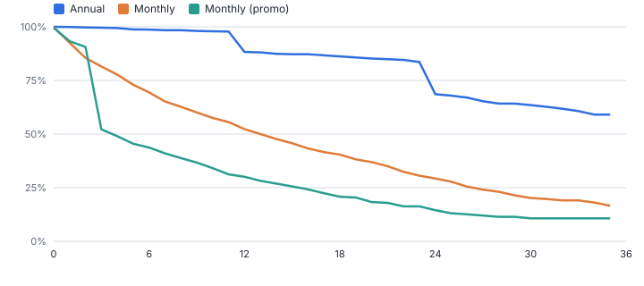
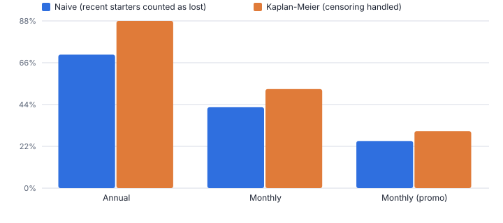
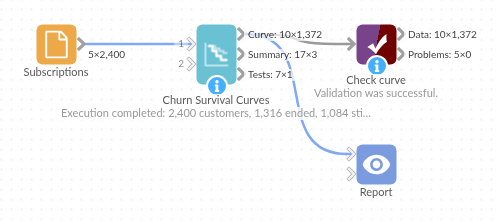

# Churn Survival Curves

*Omniscope custom block · Analytics*

**Retention curves that treat customers who are still active correctly: Kaplan-Meier survival by plan or channel, median lifetime, milestone retention and log-rank tests.**

**Python** · pandas, numpy · nothing extra to install

## The problem it solves

"What share of customers are still with us after a year?" sounds simple, but recent customers have not had a year yet. Dropping them biases the answer one way; counting them as lost biases it the other. Survival analysis handles this properly by treating them as censored, which is why it is widely used for churn, contract renewal and employee retention.

This block produces Kaplan-Meier curves with confidence bands from start and end dates, median lifetimes, retention at the milestones you choose, and log-rank tests of whether groups really differ.

- **2,400** subscriptions, 1,084 still active (censored)
- **44%** of promo customers still active at 6 months
- **13.0** months median lifetime on Monthly (11.8 to 14.2)
- **10 pts** by which a naive 12-month figure understates Monthly retention

### How it works

- Connect one row per customer or subscription with a start date and an end date (empty = still active), or a duration and an event flag.
- Choose the time unit, the milestones (for example 3, 6, 12, 24 months), an optional group to compare and an optional as-of date.
- Outputs: the curve per group (for a step chart with a band), the summary per group, and the log-rank test across groups.

## What goes in

### Subscriptions

2,400 synthetic subscriptions on three plans, January 2023 to December 2025.

| Subscription ID | Start Date | End Date | Plan | Channel |
|---|---|---|---|---|
| S00001 | 2024-03-19 | 2024-08-10 | Monthly (promo) | Partner |
| S00002 | 2023-03-02 | 2023-03-29 | Monthly | Web |
| S00003 | 2024-06-29 | 2025-12-06 | Monthly (promo) | Partner |
| S00004 | 2023-09-29 | 2025-10-26 | Monthly | Web |
| S00005 | 2023-01-05 | 2023-01-10 | Monthly | Partner |
| S00006 | 2023-09-30 |  | Monthly (promo) | Web |

*2,400 rows in the sample file.*

## The options

| Option | Demo setting | What it does |
|---|---|---|
| Start date | `Start Date` | Date each customer or subscription started. |
| End date | `End Date` | Empty = still active. |
| Compare groups (optional) | `Plan` | For example Plan or Channel. |
| As of date (optional) | `2025-12-31` | Default: the latest date in the data. |
| Time unit | `Months` | Unit for lifetimes, the curve and the milestones. |
| Retention milestones | `3, 6, 12, 24` | In the time unit, for example: 3, 6, 12, 24 |

## What comes out

### Summary by plan

| Group | Customers | Ended | Still Active (censored) | Median Lifetime | Median CI Low | Median CI High | Retention At 3 | Retention At 6 | Retention At 12 | Retention At 24 | Restricted Mean Lifetime | Observed Ended | Expected Ended | Log-Rank Chi-Square Vs Rest | P Value Vs Rest | Vs Rest |
|---|---|---|---|---|---|---|---|---|---|---|---|---|---|---|---|---|
| Annual | 689 | 141 | 548 |  |  |  | 0.996 | 0.987 | 0.883 | 0.686 | 29.3 | 141 | 524.75 | 488.40 | 3.2e-108 | Longer lifetimes |
| Monthly | 1201 | 766 | 435 | 13 | 11.8 | 14.2 | 0.815 | 0.694 | 0.523 | 0.293 | 15.9 | 766 | 598.43 | 88.1 | 6.2e-21 | Shorter lifetimes |
| Monthly (promo) | 510 | 409 | 101 | 3.8 | 3 | 5 | 0.522 | 0.437 | 0.301 | 0.145 | 10.3 | 409 | 192.82 | 295.56 | 3.1e-66 | Shorter lifetimes |

### Log-rank test

| Test | Groups | Chi-Square | Degrees Of Freedom | P Value | Significant | Restricted Mean Horizon |
|---|---|---|---|---|---|---|
| Log-rank, all groups | 3 | 601.32 | 2 | 0 | Yes | 35.25 |

*Promo customers fall away when the 3-month offer ends; annual customers step down at renewal points (synthetic data).*

*Counting customers who joined less than a year ago as lost understates retention for every plan.*

## Where it pays off

### Subscriptions and SaaS: Churn by plan and channel

Retention curves per plan, acquisition channel or cohort, with tests of whether a new onboarding or offer really changed them.

### Telecoms, utilities and insurance: Contract renewal

Survival through renewal points by tariff or product, and median customer lifetime for value models.

### HR: Employee retention

Time to leaving by department, grade or hiring route, with current employees counted correctly.

### Manufacturing: Time to failure

Survival of machines or parts by supplier or batch, with parts still in service as censored.

*Use cases describe typical scenarios and are illustrative.*

## Why do this in Omniscope

- **Curves from the subscription table.** Start and end dates go in as they are, with an empty end date meaning still active, and the curves, median lifetimes and log-rank tests feed a step chart in the same Report as the Cohort Retention matrix.
- **Estimates checked against references.** The tests match the Kaplan-Meier curve with a textbook example and with SciPy's estimator and log-rank test, so the median lifetime per plan can be quoted with confidence each time the extract refreshes.
- **Any milestone, any as-of date.** Milestones are a typed list, so 1, 18 or 36 months are as easy as the defaults, and an as-of date rebuilds the curves as they stood at a past quarter end.

## How it fits into an Omniscope workflow

Customer or subscription table → **Churn Survival Curves** → Report (step chart, summary table) → Customer Lifetime Value (optional)

Load one row per subscription; Cohort Retention gives the cohort-by-cohort matrix alongside, and Customer Lifetime Value the forward-looking value.

Chart Retention against Time per group as a line, with CI Low and CI High as a band.

## In one step

Kaplan-Meier, median lifetime, milestones and log-rank tests in Python with no extra packages.

## Try it

1. Open the demo project (`demo.iox` on the demo server, or import `demo.ioz` from this folder): synthetic subscriptions on three plans, 45% still active.
2. The question: how long do customers stay on each plan, and is the promotion bringing in customers who leave?
3. Open the block: start and end dates, group by Plan, months, milestones 3, 6, 12, 24. Run it.
4. Look at the curves: promo customers drop when the offer ends (44% still active at 6 months against 69% on Monthly); annual customers step down at renewals.
5. Look at the naive comparison: the 12-month figure is understated if recent customers are counted as lost, which is what the method fixes.

## Running in Omniscope

*The demo project's workflow: the sample data, the block, and a Validate data check on its output.*

<!--language-->
## Language and libraries

Python. It uses pandas and numpy, plus the Python standard library (math, re).

pandas and numpy are part of Omniscope's Docker Python image, and the block was run in both host mode and Docker mode on an Omniscope server, with the same results. It needs nothing else installed.
<!--/language-->

## Tested

Run on an Omniscope server, the demo workflow finished without errors (1,372 records in Curve, 3 in Summary and 1 in Tests). Automated tests also cover normal data, empty input, wrong types and large input.
