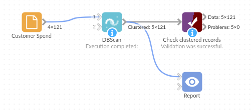

# DBScan

*Omniscope custom block · Analytics*

**Which records naturally group together, and which fit no group at all? Density-based clusters and a list of outliers, without choosing the number of clusters first.**

**Python** · scikit-learn, pandas, numpy · scikit-learn installed on first run

## The problem it solves

Customer, product or sensor data often falls into a few natural groups, plus a handful of records that fit none of them. Methods that need the number of groups up front, and put every record in one, either split real groups or drag the odd records into a group where they distort its averages.

DBSCAN looks for places where records are packed closely together. Each dense region becomes a cluster, however many there are and whatever their shape, and the records in between are marked as noise, so the outliers come out as a by-product.

- **3** customer groups found in the sample, without being told how many
- **6** customers marked as noise: none of them fits a group
- **1** customer with a missing visit count kept, with an empty Cluster

### How it works

- Choose the numeric fields, or leave **Use all numeric fields** ticked.
- Each field is standardised (mean 0, standard deviation 1), so spend and visits per year count equally.
- Records within 0.8 standard deviations of each other are neighbours; a cluster needs at least 5 records close together. These settings are fixed.
- The output is the input with a **Cluster** field: 1, 2, 3... for clusters, 0 for noise.

## What goes in

### Customer spend

121 invented customers with their annual spend and number of visits a year.

| Customer | Region | Annual Spend | Visits Per Year |
|---|---|---|---|
| C-0001 | South | 234.25 | 4 |
| C-0002 | North | 2784.17 | 8 |
| C-0003 | West | 1403.80 | 20 |
| C-0004 | South | 1202.42 | 25 |
| C-0005 | West | 1131.63 | 24 |
| C-0006 | South | 1013.65 | 16 |

*121 rows in the sample file; one has no visit count.*

## The options

| Option | Demo setting | What it does |
|---|---|---|
| Use all numeric fields | ticked | Cluster on every Integer and Decimal field (here Annual Spend and Visits Per Year). |
| Fields to cluster on | (not used) | The fields to cluster on when "Use all numeric fields" is unticked. |

## What comes out

### Clustered records (first 8)

| Customer | Region | Annual Spend | Visits Per Year | Cluster |
|---|---|---|---|---|
| C-0001 | South | 234.25 | 4 | 1 |
| C-0002 | North | 2784.17 | 8 | 2 |
| C-0003 | West | 1403.80 | 20 | 3 |
| C-0004 | South | 1202.42 | 25 | 3 |
| C-0005 | West | 1131.63 | 24 | 3 |
| C-0006 | South | 1013.65 | 16 | 3 |
| C-0007 | South | 2879.72 | 7 | 2 |
| C-0008 | West | 2993.82 | 8 | 2 |

### The clusters, summarised (Aggregate block on Cluster)

| Cluster | Customers | Average spend | Spend range | Average visits | Visits range |
|---|---|---|---|---|---|
| 1 | 39 | 302.39 | 143.83 to 420.70 | 3.8 | 1 to 7 |
| 2 | 30 | 2,668.91 | 2,338.36 to 3,113.38 | 9.0 | 5 to 12 |
| 3 | 45 | 1,226.51 | 952.00 to 1,481.57 | 21.5 | 16 to 29 |
| 0 (noise) | 6 | 2,715.12 | 80.25 to 5,400.00 | 31.5 | 3 to 52 |
| (empty) | 1 | 394.26 | | | |

Cluster 1 are occasional low spenders, cluster 2 spend a lot in few visits, cluster 3 visit often with mid-range spend. The six noise records include a customer with 5,400.00 spend in 3 visits and one with 52 visits but 160.50 spend: worth a look on their own, and kept out of the cluster averages.

## Where it pays off

### Retail and e-commerce: Customer segments

Group customers by spend, frequency and basket size without deciding the number of segments first, and set the unusual accounts aside for review.

### Operations: Unusual readings

Cluster machine or sensor readings on several measures; the readings in cluster 0 are the ones that fit no normal operating pattern.

### Finance: Transactions that stand out

Cluster payments or expense claims on amount, timing and frequency, and review the noise records first.

### Location data: Hot spots

On latitude and longitude, dense groups of incidents, stores or deliveries become clusters of any shape, and isolated points stay apart.

*Use cases describe typical scenarios and are illustrative; the sample data is invented.*

## Why do this in Omniscope

- **Clusters as a field on your records.** The output is the input plus a Cluster field, so an Aggregate block describes each group, a Record filter on 0 lists the outliers, and Cluster filters every view in the Report.
- **Re-clustered on every refresh.** The block sits between the data source and the Report, so when new customer figures arrive the clusters and the outlier list are rebuilt in the same run.
- **Density settings in plain sight.** The neighbour distance (0.8 standard deviations) is one argument in the block's script; loosen or tighten it there, or set a different minimum cluster size, if your data needs it.

## How it fits into an Omniscope workflow

Customer data (Database or File) → **DBScan** → Aggregate (per Cluster) → Report

Feed one record per customer, product or reading with the numeric measures to cluster on. Use Aggregate on Cluster to describe each group, a Record Filter on Cluster = 0 to list the outliers, and a scatter chart coloured by Cluster to show the groups in a Report.

## Try it

1. Open the demo project (`demo.iox` on the demo server, or import `demo.ioz` from this folder): 121 invented customers with annual spend and visits per year.
2. The question: which kinds of customer are there, and which customers fit none of them?
3. Open DBScan: leave **Use all numeric fields** ticked. Run it.
4. Look at the Cluster field: three clusters (39, 30 and 45 customers), six customers in cluster 0, and one customer with no visit count and no cluster.
5. Look at the cluster 0 customers: each is far from every group, for example 5,400.00 spend in 3 visits.

## Running in Omniscope

*The demo project's workflow: the sample data, the block, and a Validate data check on its output.*

<!--language-->
## Language and libraries

Python. It uses scikit-learn (DBSCAN and the standard scaler), pandas and numpy.

pandas and numpy are part of Omniscope's Python environment. scikit-learn is listed in the block's dependencies, so Omniscope installs it with pip on first run if it is missing; the server needs access to the Python package index for that, or scikit-learn installed beforehand.
<!--/language-->

## Tested

The block is covered by automated tests that run its script against a stand-in for Omniscope's Python API: the sample data, records that must keep their own cluster when some have missing values, chosen fields, Integer fields, an existing Cluster field (replaced, and not clustered on), empty input, wrong field types and missing choices, and 20,000 records.
