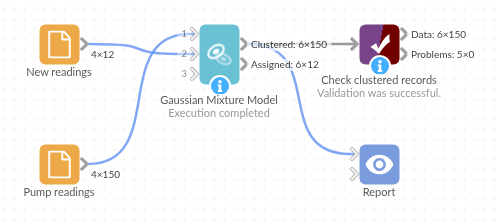

# Gaussian Mixture Model

*Omniscope custom block · Analytics · Clustering*

**Find the groups in your measurements when they are oval, slanted or overlapping, let the data choose how many there are, and see how sure each assignment is.**

**R** · mclust · install mclust on the server's R if missing

## The problem it solves

A pump logs its temperature and vibration every hour. It runs in a few operating modes (idle, normal duty, heavy load), but the log doesn't say which, and the modes look different: idle readings sit in a tight knot, normal readings stretch along a slanted line (hotter means more vibration), and heavy-load readings scatter widely. Methods that assume round, equal-sized groups cut such shapes in the wrong places.

A Gaussian mixture model fits an oval cloud to each mode, with its own spread and tilt. It tried 1 to 9 clusters and found three, and for each reading it says how sure it is. Next week's readings then go into the same three modes.

- **3** operating modes found, without being told how many
- **148 of 149** readings in their true mode; the other one sits inside the normal-duty cloud
- **4** readings with a probability below 0.9: the ones between heavy load and normal duty

### How it works

- Choose the numeric fields, or leave **Use all numeric fields** ticked.
- mclust fits mixtures of 1 up to **Maximum number of clusters** clouds, of several shapes, and keeps the best by BIC.
- Each record gets **Cluster** (1, 2, 3... in order of first appearance) and **Cluster probability** (0 to 1).
- Records on the second input are assigned to the same clusters.

## What goes in

### Pump readings (first input)

150 invented hourly readings from one pump.

| Reading | Time | Temperature | Vibration |
|---|---|---|---|
| R-0001 | 2026-09-01 00:00 | 50.1 | 2.16 |
| R-0002 | 2026-09-01 01:00 | 38.4 | 1.00 |
| R-0003 | 2026-09-01 02:00 | 53.0 | 3.01 |
| R-0004 | 2026-09-01 03:00 | 66.1 | 3.59 |
| R-0005 | 2026-09-01 04:00 | 58.5 | 3.06 |
| R-0006 | 2026-09-01 05:00 | 73.2 | 4.32 |

*150 rows in the sample file; one (R-0023) has no vibration reading.*

### New readings (second input)

12 invented readings from the following week, in the same layout.

## The options

| Option | Demo setting | What it does |
|---|---|---|
| Use all numeric fields | ticked | Cluster on every Integer and Decimal field (here Temperature and Vibration; Time is a date and is left out). |
| Fields to cluster on | (not used) | The fields to cluster on when "Use all numeric fields" is unticked. |
| Maximum number of clusters | 9 | Models with 1 to 9 clusters are compared. |

## What comes out

### Clustered records (first 8)

| Reading | Temperature | Vibration | Cluster | Cluster probability |
|---|---|---|---|---|
| R-0001 | 50.1 | 2.16 | 1 | 1.000000 |
| R-0002 | 38.4 | 1.00 | 2 | 0.999991 |
| R-0003 | 53.0 | 3.01 | 1 | 1.000000 |
| R-0004 | 66.1 | 3.59 | 1 | 0.998300 |
| R-0005 | 58.5 | 3.06 | 1 | 1.000000 |
| R-0006 | 73.2 | 4.32 | 3 | 0.972614 |
| R-0007 | 52.2 | 2.66 | 1 | 1.000000 |
| R-0008 | 75.7 | 5.78 | 3 | 0.999999 |

### The clusters, summarised (Aggregate block on Cluster)

| Cluster | Readings | Average temperature | Temperature range | Average vibration | Vibration range | Lowest probability |
|---|---|---|---|---|---|---|
| 1 (normal duty) | 61 | 59.2 | 50.1 to 69.1 | 3.14 | 2.16 to 4.24 | 0.81 |
| 2 (idle) | 49 | 40.4 | 38.1 to 43.8 | 1.19 | 0.83 to 1.55 | 1.00 |
| 3 (heavy load) | 39 | 75.0 | 67.8 to 85.6 | 4.62 | 3.37 to 6.69 | 0.57 |
| (empty) | 1 | | | | | |

The temperature ranges of clusters 1 and 3 overlap (67.8 to 69.1): there, vibration and the shape of each cloud decide. The four readings with a probability below 0.9 are all in that zone, at 67.8 to 69.7 degrees.

### Assigned (second input)

All 12 new readings go to their true mode: 4 to cluster 2, 5 to cluster 1 and 3 to cluster 3, 11 of them with a probability above 0.99.

## Where it pays off

### Operations: Machine operating modes

Find the modes a machine runs in from its sensor readings, then watch which mode each new reading falls in and how sure the model is.

### Retail: Customer segments with soft edges

Segment customers on spend and frequency, and treat customers with a low Cluster probability as between segments rather than forcing them into one.

### Quality: Batches from different sources

Separate measurements that come from a mix of production lines or suppliers, each with its own typical value and spread.

### Finance: Transaction patterns

Model the usual mixes of amount and timing, and look at the records the model is least sure about.

*Use cases describe typical scenarios and are illustrative; the sample data is invented.*

## Why do this in Omniscope

- **Fit once, assign as data arrives**: the block's second input takes the latest readings and puts them into the clusters fitted on the history, so a scheduled workflow labels each new batch with its operating mode before the Report shows it.
- **The doubtful records are a filter away**: Cluster probability is an ordinary field, so a Record filter on "below 0.9" lists the borderline readings for review, and Validate data can fail the run when there are too many of them.
- **Repeatable on large inputs too**: mclust samples 2,000 records to start on bigger data; the block fixes the seed, so a rerun on the same data gives the same clusters and probabilities.
- **More than the core block offers**: oval clusters of different spreads, a choice of the number of clusters by BIC, and per-record probabilities, from an R script you can open in the block's editor to change the model list or add mclust's outputs.

## How it fits into an Omniscope workflow

Readings history (Database) + Latest readings (Database) → **Gaussian Mixture Model** → Report

Feed the history to the first input and the records to classify to the second. Show a scatter chart of two fields coloured by Cluster and sized or filtered by Cluster probability; use Aggregate on Cluster to describe each group.

## Try it

1. Open the demo project (`demo.iox` on the demo server, or import `demo.ioz` from this folder): 150 invented pump readings and 12 newer ones.
2. The question: which operating modes does the pump run in, and which mode is each new reading in?
3. Open Gaussian Mixture Model: leave **Use all numeric fields** ticked and **Maximum number of clusters** at 9. Run it.
4. Look at **Clustered**: three clusters of 61, 49 and 39 readings, R-0023 (no vibration) with empty fields, and four readings with a probability below 0.9.
5. Look at **Assigned**: the 12 new readings, each with its cluster.

## Running in Omniscope

*The demo project's workflow: the sample data, the block, and a Validate data check on its output.*

<!--language-->
## Language and libraries

R. It uses the mclust package (GPL 2 or later) for the mixture models.

mclust is not part of base R: install it on the Omniscope server's R if it is missing (`install.packages("mclust")`).
<!--/language-->

## Tested

The block is covered by automated tests that run its script against a stand-in for Omniscope's R API: the sample data and its new readings, a second input with extra fields, records with missing values on either input, repeated runs above 2,000 records, the maximum number of clusters and chosen fields, existing cluster fields, empty inputs, wrong field types, missing fields and choices, data no model fits, and 10,000 records.
