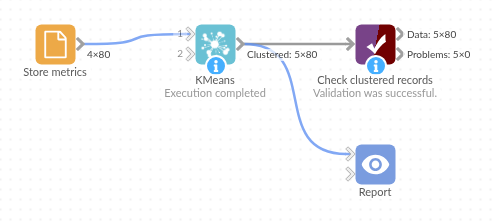

# KMeans

*Omniscope custom block · Analytics · Clustering*

**Sort shops, customers or products into a set number of groups on several measures at once, with the measures put on an equal footing first.**

**R** · base R only · nothing to install

## The problem it solves

A retailer has 80 shops of four kinds: small convenience shops, petrol-station forecourts, supermarkets and superstores. Nobody has a clean list of which shop is which, but their weekly sales and footfall tell the formats apart, as long as both measures count.

Clustering on the raw figures lets sales, in hundreds of thousands, swamp footfall, in thousands: convenience shops and forecourts merge and the supermarkets split in two. Standardising each field first gives them equal weight, and k-means then finds the four formats.

- **4 of 4** shop formats found as the four clusters, with no shop in the wrong one
- **1** shop with no footfall figure kept, with an empty Cluster
- The same clusters on every run, thanks to a fixed seed

### How it works

- Choose the numeric fields, or leave **Use all numeric fields** ticked, and set **Number of clusters**.
- Each field is standardised (mean 0, standard deviation 1), unless you untick **Standardise fields**.
- k-means runs from 10 starting points with a fixed seed and keeps the tightest result.
- The output is the input with a **Cluster** field: 1, 2, 3... in the order the clusters first appear.

## What goes in

### Store metrics

80 invented shops with their weekly sales and footfall.

| Store | Region | Weekly Sales | Footfall |
|---|---|---|---|
| ST-001 | North | 44881.47 | 8642 |
| ST-002 | Wales | 46407.07 | 9481 |
| ST-003 | North | 52179.59 | 4258 |
| ST-004 | South | 86524.31 | 17163 |
| ST-005 | Midlands | 42306.11 | 4285 |
| ST-006 | Midlands | 100874.88 | 15399 |

*80 rows in the sample file; one (ST-017) has no footfall figure.*

## The options

| Option | Demo setting | What it does |
|---|---|---|
| Use all numeric fields | ticked | Cluster on every Integer and Decimal field (here Weekly Sales and Footfall). |
| Fields to cluster on | (not used) | The fields to cluster on when "Use all numeric fields" is unticked. |
| Number of clusters | 4 | How many clusters to make. |
| Standardise fields | ticked | Put each field on the same scale before clustering. |

## What comes out

### Clustered records (first 8)

| Store | Region | Weekly Sales | Footfall | Cluster |
|---|---|---|---|---|
| ST-001 | North | 44881.47 | 8642 | 1 |
| ST-002 | Wales | 46407.07 | 9481 | 1 |
| ST-003 | North | 52179.59 | 4258 | 2 |
| ST-004 | South | 86524.31 | 17163 | 3 |
| ST-005 | Midlands | 42306.11 | 4285 | 2 |
| ST-006 | Midlands | 100874.88 | 15399 | 3 |
| ST-007 | Midlands | 296164.31 | 20661 | 4 |
| ST-008 | Wales | 46560.16 | 4447 | 2 |

### The clusters, summarised (Aggregate block on Cluster)

| Cluster | Shops | Average weekly sales | Sales range | Average footfall | Footfall range |
|---|---|---|---|---|---|
| 1 | 24 | 37,393 | 30,141 to 46,661 | 10,060 | 8,032 to 11,384 |
| 2 | 20 | 50,152 | 41,699 to 56,930 | 4,321 | 3,628 to 5,387 |
| 3 | 22 | 117,469 | 86,524 to 145,398 | 14,004 | 10,963 to 18,016 |
| 4 | 13 | 260,216 | 199,688 to 296,164 | 21,375 | 17,333 to 24,944 |
| (empty) | 1 | | | | |

Cluster 1 are the convenience shops (modest sales, steady footfall), cluster 2 the forecourts (similar sales from far fewer visitors), cluster 3 the supermarkets and cluster 4 the superstores. Clusters 1 and 2 overlap on sales; only footfall separates them.

### The same data without standardising

With **Standardise fields** unticked, all 44 convenience shops and forecourts land in one cluster, and the 22 supermarkets are split 12 and 10 between two others.

## Where it pays off

### Retail: Store formats and peer groups

Group shops on sales, footfall, floor space and basket size, then compare each shop with its peers rather than with the whole estate.

### Marketing: Customer segments

Segment customers on spend, frequency and tenure into a fixed number of segments that a campaign plan can target.

### Logistics: Delivery zones

On latitude and longitude (with **Standardise fields** unticked), split delivery addresses into a set number of zones, one per van or depot.

### Product data: Assortment groups

Cluster products on price, margin and rate of sale to find groups that should be ranged and priced alike.

*Use cases describe typical scenarios and are illustrative; the sample data is invented.*

## Why do this in Omniscope

- **Peer groups that stay current**: the block sits between the store figures and the Report, so when next week's sales arrive each shop's cluster, and every comparison with its peers, is recalculated in the same run, ready for a scheduled refresh.
- **Same clusters for the same data**: the fixed seed means a rerun on unchanged data gives identical cluster numbers, so checks on the cluster sizes stay valid and a filter on "Cluster = 3" keeps meaning the same shops.
- **Standardising built in, and optional**: the core Clustering block needs a Normalise block in front of it; this one rescales the fields itself, and the option to switch that off is a single tick for latitude and longitude.
- **An R script you can open**: to cluster around medians instead of means (`cluster::pam`), edit the script in the block's editor; the options and the output stay as they are.

## How it fits into an Omniscope workflow

Store figures (Database or File) → **KMeans** → Aggregate (per Cluster) → Report

Feed one record per shop, customer or product with the numeric measures to cluster on. Use Aggregate on Cluster to describe each group, and a scatter chart of two measures coloured by Cluster to show them in a Report.

## Try it

1. Open the demo project (`demo.iox` on the demo server, or import `demo.ioz` from this folder): 80 invented shops with weekly sales and footfall.
2. The question: which shops are alike, judged on sales and footfall together?
3. Open KMeans: leave **Use all numeric fields** and **Standardise fields** ticked, set **Number of clusters** to 4. Run it.
4. Look at the Cluster field: four clusters of 24, 20, 22 and 13 shops, and ST-017, with no footfall figure, with an empty Cluster.
5. Untick **Standardise fields** and run again: clusters 1 and 2 merge into one and the supermarkets split.

## Running in Omniscope

*The demo project's workflow: the sample data, the block, and a Validate data check on its output.*

<!--language-->
## Language and libraries

R. It uses `kmeans()` from the `stats` package, part of every R installation (GPL-2 or GPL-3, as R itself). Nothing to install.
<!--/language-->

## Tested

The block is covered by automated tests that run its script against a stand-in for Omniscope's R API: the sample data with and without standardising, a record with a missing value, repeated runs, chosen fields and numbers of clusters, an existing Cluster field, Integer and constant fields, empty input, too many clusters, wrong field types and missing choices, and 50,000 records.
