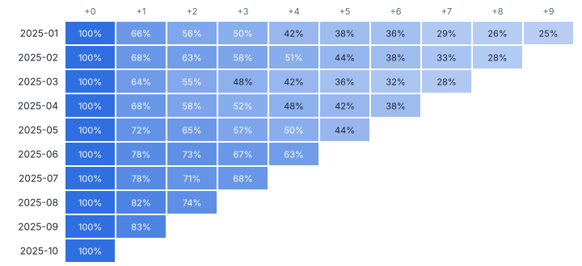
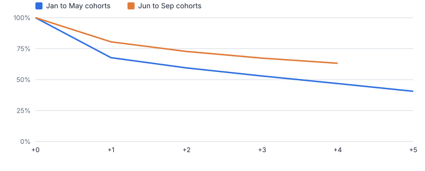
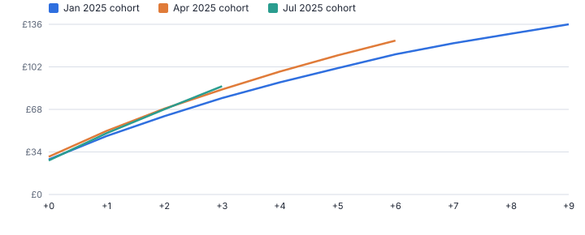
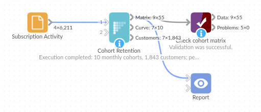

# Cohort Retention

*Omniscope custom block · Analytics*

**Are the customers you win this month sticking better than the ones you won last spring? Cohort retention and revenue per customer, from raw activity data, in one block.**

**Python** · pandas, numpy · nothing extra to install

## The problem it solves

Headline numbers such as total active customers mix old and new customers together, so a churn problem can hide behind strong acquisition. Cohort analysis separates them: group customers by when they joined and follow each group over time.

Building it by hand needs a first-activity lookup per customer, a join back, a period difference, a distinct count per cell and a division by cohort size, and zero cells are easily lost. Cohort Retention produces the matrix, the average curve and a customer table directly.

- **1,843** accounts in 10 monthly cohorts
- **68% → 80%** month-1 retention, before vs after June
- **53% → 67%** month-3 retention, before vs after June
- **3** outputs: matrix, curve, customers

### How it works

- Choose the customer and date fields (and revenue if you have it) and the cohort period: week, month, quarter or year.
- Each customer's cohort is the period of their first activity; period number 0 is that period.
- The matrix counts active customers per cohort and period, including zero periods, with retention and revenue per cohort customer.
- The curve averages retention across cohorts by period number, weighted by cohort size.
- The customer table shows each customer's cohort, last active period and whether they are active in the latest period.

## What goes in

### Subscription activity (one row per account per active month)

6,211 synthetic activity rows for 1,843 accounts, January to October 2025. The data includes an onboarding redesign from June.

| Account ID | Activity Date | Plan | Revenue |
|---|---|---|---|
| ACC-00181 | 2025-01-01 | Starter | 19 |
| ACC-00094 | 2025-01-01 | Starter | 19 |
| ACC-00003 | 2025-01-01 | Starter | 19 |
| ACC-00013 | 2025-01-01 | Starter | 19 |
| ACC-00136 | 2025-01-01 | Pro | 49 |
| ACC-00102 | 2025-01-01 | Starter | 19 |

*6,211 rows in the sample file.*

## The options

| Option | Demo setting | What it does |
|---|---|---|
| Customer field | `Account ID` | Identifies a customer; the first date seen sets the cohort. |
| Activity or order date | `Activity Date` | Date of each activity or order. |
| Revenue field (optional) | `Revenue` | Adds revenue, revenue per cohort customer and cumulative revenue per customer. |
| Cohort period | `Month` | Length of a cohort, and of each step along the retention curve. |
| Periods to follow | `24` | How many periods after acquisition to track. |

## What comes out

### Cohort matrix (January 2025 cohort)

| Cohort | Cohort Size | Period Number | Period | Active Customers | Retention | Revenue | Revenue Per Cohort Customer | Cumulative Revenue Per Customer |
|---|---|---|---|---|---|---|---|---|
| 2025-01 | 183 | 0 | 2025-01 | 183 | 1 | 5,097 | 27.85 | 27.85 |
| 2025-01 | 183 | 1 | 2025-02 | 121 | 0.661 | 3,409 | 18.63 | 46.48 |
| 2025-01 | 183 | 2 | 2025-03 | 102 | 0.557 | 2,898 | 15.84 | 62.32 |
| 2025-01 | 183 | 3 | 2025-04 | 91 | 0.497 | 2,659 | 14.53 | 76.85 |
| 2025-01 | 183 | 4 | 2025-05 | 77 | 0.421 | 2,273 | 12.42 | 89.27 |
| 2025-01 | 183 | 5 | 2025-06 | 70 | 0.383 | 2,080 | 11.37 | 100.63 |
| 2025-01 | 183 | 6 | 2025-07 | 66 | 0.361 | 2,004 | 10.95 | 111.58 |
| 2025-01 | 183 | 7 | 2025-08 | 53 | 0.29 | 1,607 | 8.781 | 120.37 |
| 2025-01 | 183 | 8 | 2025-09 | 47 | 0.257 | 1,403 | 7.667 | 128.03 |
| 2025-01 | 183 | 9 | 2025-10 | 45 | 0.246 | 1,365 | 7.459 | 135.49 |

### Retention curve

| Period Number | Cohorts | Customers In Those Cohorts | Active Customers | Retention (weighted) | Retention (mean of cohorts) | Revenue Per Customer |
|---|---|---|---|---|---|---|
| 0 | 10 | 1843 | 1843 | 1 | 1 | 28.02 |
| 1 | 9 | 1689 | 1248 | 0.739 | 0.734 | 21 |
| 2 | 8 | 1471 | 953 | 0.648 | 0.644 | 18.41 |
| 3 | 7 | 1260 | 723 | 0.574 | 0.57 | 16.4 |
| 4 | 6 | 1041 | 513 | 0.493 | 0.495 | 14.46 |
| 5 | 5 | 897 | 366 | 0.408 | 0.406 | 11.83 |
| 6 | 4 | 695 | 252 | 0.363 | 0.362 | 10.64 |
| 7 | 3 | 546 | 165 | 0.302 | 0.3 | 8.764 |
| 8 | 2 | 386 | 103 | 0.267 | 0.266 | 7.79 |
| 9 | 1 | 183 | 45 | 0.246 | 0.246 | 7.459 |

### Customer cohorts

| Account ID | Cohort | Last Active Period | Periods Since Acquisition | Periods Active | Active In Latest Period | Total Revenue |
|---|---|---|---|---|---|---|
| ACC-00001 | 2025-01 | 2025-03 | 2 | 3 | No | 57 |
| ACC-00002 | 2025-01 | 2025-06 | 5 | 6 | No | 114 |
| ACC-00003 | 2025-01 | 2025-01 | 0 | 1 | No | 19 |
| ACC-00004 | 2025-01 | 2025-10 | 9 | 10 | Yes | 490 |
| ACC-00005 | 2025-01 | 2025-07 | 6 | 7 | No | 133 |

*Each row is a cohort, each column the months since acquisition. Cohorts from June onwards are visibly darker: they retain better (synthetic data).*

*Average curves for cohorts before and after the change.*

*Cumulative revenue per acquired customer, a simple lifetime-value curve per cohort.*

## Where it pays off

### SaaS and subscriptions: Did the onboarding change work?

Compare month-1 and month-3 retention of cohorts before and after a product or pricing change, instead of guessing from total active users.

### E-commerce: Repeat purchase by acquisition month

See what share of each month's new customers buy again, and whether Black Friday cohorts behave differently from organic ones.

### Mobile apps and gaming: Day-7 and week-4 retention

Weekly cohorts of installs, followed week by week: the standard engagement chart, refreshed from the event feed.

### Financial services: Account activity after opening

Follow new accounts by opening quarter to see when they go dormant, and target activation campaigns at the right moment.

*Use cases describe typical scenarios and are illustrative.*

## Why do this in Omniscope

- **Retention for any slice of customers.** A Record filter ahead of the block restricts it to one channel or plan, and the matrix, curve and customer table feed a Pivot heat map, a line chart and a list of lapsed customers in one Report.
- **Zero months kept.** Cohort months with no active customers appear as zero rather than vanishing, which the tests check, and the matrix is rebuilt from the activity table on every refresh, so a new month arrives as a new row.
- **Your definition of active.** Here any activity row in a period counts; the block's Python code is where to require, for example, a minimum spend instead.

## How it fits into an Omniscope workflow

Activity / orders → **Cohort Retention** → Pivot (optional) → Report

Connect any table with a customer and a date. Add a Record filter before it to analyse a segment, such as one channel or plan.

In a Report, show the matrix as a Pivot table or heat map, the curve as a line chart, and use the customer table to list customers not active in the latest period.

A new month of orders appears as a new cohort row the next time the workflow runs.

## In one step

A full cohort analysis without building the multi-step workflow, with zero periods and cohort sizes handled correctly.

## Try it

1. Open the demo project (`demo.iox` on the demo server, or import `demo.ioz` from this folder): monthly activity for subscription accounts.
2. The question: we redesigned onboarding in June. Did it improve retention? Total active accounts cannot tell us.
3. Open Cohort Retention: account, date, revenue; monthly cohorts. Run it.
4. Look at the heat map: June onwards is darker. Month-1 retention rose from 68% to 80%.
5. Look at the cumulative revenue per customer by cohort, then the customer table filtered to accounts not active in the latest month: the win-back list.

## Running in Omniscope

*The demo project's workflow: the sample data, the block, and a Validate data check on its output.*

<!--language-->
## Language and libraries

Python. It uses pandas and numpy.

pandas and numpy are part of Omniscope's Docker Python image, and the block was run in both host mode and Docker mode on an Omniscope server, with the same results. It needs nothing else installed.
<!--/language-->

## Tested

On an Omniscope server the demo workflow ran cleanly: 55 records in Cohort matrix, 10 in Retention curve and 1,843 in Customer cohorts. The automated tests check normal data, empty input, wrong types and large input.
