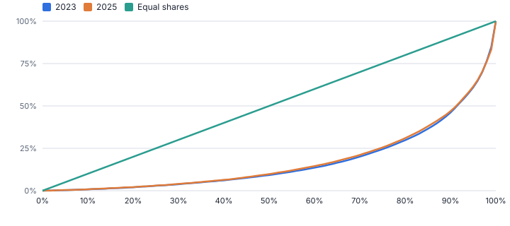
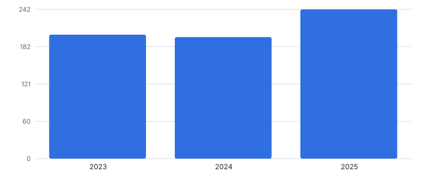
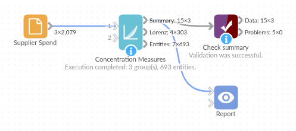

# Concentration Measures

*Omniscope custom block · Analytics*

**How concentrated is your revenue, spend or market? HHI, Gini, top-N shares and Lorenz curves, overall and per year or market.**

**Python** · pandas, numpy · nothing extra to install

## The problem it solves

Dependence on a few customers or suppliers is a risk that finance, procurement and auditors all ask about, and market concentration is a standard competition measure. The numbers are simple once you have shares, but tracking them consistently by year, market or category is fiddly.

This block sums each entity, then gives the standard measures (HHI and its equivalent number of equal-sized entities, Gini, top-1, top-4, top-10 and top-20% shares, entities for 50% and 80%) and a Lorenz curve per group.

- **201 to 242** HHI, 2023 to 2025 (illustrative)
- **240 to 213** active suppliers
- **23%** of 2025 spend with the top four suppliers
- **69%** with the top 20% of suppliers

### How it works

- Connect data with an entity (customer, supplier, firm, product) and a value; rows are summed per entity.
- Optionally choose group fields such as year or market, and the HHI thresholds for the band.
- Outputs: the measures per group, the Lorenz curve (101 points per group), and every entity with its share, rank and cumulative share.

## What goes in

### Supplier spend

Invented spend lines for 240 suppliers over three years.

| Year | Supplier | Spend (GBP) |
|---|---|---|
| 2023 | SUP1000 | 1602.33 |
| 2023 | SUP1000 | 1409.29 |
| 2023 | SUP1000 | 1192.16 |
| 2023 | SUP1001 | 26055.12 |
| 2023 | SUP1001 | 19933.71 |
| 2023 | SUP1001 | 18416.47 |

*2,079 rows in the sample file.*

## The options

| Option | Demo setting | What it does |
|---|---|---|
| Entity field | `Supplier` | For example Customer, Supplier or Company. |
| Value field | `Spend (GBP)` | For example Revenue or Spend. |
| Per group (optional) | `Year` | For example Year or Market. |
| HHI: moderately concentrated from | `1500` | HHI at or above this is labelled moderately concentrated. |
| HHI: highly concentrated above | `2500` | HHI above this is labelled highly concentrated. |

## What comes out

### Measures by year

| Year | Entities | Total | HHI | Normalised HHI | Equivalent Equal Entities | Gini | Top 1 Share | Top 4 Share (CR4) | Top 10 Share | Top 20% Of Entities Share | Entities For 50% | Entities For 80% | HHI Band | Largest Entity |
|---|---|---|---|---|---|---|---|---|---|---|---|---|---|---|
| 2023 | 240 | 5,467,153 | 201 | 0.016 | 50 | 0.658 | 0.074 | 0.209 | 0.358 | 0.702 | 21 | 73 | Unconcentrated | SUP1136 |
| 2024 | 240 | 4,983,880 | 197 | 0.016 | 51 | 0.653 | 0.076 | 0.206 | 0.356 | 0.694 | 21 | 74 | Unconcentrated | SUP1136 |
| 2025 | 213 | 3,984,198 | 242 | 0.02 | 41 | 0.648 | 0.101 | 0.229 | 0.376 | 0.692 | 19 | 67 | Unconcentrated | SUP1136 |

### Largest suppliers in 2025

| Year | Supplier | Value | Share | Rank | Cumulative Share | In Top 20% |
|---|---|---|---|---|---|---|
| 2025 | SUP1136 | 403,767.09 | 0.1013 | 1 | 0.1013 | Yes |
| 2025 | SUP1043 | 241,532.02 | 0.0606 | 2 | 0.162 | Yes |
| 2025 | SUP1107 | 141,563.01 | 0.0355 | 3 | 0.1975 | Yes |
| 2025 | SUP1113 | 126,172.06 | 0.0317 | 4 | 0.2292 | Yes |
| 2025 | SUP1035 | 122,503.22 | 0.0307 | 5 | 0.2599 | Yes |
| 2025 | SUP1021 | 115,750.48 | 0.0291 | 6 | 0.289 | Yes |
| 2025 | SUP1103 | 96,584.02 | 0.0242 | 7 | 0.3132 | Yes |
| 2025 | SUP1231 | 95,160.67 | 0.0239 | 8 | 0.3371 | Yes |

*The further the curve bows below the diagonal, the more unequal the spend (illustrative data).*

*Consolidating onto preferred suppliers and dropping part of the tail raised the HHI in 2025, while the Gini barely moved: the two measure different things.*

## Where it pays off

### Finance and audit: Customer concentration

Share of revenue from the largest customers, tracked by year, for risk reporting and lender covenants.

### Procurement: Supplier dependence

Spend concentration by category, before and after a consolidation programme.

### Competition and strategy: Market structure

HHI and CR4 by market from market-share data, with your own band thresholds.

### Retail: Range concentration

How much of sales the top products carry, per store or category (see also ABC Classification).

*Use cases describe typical scenarios and are illustrative.*

## Why do this in Omniscope

- **Trend by year from the transactions.** Feed purchase lines with a supplier and a value, group by year, and the block sums each supplier before computing HHI, Gini and top-N shares for a trend chart and a Lorenz curve.
- **Comparable from year to year.** Every year goes through the same calculation, and the tests check HHI and Gini against known values, so a rise from 201 to 242 reflects the spend, not a change in method.
- **Bands for your market.** The HHI thresholds for the moderate and high bands are options, so a regulator's limits or your own can replace the defaults of 1,500 and 2,500.

## How it fits into an Omniscope workflow

Transactions or market shares → **Concentration Measures** → Report (Lorenz curve, trend)

Feed transactions with an entity and value; group by year to see the trend. ABC Classification gives the class of each entity.

Chart Share Of Total against Share Of Entities with the Equality Line for the Lorenz curve.

## In one step

HHI, Gini, top-N shares and the Lorenz curve, side by side for every group.

## Try it

1. Open the demo project (`demo.iox` on the demo server, or import `demo.ioz` from this folder): three years of invented supplier spend.
2. The question: are we becoming more dependent on a few suppliers?
3. Open the block: Supplier, Spend, per Year. Run it.
4. Look at the measures: HHI from 201 to 242, active suppliers from 240 to 213, top four now 23%.
5. Look at the Lorenz curve: Gini barely moved while HHI rose: HHI goes up as the number of suppliers falls, while Gini measures how unequal the remaining ones are.

## Running in Omniscope

*The demo project's workflow: the sample data, the block, and a Validate data check on its output.*

<!--language-->
## Language and libraries

Python. It uses pandas and numpy.

pandas and numpy are part of Omniscope's Docker Python image, and the block was run in both host mode and Docker mode on an Omniscope server, with the same results. It needs nothing else installed.
<!--/language-->

## Tested

The demo workflow completed without errors on an Omniscope server (3 records in Summary, 303 in Lorenz curve and 693 in Entities). Automated tests check normal data, empty input, wrong types and large input.
