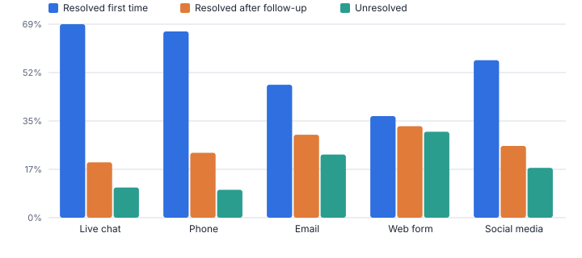
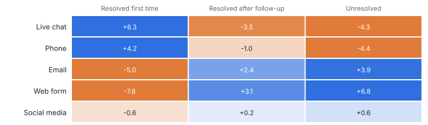
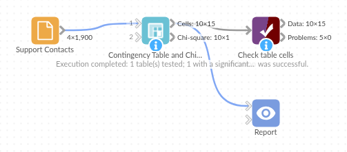

# Contingency Table and Chi-square

*Omniscope custom block · Analytics*

**Is outcome related to channel, product to region, churn to plan? A cross-tab with expected counts and residuals, the chi-square test, Cramer's V and a verdict in plain English.**

**Python** · pandas, numpy · nothing extra to install

## The problem it solves

Cross-tabs are everywhere in reporting, but a table of counts does not say whether a difference is real or which cells matter. The chi-square test answers *is there an association?*, Cramer's V says *how strong?*, and adjusted residuals show *where*.

This block produces all three from raw records (or pre-aggregated counts), with a caution when expected counts are too small for the test to be reliable.

- **1,900** support contacts
- **p < 0.001** channel and outcome are associated
- **0.18** Cramer's V (strength of association)
- **11 of 15** cells notably over- or under-represented

### How it works

- Choose the row and column fields (and a count field if the data is already aggregated).
- The cells output gives counts, row and column shares, expected counts under independence and adjusted residuals; beyond about +/-2 a cell is notably over- or under-represented.
- The test output gives chi-square, degrees of freedom, p-value, Cramer's V, the smallest expected count and a verdict naming the most over-represented combination.
- Optionally run one test per segment (for example per customer type), and apply Yates correction to 2 x 2 tables.

## What goes in

### Support contacts

1,900 synthetic contacts with channel, customer type and outcome.

| Contact ID | Channel | Customer Type | Outcome |
|---|---|---|---|
| CT-01858 | Social media | Consumer | Resolved after follow-up |
| CT-00415 | Phone | Business | Resolved first time |
| CT-01163 | Email | Consumer | Resolved first time |
| CT-00425 | Phone | Business | Resolved after follow-up |
| CT-01074 | Live chat | Consumer | Resolved first time |
| CT-01084 | Live chat | Business | Resolved first time |

*1,900 rows in the sample file.*

## The options

| Option | Demo setting | What it does |
|---|---|---|
| Row field | `Channel` | Category shown down the rows, such as Channel. |
| Column field | `Outcome` | Category shown across the columns, such as Outcome. |
| Significance level | `0.05` | A p-value below this calls the association significant. |

## What comes out

### Chi-square test

| Rows | Columns | Sample Size | Chi-Square | Degrees Of Freedom | P Value | Cramer's V | Smallest Expected Count | Cells Expected Below 5 | Verdict |
|---|---|---|---|---|---|---|---|---|---|
| 5 | 3 | 1,900 | 129.62 | 8 | 0 | 0.1847 | 22.55 | 0 | Channel and Outcome are associated (p = 3.39e-24, Cramer's V = 0.18, weak). Most over-represented: Web form with Unresolved. |

### Table cells

| Channel | Outcome | Count | Row Share | Expected Count | Adjusted Residual | Notable |
|---|---|---|---|---|---|---|
| Email | Resolved after follow-up | 113 | 0.297 | 94.6 | 2.441 | Over-represented |
| Email | Resolved first time | 181 | 0.476 | 224.20 | -5.038 | Under-represented |
| Email | Unresolved | 86 | 0.226 | 61.2 | 3.87 | Over-represented |
| Live chat | Resolved after follow-up | 121 | 0.198 | 151.86 | -3.507 | Under-represented |
| Live chat | Resolved first time | 423 | 0.693 | 359.90 | 6.304 | Over-represented |
| Live chat | Unresolved | 66 | 0.108 | 98.24 | -4.31 | Under-represented |
| Phone | Resolved after follow-up | 121 | 0.233 | 129.45 | -1.006 |  |
| Phone | Resolved first time | 347 | 0.667 | 306.80 | 4.206 | Over-represented |
| Phone | Unresolved | 52 | 0.1 | 83.75 | -4.444 | Under-represented |
| Social media | Resolved after follow-up | 36 | 0.257 | 34.85 | 0.233 |  |
| Social media | Resolved first time | 79 | 0.564 | 82.6 | -0.643 |  |
| Social media | Unresolved | 25 | 0.179 | 22.55 | 0.586 |  |
| Web form | Resolved after follow-up | 82 | 0.328 | 62.24 | 3.102 | Over-represented |
| Web form | Resolved first time | 91 | 0.364 | 147.50 | -7.796 | Under-represented |
| Web form | Unresolved | 77 | 0.308 | 40.26 | 6.783 | Over-represented |

*Row shares: web form contacts are least often resolved first time (synthetic data).*

*Adjusted residuals: blue cells occur more often than independence predicts, orange cells less often.*

## Where it pays off

### Customer service: Channel effectiveness

Test whether resolution, satisfaction or repeat contact depends on channel, and pinpoint the channel-outcome combinations that need fixing.

### Marketing: Campaign response by segment

Check whether response or conversion differs by segment, creative or region, with the residuals showing which segment responds unusually.

### Healthcare and research: Survey and outcome tables

Standard cross-tab analysis of survey answers or patient outcomes by group, with the test statistics researchers expect.

### Retail: Product mix by region

Find which categories sell disproportionately well or badly in each region, to inform ranging.

*Use cases describe typical scenarios and are illustrative.*

## Why do this in Omniscope

- **From raw contact records.** The block counts the records itself, so it can sit right after the contact database, and its residuals drive a heat map next to the verdict tile in the Report.
- **Statistics matched to SciPy.** The tests compare a weighted 2 x 2 table with SciPy and check that independent data is not called significant, and the verdict carries a caution whenever cells have an expected count below 5.
- **Strength wording in the code.** The Cramer's V cut-offs behind "weak", "moderate" and "strong" are written into the verdict code; adjust them if your field uses different conventions.

## How it fits into an Omniscope workflow

Contacts (Database) → **Contingency Table and Chi-square** → Report

Connect raw records or an aggregated table with a count field. Show the cells output as a Pivot table or heat map coloured by Adjusted Residual, and the verdict as a text tile.

Use segments to compare the association across customer types or periods.

The expected counts, residuals and verdict are produced together from the same data in one run, and the segment option repeats the test per customer type or period without separate copies of the analysis.

## In one step

Cross-tab, chi-square test, adjusted residuals, Cramer's V with a strength label, a small-expected-count caution and a verdict sentence.

## Try it

1. Open the demo project (`demo.iox` on the demo server, or import `demo.ioz` from this folder): 1,900 support contacts with channel and outcome.
2. The question: does the channel a customer uses affect whether we fix their problem first time?
3. Open the block: rows Channel, columns Outcome. Run it.
4. Read the verdict: associated, Cramer's V 0.18. Then the residual heat map: web form is over-represented in Unresolved, live chat in Resolved first time.
5. Add Customer Type as a segment to see whether the pattern holds for business customers too.

## Running in Omniscope

*The demo project's workflow: the sample data, the block, and a Validate data check on its output.*

<!--language-->
## Language and libraries

Python. It uses pandas and numpy, plus the Python standard library (math).

pandas and numpy are part of Omniscope's Docker Python image, and the block was run in both host mode and Docker mode on an Omniscope server, with the same results. It needs nothing else installed.
<!--/language-->

## Tested

The demo workflow runs without errors on an Omniscope server and produces 15 records in Table cells and 1 in Chi-square test. Its automated tests cover normal data, empty input, wrong types and large input.
