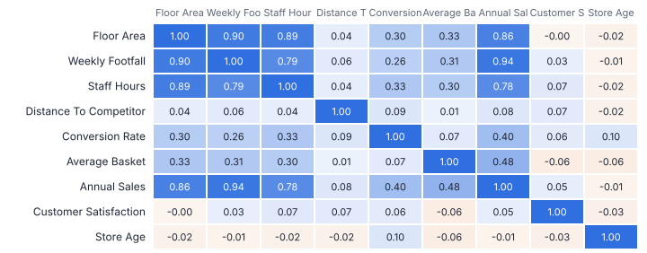
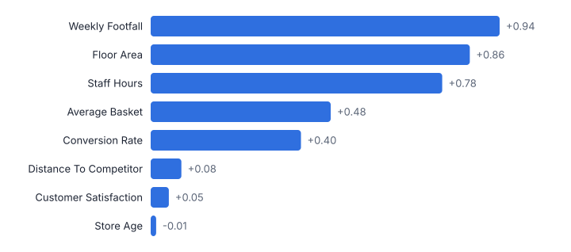
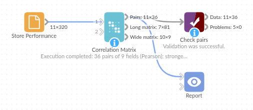

# Correlation Matrix

*Omniscope custom block · Analytics*

**Every pairwise correlation between your numeric fields, Pearson and Spearman, with p-values, strength labels, ranking and a heat-map matrix.**

**Python** · pandas, numpy · nothing extra to install

## The problem it solves

Which measures move together? It is a common first question in analyses, from store performance to survey scores, and the answer needs more than a scatter plot per pair: a full matrix, the strongest pairs first, and whether each relationship is distinguishable from noise.

This block correlates every pair of numeric fields (or every field against one target), overall or per group, with Pearson and Spearman coefficients, p-values and plain-English strength labels.

- **36** pairs of 9 store measures (synthetic)
- **14** significant at 5%
- **+0.94** strongest: Weekly Footfall and Annual Sales
- **+0.07** staff hours and satisfaction: not significant

### How it works

- Connect data and choose the numeric fields (or leave empty for all). Optionally choose a target to correlate everything against, and a group field.
- Choose Pearson or Spearman for ranking and labels, the significance level and the minimum rows per pair.
- Outputs: one row per pair with both coefficients and p-values, the long matrix for a heat map, and a wide matrix.

## What goes in

### Store performance

320 synthetic stores; 15 have no satisfaction score.

| Store | Region | Floor Area (sq m) | Weekly Footfall | Staff Hours | Distance To Competitor (km) | Conversion Rate | Average Basket (GBP) | Annual Sales (GBP k) | Customer Satisfaction | Store Age (years) |
|---|---|---|---|---|---|---|---|---|---|---|
| ST1000 | South | 800.0 | 7359.0 | 41.0 | 3.65 | 0.1499 | 24.2 | 1388.3 | 8.0 | 4 |
| ST1001 | North | 1644.0 | 14726.0 | 117.0 | 4.38 | 0.1644 | 36.79 | 4630.9 | 7.1 | 18 |
| ST1002 | Midlands | 750.0 | 8807.0 | 107.0 | 2.68 | 0.2187 | 37.77 | 3782.9 | 7.2 | 14 |
| ST1003 | Midlands | 1732.0 | 15681.0 | 144.0 | 2.46 | 0.206 | 40.37 | 6781.7 | 6.6 | 36 |
| ST1004 | South | 735.0 | 3086.0 | 52.0 | 2.56 | 0.1706 | 32.24 | 882.4 | 7.0 | 2 |
| ST1005 | North | 1106.0 | 10612.0 | 95.0 | 5.27 | 0.2297 | 35.67 | 4520.2 | 6.9 | 27 |

*320 rows in the sample file.*

## The options

| Option | Demo setting | What it does |
|---|---|---|
| Numeric fields | `(all numeric)` | Leave empty to use every numeric field. |
| Rank and label by | `Pearson` |  |
| Significance level | `0.05` |  |

## What comes out

### Strongest pairs

| Field A | Field B | Rows | Pearson | Pearson P Value | Spearman | Spearman P Value | Strength | Direction | Significant | Rank |
|---|---|---|---|---|---|---|---|---|---|---|
| Weekly Footfall | Annual Sales (GBP k) | 320 | 0.935 | 2.1e-145 | 0.942 | 2.5e-152 | Very strong | Positive | Yes | 1 |
| Floor Area (sq m) | Weekly Footfall | 320 | 0.899 | 7e-116 | 0.895 | 1.1e-113 | Very strong | Positive | Yes | 2 |
| Floor Area (sq m) | Staff Hours | 320 | 0.889 | 7.7e-110 | 0.852 | 1.5e-91 | Very strong | Positive | Yes | 3 |
| Floor Area (sq m) | Annual Sales (GBP k) | 320 | 0.855 | 8.8e-93 | 0.88 | 4.6e-105 | Very strong | Positive | Yes | 4 |
| Weekly Footfall | Staff Hours | 320 | 0.795 | 6.2e-71 | 0.759 | 2.8e-61 | Very strong | Positive | Yes | 5 |
| Staff Hours | Annual Sales (GBP k) | 320 | 0.781 | 4.8e-67 | 0.757 | 9.8e-61 | Very strong | Positive | Yes | 6 |
| Average Basket (GBP) | Annual Sales (GBP k) | 320 | 0.483 | 4.5e-20 | 0.47 | 5.1e-19 | Moderate | Positive | Yes | 7 |
| Conversion Rate | Annual Sales (GBP k) | 320 | 0.403 | 6.5e-14 | 0.409 | 2.3e-14 | Moderate | Positive | Yes | 8 |
| Floor Area (sq m) | Average Basket (GBP) | 320 | 0.334 | 9.3e-10 | 0.289 | 1.4e-07 | Moderate | Positive | Yes | 9 |
| Staff Hours | Conversion Rate | 320 | 0.328 | 1.9e-09 | 0.305 | 2.6e-08 | Moderate | Positive | Yes | 10 |
| Weekly Footfall | Average Basket (GBP) | 320 | 0.313 | 1e-08 | 0.262 | 2.1e-06 | Moderate | Positive | Yes | 11 |
| Staff Hours | Average Basket (GBP) | 320 | 0.299 | 5.1e-08 | 0.236 | 1.9e-05 | Weak | Positive | Yes | 12 |

*Size drives most measures together; satisfaction and store age are unrelated to the rest (synthetic data).*

*With a target, the same block ranks every measure against sales.*

## Where it pays off

### Retail: Store and product performance

Which store attributes move with sales, conversion or margin, and which do not.

### Customer experience: Survey drivers

Which question scores move with overall satisfaction or NPS, as a first look before a regression.

### Finance: Portfolio and risk

Correlations between returns, costs or KPIs, per business unit.

### Data science: Feature screening

Spot strongly correlated predictors before modelling (see also the VIF in the Regression block).

*Use cases describe typical scenarios and are illustrative; the sample data is synthetic.*

## Why do this in Omniscope

- **Screen, then model, in one workflow.** The target option ranks every store measure against sales, the chosen drivers pass to the Regression block downstream, and the heat map in the Report comes from the same run.
- **Coefficients checked against SciPy.** The tests compare Pearson and Spearman coefficients and p-values with SciPy, and a pair with fewer rows than the minimum gets no coefficient rather than one drawn from a handful of points.
- **Labels on a familiar scale.** "Very strong" starts at 0.7 and "Negligible" ends at 0.1, cut-offs that sit in a single line of the Python code if your team uses another convention.

## How it fits into an Omniscope workflow

Data → **Correlation Matrix** → Report (heat map, ranked pairs) → Regression (next step)

Feed any table of measures; use the target option to screen candidate drivers, then model them with the Regression block.

Show the long matrix as a heat map (row field, column field, correlation) and the ranked pairs as a table.

Every pair is computed in one run from the connected table, so the heat map, the ranked pairs and any filter in the Report are all drawn from the same set of correlations.

## In one step

Both coefficients with p-values, ranking and heat-map output in one block.

## Try it

1. Open the demo project (`demo.iox` on the demo server, or import `demo.ioz` from this folder): 320 synthetic stores and nine measures.
2. The question: which measures move with sales, and which do not?
3. Run the block with no options: every numeric field, ranked pairs and the matrix.
4. Look at the heat map, then the pairs: 14 of 36 are significant; staff hours and satisfaction are not.
5. Set the target to sales: the same block ranks the candidate drivers.

## Running in Omniscope

*The demo project's workflow: the sample data, the block, and a Validate data check on its output.*

<!--language-->
## Language and libraries

Python. It uses pandas and numpy, plus the Python standard library (math).

pandas and numpy are part of Omniscope's Docker Python image, and the block was run in both host mode and Docker mode on an Omniscope server, with the same results. It needs nothing else installed.
<!--/language-->

## Tested

Run on a real Omniscope server:

- The demo workflow ran without errors (pairs: 36 records, matrixLong: 81 records, matrixWide: 9 records).

The block is also covered by automated tests (normal data, empty input, wrong types, large input).
