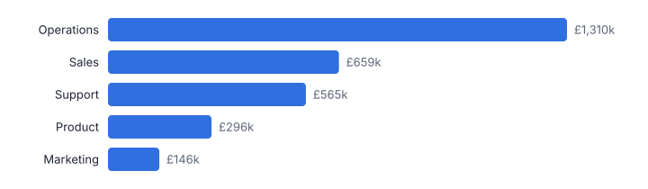
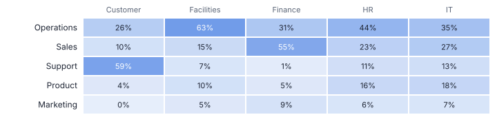
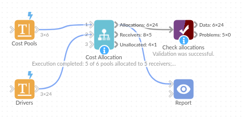

# Cost Allocation

*Omniscope custom block · Analytics*

**Apportion central costs to departments, products or customers by the right driver for each pool, to the penny, with unallocated pools listed.**

**Python** · pandas, numpy · nothing extra to install

## The problem it solves

Overhead recharges and product costing spread central cost pools over the parts of the business that use them: IT by users, facilities by floor area, HR by headcount. Done with formulas, the shares are easy to compute but the rounded results rarely add back to the pool, and pools with no driver values quietly disappear.

This block allocates every pool by its own driver, rounds with the largest-remainder method so each pool reconciles exactly, and reports anything it could not allocate.

- **5** cost pools allocated (illustrative)
- **5** departments receiving costs
- **£2,976,045.65** allocated, reconciling to the pools to the penny
- **1** pool reported as unallocated

### How it works

- Connect cost pools (name, amount, driver) to input 1 and driver values per receiver to input 2, in long (receiver, driver, value) or wide form.
- Optionally set a default driver for pools without one, and the number of decimals.
- Outputs: every allocation, the totals per receiver with a column per pool, and the unallocated pools.

## What goes in

### Input 1: cost pools

| Cost Pool | Annual Cost (GBP) | Driver |
|---|---|---|
| IT support | 486250.00 | Users |
| Facilities | 1120400.00 | Floor Area |
| HR and payroll | 312875.55 | Headcount |
| Finance | 401220.10 | Invoices |
| Customer service | 655300.00 | Tickets |
| Legal | 98000.00 | Contracts |

*6 rows in the sample file.*

### Input 2: drivers

Invented driver values in long form; no Contracts values, so Legal cannot be allocated.

| Department | Driver | Value |
|---|---|---|
| Sales | Headcount | 84 |
| Sales | Users | 91 |
| Sales | Floor Area | 1250 |
| Sales | Invoices | 11200 |
| Sales | Tickets | 2100 |
| Marketing | Headcount | 23 |

*24 rows in the sample file.*

## The options

| Option | Demo setting | What it does |
|---|---|---|
| Pool name | `Cost Pool` | Names each cost pool, such as IT or Facilities. |
| Amount | `Annual Cost (GBP)` | The cost of each pool to be shared out. |
| Driver for the pool (optional) | `Driver` | Which driver shares out this pool, such as Headcount or Floor Area. |
| Receiver | `Department` | The department, product or customer receiving a share. |
| Driver name (long form) | `Driver` | Leave empty for wide form (one column per driver). |
| Driver value (long form) | `Value` | Size of the driver for each receiver, when drivers come one per row. |
| Decimals | `2` | 2 = to the penny. |

## What comes out

### Receivers

| Department | Total Allocated | From Customer service | From Facilities | From Finance | From HR and payroll | From IT support | Share Of All Costs |
|---|---|---|---|---|---|---|---|
| Operations | 1,310,204.58 | 172,790.55 | 707,048.54 | 123,001.78 | 138,108.55 | 169,255.16 | 0.44 |
| Sales | 659,236.73 | 68,464.18 | 169,963.59 | 218,669.83 | 71,611.84 | 130,527.29 | 0.22 |
| Support | 564,769.89 | 384,703.48 | 76,143.69 | 5,857.23 | 34,953.40 | 63,112.09 | 0.19 |
| Product | 295,475.86 | 29,341.79 | 111,496.12 | 18,547.89 | 48,593.75 | 87,496.31 | 0.1 |
| Marketing | 146,358.59 | 0 | 55,748.06 | 35,143.37 | 19,608.01 | 35,859.15 | 0.05 |

### HR and payroll allocations

| Pool | Department | Driver | Driver Value | Share | Allocated |
|---|---|---|---|---|---|
| HR and payroll | Sales | Headcount | 84 | 0.2289 | 71,611.84 |
| HR and payroll | Marketing | Headcount | 23 | 0.0627 | 19,608.01 |
| HR and payroll | Operations | Headcount | 162 | 0.4414 | 138,108.55 |
| HR and payroll | Product | Headcount | 57 | 0.1553 | 48,593.75 |
| HR and payroll | Support | Headcount | 41 | 0.1117 | 34,953.40 |

### Unallocated

| Pool | Amount | Driver | Reason |
|---|---|---|---|
| Legal | 98,000 | Contracts | No driver values for this driver |

*Operations takes the largest share, driven by floor area and headcount (illustrative figures).*

*Each pool uses its own driver: Support takes most of customer service, Sales most of finance.*

## Where it pays off

### Finance: Overhead recharges

Monthly recharges of central costs to business units, reconciling exactly to the ledger.

### Manufacturing and services: Product and customer costing

Activity-based costing: allocate support activity costs by orders, calls or deliveries.

### Public sector: Service costing

Full cost of services including a fair share of corporate overheads.

### Shared services: Intercompany charges

Charges to group companies by usage drivers, with an audit trail of shares.

*Use cases describe typical scenarios and are illustrative.*

## Why do this in Omniscope

- **Ledger and drivers in one workflow.** Pools come from the ledger and headcount, users or floor area from their own source systems, and the allocations go out as a journal export from the same workflow each month.
- **Reconciles to the penny, every run.** Largest-remainder rounding makes each pool add back exactly, which the tests check, and a pool without driver values lands in the unallocated output, which should be empty before anything is posted; Validate data can insist on that.
- **Room for your costing rules.** A default driver covers pools that have none; anything beyond that, such as capping a department's share, can be written into the block's pandas code.

## How it fits into an Omniscope workflow

Cost pools (ledger) + Driver values (HR, IT, facilities systems) → **Cost Allocation** → Report / journal export

Feed pools from the ledger and drivers from the source systems; Subtotals and Rollup can present the results by division.

Export the allocations as journals; check the unallocated output is empty before posting.

## In one step

Driver-based allocation with exact rounding, plus a list of whatever could not be allocated.

## Try it

1. Open the demo project (`demo.iox` on the demo server, or import `demo.ioz` from this folder): six invented cost pools and department drivers.
2. The question: what does each department carry of the central costs, and does it add up?
3. Run the block: allocations per pool and department, to the penny.
4. Look at the receivers table and that every pool reconciles; then the unallocated Legal pool, which has no driver values.
5. Add a Contracts driver to the drivers table and re-run.

## Running in Omniscope

*The demo project's workflow: the sample data, the block, and a Validate data check on its output.*

<!--language-->
## Language and libraries

Python. It uses pandas and numpy.

pandas and numpy are part of Omniscope's Docker Python image, and the block was run in both host mode and Docker mode on an Omniscope server, with the same results. It needs nothing else installed.
<!--/language-->

## Tested

The demo workflow completed without errors on an Omniscope server (24 records in Allocations, 5 in Receivers and 1 in Unallocated). Automated tests check normal data, empty input, wrong types and large input.
