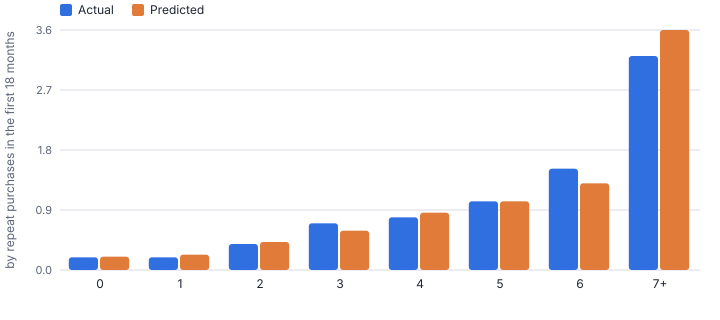
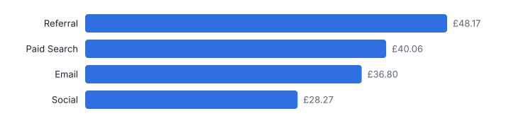
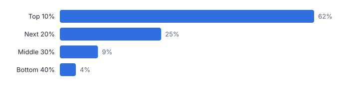
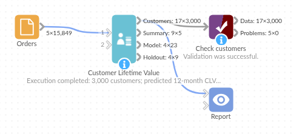

# Customer Lifetime Value

*Omniscope custom block · Analytics*

**Predictive customer lifetime value from order history: probability each customer is still active, expected purchases and spend, discounted CLV, and a holdout check of the model.**

**Python** · pandas, numpy, scipy · installs scipy automatically

## The problem it solves

Historical spend says who was valuable; it does not say who will be. A customer who bought ten times last year and nothing for six months is probably gone, while one who buys twice a year and bought last month is not. Marketing budgets, retention targeting and acquisition cost limits all need the forward-looking number.

This block fits the standard *buy till you die* models (BG/NBD for purchase frequency and dropout, Gamma-Gamma for order value) to plain order data and returns a CLV per customer, with an optional holdout check so you know how far to trust it. No tracking of churn events or subscription status is needed.

- **3,000** customers from 15,849 order lines (illustrative)
- **£112k** predicted value over the next 12 months, discounted
- **32%** of customers are likely lapsed
- **+7%** predicted vs actual purchases in the 6-month holdout

### How it works

- Connect order lines with a customer ID, order date and value (revenue or profit). Refunds can stay in: days with zero or negative net value are dropped.
- Choose the horizon in months, the annual discount rate and the margin, and optionally fields to summarise by (taken from each customer's first order).
- Optionally set a holdout period: the model is refitted on the earlier data and its predictions compared with what customers then did.
- Outputs: customers with probability active, status, expected purchases and order value, predicted CLV and tier; a summary per group; the fitted parameters; and the holdout check.

## What goes in

### Orders

Synthetic orders from 3,000 customers acquired January to June 2024, observed to December 2025, simulated from the same kind of model (so the fit is better than real data usually gives).

| Order ID | Customer ID | Order Date | Order Value | Acquisition Channel |
|---|---|---|---|---|
| O000336 | C00047 | 2024-01-01 | 74.11 | Social |
| O002206 | C00448 | 2024-01-01 | 5.95 | Social |
| O002490 | C00499 | 2024-01-01 | 14.67 | Social |
| O004029 | C00766 | 2024-01-01 | 44.09 | Paid Search |
| O004375 | C00831 | 2024-01-01 | 20.24 | Social |
| O004527 | C00868 | 2024-01-01 | 12.18 | Referral |

*15,849 rows in the sample file.*

## The options

| Option | Demo setting | What it does |
|---|---|---|
| Customer field | `Customer ID` | Identifies a customer. |
| Order date field | `Order Date` | Date of each order. |
| Order value field | `Order Value` | Revenue or profit per order line. |
| Summarise by (optional) | `Acquisition Channel` | For example acquisition channel or region (taken from each customer's first order). |
| Holdout check (months) | `6` | 0 = no check. |
| Horizon (months) | `12` | How far ahead the predicted value runs. |
| Annual discount rate | `0.1` | For example 0.1 for 10%. |
| Margin | `1.0` | Share of order value that is profit; 1 = predict revenue. |

## What comes out

### Customers (top ten by predicted CLV)

| Customer ID | Acquisition Channel | Orders | Revenue To Date | Weeks Since Last Purchase | Probability Active | Status | Expected Purchases | Expected Order Value | Predicted CLV | CLV Tier |
|---|---|---|---|---|---|---|---|---|---|---|
| C01569 | Referral | 42 | 4,900.71 | 0 | 0.984 | Active | 17.5 | 122.48 | 2,042.17 | Top 10% |
| C02538 | Email | 65 | 2,818.76 | 0.9 | 0.983 | Active | 26.5 | 44.6 | 1,125.70 | Top 10% |
| C01117 | Paid Search | 10 | 2,949.12 | 6.9 | 0.888 | Active | 4.1 | 275.89 | 1,081.94 | Top 10% |
| C02886 | Paid Search | 71 | 2,338 | 3.4 | 0.907 | Active | 28.1 | 33.5 | 895 | Top 10% |
| C00603 | Social | 45 | 2,005.28 | 2.6 | 0.951 | Active | 20.8 | 44.4 | 880 | Top 10% |
| C02965 | Paid Search | 31 | 2,080.31 | 2.3 | 0.961 | Active | 12.8 | 67.1 | 817.60 | Top 10% |
| C01627 | Referral | 78 | 1,913 | 0.3 | 0.989 | Active | 33.6 | 25 | 801.07 | Top 10% |
| C02092 | Paid Search | 26 | 2,206.32 | 6.1 | 0.899 | Active | 9.8 | 83.5 | 779.80 | Top 10% |
| C00025 | Paid Search | 58 | 1,848.08 | 0.4 | 0.986 | Active | 24.1 | 31.4 | 718.93 | Top 10% |
| C01707 | Referral | 30 | 1,750.10 | 2.4 | 0.957 | Active | 12.3 | 60.4 | 709.31 | Top 10% |

### Summary by acquisition channel

| Acquisition Channel | Customers | Active Share | Revenue To Date | Expected Purchases | Predicted CLV | Average Predicted CLV | Median Predicted CLV | Top 10% Share Of CLV |
|---|---|---|---|---|---|---|---|---|
| All | 3000 | 0.49 | 478,188.18 | 3,941.41 | 111,715.65 | 37.24 | 8.76 | 0.62 |
| Email | 584 | 0.46 | 93,958.35 | 774.72 | 21,490.46 | 36.8 | 8.45 | 0.61 |
| Paid Search | 1083 | 0.53 | 180,247.52 | 1,529.87 | 43,390.12 | 40.06 | 9.07 | 0.61 |
| Referral | 460 | 0.48 | 88,253.22 | 714.04 | 22,159.67 | 48.17 | 8.78 | 0.69 |
| Social | 873 | 0.48 | 115,729.09 | 922.78 | 24,675.39 | 28.27 | 8.63 | 0.56 |

### Model

| Model | Parameter | Value | Note |
|---|---|---|---|
| BG/NBD | r | 0.5594 | Shape of purchase-rate heterogeneity |
| BG/NBD | alpha | 5.798 | Scale of purchase rate (weeks) |
| BG/NBD | a | 0.6642 | Dropout heterogeneity |
| BG/NBD | b | 2.84 | Dropout heterogeneity |
| BG/NBD | log-likelihood | -13,596.10 | Converged |
| BG/NBD | average purchase rate per week | 0.0965 | r / alpha |
| BG/NBD | average dropout probability per purchase | 0.1895 | a / (a + b) |
| Gamma-Gamma | p | 6.198 |  |
| Gamma-Gamma | q | 3.81 |  |
| Gamma-Gamma | v | 13.81 |  |
| Gamma-Gamma | log-likelihood | -1,687.38 | Converged |
| Gamma-Gamma | population average order value | 30.45 | p v / (q - 1) |
| Gamma-Gamma | frequency / value correlation | 0.0084 | The model assumes this is near 0 |
| Data | customers | 3,000 |  |
| Data | customers with repeat purchases | 2,369 |  |
| Data | as of |  | 2025-12-30 |
| Data | horizon months | 12 |  |
| Data | annual discount rate | 0.1 |  |
| Data | margin | 1 |  |
| Holdout | holdout start |  | 2025-06-30 |
| Holdout | actual purchases | 2,458 |  |
| Holdout | predicted purchases | 2,636.68 |  |
| Holdout | mean absolute error per customer | 0.7153 |  |

*The model, fitted on the first 18 months only, tracks the last 6 months at every purchase level (synthetic data).*

*Referral customers are worth 70% more than Social customers over the next year (synthetic data).*

*The top 10% of customers hold 62% of future value (synthetic data).*

## Where it pays off

### E-commerce and retail: Retention targeting

Spend retention budget on high-CLV customers whose probability of being active is falling, rather than on those already gone or those who will buy anyway.

### Marketing: Acquisition cost limits by channel

Compare predicted CLV of customers acquired through each channel or campaign with the cost of acquiring them.

### Hospitality and leisure: Guest value

Repeat bookings per guest give expected future stays and spend, for loyalty tiers and win-back offers.

### Finance: Customer base valuation

A discounted forward value of the customer base for planning, using margin rather than revenue.

*Use cases describe typical scenarios and are illustrative.*

## Why do this in Omniscope

- **Scores that reach the campaign tools.** The block reads order lines from the database, its customer output joins back to the CRM, and tiers and statuses export to the marketing platform from the same workflow.
- **A model that reports on itself.** With a holdout set, the block refits on the earlier months and compares its predictions with what customers then did (within 7% in the demo), and the tests check that it recovers the parameters of simulated data.
- **Status rules in plain code.** The 0.7 and 0.3 probability cut-offs behind Active, At risk and Likely lapsed, and the tier bands, are single lines in the script; set them to your retention team's definitions.

## How it fits into an Omniscope workflow

Orders (database or files) → **Customer Lifetime Value** → Join (CRM) → Report / export to marketing platform

Load order history on a schedule; refresh monthly. RFM Segmentation and Cohort Retention give the descriptive view alongside.

Join the customer output back to the CRM and export tiers and status (Active, At risk, Likely lapsed) to campaign tools; show the channel summary and holdout check in a Report.

The holdout check in the Report shows how well the previous fit predicted what customers then did.

## In one step

The standard predictive CLV models with no code, including the holdout check.

## Try it

1. Open the demo project (`demo.iox` on the demo server, or import `demo.ioz` from this folder): two years of synthetic orders from 3,000 customers.
2. The question: what is each customer worth over the next year, and who has quietly stopped buying?
3. Open the block: customer, date and value fields, 12-month horizon, 10% discount, 6-month holdout. Run it.
4. Look at the customers output: probability active and status; 32% are likely lapsed. Then the channel summary: Referral is the most valuable source.
5. Look at the holdout check: fitted on 18 months, the model predicts the last 6 months closely on this sample data. On real data, check the holdout before relying on the CLV for targeting.

## Running in Omniscope

*The demo project's workflow: the sample data, the block, and a Validate data check on its output.*

<!--language-->
## Language and libraries

Python. It uses pandas, numpy and scipy.

pandas and numpy are part of Omniscope's Docker Python image, and the block was run in both host mode and Docker mode on an Omniscope server, with the same results. It also uses scipy's optimiser and special functions to fit the BG/NBD and Gamma-Gamma models. Omniscope installs scipy automatically from the block's dependencies; in Docker mode it builds an image for the block the first time it runs, which takes a little longer.
<!--/language-->

## Tested

On an Omniscope server the demo workflow ran cleanly: 3,000 records in Customers, 5 in Summary, 23 in Model and 9 in Holdout check. The automated tests check normal data, empty input, wrong types and large input.
