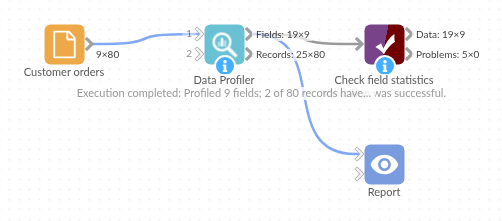

# Data Profiler

*Omniscope custom block · Analytics*

**What is in this data, really? One record per field with its gaps, repeats and spread, and every unusual number flagged on its own record.**

**Python** · SciPy, pandas, numpy · SciPy installed on first run if missing

## The problem it solves

A new export arrives, or a source system changes, and before anything is built on it someone needs to know what is in it: which fields have gaps, whether the order number is really unique, what the usual values look like, and whether any number is a typing slip. Doing that by hand, field by field, is slow and is rarely repeated when the next export arrives.

The block profiles every field in one pass and scores every number against its field, so the problems surface as records you can filter, count and report.

- **9** fields profiled from **80** orders
- **1** duplicated order number: 79 distinct values, and ORD-3017 as the most common, twice
- **8** missing values found: 3 regions, 4 discounts, 1 order date
- **2** orders flagged: 120 units on one order (and its order value), and a delivery time of −3 days

### How it works

- Leave **Fields to profile** empty to profile everything, or choose fields.
- Each field gets its type, missing and distinct counts, and most common value; numbers get mean, standard deviation, quartiles, skewness; dates get their first and last date.
- Each numeric value gets a z-score (distance from the mean in standard deviations), a 0/1 anomaly flag at the threshold (3 by default) and a p-value.

## What goes in

### Customer orders

80 invented orders from an online and in-store retailer, with a few problems planted: a duplicated order number, missing regions, discounts and one order date, a quantity of 120 typed for 12, and a negative delivery time.

| Order ID | Order Date | Region | Channel | Quantity | Unit Price | Discount % | Delivery Days | Order Value |
|---|---|---|---|---|---|---|---|---|
| ORD-3001 | 2025-01-06 | South | Phone | 7 | 14.99 | 5 | 3 | 99.68 |
| ORD-3002 | 2025-01-06 | North | Online | 4 | 55.07 | 10 | 2 | 198.25 |
| ORD-3003 | 2025-01-08 | South | Store | 12 | 34.60 | 0 | 2 | 415.20 |
| ORD-3006 | 2025-01-15 | | Online | 7 | 39.47 | 5 | 6 | 262.48 |
| ORD-3024 | 2025-02-26 | North | Online | 120 | 33.04 | 0 | 4 | 3964.80 |

*80 rows in the sample file.*

## The options

| Option | Demo setting | What it does |
|---|---|---|
| Fields to profile | (empty: all fields) | The fields to profile; empty profiles every field. |
| Anomaly threshold (standard deviations) | 3 | A numeric value at least this many standard deviations from its field's mean is flagged. |

## What comes out

### Fields (selected fields and statistics)

| Field | Type | Missing | Distinct | Most common | Most common count | Mean | Std dev | Min | Median | Max | Anomalies |
|---|---|---|---|---|---|---|---|---|---|---|---|
| Order ID | Text | 0 | 79 | ORD-3017 | 2 | | | | | | |
| Order Date | Date | 1 | 61 | 2025-03-22 | 3 | | | | | | |
| Region | Text | 3 | 4 | North | 23 | | | | | | |
| Channel | Text | 0 | 3 | Online | 46 | | | | | | |
| Quantity | Integer | 0 | 13 | 8 | 10 | 8.04 | 13.11 | 1 | 7 | 120 | 1 |
| Unit Price | Decimal | 0 | 80 | | | 32.82 | 15.65 | 4.78 | 32.80 | 57.93 | 0 |
| Discount % | Integer | 4 | 4 | 0 | 38 | 4.61 | 5.46 | 0 | 2.5 | 15 | 0 |
| Delivery Days | Integer | 0 | 7 | 1 | 15 | 3.40 | 1.93 | −3 | 3.5 | 6 | 1 |
| Order Value | Decimal | 0 | 80 | | | 252.53 | 445.11 | 6.57 | 186.17 | 3,964.80 | 1 |

Order Date's first and last dates are 6 January and 24 June 2025. Quantity's mean (8.04) is well above its median (7) and its skewness is 8.06: one large value is pulling it up.

### Records (selected orders and added fields)

| Order ID | Quantity | Quantity_z_score | Quantity_anomaly | Delivery Days | Delivery Days_z_score | Order Value_z_score | Anomaly count |
|---|---|---|---|---|---|---|---|
| ORD-3023 | 8 | 0.00 | 0 | 2 | −0.72 | −0.14 | 0 |
| ORD-3024 | 120 | 8.54 | 1 | 4 | 0.31 | 8.34 | 2 |
| ORD-3039 | 5 | −0.23 | 0 | −3 | −3.31 | −0.29 | 1 |

80 records, each with a z-score, anomaly flag and p-value for each of the five numeric fields. Two records have an Anomaly count above 0.

## Where it pays off

### Data onboarding: A first look at a new source

Profile a new extract before building a report on it, and send the Fields output to the data owner as a list of gaps and duplicates.

### Data pipelines: Catching a change upstream

Profile each scheduled load and compare Missing % or Distinct with what is normal, so a broken feed is noticed before the report is.

### Finance and operations: Typing slips in amounts

Filter the Records output on Anomaly count above 0 to review the handful of amounts, quantities or durations that sit far from the rest.

### Data quality reporting: A field-by-field scorecard

Chart Missing % by field in a Report to show where data entry needs attention.

*Use cases describe typical scenarios and are illustrative; the sample data is invented.*

## Why do this in Omniscope

- **The profile is data, not a screen.** The Fields output is a table like any other, so the workflow can be halted by Validate data when Missing % for a key field rises or Distinct for an ID falls below the record count.
- **The same profile on every load.** The block re-profiles each new export the same way when the workflow runs on a schedule, and its output fields never change with the input, so the checks and the report built on it keep working.
- **Unusual values on their own records.** The Records output carries the flags alongside each order, so a Record filter on Anomaly count passes the suspect orders straight to a review table in the Report.
- **Your threshold, your rule.** The threshold is an option; the z-score rule is a few lines in the block's script, which you can change after unlocking the design, if you want a different rule.

## How it fits into an Omniscope workflow

Orders export (File or Database) → **Data Profiler** → Fields: Validate data, Report · Records: Record filter (Anomaly count > 0) → Report

Feed the records as they arrive, before any cleaning. Use the Fields output to check the data and to report its quality, and the Records output to list the values to look at.

## Try it

1. Open the demo project (`demo.iox` on the demo server, or import `demo.ioz` from this folder): 80 invented orders with a few planted problems.
2. The question: what is wrong with this export before it goes into the sales report?
3. Open Data Profiler: leave Fields to profile empty and the threshold at 3. Run it.
4. Look at the Fields output: Order ID has 79 distinct values (ORD-3017 twice), Region has 3 missing, Quantity's maximum is 120.
5. Look at the Records output, filtered to Anomaly count above 0: ORD-3024 (120 units) and ORD-3039 (delivery in −3 days).
6. Set the threshold to 2 and run again: still the same two orders. The order of 120 units widens Quantity's standard deviation to 13.11, so no other quantity comes near 2 standard deviations.

## Running in Omniscope

*The demo project's workflow: the sample data, the block, and a Validate data check on its output.*

<!--language-->
## Language and libraries

Python. It uses SciPy (for the normal distribution behind the p-values), pandas and numpy, all under the BSD licence.

pandas and numpy are part of Omniscope's Python environment. SciPy is listed in the block's dependencies, so Omniscope installs it with pip on first run if it is missing; the server needs access to the Python package index for that, or SciPy installed beforehand.
<!--/language-->

## Tested

The block is covered by automated tests that run its script against a stand-in for Omniscope's Python API: the sample data, field types, statistics as numbers with the same output fields for any input, z-scores against the reported standard deviation, two-sided p-values, the threshold, chosen fields, missing values, constant and Boolean fields, empty input, bad options and no input, and 200,000 records.
