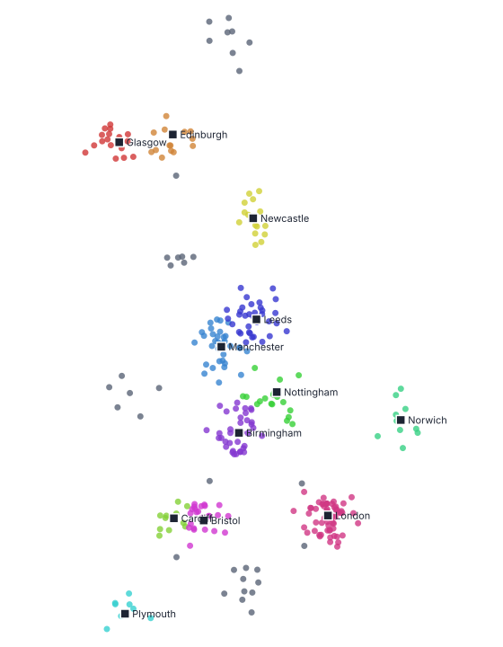
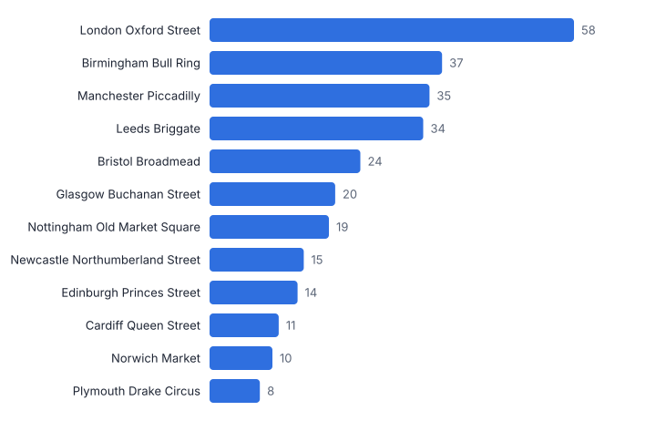
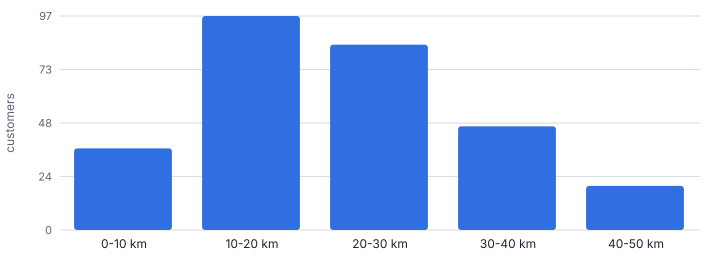
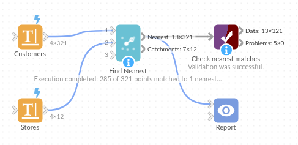

# Find Nearest

*Omniscope custom block · Analytics*

**Nearest store, branch, depot or engineer for every customer, property or incident, with distance, direction, a distance limit and a catchment summary per location.**

**Python** · pandas, numpy · nothing extra to install

## The problem it solves

Location questions come up everywhere: which store is nearest to each customer, which engineer should take each job, which properties are within 10 miles of a branch, how far are our customers from a competitor. Computing the distance from every point to every location is a cross join that explodes in size, and Omniscope's distance formula compares one pair of points at a time.

Find Nearest takes the two lists, finds the k nearest locations for each point (optionally within a maximum distance) in vectorised numpy, and summarises each location's catchment.

- **321** customers searched
- **12** stores
- **35** customers more than 50 km from any store
- **21 km** median distance to nearest store

### How it works

- Connect the points to search from to input 1 and the locations to find to input 2, and pick their latitude and longitude fields.
- Choose how many nearest locations to return, an optional maximum distance and kilometres or miles.
- Each output row carries the matched location's fields, its rank, the distance, the bearing and a compass direction.
- The catchment summary shows, per location, how many points have it as their nearest and how far away they are.

## What goes in

### Input 1: customers

321 synthetic customer locations around UK towns (one has no coordinates).

| Customer ID | Latitude | Longitude | Annual Spend |
|---|---|---|---|
| C0001 | 53.16711 | -2.57416 | 136 |
| C0002 | 53.06374 | -2.28722 | 213 |
| C0003 | 53.65223 | -1.89194 | 860 |
| C0004 | 53.63476 | -1.86363 | 287 |
| C0005 | 53.47232 | -1.88 | 240 |
| C0006 | 53.54522 | -2.17547 | 95 |

*321 rows in the sample file.*

### Input 2: stores

12 fictional stores placed at real UK city-centre coordinates.

| Store ID | Store | Latitude | Longitude |
|---|---|---|---|
| ST01 | Manchester Piccadilly | 53.4808 | -2.2426 |
| ST02 | Leeds Briggate | 53.7997 | -1.5492 |
| ST03 | Birmingham Bull Ring | 52.4778 | -1.8946 |
| ST04 | Bristol Broadmead | 51.4584 | -2.588 |
| ST05 | London Oxford Street | 51.5154 | -0.141 |
| ST06 | Glasgow Buchanan Street | 55.8617 | -4.2538 |
| ST07 | Edinburgh Princes Street | 55.952 | -3.1965 |
| ST08 | Newcastle Northumberland Street | 54.9765 | -1.613 |
| ST09 | Cardiff Queen Street | 51.4826 | -3.1766 |
| ST10 | Nottingham Old Market Square | 52.953 | -1.15 |
| ST11 | Norwich Market | 52.628 | 1.293 |
| ST12 | Plymouth Drake Circus | 50.372 | -4.139 |

*12 rows in the sample file.*

## The options

| Option | Demo setting | What it does |
|---|---|---|
| Latitude (points to search from, input 1) | `Latitude` | Latitude of each point in input 1, in decimal degrees. |
| Longitude (points to search from, input 1) | `Longitude` | Longitude of each point in input 1, in decimal degrees. |
| Latitude (points to find, input 2) | `Latitude` | Latitude of each candidate in input 2, in decimal degrees. |
| Longitude (points to find, input 2) | `Longitude` | Longitude of each candidate in input 2, in decimal degrees. |
| Name or ID (for the summary) | `Store` | Optional field naming each destination in the catchment summary. |
| Maximum distance | `50` | 0 = no limit. |
| Number of nearest points | `1` | 1 for the nearest only; more gives one row per match, ranked. |
| Distance unit | `Kilometres` | Unit for distances and the maximum distance. |

## What comes out

### Nearest matches

| Customer ID | Latitude | Longitude | Nearest: Store | Distance (km) | Bearing (degrees) | Direction | Match Status |
|---|---|---|---|---|---|---|---|
| C0001 | 53.17 | -2.574 | Manchester Piccadilly | 41.25 | 32.1 | NE | Found |
| C0002 | 53.06 | -2.287 | Manchester Piccadilly | 46.47 | 3.6 | N | Found |
| C0003 | 53.65 | -1.892 | Leeds Briggate | 27.88 | 53.8 | NE | Found |
| C0004 | 53.63 | -1.864 | Leeds Briggate | 27.65 | 48.3 | NE | Found |
| C0005 | 53.47 | -1.88 | Manchester Piccadilly | 24.02 | 272.40 | W | Found |
| C0006 | 53.55 | -2.175 | Manchester Piccadilly | 8.427 | 211.80 | SW | Found |
| C0115 | 51.92 | -2.472 |  |  |  |  | None within distance |
| C0149 | 51.16 | -0.6061 |  |  |  |  | None within distance |
| C0154 | 51.89 | -0.6546 |  |  |  |  | None within distance |

### Catchment summary

| Store | Destination Row | Points Nearest To It | Mean Distance (km) | Median Distance (km) | Furthest Point (km) | Share Of Points |
|---|---|---|---|---|---|---|
| Manchester Piccadilly | 1 | 35 | 22.07 | 22.07 | 46.47 | 0.123 |
| Leeds Briggate | 2 | 34 | 24.16 | 23.55 | 45.45 | 0.119 |
| Birmingham Bull Ring | 3 | 37 | 23.94 | 24.81 | 43.32 | 0.13 |
| Bristol Broadmead | 4 | 24 | 19.92 | 19.5 | 37.75 | 0.084 |
| London Oxford Street | 5 | 58 | 21.5 | 19.21 | 47.11 | 0.204 |
| Glasgow Buchanan Street | 6 | 20 | 17.44 | 18.43 | 43.76 | 0.07 |
| Edinburgh Princes Street | 7 | 14 | 22.93 | 23.28 | 34.8 | 0.049 |
| Newcastle Northumberland Street | 8 | 15 | 21.27 | 19.85 | 35.91 | 0.053 |
| Cardiff Queen Street | 9 | 11 | 17.98 | 18.82 | 29.86 | 0.039 |
| Nottingham Old Market Square | 10 | 19 | 24.92 | 25.18 | 46.29 | 0.067 |
| Norwich Market | 11 | 10 | 24.19 | 25.74 | 40.49 | 0.035 |
| Plymouth Drake Circus | 12 | 8 | 20.8 | 18.93 | 36.32 | 0.028 |

*Each dot is a customer, coloured by its nearest store (squares); grey dots have no store within 50 km. Synthetic data.*

*Catchment size per store, from the summary output.*

*How far customers are from their nearest store.*

## Where it pays off

### Retail: Catchments and white space

Assign every customer to their nearest store, size each catchment, and find the clusters of customers far from any store: candidates for a new site.

### Field service and utilities: Job allocation

Give each job its three nearest available engineers or depots, with distance, to feed scheduling and SLA estimates.

### Insurance and property: Proximity risk

Distance from each insured property to the nearest fire station, flood defence or river gauge, as a rating factor.

### Healthcare and public sector: Access to services

How far residents are from the nearest GP surgery, pharmacy or library, and which areas fall outside a travel threshold.

*Use cases describe typical scenarios and are illustrative.*

## Why do this in Omniscope

- **From addresses to a catchment map.** Geocode the customer addresses upstream, find the nearest store here, and show the matches on a Map view coloured by store, with the catchment summary beside it.
- **No cross join to maintain.** Each customer is compared with every location in vectorised numpy, so there is no customer-by-store table to build; the tests check distances and bearings against known values and cover text and out-of-range coordinates.
- **Open search code.** The search is a short numpy script inside the block; add a condition there, such as matching only engineers with the right skill, if allocation depends on more than distance.

## How it fits into an Omniscope workflow

Customers + Stores → **Find Nearest** → Aggregate / Report (map view)

Connect customer locations (geocoded with Omniscope's Geocode block if you only have addresses) to input 1 and store locations to input 2.

Show the nearest-matches output on a Map view in a Report, coloured by nearest store, and the catchment summary as a bar chart or table.

Distances are calculated for every customer against every location inside the block rather than looked up by hand, and the matches sit on the Map view with the same selection and filters as the rest of the Report.

## In one step

Nearest locations, distances, bearings and catchment sizes. Distances are straight-line (great-circle); drive times need a routing service.

## Try it

1. Open the demo project (`demo.iox` on the demo server, or import `demo.ioz` from this folder): 321 customers and 12 stores, just latitude and longitude.
2. The question: which store should each customer be assigned to, and who is not served at all?
3. Open Find Nearest: input 1 customers, input 2 stores, nearest 1, within 50 km. Run it.
4. Look at the output: nearest store, distance and direction per customer, and 35 customers with no store within 50 km: that is your white space.
5. Look at the catchment summary: London has the largest catchment, Plymouth the smallest. Change k to 3 for the three nearest stores per customer.

## Running in Omniscope

*The demo project's workflow: the sample data, the block, and a Validate data check on its output.*

<!--language-->
## Language and libraries

Python. It uses pandas and numpy.

pandas and numpy are part of Omniscope's Docker Python image, and the block was run in both host mode and Docker mode on an Omniscope server, with the same results. It needs nothing else installed.
<!--/language-->

## Tested

Run on an Omniscope server, the demo workflow finished without errors (321 records in Nearest matches and 12 in Catchment summary). Automated tests also cover normal data, empty input, wrong types and large input.
