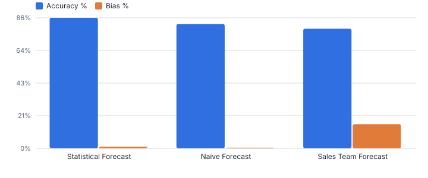
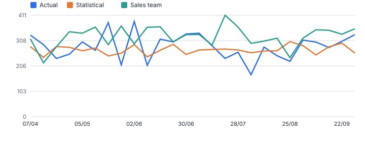
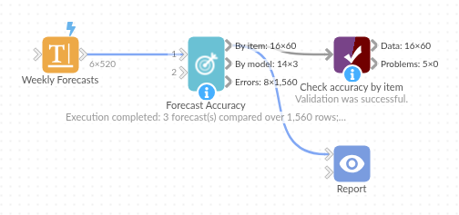

# Forecast Accuracy

*Omniscope custom block · Analytics*

**Which forecast should you trust? WAPE, MAPE, bias and tracking signal per item and model, the best model per item, and flags for forecasts that are consistently off.**

**Python** · pandas, numpy · nothing extra to install

## The problem it solves

Demand planners compare forecasts every week: the statistical model, the sales team's numbers, last year's or last week's figures. Without consistent accuracy measures, the loudest forecast wins. Simple averages of percentage error also mislead on low-volume items and fall over when actuals are zero.

Forecast Accuracy computes the standard measures for every item and model side by side, picks the best model per item, and flags biased or out-of-control forecasts.

- **86%** accuracy of the best model (statistical forecast)
- **19 of 20** SKUs where it is the best model
- **+16%** bias of the sales team forecast
- **20** SKUs with at least one flagged forecast

### How it works

- Choose the actual field, one or more forecast fields, the item fields and (for the tracking signal) the period field.
- Per item and model: MAE, RMSE, MAPE (zero actuals excluded), sMAPE, WAPE, accuracy, bias and tracking signal.
- Each item's best model is marked (by WAPE, or the measure you choose); items over the bias or tracking-signal limits are flagged.
- The model output ranks the forecasts overall; the errors output has every row for charts and drill-down.

## What goes in

### Weekly actuals and three forecasts

26 weeks x 20 SKUs, synthetic. The sales team forecast is deliberately optimistic.

| SKU | Week | Actual Units | Statistical Forecast | Sales Team Forecast | Naive Forecast |
|---|---|---|---|---|---|
| SKU-001 | 2025-04-07 | 333 | 272 | 370 | 333 |
| SKU-001 | 2025-04-14 | 296 | 300 | 397 | 333 |
| SKU-001 | 2025-04-21 | 293 | 290 | 340 | 296 |
| SKU-001 | 2025-04-28 | 261 | 283 | 360 | 293 |
| SKU-001 | 2025-05-05 | 336 | 276 | 365 | 261 |
| SKU-001 | 2025-05-12 | 321 | 313 | 302 | 336 |

*520 rows in the sample file.*

## The options

| Option | Demo setting | What it does |
|---|---|---|
| Actual field | `Actual Units` | The value that actually happened, such as units sold. |
| Forecast fields | `Statistical Forecast, Sales Team Forecast, Naive Forecast` | One or more forecasts (models) to evaluate. |
| Item fields (optional) | `SKU` | For example SKU, or SKU and Location. |
| Period field (optional) | `Week` | Orders rows for the tracking signal. |
| Pick the best model by | `WAPE` | The measure used to pick each item's best model and to rank the models. |
| Bias limit | `0.1` | Flag items whose bias exceeds this (0.1 = 10%). |

## What comes out

### Accuracy by model

| Model | Periods | Actual Total | Forecast Total | MAE | RMSE | MAPE | sMAPE | WAPE | Accuracy | Bias | Items Where Best | Items | Rank |
|---|---|---|---|---|---|---|---|---|---|---|---|---|---|
| Statistical Forecast | 520 | 114,755 | 115,954 | 31.04 | 43.27 | 0.144 | 0.146 | 0.141 | 0.859 | 0.01 | 19 | 20 | 1 |
| Naive Forecast | 520 | 114,755 | 115,238 | 40.04 | 56.78 | 0.181 | 0.182 | 0.181 | 0.819 | 0.004 | 1 | 20 | 2 |
| Sales Team Forecast | 520 | 114,755 | 133,010 | 46.87 | 64.29 | 0.229 | 0.202 | 0.212 | 0.788 | 0.159 | 0 | 20 | 3 |

### Accuracy by item (two SKUs)

| SKU | Model | Periods | Actual Total | Forecast Total | MAE | RMSE | MAPE | sMAPE | WAPE | Accuracy | Bias | Tracking Signal | Flags | Rank For Item | Best Model For Item |
|---|---|---|---|---|---|---|---|---|---|---|---|---|---|---|---|
| SKU-001 | Naive Forecast | 26 | 7,385 | 7,431 | 38.69 | 45.43 | 0.142 | 0.141 | 0.136 | 0.864 | 0.006 | 1.189 |  | 2 | No |
| SKU-001 | Sales Team Forecast | 26 | 7,385 | 8,714 | 53.65 | 67.69 | 0.202 | 0.173 | 0.189 | 0.811 | 0.18 | 24.77 | Over-forecasting; Tracking signal out of control | 3 | No |
| SKU-001 | Statistical Forecast | 26 | 7,385 | 7,547 | 27.31 | 37.12 | 0.105 | 0.099 | 0.096 | 0.904 | 0.022 | 5.932 | Tracking signal out of control | 1 | Yes |
| SKU-007 | Naive Forecast | 26 | 5,249 | 5,342 | 49.12 | 90.96 | 0.173 | 0.274 | 0.243 | 0.757 | 0.018 | 1.894 |  | 2 | No |
| SKU-007 | Sales Team Forecast | 26 | 5,249 | 7,112 | 74.27 | 107.24 | 0.275 | 0.36 | 0.368 | 0.632 | 0.355 | 25.08 | Over-forecasting; Tracking signal out of control | 3 | No |
| SKU-007 | Statistical Forecast | 26 | 5,249 | 6,041 | 46.85 | 81.35 | 0.143 | 0.274 | 0.232 | 0.768 | 0.151 | 16.91 | Over-forecasting; Tracking signal out of control | 1 | Yes |

*The statistical forecast is the most accurate overall; the sales team forecast carries a large positive bias (synthetic data).*

*One SKU over the 26 weeks: the sales team forecast sits consistently above actual demand.*

## Where it pays off

### Retail and consumer goods: Demand planning review

Weekly accuracy and bias per SKU and location, to decide where to trust the system forecast and where planners should step in.

### Manufacturing: S&OP forecast value added

Compare the statistical forecast with the consensus forecast to see whether manual overrides add or destroy accuracy.

### Energy and utilities: Load forecasting

Track error and bias of daily or hourly load forecasts per region, with tracking signals for model drift.

### Finance: Budget and outlook accuracy

Measure how far budgets and quarterly outlooks were from actuals, by business unit, to calibrate the next round.

*Use cases describe typical scenarios and are illustrative.*

## Why do this in Omniscope

- **Scores beside the forecasts they judge.** Omniscope's Time Series Forecast output and imported planner forecasts join to actuals upstream, are scored here, and the ranking and flagged SKUs reach the planner's Report on a weekly schedule.
- **Measures that survive zero weeks.** MAPE leaves out zero actuals while WAPE and bias use totals, the tests check each measure by hand, and the sales team's +16% bias is measured exactly as the statistical model's is.
- **Limits set by you.** The bias and tracking-signal limits and the measure that picks the best model are options; a further measure, such as a scaled error, fits alongside the others in the script.

## How it fits into an Omniscope workflow

Actuals + Forecasts (Time Series Forecast or imports) → Join → **Forecast Accuracy** → Report

Join actuals and forecasts on item and period (Omniscope's Time Series Forecast output can be one of the forecasts), then run Forecast Accuracy.

Show the model ranking and flagged items in a planner's Report; schedule weekly.

## In one step

Works for any forecast source, with supply-chain measures (WAPE, bias, tracking signal) and best-model selection per item.

## Try it

1. Open the demo project (`demo.iox` on the demo server, or import `demo.ioz` from this folder): 26 weeks of actuals for 20 SKUs with three competing forecasts.
2. The question: which forecast should the planners use, and where?
3. Open Forecast Accuracy: actual, three forecast fields, item SKU, period Week. Run it.
4. Look at the model ranking: statistical 86% accurate and best on 19 SKUs; the sales team forecast is biased +16%.
5. Look at the flagged items and the line chart for one SKU: bias is visible week after week.

## Running in Omniscope

*The demo project's workflow: the sample data, the block, and a Validate data check on its output.*

<!--language-->
## Language and libraries

Python. It uses pandas and numpy.

pandas and numpy are part of Omniscope's Docker Python image, and the block was run in both host mode and Docker mode on an Omniscope server, with the same results. It needs nothing else installed.
<!--/language-->

## Tested

The demo workflow runs without errors on an Omniscope server and produces 60 records in Accuracy by item, 3 in Accuracy by model and 1,560 in Errors by row. Its automated tests cover normal data, empty input, wrong types and large input.
