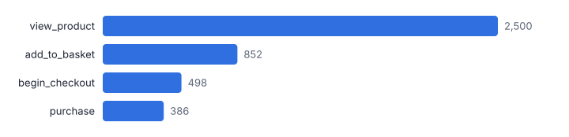
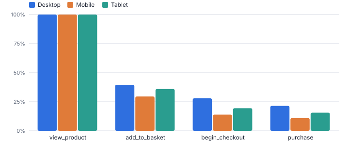
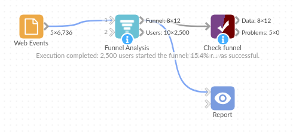

# Funnel Analysis

*Omniscope custom block · Analytics*

**From raw events to a step-by-step funnel: how many users reach each step, in order and within a time window, per segment, with drop-off and time between steps.**

**Python** · pandas, numpy · nothing extra to install

## The problem it solves

Web analytics tools show funnels for their own tracked events, but the events behind a business funnel often sit elsewhere: an app database, a CRM, a booking system, an onboarding log. Rebuilding the funnel by hand means pivoting, self-joins and careful handling of order and timing.

This block takes a plain event log (user, event, time) and the list of steps, and counts users through the funnel the standard way: each step must come after the previous one, optionally within a window from the first step, with segments taken from each user's first event.

- **2,500** users started the funnel
- **15.4%** reached purchase
- **34%** of viewers added to basket, the biggest drop
- **21.4% vs 10.9%** Desktop vs Mobile conversion

### How it works

- Connect an event log with a user ID, an event name and a timestamp (text or date).
- Type the funnel steps in order, separated by commas or arrows, for example `view_product -> add_to_basket -> checkout -> purchase`. Matching is case-insensitive; other events are ignored.
- Choose whether steps must happen in order, an optional time window in hours from the first step, and any segment fields (device, channel, campaign).
- Outputs: the funnel per segment (users, conversion from start and from the previous step, drop-off, median hours between steps) and one row per user with the furthest step reached and the time of each step.

## What goes in

### Web events

Synthetic events from 2,500 users over a month, with device and channel, including page_view events that are not part of the funnel (illustrative).

| User ID | Event | Event Time | Device | Channel |
|---|---|---|---|---|
| U00246 | begin_checkout | 2025-10-06 06:13:06 | Desktop | Social |
| U00430 | add_to_basket | 2025-10-15 21:09:41 | Tablet | Email |
| U00710 | view_product | 2025-10-07 06:31:40 | Desktop | Social |
| U00009 | view_product | 2025-10-11 15:22:28 | Mobile | Social |
| U00534 | view_product | 2025-10-27 22:10:59 | Mobile | Search |
| U02388 | page_view | 2025-10-02 08:35:00 | Mobile | Email |

*6,736 rows in the sample file.*

## The options

| Option | Demo setting | What it does |
|---|---|---|
| User field | `User ID` | Identifies the person or session moving through the funnel. |
| Event name field | `Event` | Holds the event names listed in the funnel steps. |
| Event time field | `Event Time` | When each event happened. |
| Funnel steps, in order | `view_product, add_to_basket, begin_checkout, purchase` | Event names separated by commas or ->, for example: view_product, add_to_basket, begin_checkout, purchase |
| Segment by (optional) | `Device` | For example Device or Channel. |
| Steps must happen in order | `On` | Ticked: a step counts only after the previous one. Unticked: any order. |
| Time window (hours) | `0` | All steps within this many hours of the first step. 0 = no limit. |

## What comes out

### Funnel by device

| Device | Step Number | Step | Users | Conversion From Start | Conversion From Previous | Drop-off From Previous | Median Hours From Previous |
|---|---|---|---|---|---|---|---|
| Desktop | 1 | view_product | 977 | 1 | 1 | 0 |  |
| Desktop | 2 | add_to_basket | 387 | 0.396 | 0.396 | 590 | 0.27 |
| Desktop | 3 | begin_checkout | 273 | 0.279 | 0.705 | 114 | 0.24 |
| Desktop | 4 | purchase | 209 | 0.214 | 0.766 | 64 | 0.1 |
| Mobile | 1 | view_product | 1286 | 1 | 1 | 0 |  |
| Mobile | 2 | add_to_basket | 380 | 0.295 | 0.295 | 906 | 0.28 |
| Mobile | 3 | begin_checkout | 179 | 0.139 | 0.471 | 201 | 0.25 |
| Mobile | 4 | purchase | 140 | 0.109 | 0.782 | 39 | 0.09 |
| Tablet | 1 | view_product | 237 | 1 | 1 | 0 |  |
| Tablet | 2 | add_to_basket | 85 | 0.359 | 0.359 | 152 | 0.24 |
| Tablet | 3 | begin_checkout | 46 | 0.194 | 0.541 | 39 | 0.24 |
| Tablet | 4 | purchase | 37 | 0.156 | 0.804 | 9 | 0.07 |

### Users (first eight)

| User ID | Device | Steps Reached | Furthest Step | Converted | view_product Time | add_to_basket Time | begin_checkout Time | purchase Time | Hours To Convert |
|---|---|---|---|---|---|---|---|---|---|
| U00001 | Tablet | 1 | view_product | No | 2025-10-20 20:03 |  |  |  |  |
| U00002 | Mobile | 1 | view_product | No | 2025-10-04 12:50 |  |  |  |  |
| U00003 | Mobile | 1 | view_product | No | 2025-10-02 00:45 |  |  |  |  |
| U00004 | Tablet | 2 | add_to_basket | No | 2025-10-13 00:41 | 2025-10-13 00:48 |  |  |  |
| U00005 | Mobile | 1 | view_product | No | 2025-10-04 01:41 |  |  |  |  |
| U00006 | Mobile | 1 | view_product | No | 2025-10-26 22:51 |  |  |  |  |
| U00007 | Desktop | 1 | view_product | No | 2025-10-22 22:44 |  |  |  |  |
| U00008 | Desktop | 3 | begin_checkout | No | 2025-10-28 20:18 | 2025-10-28 20:25 | 2025-10-28 21:34 |  |  |

*The classic funnel: most users leave between viewing a product and adding it to the basket (synthetic data).*

*Mobile users drop off faster at each step; the gap opens at basket and checkout (synthetic data).*

## Where it pays off

### E-commerce and retail: Checkout funnel

View, basket, checkout and purchase by device and channel, to see where mobile shoppers drop out and whether a site change helped.

### SaaS and apps: Onboarding and activation

Sign-up, first login, first project, invite a colleague, within 7 days (window 168 hours), by acquisition campaign.

### Financial services: Application journeys

Quote, application started, documents uploaded, approved, funded, from the application system's event table, by product and broker.

### Travel and leisure: Booking flow

Search, select, extras, payment, confirmation, with median time between steps to find slow pages.

*Use cases describe typical scenarios and are illustrative.*

## Why do this in Omniscope

- **Funnels from any event table.** Events can come from an app database, a CRM or a booking system, and the user output joins back to customer data or feeds the A/B Test block in the same workflow.
- **One rule for every user.** Each step must follow the previous one, within the window you set from the first step, step names match regardless of case, and the tests check ordered and unordered counts; the funnel is recounted each time the event log loads.
- **New steps by typing.** The funnel is a typed list of event names, so adding a step or a 168-hour window changes an option, not the workflow; the counting code is in the block if you need a variant.

## How it fits into an Omniscope workflow

Database / event export → **Funnel Analysis** → Report (funnel chart, segment table) → A/B Test (optional)

Load the event log from a database or file and schedule the workflow. Sessionise Events upstream can split activity into visits first.

Show the funnel output in a Report; join the user output back to customer data, or feed converted / not converted into the A/B Test block to compare variants.

## In one step

One block with ordering, time window and segments handled, instead of a join chain per step.

## Try it

1. Open the demo project (`demo.iox` on the demo server, or import `demo.ioz` from this folder): a month of synthetic web events, one row per event.
2. The question: of the people who view a product, how many buy, and where do we lose them?
3. Open the block: map user, event and time, type the four steps, segment by Device. Run it.
4. Look at the funnel: 2,500 viewers, 15.4% purchase; the biggest loss is viewing to basket (66% leave).
5. Look at the device comparison: Desktop converts at 21.4%, Mobile at 10.9%; Mobile checkout-from-basket is 47% against 71%, so the basket page on that device is the first place to look.

## Running in Omniscope

*The demo project's workflow: the sample data, the block, and a Validate data check on its output.*

<!--language-->
## Language and libraries

Python. It uses pandas and numpy, plus the Python standard library (re).

pandas and numpy are part of Omniscope's Docker Python image, and the block was run in both host mode and Docker mode on an Omniscope server, with the same results. It needs nothing else installed.
<!--/language-->

## Tested

On an Omniscope server the demo workflow ran cleanly: 12 records in Funnel and 2,500 in Users. The automated tests check normal data, empty input, wrong types and large input.
