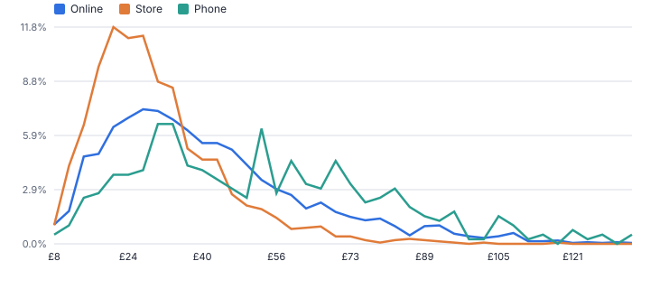
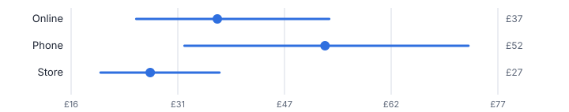
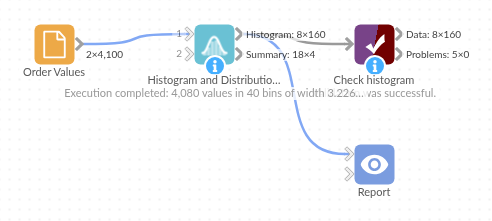

# Histogram and Distribution

*Omniscope custom block · Analytics*

**Histograms with sensible bins shared across groups, and the distribution statistics that go with them: percentiles, skewness and kurtosis.**

**Python** · pandas, numpy · nothing extra to install

## The problem it solves

A mean says little about order values, claim sizes or handling times, which are usually skewed. The distribution matters, and histograms need a sensible bin width, the same bins for each group, and a way to stop a few extreme values squashing the chart.

This block bins any numeric field with the Freedman-Diaconis rule (or your own width), per group on shared bins, and returns the percentiles, skewness and kurtosis alongside.

- **4,080** order values (synthetic)
- **£33 vs £40** median vs mean: a right-skewed distribution
- **2.0** skewness overall
- **1** set of bins shared by all three channels

### How it works

- Connect data and choose the numeric field, and optionally a group field.
- Leave the bin rule on Freedman-Diaconis, or set Sturges, a number of bins or a width; optionally clip the range to percentiles.
- Outputs: the histogram per group and bin, and the summary statistics per group.

## What goes in

### Order values

Synthetic order values for three channels, 20 missing.

| Channel | Order Value (GBP) |
|---|---|
| Online | 102.22 |
| Online | 58.8 |
| Online | 54.1 |
| Online | 36.89 |
| Online | 75.71 |
| Online | 57.05 |

*4,100 rows in the sample file.*

## The options

| Option | Demo setting | What it does |
|---|---|---|
| Value field | `Order Value (GBP)` | The numbers to bin and describe. |
| Per group (optional) | `Channel` | One histogram per value, all on the same bins so they can be compared. |
| Clip range to percentiles | `1` | For example 1 = from P1 to P99; 0 = full range. |
| Bin width rule | `Freedman-Diaconis` | How the bin width is chosen when you do not set one. Freedman-Diaconis copes better with outliers. |

## What comes out

### Summary statistics

| Channel | Count | Missing | Mean | Std Dev | Minimum | P1 | P5 | Q1 | Median | Q3 | P95 | P99 | Maximum | Skewness | Excess Kurtosis | Below Range | Above Range |
|---|---|---|---|---|---|---|---|---|---|---|---|---|---|---|---|---|---|
| Online | 2192 | 8 | 42.66 | 24.83 | 6.42 | 9.63 | 14.25 | 25.37 | 37.04 | 52.96 | 90.59 | 136.27 | 221.28 | 1.72 | 4.98 | 1 | 23 |
| Phone | 400 | 0 | 57.52 | 33.92 | 7.33 | 11.32 | 16.84 | 32.34 | 52.4 | 72.94 | 123.61 | 170.60 | 210.78 | 1.39 | 2.53 | 0 | 16 |
| Store | 1488 | 12 | 30.22 | 14.21 | 4.45 | 9.58 | 12.81 | 20.32 | 27.4 | 37.3 | 57.14 | 80.52 | 117.50 | 1.42 | 3.18 | 2 | 0 |
| All | 4080 | 20 | 39.58 | 24.21 | 4.45 | 9.64 | 13.92 | 23.22 | 33.34 | 48.99 | 85.94 | 133.57 | 221.28 | 1.99 | 6.38 | 3 | 39 |

*Shared bins make the channels directly comparable (synthetic data).*

*Medians and interquartile ranges from the summary output.*

## Where it pays off

### Retail and e-commerce: Order and basket values

Distribution of order values by channel or segment, to set free-delivery thresholds and promotions.

### Insurance: Claim sizes

Skewed claim distributions by product, with the tail percentiles that drive reserves.

### Operations: Handling and wait times

Distribution of times per team, where the 95th percentile matters more than the average.

### Data quality: Profiling new data

A quick look at the shape of every numeric field before modelling.

*Use cases describe typical scenarios and are illustrative.*

## Why do this in Omniscope

- **Bins that compare channels fairly.** One set of bin edges is worked out for all the groups together, so the channels' bars line up in one Report chart, and the percentiles beside them come from the same pass.
- **Width chosen by rule, not by eye.** Freedman-Diaconis or Sturges sets the width from the data on each run, so next month's values get bins that suit them; the tests check counts, widths and clipping on known inputs.
- **Percentiles you can add.** The summary lists the 1st, 5th, 25th, 50th, 75th, 95th and 99th percentiles; another, such as the 90th for a service target, is one number to add to that list in the code.

## How it fits into an Omniscope workflow

Data → **Histogram and Distribution** → Report (bar chart of bins, statistics table)

Outlier Flagger and Tile work well alongside: one flags extremes, the other assigns quantile groups.

Chart Count or Share against Midpoint per group as bars or lines.

Bins are calculated once and shared across groups, so every group's chart in the Report uses the same bin edges, and the statistics come from the same pass over the data.

## In one step

Histograms on shared bins, with the distribution statistics alongside.

## Try it

1. Open the demo project (`demo.iox` on the demo server, or import `demo.ioz` from this folder): synthetic order values from three channels.
2. The question: what does a typical order look like in each channel?
3. Run the block: shared bins, statistics per channel.
4. Look at the summary: medians below means, skewness 2.0; phone orders are largest.
5. Change the clip percentile to see the full tail.

## Running in Omniscope

*The demo project's workflow: the sample data, the block, and a Validate data check on its output.*

<!--language-->
## Language and libraries

Python. It uses pandas and numpy.

pandas and numpy are part of Omniscope's Docker Python image, and the block was run in both host mode and Docker mode on an Omniscope server, with the same results. It needs nothing else installed.
<!--/language-->

## Tested

On an Omniscope server the demo workflow ran cleanly: 160 records in Histogram and 4 in Summary. The automated tests check normal data, empty input, wrong types and large input.
