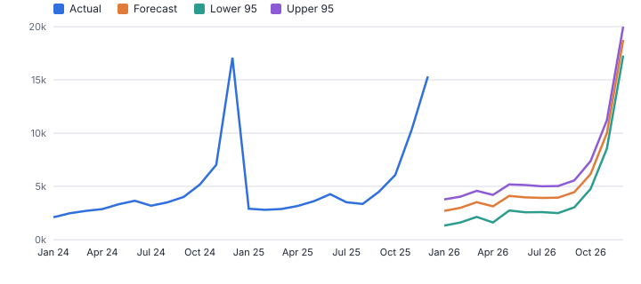
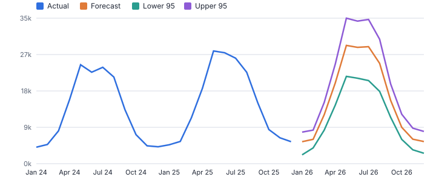
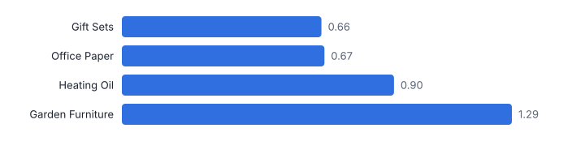
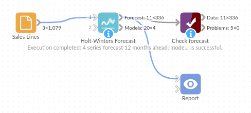

# Holt-Winters Forecast

*Omniscope custom block · Analytics*

**Seasonal forecasts for every product, store or cost centre in one step: automatic Holt-Winters model choice, prediction intervals, and a holdout check.**

**Python** · pandas, numpy, scipy · installs scipy automatically

## The problem it solves

A lot of planning still starts from last year plus a percentage. Exponential smoothing is a common step up: it learns each series' level, trend and seasonal shape and updates as new data arrives, but setting it up per series, choosing the model and checking it against a simple benchmark takes time.

This block fits the Holt-Winters family per series, chooses the model by AICc, gives 80% and 95% intervals from simulated paths, and, with a holdout, tells you whether the forecast actually beats "same as last season" before anyone relies on it.

- **4** product lines forecast 12 months ahead (synthetic)
- **3 of 4** beat the seasonal naive forecast in the holdout
- **9%** holdout MAPE for Gift Sets
- **1.29** MASE for Garden Furniture: worse than naive, flagged rather than hidden

### How it works

- Connect history with a date and a value; choose the fields that define each series and the period (day, week, month, quarter).
- Choose the horizon, and either leave trend and seasonality on Automatic or force a model; set a holdout to score the method on the most recent periods.
- Outputs: actuals, fitted values, holdout forecasts and future forecasts with intervals in one table for a line chart, and a model table per series.

## What goes in

### Sales lines

Synthetic order lines for four product lines, 2021 to 2025, with different seasonal shapes.

| Order Date | Product Line | Sales |
|---|---|---|
| 2021-01-05 | Garden Furniture | 88.15 |
| 2021-01-06 | Gift Sets | 867.42 |
| 2021-01-09 | Gift Sets | 632.76 |
| 2021-01-10 | Garden Furniture | 429.95 |
| 2021-01-10 | Office Paper | 1879.88 |
| 2021-01-13 | Heating Oil | 16430.24 |

*1,079 rows in the sample file.*

## The options

| Option | Demo setting | What it does |
|---|---|---|
| Date field | `Order Date` | Date of each value; values are summed per period. |
| Value field | `Sales` | The quantity to forecast, such as sales. |
| One forecast per (optional) | `Product Line` | For example Product or Store. |
| Holdout check (periods) | `12` | 0 = no check. |
| Horizon (periods) | `12` | How many periods to forecast past the last one in the data. |
| Trend | `Automatic` | Automatic picks the trend with the best fit; a damped trend levels off over the horizon. |
| Seasonality | `Automatic` | Automatic picks the best fit. Multiplicative seasons grow with the level; additive ones stay the same size. |

## What comes out

### Models and holdout accuracy

| Product Line | Model | Alpha | Beta | Gamma | AICc | Forecast Total | Holdout MAPE | Seasonal Naive MAE | Holdout MAE | MASE |
|---|---|---|---|---|---|---|---|---|---|---|
| Garden Furniture | ETS(A,N,M) | 0.423 |  | 0.419 | 866 | 188,733 | 0.188 | 2,068 | 2,669 | 1.291 |
| Gift Sets | ETS(A,A,M) | 0.042 | 0.042 | 0 | 796 | 68,316 | 0.089 | 790 | 518 | 0.655 |
| Heating Oil | ETS(A,N,M) | 0.152 |  | 0 | 842 | 132,037 | 0.086 | 1,130 | 1,021 | 0.903 |
| Office Paper | ETS(A,N,N) | 0.256 |  |  | 655 | 48,396 | 0.062 | 361 | 244 | 0.675 |

### Gift Sets forecast

| Product Line | Period | Forecast | Lower 95 | Lower 80 | Upper 80 | Upper 95 | Horizon |
|---|---|---|---|---|---|---|---|
| Gift Sets | 2026-01 | 2,728 | 1,332 | 2,327 | 3,195 | 3,813 | 1 |
| Gift Sets | 2026-02 | 3,011 | 1,624 | 2,633 | 3,472 | 4,077 | 2 |
| Gift Sets | 2026-03 | 3,551 | 2,159 | 3,060 | 3,997 | 4,630 | 3 |
| Gift Sets | 2026-04 | 3,160 | 1,623 | 2,715 | 3,638 | 4,243 | 4 |
| Gift Sets | 2026-05 | 4,150 | 2,758 | 3,661 | 4,636 | 5,234 | 5 |
| Gift Sets | 2026-06 | 4,008 | 2,594 | 3,579 | 4,469 | 5,179 | 6 |
| Gift Sets | 2026-07 | 3,960 | 2,609 | 3,557 | 4,421 | 5,057 | 7 |
| Gift Sets | 2026-08 | 3,980 | 2,517 | 3,593 | 4,466 | 5,087 | 8 |
| Gift Sets | 2026-09 | 4,501 | 3,062 | 4,061 | 4,989 | 5,614 | 9 |
| Gift Sets | 2026-10 | 6,221 | 4,819 | 5,754 | 6,788 | 7,453 | 10 |
| Gift Sets | 2026-11 | 10,105 | 8,646 | 9,554 | 10,783 | 11,332 | 11 |
| Gift Sets | 2026-12 | 18,942 | 17,456 | 18,106 | 19,695 | 20,203 | 12 |

*A strong Christmas peak, learned from the history and carried into 2026 with its interval (synthetic data).*

*Garden Furniture's summer peak; this series was growing quickly, and the holdout shows the model under-forecast it.*

*The holdout check scores each series on the last 12 months against a seasonal naive forecast.*

## Where it pays off

### Retail and wholesale: Demand planning

Monthly or weekly forecasts per product or store, with intervals to set safety stock (feed the Safety Stock block).

### Finance: Budget and run-rate forecasts

Revenue and cost forecasts per cost centre with seasonality, as a baseline for the budget conversation.

### Contact centres and operations: Volume forecasting

Daily or weekly call, ticket or order volumes for staffing, with weekday seasonality.

### Utilities and energy: Consumption forecasts

Monthly consumption per site or tariff with winter and summer patterns.

*Use cases describe typical scenarios and are illustrative.*

## Why do this in Omniscope

- **Forecast, intervals and actuals in one table.** Actuals, fitted values and forecasts share one output, so a single line chart shows history and the 95% band per product line, and the monthly run can pass the saved forecasts to Forecast Accuracy later.
- **A check before anyone relies on it.** With a holdout, each series is scored against "same as last season", and one that does worse, like Garden Furniture at a MASE of 1.29, is flagged; a fixed seed makes the intervals the same on a re-run of the same history.
- **Override where you know better.** Trend, seasonality and season length can be set instead of chosen automatically, and the smoothing code is in the block for teams that must match a documented method exactly.

## How it fits into an Omniscope workflow

History (database / files) → **Holt-Winters Forecast** → Forecast Accuracy (later, against actuals) → Report (line chart with band)

Schedule monthly; the Forecast Accuracy block can later compare the saved forecasts with what actually happened.

Chart Actual, Fitted and Forecast against Period with Lower and Upper 95 as a band, per series.

## In one step

Per-series exponential smoothing with automatic model choice, intervals and a holdout check.

## Try it

1. Open the demo project (`demo.iox` on the demo server, or import `demo.ioz` from this folder): five years of synthetic sales for four product lines.
2. The question: what will each line sell next year, how sure can we be, and is this better than last year's pattern?
3. Open the block: date, sales, one forecast per Product Line, monthly, horizon 12, holdout 12. Run it.
4. Look at the forecast chart with its band, then the model table: different models per line, chosen automatically.
5. Look at the holdout: 3 of 4 lines beat the seasonal naive benchmark; Garden Furniture does not, so it needs a closer look before anyone plans on it.

## Running in Omniscope

*The demo project's workflow: the sample data, the block, and a Validate data check on its output.*

<!--language-->
## Language and libraries

Python. It uses pandas, numpy and scipy, plus the Python standard library (math).

pandas and numpy are part of Omniscope's Docker Python image, and the block was run in both host mode and Docker mode on an Omniscope server, with the same results. It also uses scipy's optimiser to fit the smoothing parameters. Omniscope installs scipy automatically from the block's dependencies; in Docker mode it builds an image for the block the first time it runs, which takes a little longer.
<!--/language-->

## Tested

On an Omniscope server the demo workflow ran cleanly: 336 records in Forecast and 4 in Models. The automated tests check normal data, empty input, wrong types and large input.
