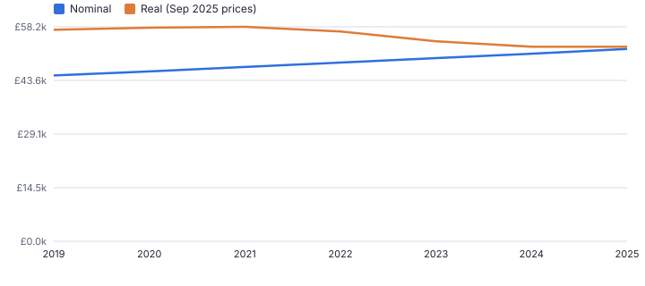
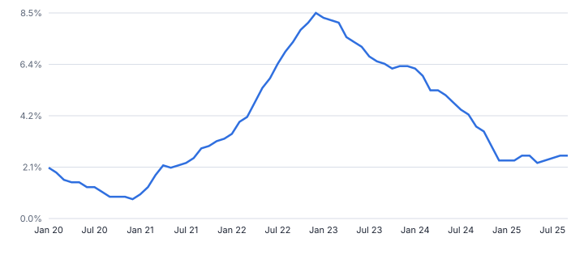
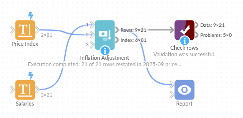

# Inflation Adjustment

*Omniscope custom block · Analytics*

**Restate money values in real terms of a base period from a price index table: salaries, prices, budgets and revenue comparable across years.**

**Python** · pandas, numpy · nothing extra to install

## The problem it solves

A salary, price or budget that rose 15% over six years may have fallen in real terms. Comparing money values across years needs them restated in one period's prices, using the index in force at each date.

This block looks up the index on or before each row's date (per country or series if needed), restates any number of money fields in the base period's prices, and returns the index table with cumulative and annual inflation.

- **16%** nominal rise in the engineer band, 2019 to 2025 (illustrative)
- **-8%** the same in real terms
- **28%** rise in the index from April 2019 to the base month
- **21 of 21** salary rows adjusted, none with a stale index

### How it works

- Connect values with a date and money fields to input 1, and a price index (period, value, optional key such as country) to input 2.
- Choose the base period (default: the latest index period), the maximum age of an index value, and the suffix for the new fields.
- Outputs: rows with the index used, inflation factor and real values; and the index table with inflation to base and annual change.

## What goes in

### Input 1: salaries

| Effective Date | Role | Salary (GBP) |
|---|---|---|
| 2019-04-01 | Analyst | 30000.0 |
| 2019-04-01 | Engineer | 45000.0 |
| 2019-04-01 | Manager | 58000.0 |
| 2020-04-01 | Analyst | 30700.0 |
| 2020-04-01 | Engineer | 46100.0 |
| 2020-04-01 | Manager | 59400.0 |

*21 rows in the sample file.*

### Input 2: price index

An invented monthly index, not official statistics.

| Month | Price Index (illustrative) |
|---|---|
| 2019-01 | 100.1 |
| 2019-02 | 100.2 |
| 2019-03 | 100.4 |
| 2019-04 | 100.5 |
| 2019-05 | 100.8 |
| 2019-06 | 101.0 |

*81 rows in the sample file.*

## The options

| Option | Demo setting | What it does |
|---|---|---|
| Date field | `Effective Date` | Date of each value, matched to the index period it falls in. |
| Money fields to adjust | `Salary (GBP)` | Money amounts to restate in base-period prices; each gets a new real-terms field. |
| Index period | `Month` | The month or date each index value applies to. |
| Index value | `Price Index (illustrative)` | The price index, such as CPI. |
| Base period | `(latest)` | A date or month, for example 2025-06. Default: latest index period. |

## What comes out

### Engineer rows

| Effective Date | Role | Salary (GBP) | Index Period Used | Index At Date | Index At Base | Inflation Factor | Salary (GBP) (real) | Adjustment Status |
|---|---|---|---|---|---|---|---|---|
| 2019-04-01 | Engineer | 45,000 | 2019-04-01 | 100.50 | 128.20 | 1.276 | 57,402.99 | Adjusted |
| 2020-04-01 | Engineer | 46,100 | 2020-04-01 | 102 | 128.20 | 1.257 | 57,941.37 | Adjusted |
| 2021-04-01 | Engineer | 47,300 | 2021-04-01 | 104.20 | 128.20 | 1.23 | 58,194.43 | Adjusted |
| 2022-04-01 | Engineer | 48,500 | 2022-04-01 | 109.20 | 128.20 | 1.174 | 56,938.64 | Adjusted |
| 2023-04-01 | Engineer | 49,700 | 2023-04-01 | 117.40 | 128.20 | 1.092 | 54,272.06 | Adjusted |
| 2024-04-01 | Engineer | 50,900 | 2024-04-01 | 123.60 | 128.20 | 1.037 | 52,794.34 | Adjusted |
| 2025-04-01 | Engineer | 52,200 | 2025-04-01 | 126.80 | 128.20 | 1.011 | 52,776.34 | Adjusted |

*Pay rose every year but fell in real terms while inflation was high (illustrative figures).*

*The year-on-year change from the index output.*

## Where it pays off

### HR and reward: Real pay

Salary bands and settlements in constant prices, to show whether pay kept up with inflation.

### Finance: Long-run comparisons

Revenue, costs and budgets over several years in one year's prices.

### Public sector: Spending in real terms

Programme spend restated with the deflator the organisation uses.

### Pricing: Price history

Whether list prices rose faster or slower than the relevant price index, per country.

*Use cases describe typical scenarios and are illustrative.*

## Why do this in Omniscope

- **Index and values side by side.** The price index loads as the second input next to the salary or budget data, and a new index release updates every restated figure in the Report on the next run.
- **No silent stale index.** Each row records the index period it used, and a row whose latest index is older than the maximum age (400 days by default) is marked "Index too old" instead of being adjusted.
- **Whatever index you work with.** The index is just a table with an optional key per country, so a regional deflator or your own cost index works as well as a national price index.

## How it fits into an Omniscope workflow

Values with dates + Price index (file or published series) → **Inflation Adjustment** → Report

Load the index series your organisation uses; As-Of Join is the general-purpose version of the lookup.

Chart nominal and real values side by side.

The index is applied by a lookup in the workflow, so when a new index release is loaded every restated figure in the Report updates together.

## In one step

Looks up the index on or before each date, rebases it and gives real values.

## Try it

1. Open the demo project (`demo.iox` on the demo server, or import `demo.ioz` from this folder): invented salary bands and an invented price index.
2. The question: did pay keep up with prices?
3. Run the block with the latest index month as the base.
4. Look at the engineer band: up 16% as paid, -8% in real terms.
5. Change the base period to 2019 to express everything in 2019 prices.

## Running in Omniscope

*The demo project's workflow: the sample data, the block, and a Validate data check on its output.*

<!--language-->
## Language and libraries

Python. It uses pandas and numpy.

pandas and numpy are part of Omniscope's Docker Python image, and the block was run in both host mode and Docker mode on an Omniscope server, with the same results. It needs nothing else installed.
<!--/language-->

## Tested

The demo workflow completed without errors on an Omniscope server (21 records in Rows and 81 in Index). Automated tests check normal data, empty input, wrong types and large input.
