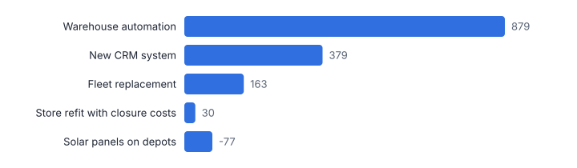
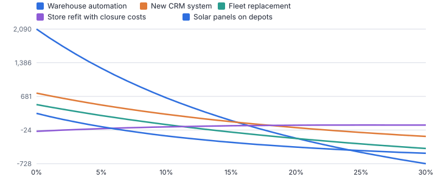
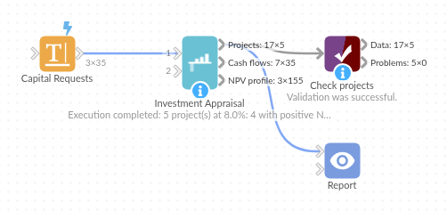

# Investment Appraisal

*Omniscope custom block · Analytics*

**NPV, IRR, MIRR, payback and profitability index for every project from its cash flows, with NPV profiles and a warning when IRR cannot be trusted.**

**Python** · pandas, numpy · nothing extra to install

## The problem it solves

Capital requests and business cases arrive as cash-flow tables, and are compared on a mix of NPV, IRR and payback worked out in spreadsheets, each slightly differently. IRR in particular misleads when cash flows change sign more than once, and ranks projects of different sizes in the wrong order.

This block calculates the standard measures consistently for every project, by period or on actual dates, ranks by NPV, and flags projects with more than one IRR.

- **5** capital requests appraised (illustrative)
- **£879k** NPV of the best project, warehouse automation
- **21% vs 17%** the CRM has the higher IRR but the lower NPV
- **2** IRRs for the store refit, flagged

### How it works

- Connect cash flows: project, period number or date, and amount (outflows negative). Several rows for the same time are added.
- Choose period or date timing, the discount rate (or a rate field per project) and the top rate for the NPV profile.
- Outputs: one row per project with all measures and a decision, the discounted cash flows, and the NPV profile.

## What goes in

### Capital requests

Five invented projects, cash flows in £ thousands.

| Project | Year | Cash Flow (GBP k) |
|---|---|---|
| Warehouse automation | 0 | -2400 |
| Warehouse automation | 1 | 380 |
| Warehouse automation | 2 | 620 |
| Warehouse automation | 3 | 700 |
| Warehouse automation | 4 | 720 |
| Warehouse automation | 5 | 720 |
| Warehouse automation | 6 | 700 |
| Warehouse automation | 7 | 650 |

*35 rows in the sample file.*

## The options

| Option | Demo setting | What it does |
|---|---|---|
| Project field | `Project` | Names the project each cash flow belongs to. |
| Period or date field | `Year` | Period number (0 = today) or the date of each cash flow, to match Timing. |
| Cash flow field | `Cash Flow (GBP k)` | Outflows negative, inflows positive. |
| Discount rate | `0.08` | Per period, or annual for dates. For example 0.08. |
| Timing | `Period numbers (0, 1, 2...)` | Period numbers for NPV and IRR; dates for XNPV and XIRR on actual days. |

## What comes out

### Projects

| Project | NPV | IRR | MIRR | Profitability Index | Payback | Discounted Payback | Sign Changes | IRR Note | Decision | Rank By NPV |
|---|---|---|---|---|---|---|---|---|---|---|
| Warehouse automation | 879 | 0.172 | 0.129 | 1.37 | 3.97 | 4.88 | 1 |  | Accept | 1 |
| New CRM system | 379 | 0.212 | 0.164 | 1.46 | 3.33 | 3.78 | 1 |  | Accept | 2 |
| Fleet replacement | 163 | 0.128 | 0.102 | 1.11 | 2.88 | 3.73 | 1 |  | Accept | 3 |
| Store refit with closure costs | 30 | 0.044 | 0.085 | 1.01 | 0.56 | 0.6 | 2 | 2 IRRs found (4.4%, 61.6%); use NPV | Accept | 4 |
| Solar panels on depots | -77 | 0.06 | 0.07 | 0.91 | 7.48 |  | 1 |  | Reject | 5 |

### Warehouse automation cash flows

| Project | Period | Cash Flow | Discount Factor | Present Value | Cumulative Cash Flow | Cumulative Present Value |
|---|---|---|---|---|---|---|
| Warehouse automation | 0 | -2,400 | 1 | -2,400 | -2,400 | -2,400 |
| Warehouse automation | 1 | 380 | 0.93 | 351.85 | -2,020 | -2,048.15 |
| Warehouse automation | 2 | 620 | 0.86 | 531.55 | -1,400 | -1,516.60 |
| Warehouse automation | 3 | 700 | 0.79 | 555.68 | -700 | -960.92 |
| Warehouse automation | 4 | 720 | 0.74 | 529.22 | 20 | -431.69 |
| Warehouse automation | 5 | 720 | 0.68 | 490.02 | 740 | 58.33 |
| Warehouse automation | 6 | 700 | 0.63 | 441.12 | 1,440 | 499.44 |
| Warehouse automation | 7 | 650 | 0.58 | 379.27 | 2,090 | 878.71 |

*Ranked by NPV, the measure that adds up across projects (illustrative figures).*

*The store refit's line crosses zero twice: two IRRs, so only its NPV is meaningful.*

## Where it pays off

### Finance: Capital allocation

Rank capital requests consistently at the company's hurdle rate, with payback for the cash-constrained.

### Energy and property: Long-lived investments

Solar, refits and leases with irregular dated cash flows (XNPV / XIRR).

### IT and change: Business cases

Compare programme options on NPV and discounted payback with a rate per risk class.

### Private equity and lending: Deal returns

XIRR on dated drawdowns and distributions per fund or loan.

*Use cases describe typical scenarios and are illustrative.*

## Why do this in Omniscope

- **Cash flows to committee pack.** Business cases collected in one table go through the block into a Report with the NPV ranking and profile chart, and Monte Carlo Cost Risk can supply the cost range behind them.
- **The same formulas for every project.** NPV, IRR and payback are worked out identically for each request, XIRR is checked against a published example in the tests, and a project whose cash flows change sign twice gets an IRR note rather than a misleading single rate.
- **Your own hurdle and decision rule.** The discount rate can come from a field per project, and the Accept / Reject rule (NPV above zero) is one line of the script, ready to require a maximum payback as well.

## How it fits into an Omniscope workflow

Business cases (spreadsheet or database), with cost ranges from Monte Carlo Cost Risk if needed → **Investment Appraisal** → Report (ranking, NPV profile)

Collect cash flows per project in one table; Monte Carlo Cost Risk can give the range of the costs that feed it.

Show the ranked projects and the NPV profile chart to the investment committee.

## In one step

All the standard measures, dated or by period, with a check for multiple IRRs.

## Try it

1. Open the demo project (`demo.iox` on the demo server, or import `demo.ioz` from this folder): five invented capital requests.
2. The question: which should we fund at our 8% hurdle rate?
3. Run the block: NPV, IRR, MIRR, payback and a decision per project.
4. Look at the ranking: warehouse automation adds most value (£879k NPV) although the CRM has the higher IRR.
5. Look at the NPV profile: the store refit crosses zero twice, so its IRR is not a reliable guide.

## Running in Omniscope

*The demo project's workflow: the sample data, the block, and a Validate data check on its output.*

<!--language-->
## Language and libraries

Python. It uses pandas and numpy.

pandas and numpy are part of Omniscope's Docker Python image, and the block was run in both host mode and Docker mode on an Omniscope server, with the same results. It needs nothing else installed.
<!--/language-->

## Tested

Run on an Omniscope server, the demo workflow finished without errors (5 records in Projects, 35 in Cash flows and 155 in NPV profile). Automated tests also cover normal data, empty input, wrong types and large input.
