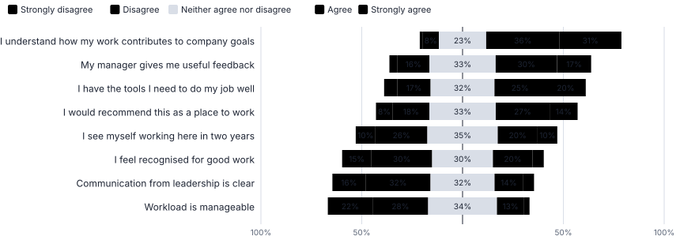
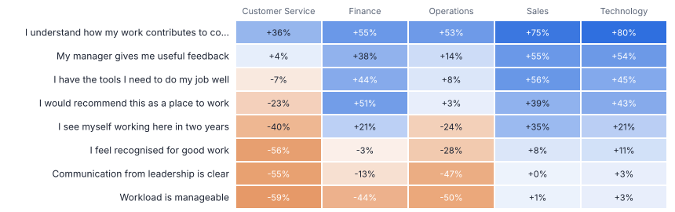
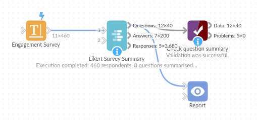

# Likert Survey Summary

*Omniscope custom block · Analytics*

**From a raw survey export to the charts leadership expects: agree / disagree distributions, top-2-box, net scores and means per statement and department, in one block.**

**Python** · pandas, numpy · nothing extra to install

## The problem it solves

Engagement, customer and patient surveys arrive as one row per respondent and one column per statement, with answers as text. Turning that into a results pack means unpivoting, mapping labels to scores, counting each answer, computing top-2-box and net scores, and repeating per department, with care for blanks, "N/A" and stray spellings.

Likert Survey Summary does it in one step and returns the tables in the shapes a report needs, including signed shares for the classic diverging bar chart.

- **460** respondents
- **8 statements x 5** departments
- **+58%** best net score: "I understand how my work contributes to company goals"
- **-34%** lowest net score: Workload is manageable

### How it works

- Choose the statement fields and, optionally, the fields to break down by.
- Pick the scale (agree, satisfaction, likelihood, frequency, numeric, or your own labels). Answers are matched ignoring case and punctuation; N/A, Don't know and Prefer not to say count as no answer.
- The summary gives responses, mean score, top-2-box, bottom-2-box, neutral and net score, ranked, with a flag for small groups.
- The distribution output has a signed share per answer for diverging bar charts; the long output has one row per respondent and statement.

## What goes in

### Engagement survey export

460 synthetic respondents, 8 statements on a 5-point agree scale (3 shown), a few blanks and 'Prefer not to say'.

| Respondent ID | Department | Tenure | I understand how my work contributes to company goals | I have the tools I need to do my job well | My manager gives me useful feedback |
|---|---|---|---|---|---|
| R0001 | Operations | 1-3 years | Strongly agree | Neither agree nor disagree | Strongly agree |
| R0002 | Operations | 1-3 years | Agree | Disagree | Neither agree nor disagree |
| R0003 | Operations | 1-3 years | Neither agree nor disagree | Disagree | Neither agree nor disagree |
| R0004 | Operations | 3+ years | Neither agree nor disagree | Strongly disagree | Neither agree nor disagree |
| R0005 | Operations | < 1 year | Neither agree nor disagree | Neither agree nor disagree | Neither agree nor disagree |

*460 rows in the sample file.*

## The options

| Option | Demo setting | What it does |
|---|---|---|
| Question fields | `8 statement fields` | One field per survey statement. |
| Break down by (optional) | `Department` | For example Department or Region. |
| Answer scale | `Agree, 5 point (Strongly disagree ... Strongly agree)` | How the answers are worded, lowest to highest. Numbers and custom labels cover other scales. |
| Top / bottom box size | `2` | 2 = top-2-box (Agree + Strongly agree). |

## What comes out

### Question summary (all respondents)

| Question | Responses | No Answer | Unrecognised | Mean Score | Top 2 Box | Bottom 2 Box | Neutral | Net Score | Reliable | Rank (by net score) |
|---|---|---|---|---|---|---|---|---|---|---|
| I understand how my work contributes to company goals | 443 | 17 | 0 | 3.869 | 0.67 | 0.095 | 0.235 | 0.576 | Yes | 1 |
| My manager gives me useful feedback | 444 | 16 | 0 | 3.405 | 0.473 | 0.198 | 0.329 | 0.275 | Yes | 2 |
| I have the tools I need to do my job well | 442 | 18 | 0 | 3.355 | 0.452 | 0.231 | 0.317 | 0.222 | Yes | 3 |
| I would recommend this as a place to work | 446 | 14 | 0 | 3.197 | 0.406 | 0.265 | 0.33 | 0.141 | Yes | 4 |
| I see myself working here in two years | 450 | 10 | 0 | 2.94 | 0.296 | 0.356 | 0.349 | -0.06 | Yes | 5 |
| I feel recognised for good work | 448 | 12 | 0 | 2.717 | 0.252 | 0.446 | 0.301 | -0.194 | Yes | 6 |
| Communication from leadership is clear | 450 | 10 | 0 | 2.6 | 0.196 | 0.487 | 0.318 | -0.291 | Yes | 7 |
| Workload is manageable | 446 | 14 | 0 | 2.469 | 0.161 | 0.498 | 0.341 | -0.336 | Yes | 8 |

### By department: Workload is manageable

| Department | Question | Responses | No Answer | Unrecognised | Mean Score | Top 2 Box | Bottom 2 Box | Neutral | Net Score | Reliable | Rank (by net score) |
|---|---|---|---|---|---|---|---|---|---|---|---|
| Operations | Workload is manageable | 147 | 3 | 0 | 2.259 | 0.075 | 0.578 | 0.347 | -0.503 | Yes | 8 |
| Sales | Workload is manageable | 87 | 3 | 0 | 2.931 | 0.345 | 0.333 | 0.322 | 0.011 | Yes | 7 |
| Technology | Workload is manageable | 68 | 2 | 0 | 3.044 | 0.309 | 0.279 | 0.412 | 0.029 | Yes | 7 |
| Customer Service | Workload is manageable | 105 | 5 | 0 | 2.029 | 0.057 | 0.648 | 0.295 | -0.59 | Yes | 8 |
| Finance | Workload is manageable | 39 | 1 | 0 | 2.41 | 0.103 | 0.538 | 0.359 | -0.436 | Yes | 8 |

*The standard diverging chart: disagreement to the left of the line, agreement to the right (synthetic data).*

*Net score by department: Customer Service and Operations trail on workload and recognition.*

## Where it pays off

### HR: Employee engagement

Engagement and pulse surveys by department, site or tenure, with the same metrics every time so trends can be tracked survey to survey.

### Customer experience: Satisfaction surveys

Post-purchase or post-contact satisfaction statements by channel, product or region, feeding a CX dashboard.

### Education: Course and module feedback

Student feedback per module and cohort with top-2-box satisfaction and the statements that drag scores down.

### Healthcare and public sector: Patient and resident surveys

Experience statements by ward, service or area, with reliability flags for small groups.

*Use cases describe typical scenarios and are illustrative.*

## Why do this in Omniscope

- **Survey waves tracked together.** Append each wave's export ahead of the block and add the wave as a breakdown field, and the summary, diverging bar chart and department table show the change between waves.
- **Messy answers scored consistently.** Answers match ignoring case and punctuation, N/A and Don't know count as no answer, groups under 5 responses are flagged, and the tests cover four- and five-point and numeric scales.
- **Scales you define.** A custom list of labels covers whatever wording the questionnaire used, and the box size is an option, so a top-3-box on a seven-point scale needs no change to the block.

## How it fits into an Omniscope workflow

Survey export (CSV / Excel) → **Likert Survey Summary** → Report

Connect the survey export directly. Use the summary for KPI tiles and ranked tables, the distribution for diverging bar charts, and the long output for cross-analysis with other blocks.

Append several survey waves before the block and add the wave as a breakdown field to track change over time.

## In one step

A complete Likert summary without hand-built label mappings and aggregations.

## Try it

1. Open the demo project (`demo.iox` on the demo server, or import `demo.ioz` from this folder): an engagement survey export, one row per person, one column per statement.
2. The question: which statements score worst, and in which departments?
3. Open Likert Survey Summary: select the eight statements, break down by Department, 5-point agree scale. Run it.
4. Look at the question summary: 'Workload is manageable' has the lowest net score. Open the heat map: it is worst in Customer Service.
5. Look at the distribution output feeding a diverging bar chart in a Report: the chart leadership expects, refreshed automatically each survey.

## Running in Omniscope

*The demo project's workflow: the sample data, the block, and a Validate data check on its output.*

<!--language-->
## Language and libraries

Python. It uses pandas and numpy, plus the Python standard library (re).

pandas and numpy are part of Omniscope's Docker Python image, and the block was run in both host mode and Docker mode on an Omniscope server, with the same results. It needs nothing else installed.
<!--/language-->

## Tested

On an Omniscope server the demo workflow ran cleanly: 40 records in Question summary, 200 in Answer distribution and 3,680 in Responses (long). The automated tests check normal data, empty input, wrong types and large input.
