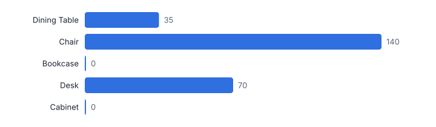
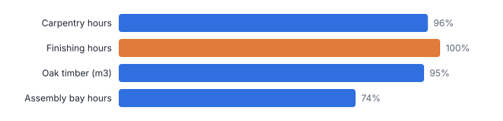
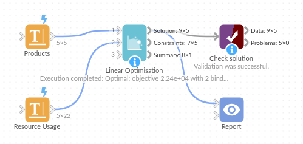

# Linear Optimisation

*Omniscope custom block · Analytics*

**The best plan under your constraints: product mix, allocation, blending or staffing, solved to optimality from a model kept as ordinary data, with the binding constraints and what extra capacity is worth.**

**Python** · pandas, numpy, scipy · installs scipy automatically

## The problem it solves

Many planning questions are optimisation problems in disguise: which mix of products makes the most profit with the machine hours, labour and materials available; which suppliers to buy from to meet demand at least cost; how many staff to roster per shift. Spreadsheets and rules of thumb get close but rarely to the best answer.

Linear Optimisation reads the model as data (variables in one table, constraints in another), solves it with the HiGHS solver, and reports the optimal plan, which constraints are binding and, for continuous models, the shadow price of each resource.

- **£22,400** maximum weekly profit
- **2** binding constraints
- **5** products, all whole units
- **£51** weekly profit from one more finishing hour (continuous model)

### How it works

- Input 1 lists the decision variables: name, objective coefficient (profit or cost per unit), optional bounds and a whole-number flag.
- Input 2 lists the constraints in long format: constraint, variable, coefficient, sense (<=, >=, =) and limit. This is the same shape as a bill of materials or a resource-usage table.
- Choose maximise or minimise and map the fields. scipy's HiGHS solver finds the optimum (linear or mixed-integer).
- Outputs: the optimal value per variable, constraint usage with slack, binding flag and shadow price, and a summary with status and objective value.

## What goes in

### Input 1: products (decision variables)

| Product | Profit Per Unit | Minimum Units | Maximum Demand | Whole Units |
|---|---|---|---|---|
| Dining Table | 180 | 0 | 60 | Yes |
| Chair | 45 | 120 | 400 | Yes |
| Bookcase | 95 | 0 | 80 | Yes |
| Desk | 140 | 10 | 70 | Yes |
| Cabinet | 120 | 0 | 50 | Yes |

*5 rows in the sample file.*

### Input 2: resource usage (constraints, long format)

Hours and timber per unit for each product and resource, with weekly capacities. Two extra rows say every dining table needs four chairs.

| Resource | Product | Usage Per Unit | Sense | Capacity |
|---|---|---|---|---|
| Carpentry hours | Dining Table | 6.0 | <= | 800 |
| Carpentry hours | Chair | 1.5 | <= | 800 |
| Carpentry hours | Bookcase | 4.0 | <= | 800 |
| Carpentry hours | Desk | 5.0 | <= | 800 |
| Carpentry hours | Cabinet | 5.0 | <= | 800 |
| Finishing hours | Dining Table | 3.0 | <= | 420 |
| Finishing hours | Chair | 1.0 | <= | 420 |
| Finishing hours | Bookcase | 2.0 | <= | 420 |
| Finishing hours | Desk | 2.5 | <= | 420 |
| Finishing hours | Cabinet | 3.0 | <= | 420 |

*22 rows in the sample file.*

## The options

| Option | Demo setting | What it does |
|---|---|---|
| Goal | `Maximise (profit, output)` | Whether the best plan has the highest or the lowest objective. |
| Variable name | `Product` | Names each decision variable, such as a product to make. |
| Objective coefficient | `Profit Per Unit` | Profit or cost per unit. |
| Lower bound (optional) | `Minimum Units` | Minimum value; empty means 0. |
| Upper bound (optional) | `Maximum Demand` | Maximum value; empty means no limit. |
| Whole-number flag (optional) | `Whole Units` | Yes / true / 1 for variables that must be whole numbers. |
| Constraint name | `Resource` | Names each constraint, such as a resource; one row per variable that uses it. |
| Variable | `Product` | Must match the variable names in input 1. |
| Coefficient | `Usage Per Unit` | Amount of the constraint used by one unit of the variable. |
| Sense | `Sense` | <=, >= or = (also: at most, at least, exactly). |
| Limit | `Capacity` | Right-hand side, such as capacity. |

## What comes out

### Solution

| Product | Profit Per Unit | Minimum Units | Maximum Demand | Whole Units | Optimal Value | Objective Contribution | At Bound | Reduced Cost |
|---|---|---|---|---|---|---|---|---|
| Dining Table | 180 | 0 | 60 | Yes | 35 | 6,300 |  |  |
| Chair | 45 | 120 | 400 | Yes | 140 | 6,300 |  |  |
| Bookcase | 95 | 0 | 80 | Yes | 0 | 0 | Lower |  |
| Desk | 140 | 10 | 70 | Yes | 70 | 9,800 | Upper |  |
| Cabinet | 120 | 0 | 50 | Yes | 0 | 0 | Lower |  |

### Constraints

| Constraint | Sense | Limit | Used | Slack | Binding | Shadow Price |
|---|---|---|---|---|---|---|
| Carpentry hours | <= | 800 | 770 | 30 | No |  |
| Finishing hours | <= | 420 | 420 | 0 | Yes |  |
| Oak timber (m3) | <= | 14 | 13.3 | 0.7 | No |  |
| Assembly bay hours | <= | 190 | 140 | 50 | No |  |
| Tables need 4 chairs | >= | 0 | 0 | 0 | Yes |  |

### Summary

| Status | Objective | Objective Value | Variables | Integer Variables | Constraints | Binding Constraints |
|---|---|---|---|---|---|---|
| Optimal | Maximise | 22,400 | 5 | 5 | 5 | 2 |

### Shadow prices (same model with continuous units)

How much weekly profit would rise for one more unit of each binding resource: the business case for overtime or more timber.

| Constraint | Used | Limit | Shadow Price |
|---|---|---|---|
| Finishing hours | 420 | 420 | 51.43 |
| Tables need 4 chairs | 0 | 0 | -6.43 |

*The profit-maximising weekly plan (synthetic data).*

*Capacity used per resource; orange bars are binding constraints, the bottlenecks.*

## Where it pays off

### Manufacturing: Product mix and capacity planning

Maximise contribution within machine, labour and material limits, and see which bottleneck is worth investing in from its shadow price.

### Logistics: Allocation and transport

Assign demand from customers to depots at least cost within depot capacities: a classic transportation problem in long-format data.

### Food, chemicals and agriculture: Blending

Cheapest blend of ingredients that meets nutritional or specification limits, recalculated as ingredient prices change.

### Retail and services: Staffing and budget allocation

Cover forecast demand per shift with the fewest staff hours, or split a marketing budget across channels with minimum and maximum spends.

*Use cases describe typical scenarios and are illustrative.*

## Why do this in Omniscope

- **The model is ordinary data.** Variables and constraints are tables, so profit per unit can come from a pricing table and capacities from a planning sheet through other blocks, and the plan re-solves when either changes.
- **Optimal and reproducible.** HiGHS solves to optimality, the tests check values and shadow prices on a textbook problem and that infeasible or unbounded models are reported rather than given a plan, and the same tables give the same plan on every run.
- **New constraints are new rows.** A minimum batch size or an extra resource is another row in the constraint table, not a change to the block, and scenario parameters for capacity or prices compare plans in the Report.

## How it fits into an Omniscope workflow

Products / costs (Database) + Resource usage → **Linear Optimisation** → Report

Keep the model in ordinary tables (or build it with Omniscope blocks from operational data: prices from a pricing table, capacities from a planning sheet), so the plan refreshes as inputs change.

Show the plan and the binding constraints in a Report; add scenario parameters (capacity, prices) to compare plans.

## In one step

A long-format constraint table that maps directly to resource-usage data, solved in one step with the open-source HiGHS solver through scipy; no licence needed.

## Try it

1. Open the demo project (`demo.iox` on the demo server, or import `demo.ioz` from this folder): five furniture products with profit per unit and demand limits, and a resource table of hours and timber per product.
2. The question: what should the workshop make this week to earn the most?
3. Open Linear Optimisation: maximise, map the variable and constraint fields. Run it.
4. Look at the plan and the profit (£22,400), then the constraints output: the binding ones are the bottlenecks.
5. Look at the shadow prices from the continuous model: what one more hour of the bottleneck resource is worth, which is the overtime business case.

## Running in Omniscope

*The demo project's workflow: the sample data, the block, and a Validate data check on its output.*

<!--language-->
## Language and libraries

Python. It uses pandas, numpy and scipy.

pandas and numpy are part of Omniscope's Docker Python image, and the block was run in both host mode and Docker mode on an Omniscope server, with the same results. It also uses scipy's HiGHS solver (linear and mixed-integer programming). Omniscope installs scipy automatically from the block's dependencies; in Docker mode it builds an image for the block the first time it runs.
<!--/language-->

## Tested

Run on an Omniscope server, the demo workflow finished without errors (5 records in Solution, 5 in Constraints and 1 in Summary). Automated tests also cover normal data, empty input, wrong types and large input.
