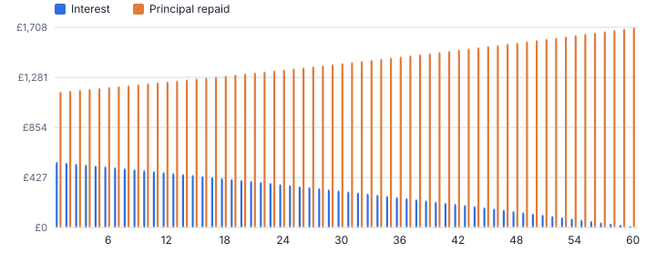
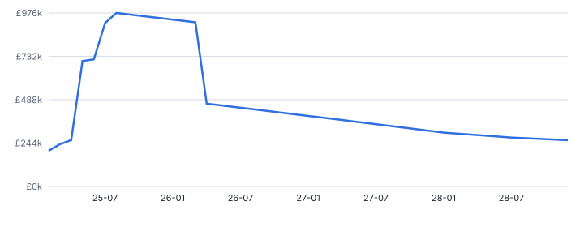
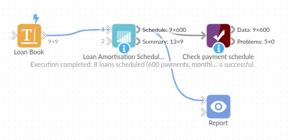

# Loan Amortisation Schedule

*Omniscope custom block · Analytics*

**Full payment schedules for a whole loan book in one step: repayment, equal principal, interest only and balloon structures, with interest, capital and balances per payment.**

**Python** · pandas, numpy · nothing extra to install

## The problem it solves

Lenders, lessors, treasury and finance teams need payment-level schedules: to forecast cash and interest income, reconcile statements, value a book or answer a customer. In spreadsheets each loan is its own tab; with core blocks it takes a row generator and running formulas to carry the balances forward.

Loan Amortisation Schedule takes a table of loans and returns every payment of every loan, with the summary figures alongside.

- **8 loans** scheduled in one run
- **600** payment rows
- **£383,449** total interest over the lives of the loans
- **1** invalid loan reported, not failed

### How it works

- Map principal, annual rate, term and (optionally) start date, balloon and a per-loan repayment type.
- Choose the payment frequency and whether the term is in months or years; percentage or fractional rates are detected.
- Each payment row has opening balance, payment, interest, principal repaid, closing balance and cumulative interest; the last payment clears the balance, including any balloon.
- The summary has the regular, first and final payments, totals, interest as a share of principal and the final payment date per loan.

## What goes in

### Loan book

Nine synthetic loans covering every structure, including a PCP-style balloon, a 0% loan and a row with a negative principal.

| Loan ID | Borrower Type | Product | Principal | Annual Rate % | Term Months | Start Date | Repayment Type | Balloon |
|---|---|---|---|---|---|---|---|---|
| L-1001 | SME | Equipment finance | 85000 | 7.9 | 60 | 2025-01-15 | Repayment | 0 |
| L-1002 | SME | Commercial vehicle | 42000 | 8.4 | 48 | 2025-02-01 | Repayment | 10000 |
| L-1003 | Consumer | Car finance (PCP) | 28500 | 9.9 | 48 | 2025-03-10 | Repayment | 11000 |
| L-1004 | SME | Working capital | 120000 | 9.25 | 36 | 2025-01-31 | Equal principal | 0 |
| L-1005 | Property | Bridging loan | 450000 | 10.5 | 12 | 2025-04-01 | Interest only | 0 |
| L-1006 | Consumer | Home improvement | 15000 | 6.9 | 60 | 2025-05-20 | Repayment | 0 |
| L-1007 | Property | Buy-to-let mortgage | 210000 | 5.35 | 300 | 2025-06-01 | Interest only | 0 |
| L-1008 | SME | Solar installation | 64000 | 0 | 36 | 2025-07-01 | Repayment | 0 |
| L-1009 | SME | Fit-out loan | -5000 | 8.0 | 24 | 2025-08-01 | Repayment | 0 |

*9 rows in the sample file.*

## The options

| Option | Demo setting | What it does |
|---|---|---|
| Loan ID (optional) | `Loan ID` | Names each loan in the schedule and summary. |
| Principal | `Principal` | Amount borrowed. |
| Annual interest rate | `Annual Rate %` | Percent (7.9) or fraction (0.079). |
| Term | `Term Months` | Length of the loan, in the unit set by Term is in. |
| Start date (optional) | `Start Date` | Payments fall one period after this date, then every period. |
| Balloon / residual (optional) | `Balloon` | Amount left to pay at the end, as in a lease or balloon loan. |
| Repayment type field (optional) | `Repayment Type` | Per-loan type; otherwise the default below is used. |
| Payment frequency | `Monthly` | How often payments fall due. |
| Term is in | `Months` | Whether the term field counts months or years. |

## What comes out

### Loan summary

| Loan ID | Repayment Type | Status | Principal | Annual Rate | Payments | Regular Payment | First Payment | Final Payment | Total Paid | Total Interest | Interest As Share Of Principal | Final Payment Date |
|---|---|---|---|---|---|---|---|---|---|---|---|---|
| L-1001 | Repayment (annuity) | OK | 85,000 | 0.079 | 60 | 1,719.43 | 1,719.43 | 1,719.43 | 103,165.71 | 18,165.71 | 0.21 | 2030-01-15 |
| L-1002 | Repayment (annuity) | OK | 42,000 | 0.084 | 48 | 857.24 | 857.24 | 10,857.24 | 51,147.32 | 9,147.32 | 0.22 | 2029-02-01 |
| L-1003 | Repayment (annuity) | OK | 28,500 | 0.099 | 48 | 533.76 | 533.76 | 11,533.76 | 36,620.25 | 8,120.25 | 0.28 | 2029-03-10 |
| L-1004 | Equal principal | OK | 120,000 | 0.0925 | 36 |  | 4,258.33 | 3,359.03 | 137,112.50 | 17,112.50 | 0.14 | 2028-01-31 |
| L-1005 | Interest only | OK | 450,000 | 0.105 | 12 | 3,937.50 | 3,937.50 | 453,937.50 | 497,250 | 47,250 | 0.1 | 2026-04-01 |
| L-1006 | Repayment (annuity) | OK | 15,000 | 0.069 | 60 | 296.31 | 296.31 | 296.31 | 17,778.65 | 2,778.65 | 0.19 | 2030-05-20 |
| L-1007 | Interest only | OK | 210,000 | 0.0535 | 300 | 936.25 | 936.25 | 210,936.25 | 490,875 | 280,875 | 1.34 | 2050-06-01 |
| L-1008 | Repayment (annuity) | OK | 64,000 | 0 | 36 | 1,777.78 | 1,777.78 | 1,777.78 | 64,000 | 0 | 0 | 2028-07-01 |
| L-1009 | Repayment (annuity) | Principal missing or not positive |  |  |  |  |  |  |  |  |  |  |

### Schedule: last payments of the PCP car finance (balloon in the final payment)

| Loan ID | Payment Number | Payment Date | Opening Balance | Payment | Interest | Principal Repaid | Closing Balance | Cumulative Interest |
|---|---|---|---|---|---|---|---|---|
| L-1003 | 45 | 2028-12-10 | 12,736.07 | 533.76 | 105.07 | 428.68 | 12,307.38 | 7,826.37 |
| L-1003 | 46 | 2029-01-10 | 12,307.38 | 533.76 | 101.54 | 432.22 | 11,875.17 | 7,927.91 |
| L-1003 | 47 | 2029-02-10 | 11,875.17 | 533.76 | 97.97 | 435.79 | 11,439.38 | 8,025.88 |
| L-1003 | 48 | 2029-03-10 | 11,439.38 | 11,533.76 | 94.37 | 11,439.38 | 0 | 8,120.25 |

*In a repayment loan the interest share falls and the capital share rises with every payment (synthetic data).*

*Outstanding balance of the whole book, from the schedule output.*

## Where it pays off

### Lending and asset finance: Book-level cash and interest forecasts

Project interest income and capital repayments month by month across the book, by product or broker.

### Corporate treasury: Debt schedules

Schedule every facility's interest and repayments for cash-flow forecasts and covenant reporting.

### Leasing and car finance: PCP and balloon products

Show customers and auditors the payment profile with the residual value, and track the residual exposure across the book.

### Property: Mortgage and bridging portfolios

Interest-only and repayment structures side by side, with remaining balances at any date.

*Use cases describe typical scenarios and are illustrative.*

## Why do this in Omniscope

- **Forecast and statements from one schedule.** The loan book is read from the database and scheduled in one run; an Aggregate by month gives the cash and interest forecast, a filter on one loan a customer statement, and a join to actual payments the arrears.
- **Balances that close to zero.** The last payment clears each balance, balloon included, the tests check annuity payments against a known value and cover zero-rate and quarterly loans, and a loan with bad inputs is reported without stopping the run.
- **Structures written in Python.** Repayment, equal principal and interest only are handled separately in the script, so a payment holiday or a stepped rate can be added beside them.

## How it fits into an Omniscope workflow

Loan book (Database) → **Loan Amortisation Schedule** → Aggregate (by month) → Report

Aggregate the schedule by month for cash and interest forecasts, or filter to one loan for a customer statement.

Join actual payments to the schedule to find arrears; feed the summary into Tile or ABC Classification to segment the book.

## In one step

No loops or carry-forward formulas: one block for any number of loans and the three common structures.

## Try it

1. Open the demo project (`demo.iox` on the demo server, or import `demo.ioz` from this folder): a small loan book with every structure in it.
2. The question: what does each loan pay each month, and how much interest will the book earn?
3. Open the block: principal, rate, term, start date, balloon and the repayment type field. Run it.
4. Look at the summary: regular payments and total interest per loan, and the invalid loan flagged with its reason.
5. Look at the PCP loan's last rows (the balloon in the final payment) and the interest / principal chart; then aggregate the schedule by month for a cash forecast.

## Running in Omniscope

*The demo project's workflow: the sample data, the block, and a Validate data check on its output.*

<!--language-->
## Language and libraries

Python. It uses pandas and numpy.

pandas and numpy are part of Omniscope's Docker Python image, and the block was run in both host mode and Docker mode on an Omniscope server, with the same results. It needs nothing else installed.
<!--/language-->

## Tested

Run on an Omniscope server, the demo workflow finished without errors (600 records in Payment schedule and 9 in Loan summary). Automated tests also cover normal data, empty input, wrong types and large input.
