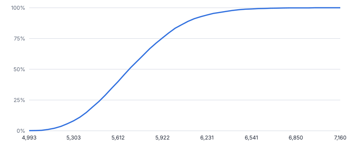
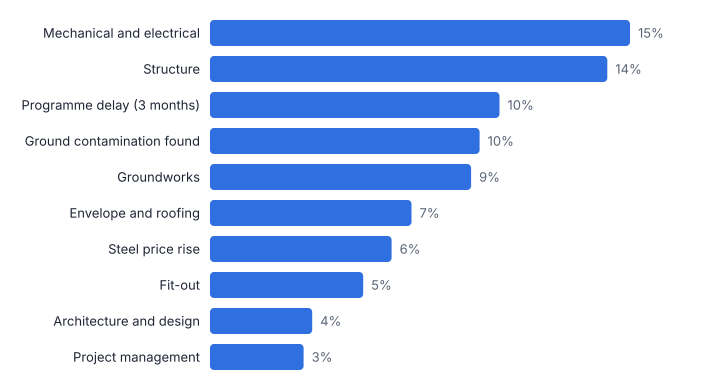
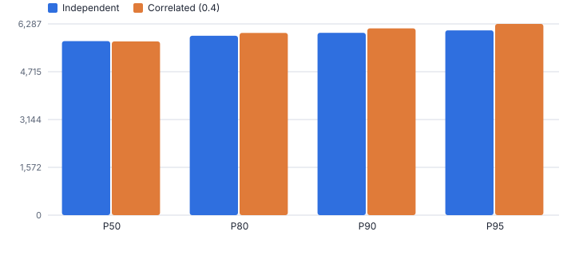
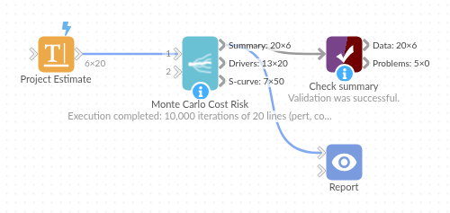

# Monte Carlo Cost Risk

*Omniscope custom block · Analytics*

**Turn low / most likely / high estimates and a risk register into P50, P80 and P90 totals, the contingency to hold, and the lines that drive the uncertainty.**

**Python** · pandas, numpy · nothing extra to install

## The problem it solves

Adding up the most likely value of every line gives a total that is very likely to be exceeded: costs are skewed upwards, risks may or may not happen, and related lines move together. A single-figure estimate hides all of that, and contingency ends up as a round percentage.

This block simulates the estimate thousands of times: each line from its three-point estimate, each risk with its probability, with optional correlation, and reports the total at each confidence level, the contingency needed, the chance of exceeding a budget, and which lines matter most.

- **£5.38m** base estimate (sum of most likely, illustrative)
- **88%** chance the outturn exceeds the base
- **£607k** contingency needed for 80% confidence
- **71%** confidence that a £5.9m budget is enough

### How it works

- Connect the estimate lines with a name and low, most likely and high values; optionally a probability (for risk events) and a group (work package).
- Choose the distribution (PERT, triangular or uniform), the number of iterations, the correlation between lines, a random seed and an optional target or budget.
- Outputs: the summary for the total and each group, the drivers (tornado), and the S-curve.

## What goes in

### Project estimate

Invented building project: 15 cost lines and 5 risk events (GBP thousands).

| Package | Line Item | Low (GBP k) | Most Likely (GBP k) | High (GBP k) | Probability |
|---|---|---|---|---|---|
| Design | Architecture and design | 180 | 210 | 290 |  |
| Design | Planning and surveys | 45 | 55 | 80 |  |
| Design | Specialist consultants | 60 | 75 | 120 |  |
| Build | Groundworks | 420 | 480 | 690 |  |
| Build | Structure | 1150 | 1260 | 1520 |  |
| Build | Envelope and roofing | 610 | 660 | 820 |  |
| Build | Mechanical and electrical | 880 | 950 | 1300 |  |
| Build | Fit-out | 540 | 590 | 700 |  |
| Build | External works | 160 | 190 | 260 |  |
| IT and equipment | Network and data | 140 | 155 | 190 |  |
| IT and equipment | AV and security systems | 90 | 105 | 150 |  |
| IT and equipment | Furniture and equipment | 210 | 230 | 260 |  |
| Management | Project management | 260 | 290 | 360 |  |
| Management | Commissioning and handover | 70 | 80 | 110 |  |
| Management | Legal and fees | 50 | 55 | 70 |  |
| Risks | Ground contamination found | 80 | 150 | 400 | 0.25 |
| Risks | Steel price rise | 60 | 120 | 220 | 0.4 |
| Risks | Planning condition changes | 20 | 45 | 90 | 0.3 |
| Risks | Programme delay (3 months) | 150 | 220 | 350 | 0.2 |
| Risks | Utility connection upgrade | 40 | 70 | 130 | 0.35 |

*20 rows in the sample file.*

## The options

| Option | Demo setting | What it does |
|---|---|---|
| Line name | `Line Item` | Names each estimate line or risk. |
| Low estimate | `Low (GBP k)` | Optimistic cost of the line. |
| Most likely estimate | `Most Likely (GBP k)` | Most likely cost of the line. |
| High estimate | `High (GBP k)` | Pessimistic cost of the line. |
| Probability (optional) | `Probability` | For risk events; empty = always occurs. |
| Group (optional) | `Package` | For example work package. |
| Correlation between lines | `0.4` | 0 = independent; 0.3 to 0.5 is common for related costs. |
| Target or budget (optional) | `5900` | Reports the chance of exceeding it. |
| Distribution | `PERT` | Shape of each line's range. PERT weights the most likely value; triangular gives more weight to the extremes. |
| Iterations | `10000` | Number of simulated totals. More gives steadier percentiles. |
| Random seed | `1` | Fixes the random numbers, so a rerun gives the same results. |

## What comes out

### Summary (total and packages, GBP k)

| Scope | Base Estimate (most likely) | Expected Risk Events | Mean | P10 | P50 | P80 | P90 | Contingency To P80 | Contingency To P90 | Probability Over Base |
|---|---|---|---|---|---|---|---|---|---|---|
| Total | 5,385 | 167.50 | 5,736.43 | 5,352 | 5,711 | 5,992 | 6,141.46 | 607 | 756.46 | 0.88 |
| Build | 4,130 | 0 | 4,262.67 | 4,019.51 | 4,249.49 | 4,427.45 | 4,519.23 | 297.45 | 389.23 | 0.73 |
| Design | 340 | 0 | 355.50 | 318.89 | 353 | 380.83 | 395.61 | 40.8 | 55.6 | 0.67 |
| IT and equipment | 490 | 0 | 499.92 | 471.14 | 498.86 | 519.29 | 530 | 29.3 | 40 | 0.65 |
| Management | 425 | 0 | 436.43 | 406 | 434.51 | 457.81 | 469.89 | 32.8 | 44.9 | 0.65 |
| Risks | 0 | 167.50 | 181.91 | 0 | 158.31 | 302.41 | 390.22 | 302.41 | 390.22 | 0.83 |

### Top ten drivers

| Line Item | Package | Low | Most Likely | High | Probability | Mean | P10 | P90 | Share Of Variance | Driver Rank |
|---|---|---|---|---|---|---|---|---|---|---|
| Mechanical and electrical | Build | 880 | 950 | 1,300 | 1 | 995.83 | 911.12 | 1,096.52 | 0.148 | 1 |
| Structure | Build | 1,150 | 1,260 | 1,520 | 1 | 1,285.28 | 1,199.72 | 1,378.68 | 0.14 | 2 |
| Programme delay (3 months) | Risks | 150 | 220 | 350 | 0.2 | 45.84 | 0 | 227.33 | 0.102 | 3 |
| Ground contamination found | Risks | 80 | 150 | 400 | 0.25 | 45.3 | 0 | 191.61 | 0.095 | 4 |
| Groundworks | Build | 420 | 480 | 690 | 1 | 506.33 | 447.40 | 573.77 | 0.092 | 5 |
| Envelope and roofing | Build | 610 | 660 | 820 | 1 | 678.52 | 632.17 | 731.08 | 0.071 | 6 |
| Steel price rise | Risks | 60 | 120 | 220 | 0.4 | 50.73 | 0 | 148.83 | 0.064 | 7 |
| Fit-out | Build | 540 | 590 | 700 | 1 | 600.01 | 562.94 | 641.02 | 0.054 | 8 |
| Architecture and design | Design | 180 | 210 | 290 | 1 | 218.14 | 193.78 | 245.73 | 0.036 | 9 |
| Project management | Management | 260 | 290 | 360 | 1 | 296.52 | 273.53 | 322.48 | 0.033 | 10 |

*Read off any confidence level: P50 £5,711k, P80 £5,992k, P90 £6,141k (illustrative).*

*The largest build lines and the risk events top the list; the five risks together account for 30% of the variance.*

*Assuming the lines are independent understates the P90 by £148k: related costs tend to overrun together.*

## Where it pays off

### Construction and infrastructure: Cost estimates and contingency

Quantitative cost risk analysis for business cases: P50 and P80 estimates and the contingency to hold, from the estimate and the risk register.

### IT and change: Programme budgets

Three-point estimates for workstreams with delivery risks, to set a budget the programme board can defend.

### Finance: Budget and forecast ranges

A range for next year's costs from line-level uncertainty, instead of a single number.

### Bids and tenders: Pricing risk

The chance that a fixed-price bid loses money at each price point, before the bid is submitted.

*Use cases describe typical scenarios and are illustrative.*

## Why do this in Omniscope

- **Estimate and register feed the model.** The three-point estimate and the risk register stay in a spreadsheet or Data Table block, and the S-curve, tornado and contingency by package in the Report update when either changes.
- **Same seed, same percentiles.** A fixed random seed gives the same P50, P80 and P90 on unchanged inputs, and the tests check that correlating the lines widens the spread, so a movement in P80 traces back to the estimate or the register.
- **Distributions as options.** PERT, triangular or uniform, the correlation and the budget to test are all options; another shape, such as lognormal for long-tailed lines, can be coded into the simulation.

## How it fits into an Omniscope workflow

Estimate / risk register (spreadsheet or database) → **Monte Carlo Cost Risk** → Report (S-curve, tornado, table)

Keep the estimate and risk register in a spreadsheet or Data Table block; re-run whenever they change.

Chart the S-curve as a line, the drivers as a bar chart, and show contingency by package; the fixed seed keeps the numbers stable between runs.

The fixed seed and the block's tests make the percentiles repeatable, so a change in P80 after a re-run comes from a changed estimate or risk register, not from the simulation.

## In one step

Three-point and risk-event simulation with correlation, giving percentiles, contingency and the main drivers.

## Try it

1. Open the demo project (`demo.iox` on the demo server, or import `demo.ioz` from this folder): an invented project estimate with five risk events.
2. The question: the estimate adds up to £5,385k; how likely is it to come in on budget, and what contingency should we hold?
3. Open the block: three-point fields, probability, package, PERT, 10,000 iterations, correlation 0.4, target 5,900. Run it.
4. Look at the summary: 88% chance of exceeding the base; £607k contingency for P80.
5. Look at the drivers and the comparison with independent lines: where to focus risk management, and why correlation matters.

## Running in Omniscope

*The demo project's workflow: the sample data, the block, and a Validate data check on its output.*

<!--language-->
## Language and libraries

Python. It uses pandas and numpy.

pandas and numpy are part of Omniscope's Docker Python image, and the block was run in both host mode and Docker mode on an Omniscope server, with the same results. It needs nothing else installed.
<!--/language-->

## Tested

On an Omniscope server the demo workflow ran cleanly: 6 records in Summary, 20 in Drivers and 50 in S-curve. The automated tests check normal data, empty input, wrong types and large input.
