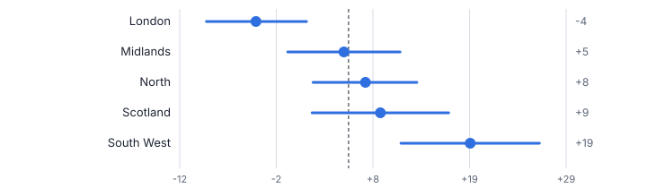
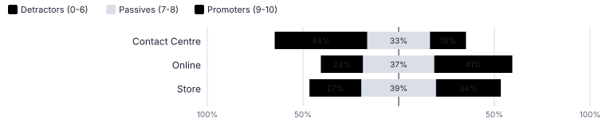
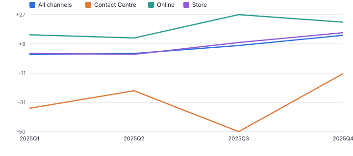
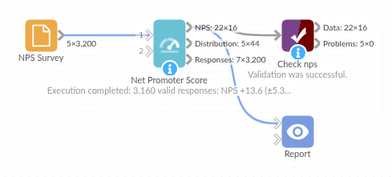

# Net Promoter Score

*Omniscope custom block · Analytics*

**Net Promoter Score per group and period with the margin of error, so a change of a few points is not reported as news when it is noise.**

**Python** · pandas, numpy · nothing extra to install

## The problem it solves

NPS is simple to calculate and easy to over-read. A store, agent or month with 40 responses can move 20 points by chance, and dashboards that show only the score invite the wrong conversations: celebrating noise, or chasing a team whose score is within the margin of error.

This block calculates NPS the standard way and adds what an analyst would: the margin of error and confidence interval, survey weights, a test of each group against the rest and of each period against the previous one, plus the score distribution and per-response NPS points for any further slicing.

- **3,160** valid responses (40 blank or 'Don't know' skipped)
- **+5.7** overall NPS, ±2.8 at 95%
- **-30** Contact Centre NPS, significantly below the rest
- **-27** Contact Centre change in Q3, flagged lower

### How it works

- Connect survey responses with a 0-10 likelihood-to-recommend answer. Text answers such as *Don't know* and blanks are skipped and counted.
- Optionally choose group fields (region, store, channel, agent), a weight field and a date field with a reporting period (month, quarter, year).
- Set the confidence level for the margin of error and the tests, and the response count below which rows are flagged as small samples.
- Outputs: the NPS table, the 0-10 distribution per group, and the responses with `NPS Category` and `NPS Points` (+100 / 0 / -100).

## What goes in

### NPS survey

3,200 synthetic responses over 2025 by region and channel, with a few blank and "Don't know" answers (illustrative).

| Response ID | Response Date | Region | Channel | Likelihood To Recommend |
|---|---|---|---|---|
| R02809 | 2025-01-01 | Midlands | Store | 9 |
| R02285 | 2025-01-01 | Midlands | Online | 10 |
| R02779 | 2025-01-01 | London | Online | 6 |
| R00105 | 2025-01-01 | North | Online | 9 |
| R00713 | 2025-01-01 | Midlands | Online | 5 |
| R01347 | 2025-01-01 | South West | Online | 9 |

*3,200 rows in the sample file.*

## The options

| Option | Demo setting | What it does |
|---|---|---|
| Score field (0-10) | `Likelihood To Recommend` | The answer to the likelihood-to-recommend question, from 0 to 10. |
| Group by (optional) | `Channel` | For example Region or Channel. |
| Date field (optional) | `Response Date` | Needed to report by period. |
| Report by period | `Quarter` | Adds a row per period, compared with the period before. Needs a date field. |
| Confidence level | `0.95` | For the margin of error and significance tests. |
| Small sample below | `30` | Rows with fewer responses are flagged. |

## What comes out

### NPS by channel and quarter

| Channel | Period | Responses | % Promoters | % Detractors | NPS | Margin Of Error | CI Low | CI High | Vs Rest | Change Vs Previous | Change Significant |
|---|---|---|---|---|---|---|---|---|---|---|---|
| All | 2025Q1 | 788 | 32.9 | 32 | 0.9 | 5.6 | -4.7 | 6.5 |  |  |  |
| All | 2025Q2 | 791 | 32.2 | 30.6 | 1.6 | 5.5 | -3.9 | 7.2 |  | 0.8 | Not significant |
| All | 2025Q3 | 795 | 35.6 | 28.8 | 6.8 | 5.6 | 1.2 | 12.4 |  | 5.1 | Not significant |
| All | 2025Q4 | 786 | 36.5 | 22.9 | 13.6 | 5.3 | 8.3 | 18.9 |  | 6.8 | Not significant |
| Contact Centre | 2025Q1 | 133 | 20.3 | 54.9 | -34.6 | 13.5 | -48.1 | -21.1 | Lower |  |  |
| Contact Centre | 2025Q2 | 135 | 23 | 45.9 | -23 | 13.5 | -36.4 | -9.5 | Lower | 11.6 | Not significant |
| Contact Centre | 2025Q3 | 132 | 9.8 | 59.8 | -50 | 11.4 | -61.4 | -38.6 | Lower | -27 | Lower |
| Contact Centre | 2025Q4 | 137 | 21.9 | 33.6 | -11.7 | 12.3 | -24 | 0.6 | Lower | 38.3 | Higher |
| Online | 2025Q1 | 346 | 38.7 | 24.9 | 13.9 | 8.3 | 5.6 | 22.1 | Higher |  |  |
| Online | 2025Q2 | 348 | 37.1 | 25.3 | 11.8 | 8.2 | 3.6 | 20 | Higher | -2.1 | Not significant |
| Online | 2025Q3 | 335 | 46.6 | 19.4 | 27.2 | 8.2 | 19 | 35.4 | Higher | 15.4 | Higher |
| Online | 2025Q4 | 342 | 40.9 | 18.7 | 22.2 | 7.8 | 14.4 | 30.1 | Higher | -4.9 | Not significant |
| Store | 2025Q1 | 309 | 31.7 | 30.1 | 1.6 | 8.8 | -7.1 | 10.4 | Not significant |  |  |
| Store | 2025Q2 | 308 | 30.8 | 29.9 | 1 | 8.7 | -7.7 | 9.7 | Not significant | -0.6 | Not significant |
| Store | 2025Q3 | 328 | 34.8 | 25.9 | 8.8 | 8.4 | 0.5 | 17.2 | Not significant | 7.9 | Not significant |
| Store | 2025Q4 | 307 | 38.1 | 22.8 | 15.3 | 8.6 | 6.7 | 23.9 | Not significant | 6.5 | Not significant |

### Score distribution (all channels)

| Channel | Score | Category | Responses | Share |
|---|---|---|---|---|
| All | 0 | Detractor | 2 | 0.001 |
| All | 1 | Detractor | 7 | 0.002 |
| All | 2 | Detractor | 17 | 0.005 |
| All | 3 | Detractor | 57 | 0.018 |
| All | 4 | Detractor | 130 | 0.041 |
| All | 5 | Detractor | 277 | 0.088 |
| All | 6 | Detractor | 413 | 0.131 |
| All | 7 | Passive | 554 | 0.175 |
| All | 8 | Passive | 619 | 0.196 |
| All | 9 | Promoter | 502 | 0.159 |
| All | 10 | Promoter | 582 | 0.184 |

*The line is overall NPS; each bar shows how far a region's score could move by chance. London is lowest at -4 (synthetic data).*

*Nearly half of Contact Centre respondents are detractors (synthetic data).*

*Quarterly NPS: the Contact Centre dip in Q3 is flagged as significant; most other quarter-on-quarter moves are not (synthetic data).*

## Where it pays off

### Retail and hospitality: Store and site league tables

NPS per store with margins of error, so area managers act on stores that are significantly below the rest, not on the ones with the fewest responses.

### Telecoms and utilities: Journey and channel NPS

Transactional NPS by contact channel and reason, with month-on-month changes tested before they reach the board pack.

### SaaS and B2B: Relationship NPS by segment

Account-weighted NPS (weights by revenue or seats) by plan, region and customer age.

### Public sector and healthcare: Friends and family style surveys

Recommendation scores per ward, practice or service with small samples flagged.

*Use cases describe typical scenarios and are illustrative.*

## Why do this in Omniscope

- **League table to owner alert.** Responses load on a schedule, Data Cleansing tidies group names upstream, and groups whose change is significantly lower go to their owners by Email output, with the league table and trend in the Report.
- **Noise labelled as noise.** Every group and period gets a margin of error and a test against the rest or the previous period, groups under 30 responses are flagged, and the tests check the error, the weighted effective sample size and skipped invalid scores.
- **Points for any other slice.** The responses output carries NPS Points (+100, 0, -100) per answer, so averaging it in any Report view gives NPS by a field the block was never told about.

## How it fits into an Omniscope workflow

Survey export (file, database or API) → **Net Promoter Score** → Report (league table, trend, distribution) → Email output (alerts)

Load survey responses on a schedule; Data Cleansing upstream can tidy free-text group names.

Show the NPS table and trend in a Report; filter rows where `Change Significant` is Lower to alert owners. The responses output with NPS Points lets any Report re-aggregate NPS by any field as an average.

## In one step

Categories, NPS, margin of error and significance tests, with weights and period-on-period changes.

## Try it

1. Open the demo project (`demo.iox` on the demo server, or import `demo.ioz` from this folder): a year of synthetic survey responses by channel and region.
2. The question: what is our NPS, which channel is dragging it down, and did anything really change this year?
3. Open the block: choose the score field, group by Channel, date field and Quarter. Run it.
4. Look at the table: overall +5.7 ±2.8; Contact Centre -30, flagged lower than the rest.
5. Look at the trend: the Contact Centre Q3 dip (-27) is significant, while most other moves are flagged not significant, which is why the block reports the margin of error.

## Running in Omniscope

*The demo project's workflow: the sample data, the block, and a Validate data check on its output.*

<!--language-->
## Language and libraries

Python. It uses pandas and numpy, plus the Python standard library (math).

pandas and numpy are part of Omniscope's Docker Python image, and the block was run in both host mode and Docker mode on an Omniscope server, with the same results. It needs nothing else installed.
<!--/language-->

## Tested

Run on an Omniscope server, the demo workflow finished without errors (16 records in NPS, 44 in Score distribution and 3,200 in Responses). Automated tests also cover normal data, empty input, wrong types and large input.
