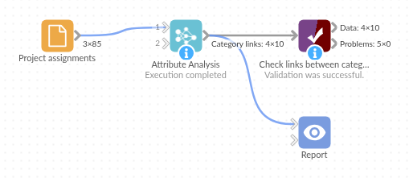

# Attribute Analysis

*Omniscope custom block · Analytics · Network Analysis*

**Which departments work on the same projects, which customer segments buy the same products? A table of how much each group's connections overlap with each other group's, from a plain list of who is connected to what.**

**R** · data.table · install data.table on the server's R if missing

## The problem it solves

A company keeps a list of who works on which project. Managers want to know which departments actually collaborate: does Sales work with Marketing, or with Finance? Does Engineering work with Operations as much as Operations works with Engineering? The list has one record per person and project; the answer needs every person rolled up to their department and every project to the departments that meet there.

The block does that roll-up. For each pair of departments it gives the share of the first department's assignments that are on projects the second department also works on.

- **73 %** of Engineering's assignments are on projects shared with Operations; **62 %** the other way round
- **19 %** of Engineering's assignments are on a project no other department works on
- **10** department pairs that meet on at least one project, out of 20 possible

### How it works

- Each record is one connection: a person (From), a project (To) and the person's department (Category).
- Each department's assignments share a weight of 1, so a large department does not outweigh a small one.
- At each project, an assignment is split between the *other* departments there, in proportion to how strongly each works on it.
- **Probability** for a pair adds those parts up; a department's row adds up to at most 1.

## What goes in

### Project assignments

85 invented assignments of 36 people in five departments to 16 projects.

| Person | Project | Department |
|---|---|---|
| P05 | PRJ-01 | Sales |
| P06 | PRJ-01 | Sales |
| P09 | PRJ-01 | Sales |
| P11 | PRJ-01 | Marketing |
| P15 | PRJ-01 | Marketing |
| P06 | PRJ-02 | Sales |

*85 rows in the sample file; one assignment (P08 on PRJ-02) has no department and is left out.*

## The options

| Option | Demo setting | What it does |
|---|---|---|
| From field | `Person` | The node that has the category. |
| To field | `Project` | The node the categories share. |
| Category field | `Department` | The person's department. |

## What comes out

### Category links

| From category | To category | Probability | Connections |
|---|---|---|---|
| Engineering | Operations | 0.731 | 26 |
| Engineering | Marketing | 0.077 | 26 |
| Finance | Operations | 0.667 | 6 |
| Finance | Sales | 0.333 | 6 |
| Marketing | Sales | 0.857 | 14 |
| Marketing | Engineering | 0.143 | 14 |
| Operations | Engineering | 0.625 | 16 |
| Operations | Finance | 0.375 | 16 |
| Sales | Marketing | 0.682 | 22 |
| Sales | Finance | 0.318 | 22 |

Engineering's two rows add up to 0.81: the other 0.19 is its work on a project staffed only by engineers. Marketing works mostly with Sales (0.86), while Sales splits its shared work between Marketing (0.68) and Finance (0.32). Finance (6 assignments) rests on little data: the Connections field says so.

## Where it pays off

### Organisations: Who works with whom

From project, ticket or meeting records, see which departments, offices or teams share work, and which work alone.

### Retail: Segments with shared tastes

From purchases (customer to product, with the customer's segment), find which segments buy the same products, for shared promotions or range planning.

### Research: Fields that meet

From authors and journals or grants, see which disciplines publish in the same places.

### Healthcare and services: Shared providers

From patients or clients and the providers they use, with a region or plan, see which groups rely on the same providers.

*Use cases describe typical scenarios and are illustrative; the sample data is invented.*

## Why do this in Omniscope

- **From the assignment list to a collaboration matrix in one workflow**: the block reads the project records straight from their source, and its output feeds a Pivot view of From category by To category, so the managers' report is rebuilt whenever the assignments change.
- **Recomputed, not pasted**: the weights and splits are worked out the same way on every run, so this quarter's matrix can be appended to last quarter's and compared pair by pair.
- **Categories you choose at run time**: swap the Category field to Office or Grade in the block's options and the same network is rolled up a different way; the R script is open in the block's editor if you want, say, raw counts instead of weighted shares.

## How it fits into an Omniscope workflow

Assignments (Database) + Staff (File) → Join (department onto each assignment) → **Attribute Analysis** → Pivot view (From category by To category, Probability) in a Report

If the category is held in a separate list of people, join it onto the connection records first, so that each record carries the From node's category.

## Try it

1. Open the demo project (`demo.iox` on the demo server, or import `demo.ioz` from this folder): 85 invented project assignments.
2. The question: which departments work on the same projects?
3. Open Attribute Analysis: From field Person, To field Project, Category field Department. Run it.
4. Look at the output: 10 department pairs; Marketing to Sales is the strongest link (0.857), Engineering to Marketing the weakest (0.077).
5. Add up Engineering's two rows (0.81): the rest is its work on a project no other department touches.

## Running in Omniscope

*The demo project's workflow: the sample data, the block, and a Validate data check on its output.*

<!--language-->
## Language and libraries

R. It uses the data.table package (MPL-2.0).

data.table is not part of base R: install it on the Omniscope server's R if it is missing (`install.packages("data.table")`).
<!--/language-->

## Tested

The block is covered by automated tests that run its script against a stand-in for Omniscope's R API: the sample data against the previous version's values, a worked example checked by hand, numeric node IDs, missing values, one category or nothing shared, empty input, missing choices and fields, and 200,000 connections.
