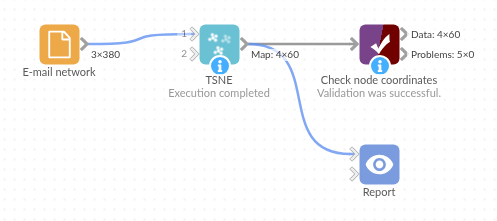

# TSNE

*Omniscope custom block · Analytics · Network Analysis*

**Turn a list of who-contacts-whom into a map where each node sits next to the nodes it shares connections with, as two ordinary fields you can plot, filter and join.**

**R** · Rtsne, data.table · install both on the server's R if missing

## The problem it solves

An organisation has a quarter's e-mail log: who wrote to whom, and how often. It wants to see how people actually group together, which may or may not follow the org chart. A drawing of 60 people and 380 links is a tangle; a table of counts is unreadable.

The block describes each person by whom they exchange e-mails with, and places people with similar contacts near each other. Groups of people who work together show up as clusters of points, with no team information given to the block.

- **60 of 60** people placed next to someone from their own team, though the block never saw the team names
- **3** separate clusters, one per team, on a scatter chart of Dimension 1 against Dimension 2
- **1** fixed seed: rerun on the same log, every point lands in the same place

### How it works

- Each record is one connection (sender, recipient, number of e-mails); connections count in both directions, and repeats add up.
- Each person's row of connection weights is reduced to 25 dimensions with PCA.
- t-SNE places the people on a 2-D map, keeping each person's nearest neighbours (in contact terms) close.
- The output has one record per person with **Dimension 1**, **Dimension 2** and **Connections**.

## What goes in

### E-mail network

380 invented records: a sender, a recipient and the number of e-mails between them in the quarter, for 60 staff.

| From | To | Emails |
|---|---|---|
| Fin-01 | Fin-04 | 10 |
| Fin-01 | Fin-05 | 12 |
| Fin-01 | Fin-18 | 13 |
| Fin-01 | Fin-08 | 11 |

*380 rows in the sample file; one has no count and is left out. The names start with the team (Fin, Log, Pro) so the result is easy to check; the block does not use that.*

## The options

| Option | Demo setting | What it does |
|---|---|---|
| From field | `From` | One end of each connection. |
| To field | `To` | The other end. |
| Weight field | `Emails` | How strong each connection is. |
| Number of output dimensions | 2 | Two coordinates per person. |
| PCA dimensions | 25 | Detail kept before t-SNE. |
| Perplexity | 15 | Roughly how many neighbours each person takes into account. |

## What comes out

### Map (first 6)

| Node | Dimension 1 | Dimension 2 | Connections |
|---|---|---|---|
| Fin-01 | -2.109124 | 6.812777 | 10 |
| Fin-04 | 2.289994 | 6.804985 | 12 |
| Fin-05 | 2.650993 | 5.171562 | 12 |
| Fin-18 | 0.783911 | 4.649844 | 10 |
| Fin-08 | 1.285056 | 5.279385 | 11 |
| Pro-10 | -6.351652 | -1.228815 | 14 |

### Where the teams land

| Team (from the names) | Dimension 1 range | Dimension 2 range |
|---|---|---|
| Finance | -2.1 to 2.7 | 4.6 to 8.7 |
| Logistics | 2.4 to 8.3 | -6.4 to -1.2 |
| Product | -9.6 to -3.3 | -3.6 to 1.2 |

Three clusters that do not overlap. Connections (8 to 19 per person) can size the points, so the busiest people, such as Pro-09 with 19, stand out.

## Where it pays off

### Organisations: How people really work together

From e-mail, chat or meeting records, see the working groups that exist in practice, and who sits between them.

### Retail: Customers and products

From purchases (customer to product), customers who buy the same things land together, and so do products bought by the same customers.

### Web and content: Pages and links

From page-to-page links or co-visits, see which pages form natural sections of a site.

### Research: Citation and collaboration networks

From co-authorship or citation records, see the communities in a field.

*Use cases describe typical scenarios and are illustrative; the sample data is invented.*

## Why do this in Omniscope

- **A map that is just two more fields**: Dimension 1 and Dimension 2 come out as ordinary fields, so a Join brings in each person's team or office for colour, and a scatter chart in the Report shows the map next to the e-mail figures behind it.
- **The same map every run**: t-SNE starts from random positions; the block fixes the seed, so rerunning the workflow on an unchanged log gives identical coordinates, so the Report's map doesn't shift between refreshes, while a scheduled run on next quarter's log gives the new map.
- **Straight from connection records**: the block builds the node-by-node table from a plain list of connections itself, adding up repeated pairs and counting both directions; the R script, open in the block's editor, is where to change the number of iterations or try another layout package.

## How it fits into an Omniscope workflow

E-mail log (Database) → Aggregate (From, To: count) → **TSNE** → Join (staff list: team, office) → Report (scatter of Dimension 1 by Dimension 2, coloured by team)

If the source has one record per message, aggregate it to one record per pair with a count first, or feed it as it is: repeated pairs are added up either way.

## Try it

1. Open the demo project (`demo.iox` on the demo server, or import `demo.ioz` from this folder): 380 invented e-mail counts between 60 staff.
2. The question: which groups of people work together?
3. Open TSNE: From field From, To field To, Weight field Emails, the other options at their defaults. Run it.
4. Look at the output: 60 records, one per person. In a scatter chart of Dimension 1 against Dimension 2, three separate clusters appear.
5. Colour the points by the first three letters of Node (Fin, Log, Pro): each cluster is one team.

## Running in Omniscope

*The demo project's workflow: the sample data, the block, and a Validate data check on its output.*

<!--language-->
## Language and libraries

R. It uses the Rtsne package (BSD 3-Clause; the Barnes-Hut t-SNE code it wraps is under a BSD licence with an advertising clause) for t-SNE, and data.table (MPL-2.0).

Neither is part of base R: install them on the Omniscope server's R if they are missing (`install.packages(c("Rtsne", "data.table"))`).
<!--/language-->

## Tested

The block is covered by automated tests that run its script against a stand-in for Omniscope's R API: the sample data (every person next to their own team), repeated runs, nodes that only receive connections, repeated connections, numeric node IDs, no weight, one to three dimensions, an empty Weight option, empty input, bad options and inputs (perplexity too large, too many dimensions, text or negative weights, missing choices and fields), and 1,000 nodes.
