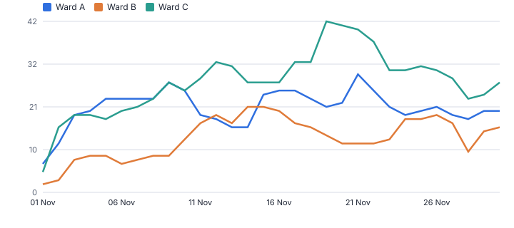
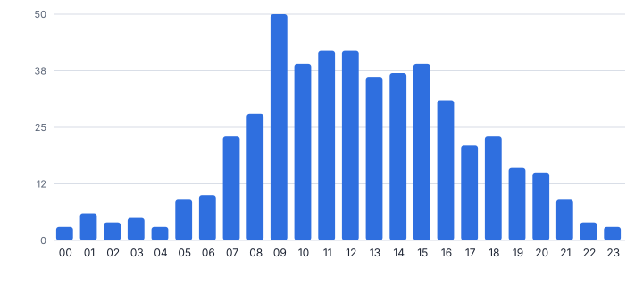
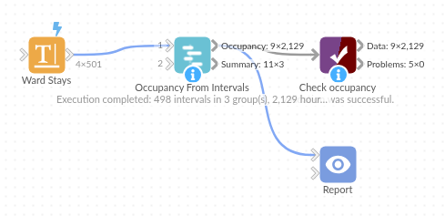

# Occupancy From Intervals

*Omniscope custom block · Analytics*

**Turn start and end times into occupancy over time: average and peak in every hour or day, utilisation against capacity, and time spent over capacity.**

**Python** · pandas, numpy · nothing extra to install

## The problem it solves

Bed managers, car park operators, facilities teams and IT capacity planners all ask the same question: how many are in at once? The data is a list of stays, sessions or bookings with start and end times, and turning it into occupancy usually means generating a row per hour per stay, which is slow and approximate.

This block sweeps every start and end exactly, giving time-weighted average and peak occupancy per bucket and per group, utilisation against capacity, and hours over capacity.

- **498** ward stays (synthetic)
- **3** wards with their own bed numbers
- **82%** highest average utilisation (Ward C)
- **183 h** over capacity across the month

### How it works

- Connect intervals with start and end times (empty end = still in progress at the as-of time); optionally a group and a weight.
- Choose the time bucket (15 minutes, hour, day) and the capacity, one number or per group.
- Outputs: occupancy per group and bucket, and a summary per group.

## What goes in

### Ward stays

About 500 synthetic stays in three wards, November 2025.

| Stay ID | Ward | Admitted | Discharged |
|---|---|---|---|
| A0001 | Ward A | 2025-11-01 13:14 | 2025-11-06 08:07 |
| A0002 | Ward A | 2025-11-01 22:03 | 2025-11-05 00:29 |
| A0003 | Ward A | 2025-11-01 11:29 | 2025-11-02 10:59 |
| A0004 | Ward A | 2025-11-01 13:33 | 2025-11-04 13:00 |
| A0005 | Ward A | 2025-11-01 13:59 | 2025-11-03 13:52 |
| A0006 | Ward A | 2025-11-01 18:34 | 2025-11-06 09:14 |

*501 rows in the sample file.*

## The options

| Option | Demo setting | What it does |
|---|---|---|
| Start time | `Admitted` | When each stay, booking or session began. |
| End time | `Discharged` | Empty = still in progress. |
| Group (optional) | `Ward` | For example Ward or Car Park. |
| Capacity by group | `Ward A=24, Ward B=18, Ward C=30` | For example: Ward A=24, Ward B=18 |
| As of (for open intervals) | `2025-11-30 23:59` | Default: the latest time in the data. |
| Time bucket | `Hour` | Length of each time slot the occupancy is measured in. |

## What comes out

### Summary by ward

| Ward | Intervals | From | To | Peak Occupancy | Peak First Reached | Average Occupancy | Capacity | Average Utilisation | Hours Over Capacity | Median Duration Hours |
|---|---|---|---|---|---|---|---|---|---|---|
| Ward A | 170 | 2025-11-01 11:29 | 2025-11-30 23:59 | 29 | 2025-11-21 14:50 | 18.53 | 24 | 0.77 | 47.83 | 70.94 |
| Ward B | 112 | 2025-11-01 12:56 | 2025-11-30 23:59 | 21 | 2025-11-14 17:10 | 11.7 | 18 | 0.65 | 34.53 | 62.58 |
| Ward C | 216 | 2025-11-01 08:36 | 2025-11-30 23:59 | 42 | 2025-11-19 18:56 | 24.48 | 30 | 0.82 | 100.40 | 67.61 |

*Peaks run above the bed numbers on some days: demand that would need beds elsewhere (synthetic data).*

*Arrivals concentrate in the late morning and early afternoon.*

## Where it pays off

### Healthcare: Bed occupancy

Hourly occupancy per ward from admissions and discharges, peaks against bed numbers, and hours over capacity.

### Transport and property: Car parks and spaces

Concurrent vehicles from entry and exit times, by car park and hour.

### Facilities and HR: Desks, rooms and staff on site

Occupancy from badge-in and badge-out or bookings, for space planning.

### IT: Concurrent users and licences

Peak concurrent sessions against licence counts, by system and hour.

*Use cases describe typical scenarios and are illustrative.*

## Why do this in Omniscope

- **From admissions to a ward heat map.** Stays load on a schedule, Date Dimension can add calendar fields, and hourly occupancy feeds a heat map by hour and a filter on Over Capacity in the same Report.
- **Exact, not sampled.** Every start and end is swept, so the average is time-weighted within each bucket and a peak between hour marks is not missed; the tests check average and peak on hand-worked intervals.
- **Capacity per ward.** Each ward can have its own bed number, and a weight field lets one interval count as more than one, such as a booking for four; the sweep is short pandas code in the block if you need another measure.

## How it fits into an Omniscope workflow

Stays / sessions / bookings → **Occupancy From Intervals** → Report (occupancy line, heat map by hour)

Load intervals on a schedule; Business Hours and SLA or Date Dimension can add working-time and calendar fields.

Chart average and peak occupancy per hour, and filter on Over Capacity.

## In one step

Exact occupancy from a sweep through the intervals, with capacity and utilisation.

## Try it

1. Open the demo project (`demo.iox` on the demo server, or import `demo.ioz` from this folder): a synthetic month of ward stays.
2. The question: how full were the wards, and when did demand exceed the beds?
3. Run the block: hourly occupancy per ward with bed numbers as capacity.
4. Look at the summary: Ward C averaged 82% and spent 100 hours over capacity.
5. Switch to 15-minute buckets for a single day's detail.

## Running in Omniscope

*The demo project's workflow: the sample data, the block, and a Validate data check on its output.*

<!--language-->
## Language and libraries

Python. It uses pandas and numpy, plus the Python standard library (re).

pandas and numpy are part of Omniscope's Docker Python image, and the block was run in both host mode and Docker mode on an Omniscope server, with the same results. It needs nothing else installed.
<!--/language-->

## Tested

Run on an Omniscope server, the demo workflow finished without errors (2,129 records in Occupancy and 3 in Summary). Automated tests also cover hand-worked averages and peaks, groups, weights and capacity, the sample data, bad inputs and large input.
