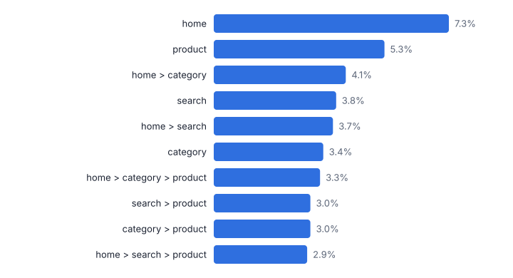
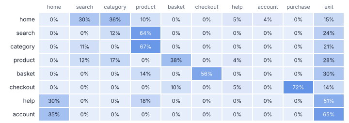
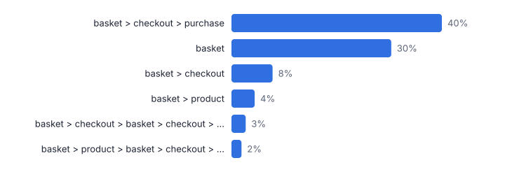
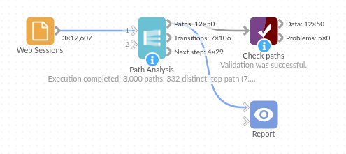

# Path Analysis

*Omniscope custom block · Analytics*

**The routes users really take: top event sequences per session, step-numbered transitions for Sankey charts, and next-step probabilities.**

**Python** · pandas, numpy · nothing extra to install

## The problem it solves

Funnels answer a question you already know to ask. Paths show what people actually do: where they go after the home page, how often they loop back from the basket, which routes end in a purchase and which end nowhere.

This block turns an event log into ranked paths per session, step-by-step transitions ready for a Sankey chart, and a next-step probability table, with options to start at an event, stop at an outcome and collapse repeats.

- **3,000** sessions (synthetic)
- **332** distinct paths; the top 50 cover 75% of sessions
- **500** sessions reaching purchase
- **30%** of basket views followed by leaving

### How it works

- Connect an event log with a user or session field, an event field and (optionally) a time field.
- Choose the maximum steps, whether to collapse repeated events, an optional start event and end events, and how many top paths to return.
- Outputs: the top paths, step-numbered transitions (From, To, Paths) for a Sankey chart, and next-step probabilities.

## What goes in

### Web sessions

3,000 synthetic sessions, 12,607 page views, October 2025.

| Session ID | Event Time | Page |
|---|---|---|
| S00001 | 2025-10-23 05:29:00 | home |
| S00001 | 2025-10-23 05:29:12 | category |
| S00001 | 2025-10-23 05:29:42 | product |
| S00001 | 2025-10-23 05:30:16 | search |
| S00001 | 2025-10-23 05:32:31 | search |
| S00001 | 2025-10-23 05:34:12 | search |

*12,607 rows in the sample file.*

## The options

| Option | Demo setting | What it does |
|---|---|---|
| User or session field | `Session ID` | Identifies one path: all events with the same value form a sequence. |
| Event field | `Page` | The page, screen or step recorded in each event. |
| Time field (optional) | `Event Time` | Orders the events; without it, input order is used. |
| End events (optional) | `purchase` | Comma-separated; a path stops at the first one, for example: purchase |
| Maximum steps | `5` | Paths are cut after this many steps, so long journeys group together. |
| Collapse repeated consecutive events | `On` | Treats the same event several times in a row (such as page reloads) as one step. |

## What comes out

### Top paths

| Rank | Path | Steps Shown | Paths | Share | Cumulative Share | First Event | Last Event | Reached End Event | Reached End Share | Average Steps (untruncated) | Median Minutes |
|---|---|---|---|---|---|---|---|---|---|---|---|
| 1 | home | 1 | 218 | 0.073 | 0.073 | home | home | 0 | 0 | 1 | 0 |
| 2 | product | 1 | 160 | 0.053 | 0.126 | product | product | 0 | 0 | 1 | 0 |
| 3 | home > category | 2 | 124 | 0.041 | 0.167 | home | category | 0 | 0 | 2 | 0.7 |
| 4 | search | 1 | 115 | 0.038 | 0.206 | search | search | 0 | 0 | 1 | 0 |
| 5 | home > search | 2 | 112 | 0.037 | 0.243 | home | search | 0 | 0 | 2 | 0.7 |
| 6 | category | 1 | 101 | 0.034 | 0.277 | category | category | 0 | 0 | 1 | 0 |
| 7 | home > category > product | 3 | 100 | 0.033 | 0.31 | home | product | 0 | 0 | 3 | 1.6 |
| 8 | search > product | 2 | 91 | 0.03 | 0.34 | search | product | 0 | 0 | 2 | 0.8 |
| 9 | category > product | 2 | 90 | 0.03 | 0.37 | category | product | 0 | 0 | 2 | 0.8 |
| 10 | home > search > product | 3 | 86 | 0.029 | 0.399 | home | product | 0 | 0 | 3 | 1.7 |
| 11 | product > basket > checkout > purchase | 4 | 85 | 0.028 | 0.427 | product | purchase | 85 | 1 | 4 | 2.5 |
| 12 | product > basket | 2 | 65 | 0.022 | 0.449 | product | basket | 0 | 0 | 2 | 0.8 |

### Transitions (first rows)

| Step | From | To | Paths | Share Of Step | From Event | To Event |
|---|---|---|---|---|---|---|
| 1 | 1. home | 2. category | 545 | 0.182 | home | category |
| 1 | 1. home | 2. search | 454 | 0.151 | home | search |
| 1 | 1. search | 2. product | 299 | 0.1 | search | product |
| 1 | 1. category | 2. product | 298 | 0.099 | category | product |
| 1 | 1. product | 2. basket | 222 | 0.074 | product | basket |
| 1 | 1. home | 2. (exit) | 218 | 0.073 | home | (exit) |
| 1 | 1. product | 2. (exit) | 160 | 0.053 | product | (exit) |
| 1 | 1. home | 2. product | 145 | 0.048 | home | product |
| 1 | 1. search | 2. (exit) | 115 | 0.038 | search | (exit) |
| 1 | 1. category | 2. (exit) | 101 | 0.034 | category | (exit) |

*Most sessions are short: one or two pages before leaving (synthetic data).*

*Each row adds up to 100%: from the basket, most go to checkout but many leave (synthetic data).*

*Starting the paths at the basket shows the checkout loop and the abandonment directly (synthetic data).*

## Where it pays off

### E-commerce and digital: Web and app journeys

Top routes through a site or app, where users loop, and which entry pages lead to a purchase or sign-up.

### Insurance and financial services: Case and claim stages

The sequences of stages claims or applications go through, including rework loops, from the workflow system's event log.

### Healthcare: Patient pathways

Common sequences of appointments, tests and treatments, and how often patients return to an earlier stage.

### Customer service: Contact journeys

Which channels customers try, in which order, before a case is resolved.

*Use cases describe typical scenarios and are illustrative.*

## Why do this in Omniscope

- **From raw clicks to a Sankey in one workflow.** Sessionise Events can split raw activity into sessions upstream and the transitions output feeds a Sankey downstream, so a new batch of events redraws the routes with no export in between.
- **Every session counted once.** The top paths carry a cumulative share and each event's next-step probabilities, leaving included, add up to 100%, so the figures can be checked against the session count; the tests check collapsing, truncation and the transition table on known sessions.
- **Path rules in a short script.** Start event, end events and repeat collapsing are options; how a long path is cut and a loop counted is pandas code in the block, where a different rule can be written.

## How it fits into an Omniscope workflow

Event log (analytics export, database) → Sessionise Events (optional) → **Path Analysis** → Report (Sankey, bar, table)

Sessionise Events upstream can split raw user activity into sessions; Funnel Analysis gives the conversion view of the same data.

Chart the transitions output as a Sankey (From, To, Paths) and the top paths as a bar chart.

The event log stays connected to its source, so the paths and transition probabilities are recomputed whenever new events arrive, and selecting a Sankey link filters the other views in the report.

## In one step

Ranked paths, Sankey-ready transitions and next-step probabilities from one event log.

## Try it

1. Open the demo project (`demo.iox` on the demo server, or import `demo.ioz` from this folder): 3,000 synthetic web sessions.
2. The question: what routes do visitors actually take, and what happens after they add to basket?
3. Open the block: session, page and time fields, up to 5 steps, stop at purchase. Run it.
4. Look at the top paths and the next-page heat map; then set the start event to basket and run again to see the checkout loop and abandonment.
5. Look at the transitions output as a Sankey in a Report.

## Running in Omniscope

*The demo project's workflow: the sample data, the block, and a Validate data check on its output.*

<!--language-->
## Language and libraries

Python. It uses pandas and numpy.

pandas and numpy are part of Omniscope's Docker Python image, and the block was run in both host mode and Docker mode on an Omniscope server, with the same results. It needs nothing else installed.
<!--/language-->

## Tested

On an Omniscope server the demo workflow ran cleanly: 50 records in Paths, 106 in Transitions and 29 in Next step. The automated tests check normal data, empty input, wrong types and large input.
