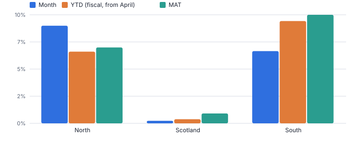
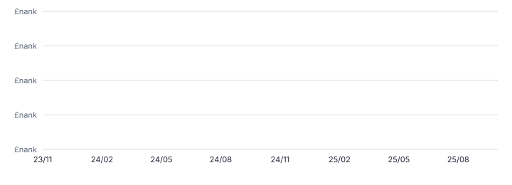
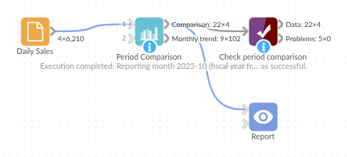

# Period Comparison

*Omniscope custom block · Analytics*

**This month, last year, year to date and moving annual total, with variances, per region or product, from raw transactions in one block. Fiscal years starting in April welcome.**

**Python** · pandas, numpy · nothing extra to install

## The problem it solves

Monthly packs typically start with the same table: this month against last month and the same month last year, year to date against last year, and the last twelve months against the twelve before. Building it means date arithmetic, fiscal-year logic and a page of formulas, and it breaks every January (or April).

Period Comparison produces the whole table from transactions as at the latest complete month (or any date you choose), with a fiscal year start of your choice, a total row and a monthly trend table.

- **9** period columns plus 10 variance columns
- **+6.7%** total YTD growth (fiscal year from April)
- **+7.2%** total moving annual total growth
- **1** setting for the fiscal year start

### How it works

- Choose the date and value fields and the grouping (region, channel, product).
- Set the fiscal year start month; quarters follow it. Leave the reporting date empty to use the latest complete month.
- The comparison output has month, prior month, same month last year, QTD, YTD and MAT with their comparators and changes, plus a total row.
- The trend output has one row per group and month with last year's value, % change, YTD and MAT, ready for charts.

## What goes in

### Daily sales

Synthetic daily sales for three regions and two channels, January 2023 to October 2025.

| Date | Region | Channel | Sales |
|---|---|---|---|
| 2023-01-01 | North | Stores | 891.93 |
| 2023-01-01 | North | Online | 322.39 |
| 2023-01-01 | South | Stores | 985.51 |
| 2023-01-01 | South | Online | 354.62 |
| 2023-01-01 | Scotland | Stores | 421.86 |
| 2023-01-01 | Scotland | Online | 210.8 |

*6,210 rows in the sample file.*

## The options

| Option | Demo setting | What it does |
|---|---|---|
| Date field | `Date` | Date of each value. |
| Value field | `Sales` | Sales, revenue, units, cost... |
| Group by (optional) | `Region` | One comparison per value, such as Region. |
| Fiscal year starts in month | `4` | 1 = January, 4 = April. |
| Use the latest complete month | `On` | When no reporting date is set and the last month in the data is partial, report the month before. |

## What comes out

### Period comparison (October 2025)

| Region | Month | Same Month Last Year | % Change vs Last Year | YTD | Prior YTD | % Change YTD vs Last Year | MAT | Prior MAT | % Change MAT vs Prior MAT |
|---|---|---|---|---|---|---|---|---|---|
| North | 36,852.32 | 33,931.66 | 0.086 | 207,466.89 | 195,128.36 | 0.063 | 376,067.36 | 352,482.02 | 0.067 |
| Scotland | 16,056.93 | 16,021.66 | 0.002 | 94,339.91 | 94,002.24 | 0.004 | 173,772.12 | 172,273.64 | 0.009 |
| South | 54,737.06 | 51,459.85 | 0.064 | 315,795.38 | 289,676.43 | 0.09 | 569,784.89 | 520,014.65 | 0.096 |
| Total | 107,646.31 | 101,413.17 | 0.061 | 617,602.18 | 578,807.03 | 0.067 | 1,119,624.37 | 1,044,770.31 | 0.072 |

### Monthly trend (North, last six months)

| Region | Month | Value | Same Month Last Year | % Change vs Last Year | YTD | MAT | Fiscal Year |
|---|---|---|---|---|---|---|---|
| North | 2025-05 | 26,391.09 | 25,364.15 | 0.04 | 53,843.50 | 366,516.12 | FY 2025/26 |
| North | 2025-06 | 26,085.33 | 23,757.74 | 0.098 | 79,928.83 | 368,843.71 | FY 2025/26 |
| North | 2025-07 | 27,649.26 | 26,058.93 | 0.061 | 107,578.09 | 370,434.04 | FY 2025/26 |
| North | 2025-08 | 30,978.12 | 29,194.34 | 0.061 | 138,556.21 | 372,217.82 | FY 2025/26 |
| North | 2025-09 | 32,058.36 | 31,129.48 | 0.03 | 170,614.57 | 373,146.70 | FY 2025/26 |
| North | 2025-10 | 36,852.32 | 33,931.66 | 0.086 | 207,466.89 | 376,067.36 | FY 2025/26 |

*Month, YTD and MAT growth side by side: the month can mislead, MAT shows the underlying trend (synthetic data).*

*Moving annual total from the trend output: seasonality removed, growth visible.*

## Where it pays off

### Finance: Monthly management pack

The standard month / YTD / MAT table by business unit, regenerated automatically at each month end.

### Retail and hospitality: Like-for-like trading

Sales by store or region against last year and year to date, a table many trading meetings start with.

### Public sector and charities: Fiscal year reporting

April-to-March year-to-date income, spend or activity against the previous year, without hand-built date logic.

### SaaS: Bookings and usage

MAT of bookings or usage per product line to see growth through seasonal noise.

*Use cases describe typical scenarios and are illustrative.*

## Why do this in Omniscope

- **The pack moves on by itself.** With no reporting date set, each scheduled run reports the latest complete month, so the month, QTD, YTD and MAT columns roll forward without a formula being touched, and a half-finished month is not reported by mistake.
- **Table and trend from the same monthly sums.** Both outputs are built from one set of monthly totals, so the MAT in the pack's first table is the last point on its MAT chart; the tests cover calendar and April fiscal years, partial months and the total row.
- **Fiscal logic you can open.** The year start is one setting; quarters, comparators and the complete-month rule are in the block's Python, where a 4-4-5 calendar or an extra comparator column could be added.

## How it fits into an Omniscope workflow

Transactions (Database) → **Period Comparison** → Report

Feed transactions or daily totals. Add a Record filter before it for one business unit, or group by several fields for a deeper cut.

Show the comparison output as the pack's first table and the trend output as line charts; schedule it for month end.

## In one step

Month, quarter-to-date, year-to-date and moving annual total, including fiscal years and the latest-complete-month rule.

## Try it

1. Open the demo project (`demo.iox` on the demo server, or import `demo.ioz` from this folder): nearly three years of daily sales by region.
2. The question: how did October do against last year, and how is the fiscal year going?
3. Open Period Comparison: date, value, group by Region, fiscal year from April. Run it.
4. Look at the comparison table with the total row: YTD +6.7% and MAT +7.2%; the South grows fastest while Scotland is flat.
5. Look at the trend output as a MAT line chart. When next month's data arrives, the workflow updates both outputs.

## Running in Omniscope

*The demo project's workflow: the sample data, the block, and a Validate data check on its output.*

<!--language-->
## Language and libraries

Python. It uses pandas and numpy.

pandas and numpy are part of Omniscope's Docker Python image, and the block was run in both host mode and Docker mode on an Omniscope server, with the same results. It needs nothing else installed.
<!--/language-->

## Tested

The demo workflow completed without errors on an Omniscope server (4 records in Period comparison and 102 in Monthly trend). Automated tests check normal data, empty input, wrong types and large input.
