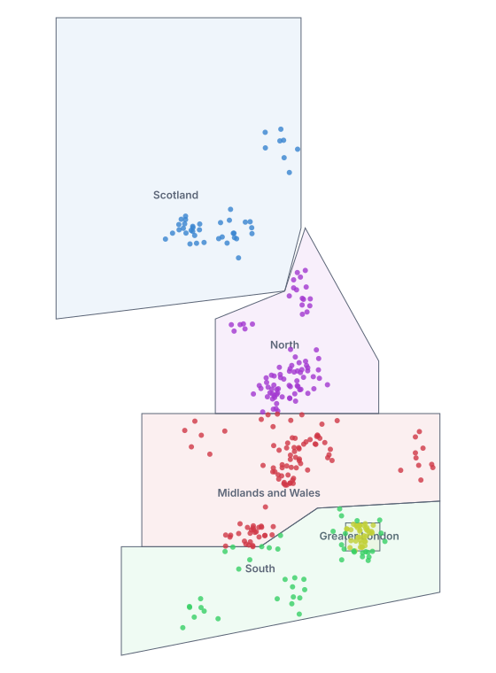
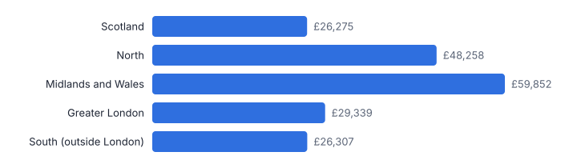
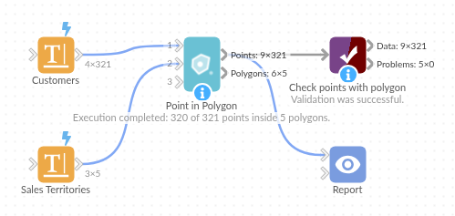

# Point in Polygon

*Omniscope custom block · Analytics*

**Which territory, zone or area is each customer, property or incident in? Point-in-polygon matching from GeoJSON or WKT shapes, with counts and totals per area.**

**Python** · pandas, numpy · nothing extra to install

## The problem it solves

Organisations draw their world in areas: sales territories, delivery zones, council wards, flood zones, catchments. Data arrives as points (geocoded addresses, GPS positions). Joining the two needs a spatial test that ordinary joins cannot do, and usually a GIS tool or extra software.

Point in Polygon reads the area shapes straight from a text field (GeoJSON or WKT, as GIS tools and databases export them), tests every point, appends the area's fields and summarises each area.

- **320 of 321** customers placed in a territory
- **5** territories, as GeoJSON and WKT
- **1** territory with a hole (South excludes London)
- No GIS software or extra Python packages needed

### How it works

- Input 1: points with latitude and longitude. Input 2: one polygon per row, geometry in a text field.
- GeoJSON Polygon / MultiPolygon / Feature and WKT POLYGON / MULTIPOLYGON are read; holes are respected.
- Each point gets the fields of the polygon containing it (or one row per polygon when they overlap), plus a match status.
- The polygon summary counts the points, sums a value field, and flags any geometry that could not be read.

## What goes in

### Input 1: customers

| Customer ID | Latitude | Longitude | Annual Spend |
|---|---|---|---|
| C0001 | 53.16711 | -2.57416 | 136 |
| C0002 | 53.06374 | -2.28722 | 213 |
| C0003 | 53.65223 | -1.89194 | 860 |
| C0004 | 53.63476 | -1.86363 | 287 |
| C0005 | 53.47232 | -1.88 | 240 |

*321 rows in the sample file.*

### Input 2: sales territories

Five illustrative territories; geometry shortened here. Scotland, North and Midlands and Wales are GeoJSON; Greater London and South are WKT, with London cut out of South as a hole.

| Territory | Manager | Geometry |
|---|---|---|
| Scotland | A. Campbell | {"type": "Polygon", "coordinates": [[[-7.6, 54.6], [-2.0, 55... |
| North | B. Hughes | {"type": "Polygon", "coordinates": [[[-3.7, 53.25], [0.3, 53... |
| Midlands and Wales | C. Jones | {"type": "Polygon", "coordinates": [[[-5.5, 51.35], [-2.6, 5... |
| Greater London | D. Okafor | POLYGON ((-0.51 51.29, 0.33 51.29, 0.33 51.69, -0.51 51.69, ... |
| South (outside London) | E. Patel | POLYGON ((-6.0 49.8, 1.8 50.7, 1.8 52.0, -1.2 51.9, -2.6 51.... |

*5 rows in the sample file.*

## The options

| Option | Demo setting | What it does |
|---|---|---|
| Latitude | `Latitude` | Latitude of each point, in decimal degrees. |
| Longitude | `Longitude` | Longitude of each point, in decimal degrees. |
| Geometry (GeoJSON or WKT) | `Geometry` | The shape of each polygon in input 2, as GeoJSON or WKT text. |
| Value to sum per polygon (optional) | `Annual Spend` | A number to total per polygon, such as spend. |
| Points in overlapping polygons | `First matching polygon` | Where polygons overlap: keep only the first match, or a row for each. |

## What comes out

### Customers with territory (one per territory, and the unmatched one)

| Customer ID | Latitude | Longitude | Annual Spend | Polygon: Territory | Polygon: Manager | Match Status |
|---|---|---|---|---|---|---|
| C0001 | 53.17 | -2.574 | 136 | Midlands and Wales | C. Jones | Inside |
| C0003 | 53.65 | -1.892 | 860 | North | B. Hughes | Inside |
| C0111 | 51.35 | -2.564 | 745 | South (outside London) | E. Patel | Inside |
| C0136 | 51.58 | 0.01003 | 1624 | Greater London | D. Okafor | Inside |
| C0196 | 55.67 | -4.32 | 15 | Scotland | A. Campbell | Inside |
| C0321 |  |  | 120 |  |  | Invalid coordinates |

### Territory summary

| Polygon Row | Territory | Manager | Points | Total Annual Spend | Geometry Status |
|---|---|---|---|---|---|
| 1 | Scotland | A. Campbell | 43 | 26,275 | OK |
| 2 | North | B. Hughes | 85 | 48,258 | OK |
| 3 | Midlands and Wales | C. Jones | 106 | 59,852 | OK |
| 4 | Greater London | D. Okafor | 40 | 29,339 | OK |
| 5 | South (outside London) | E. Patel | 46 | 26,307 | OK |

*Each customer coloured by the territory it falls in (illustrative territories, synthetic customers).*

*Annual spend per territory, from the summary output.*

## Where it pays off

### Sales: Territory assignment

Assign every account and lead to its territory and owner from the territory map, and rebalance territories by comparing counts and value per area.

### Insurance and property: Hazard zones

Tag properties with flood, subsidence or fire-risk zones published as GeoJSON by public agencies, for pricing and accumulation.

### Public sector: Wards and catchments

Count service users, incidents or requests per ward, school catchment or health area from open boundary data.

### Logistics: Delivery zones

Place every order in its delivery zone to price delivery and plan capacity per zone.

*Use cases describe typical scenarios and are illustrative.*

## Why do this in Omniscope

- **Boundaries kept as data.** Territory shapes are read from a text column in any file or table, so a redrawn boundary re-assigns every customer on the next run, and the Map view and the territory summary change with it.
- **Every point accounted for.** Points outside all polygons stay in the output with a match status and unreadable shapes are flagged in the summary, so the demo's 320 placed customers reconcile with the 321 supplied; the tests cover holes, multipolygons and bad geometry rows.
- **No GIS add-ons to install.** The containment test is plain numpy inside the block, so it runs in Omniscope's standard Python environment, and the overlap rule (first match, or one row per polygon) is an option.

## How it fits into an Omniscope workflow

Customers → Geocode (if only addresses) → **Point in Polygon** → Report (map)

Use Omniscope's Geocode block first if the points are addresses. Territory shapes can come from any file or database table with a geometry text column.

Show the matched points on a Map view coloured by territory, and the summary as a table or bar chart.

## In one step

Point-in-polygon matching from GeoJSON or WKT shapes, with no spatial objects or extra extensions needed.

## Try it

1. Open the demo project (`demo.iox` on the demo server, or import `demo.ioz` from this folder): customer locations and a table of territory shapes, three in GeoJSON and two in WKT.
2. The question: which territory and manager does each customer belong to?
3. Open Point in Polygon: latitude, longitude, geometry field, sum Annual Spend. Run it.
4. Look at the output with territory and manager per customer; South has London cut out as a hole, which the block respects.
5. Look at the territory summary: customers and spend per territory, ready for a rebalancing discussion.

## Running in Omniscope

*The demo project's workflow: the sample data, the block, and a Validate data check on its output.*

<!--language-->
## Language and libraries

Python. It uses pandas and numpy, plus the Python standard library (json, re).

pandas and numpy are part of Omniscope's Docker Python image, and the block was run in both host mode and Docker mode on an Omniscope server, with the same results. It needs nothing else installed.
<!--/language-->

## Tested

Run on an Omniscope server, the demo workflow finished without errors (321 records in Points with polygon and 5 in Polygon summary). Automated tests also cover normal data, empty input, wrong types and large input.
