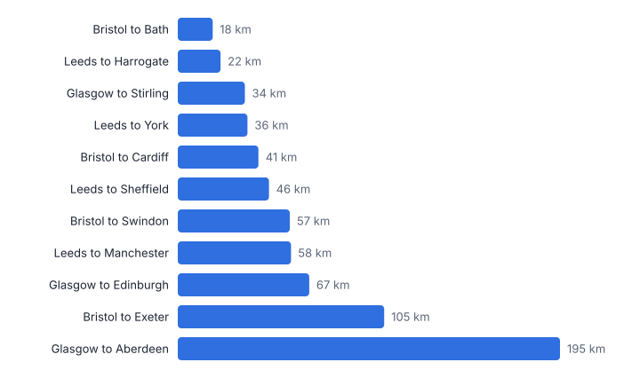
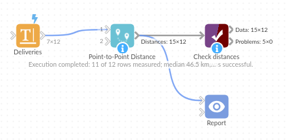

# Point-to-Point Distance

*Omniscope custom block · Analytics*

**Distance, bearing, direction and midpoint between two locations on every row, with optional road distance and travel time estimates.**

**Python** · pandas, numpy · nothing extra to install

## The problem it solves

Journey lengths, delivery distances and travel times for patients or engineers come up constantly, and the data usually holds two pairs of coordinates per row. A spreadsheet formula for the haversine distance is easy to get wrong, and bearings and midpoints are harder still.

This block computes them per row in kilometres or miles, with rough road distance and travel time estimates from a factor and an average speed, and marks rows with bad coordinates.

- **11** deliveries measured (invented)
- **195 km** longest, Glasgow to Aberdeen
- **1** row flagged with no coordinates
- **x1.3** road factor for the estimates

### How it works

- Connect data with from and to latitude and longitude fields.
- Choose kilometres or miles, and optionally a road distance factor and an average speed.
- Output: the input with distance, bearing, direction, midpoint, estimated road distance and minutes, and a valid flag.

## What goes in

### Deliveries

Invented deliveries; approximate town-centre coordinates.

| Delivery | Depot | Depot Lat | Depot Lon | Drop Postcode Area | Drop Lat | Drop Lon |
|---|---|---|---|---|---|---|
| D001 | Leeds | 53.7965 | -1.5478 | York | 53.9590 | -1.0815 |
| D002 | Leeds | 53.7965 | -1.5478 | Harrogate | 53.9921 | -1.5418 |
| D003 | Leeds | 53.7965 | -1.5478 | Sheffield | 53.3811 | -1.4701 |
| D004 | Leeds | 53.7965 | -1.5478 | Manchester | 53.4808 | -2.2426 |
| D005 | Bristol | 51.4545 | -2.5879 | Bath | 51.3811 | -2.3590 |
| D006 | Bristol | 51.4545 | -2.5879 | Cardiff | 51.4816 | -3.1791 |
| D007 | Bristol | 51.4545 | -2.5879 | Exeter | 50.7184 | -3.5339 |
| D008 | Bristol | 51.4545 | -2.5879 | Swindon | 51.5558 | -1.7797 |
| D009 | Glasgow | 55.8642 | -4.2518 | Edinburgh | 55.9533 | -3.1883 |
| D010 | Glasgow | 55.8642 | -4.2518 | Stirling | 56.1165 | -3.9369 |
| D011 | Glasgow | 55.8642 | -4.2518 | Aberdeen | 57.1497 | -2.0943 |
| D012 | Glasgow | 55.8642 | -4.2518 | Unknown |  |  |

*12 rows in the sample file.*

## The options

| Option | Demo setting | What it does |
|---|---|---|
| From latitude | `Depot Lat` | Latitude of the starting point, in decimal degrees. |
| From longitude | `Depot Lon` | Longitude of the starting point, in decimal degrees. |
| To latitude | `Drop Lat` | Latitude of the destination, in decimal degrees. |
| To longitude | `Drop Lon` | Longitude of the destination, in decimal degrees. |
| Road distance factor (optional) | `1.3` | For example 1.3; 0 = none. |
| Average speed for travel time (optional) | `60` | In km/h or mph; needs a road factor. |
| Unit | `Kilometres` | Unit for distances; speed is then km/h or mph. |

## What comes out

### Distances

| Delivery | Depot | Drop Postcode Area | Distance (km) | Bearing (degrees) | Direction | Estimated Road Distance (km) | Estimated Minutes | Valid Coordinates |
|---|---|---|---|---|---|---|---|---|
| D001 | Leeds | York | 35.5 | 59.2 | NE | 46.2 | 46.2 | Yes |
| D002 | Leeds | Harrogate | 21.8 | 1 | N | 28.3 | 28.3 | Yes |
| D003 | Leeds | Sheffield | 46.5 | 173.63 | S | 60.4 | 60.4 | Yes |
| D004 | Leeds | Manchester | 57.7 | 232.81 | SW | 75 | 75 | Yes |
| D005 | Bristol | Bath | 17.8 | 117.12 | SE | 23.2 | 23.2 | Yes |
| D006 | Bristol | Cardiff | 41.1 | 274.44 | W | 53.4 | 53.4 | Yes |
| D007 | Bristol | Exeter | 105.19 | 219.28 | SW | 136.75 | 136.75 | Yes |
| D008 | Bristol | Swindon | 57.1 | 78.3 | E | 74.2 | 74.2 | Yes |
| D009 | Glasgow | Edinburgh | 67 | 81.1 | E | 87.1 | 87.1 | Yes |
| D010 | Glasgow | Stirling | 34.2 | 34.8 | NE | 44.5 | 44.5 | Yes |
| D011 | Glasgow | Aberdeen | 194.81 | 41.9 | NE | 253.25 | 253.25 | Yes |
| D012 | Glasgow | Unknown |  |  |  |  |  | No |

*Straight-line distances; road distances are typically longer, hence the factor (invented deliveries).*

## Where it pays off

### Logistics: Delivery distances

Distance and rough time per drop, for costing routes and depot catchments.

### Healthcare: Patient travel

How far patients travel from home to clinic, by service.

### Field service: Engineer journeys

Distance from base to job for every visit, to check travel claims and allocation.

### Retail: Customer to store

Distance from each customer to their usual store, for catchment analysis.

*Use cases describe typical scenarios and are illustrative.*

## Why do this in Omniscope

- **Postcode, distance and band together.** Geocoding with UK Postcode Tools, this block and Tile banding sit in one workflow, so a corrected postcode gives a corrected distance and band on the next run.
- **Bad coordinates kept, not dropped.** A row with a missing or impossible coordinate stays in the output marked as invalid, so the delivery count is unchanged and the problem rows can be filtered out for fixing; distances, bearings and midpoints are tested against known values.
- **Your own travel assumptions.** The road factor and average speed are options, and replacing the single factor with one per region is a small edit to the block's short script.

## How it fits into an Omniscope workflow

Data with two locations (geocoded with UK Postcode Tools) → **Point-to-Point Distance** → Report (map, distance bands)

Geocode postcodes first if needed; Find Nearest picks the nearest location, Trade Area Summary counts within radii.

Map the midpoints or band the distances with the Tile block.

Geocoding, distance calculation and banding sit in one workflow, so corrected postcodes upstream give corrected distances and bands downstream without editing a calculation.

## In one step

Distance, bearing, midpoint and travel estimates for every row.

## Try it

1. Open the demo project (`demo.iox` on the demo server, or import `demo.ioz` from this folder): invented deliveries from three depots.
2. The question: how far is each delivery, and roughly how long does it take?
3. Run the block with a road factor of 1.3 and 60 km/h.
4. Look at distances, bearings and the flagged row without coordinates.
5. Switch to miles.

## Running in Omniscope

*The demo project's workflow: the sample data, the block, and a Validate data check on its output.*

<!--language-->
## Language and libraries

Python. It uses pandas and numpy.

pandas and numpy are part of Omniscope's Docker Python image, and the block was run in both host mode and Docker mode on an Omniscope server, with the same results. It needs nothing else installed.
<!--/language-->

## Tested

On an Omniscope server the demo workflow ran cleanly: 12 records in Distances. The automated tests check known distances, bearings and midpoints, invalid coordinates, the sample data and large input.
