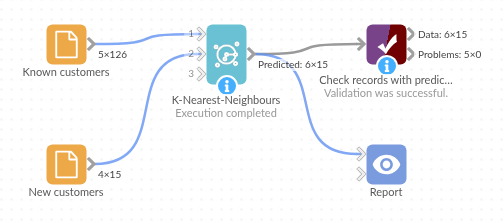

# K-Nearest-Neighbours

*Omniscope custom block · Analytics · Prediction*

**Give new or unlabelled records the category of the known records they most resemble, with a vote share that shows how clear-cut each call is.**

**R** · class · comes with R

## The problem it solves

An account team has sorted 120 customers into three segments (bargain hunters, loyal regulars and big-ticket buyers) and wants every new customer sorted the same way, without a meeting for each one. The segments are not cut-offs on one number: bargain hunters and loyal regulars spend much the same; discount use tells them apart.

The block compares each new customer with the sorted ones on spend, orders and discount, and gives it the segment of its five closest matches. Standardising the three fields first stops spend, in hundreds of pounds, from drowning out discount, in single figures.

- **15 of 15** new customers placed in their true segment (11 of 15 without standardising)
- **117 of 120** sorted customers given their own segment back by their neighbours, a check of the method
- **6** customers the team had not yet sorted, each given a segment with a unanimous vote

### How it works

- Choose the **Field to predict** (a Text field) and the numeric fields to predict from, or use all numeric fields.
- Fields are standardised on the known records; each record's **Number of neighbours** closest known records vote.
- The output adds **Predicted (*field*)** and **Vote share**.
- With a second input, its records are predicted; with one input, all records are.

## What goes in

### Known customers (first input)

126 invented customers, 120 with a segment and 6 not yet assigned.

| Customer | Annual Spend | Orders Per Year | Average Discount | Segment |
|---|---|---|---|---|
| C-0001 | 2645.93 | 4 | 7.3 | Big-ticket buyer |
| C-0002 | 1130.70 | 22 | 23.2 | Bargain hunter |
| C-0003 | 2339.16 | 5 | 1.7 | Big-ticket buyer |
| C-0004 | 771.23 | 27 | 4.6 | Loyal regular |
| C-0005 | 1001.28 | 27 | 9.1 | Loyal regular |
| C-0006 | 2254.98 | 3 | 6.0 | Big-ticket buyer |

*126 rows in the sample file: 39 bargain hunters, 36 big-ticket buyers, 45 loyal regulars and 6 with no segment.*

### New customers (second input)

15 invented customers with the same three measures and no segment.

## The options

| Option | Demo setting | What it does |
|---|---|---|
| Field to predict | `Segment` | The category to predict. |
| Use all numeric fields | ticked | Predict from Annual Spend, Orders Per Year and Average Discount. |
| Fields to predict from | (not used) | The fields to use when "Use all numeric fields" is unticked. |
| Number of neighbours | 5 | Five closest known customers vote. |
| Standardise fields | ticked | Put the three fields on the same scale first. |

## What comes out

### Predicted (new customers, first 8)

| Customer | Annual Spend | Orders Per Year | Average Discount | Predicted (Segment) | Vote share |
|---|---|---|---|---|---|
| N-0001 | 2858.21 | 4 | 19.0 | Big-ticket buyer | 1.0 |
| N-0002 | 1353.37 | 18 | 17.3 | Bargain hunter | 0.8 |
| N-0003 | 1048.49 | 21 | 22.5 | Bargain hunter | 1.0 |
| N-0004 | 1391.32 | 26 | 6.3 | Loyal regular | 1.0 |
| N-0005 | 678.54 | 24 | 23.6 | Bargain hunter | 1.0 |
| N-0006 | 1260.71 | 16 | 9.6 | Loyal regular | 1.0 |
| N-0007 | 2496.93 | 6 | 13.7 | Big-ticket buyer | 1.0 |
| N-0008 | 3473.15 | 4 | 12.3 | Big-ticket buyer | 1.0 |

Five new customers are bargain hunters, six loyal regulars and four big-ticket buyers; 13 of the 15 calls are unanimous.

### With the first input alone

Connect only the known customers and every record gets a prediction. The six unsorted customers get one each (C-0009 and C-0077 big-ticket buyers, C-0031 a loyal regular, the other three bargain hunters, all 5 votes to 0). For the 120 sorted customers the prediction ignores their own segment; it matches for 117. The three that differ (C-0024, C-0028, C-0103) have discounts of 14 to 16 %, between the two groups, and vote shares of 0.6 to 0.8: worth a second look by the team.

## Where it pays off

### Sales and marketing: Segmenting new customers

Give each new account the segment of the existing accounts it most resembles, and review only the close calls.

### Operations: Fault or job types

Classify new readings, tickets or jobs by the known cases with the most similar measurements.

### Quality: Grading

Grade items by their measurements against a set of items already graded by an inspector.

### Data cleaning: Filling gaps

With one input, fill in a missing category from similar records, and see from the known ones how reliable that is.

*Use cases describe typical scenarios and are illustrative; the sample data is invented.*

## Why do this in Omniscope

- **New records sorted as they arrive**: with the sorted customers on the first input and this week's sign-ups on the second, both read from the CRM, every run of the workflow hands the next blocks and the Report an up-to-date segment table.
- **A built-in check you can automate**: with one input the labelled records are re-predicted without their own answer, so the run can be stopped (with Validate data) once the share that match drops under an agreed level, and a filter on Vote share below 1 lists the close calls.
- **Repeatable to the record**: R's random tie-breaking is pinned by a fixed seed, so rerunning on the same data never moves a customer between segments.
- **Short, open R**: the script is under 150 lines in the block's editor; changing the distance (say, weighting one field double) or the vote is a small edit there.

## How it fits into an Omniscope workflow

Sorted customers (Database) + New customers (Database) → **K-Nearest-Neighbours** → Report

For an accuracy check, run it on the first input alone and feed the output to the Model Validation block (Ground Truth: Segment, Prediction: Predicted (Segment)), or to an Aggregate on both fields.

## Try it

1. Open the demo project (`demo.iox` on the demo server, or import `demo.ioz` from this folder): 126 known customers and 15 new ones.
2. The question: which segment does each new customer belong to?
3. Open K-Nearest-Neighbours: field to predict Segment, use all numeric fields, 5 neighbours, standardise ticked. Run it.
4. Look at the output: 15 new customers, each with a predicted segment and a vote share; N-0002 and N-0014 are 4 to 1 calls.
5. Untick **Standardise fields** and run again: four of the 15 change segment, because spend now decides almost alone.

## Running in Omniscope

*The demo project's workflow: the sample data, the block, and a Validate data check on its output.*

<!--language-->
## Language and libraries

R. It uses the class package (GPL-2 or GPL-3), one of R's recommended packages that come with most R installations; install it with `install.packages("class")` if it is missing.
<!--/language-->

## Tested

The block is covered by automated tests that run its script against a stand-in for Omniscope's R API: the sample data with two inputs and with one, leave-one-out predictions, standardised and raw fields, tied votes on repeated runs, records with missing values, chosen and Integer fields, empty inputs, bad choices (no field to predict, a numeric field to predict, text fields to predict from, missing fields, too many neighbours, no known records, no input) and 20,000 records on each input.
