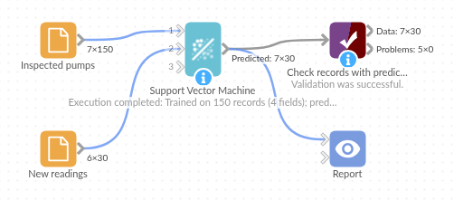

# Support Vector Machine

*Omniscope custom block · Analytics*

**You know the answer for some records and not for others. Learn it from the ones you know, and predict it for the rest.**

**Python** · scikit-learn, pandas, numpy · scikit-learn installed on first run

## The problem it solves

Engineers have inspected 150 pumps and recorded each one as Normal, Worn or Faulty, alongside its vibration, temperature, pressure and running hours. Thirty more pumps have sensor readings but no inspection yet. Which of them need a visit first?

The block learns how the condition relates to the four readings from the inspected pumps, then predicts the condition of each new pump from its readings.

- **150** inspected pumps to learn from, **30** new pumps to assess
- **5** new pumps predicted Faulty and **8** Worn: the visit list
- **29 of 29** predictions match what an engineer found later
- **1** pump whose vibration sensor did not report kept in the list, with no prediction rather than a guess

### How it works

- Connect the inspected pumps to the first input and the new readings to the second.
- Choose the Field to predict (Condition). Every other numeric field is used to predict it, each standardised first so running hours in thousands don't outweigh vibration in single figures.
- Each new record gets a Prediction field.

## What goes in

### Inspected pumps (first input)

150 invented pumps with their readings and the condition an engineer recorded: 80 Normal, 45 Worn, 25 Faulty.

| Pump | Site | Vibration | Temperature | Pressure | Runtime Hours | Condition |
|---|---|---|---|---|---|---|
| P-1001 | Riverside | 11.37 | 87.6 | 3.28 | 8619 | Faulty |
| P-1002 | Hillcrest | 5.48 | 87.6 | 4.18 | 11494 | Faulty |
| P-1003 | Riverside | 2.60 | 62.3 | 5.13 | 1480 | Normal |
| P-1004 | Hillcrest | 4.53 | 78.7 | 4.25 | 6387 | Worn |
| P-1005 | Hillcrest | 2.49 | 61.5 | 5.16 | 6494 | Normal |

*150 rows in `pump-history.csv`.*

### New readings (second input)

30 invented pumps with the same readings and no condition. One has no vibration reading.

| Pump | Site | Vibration | Temperature | Pressure | Runtime Hours |
|---|---|---|---|---|---|
| P-2001 | Hillcrest | 4.82 | 57.7 | 3.14 | 14470 |
| P-2002 | Hillcrest | 8.67 | 85.7 | 3.17 | 15551 |
| P-2003 | Hillcrest | 5.69 | 64.0 | 4.70 | 9287 |
| P-2008 | Docklands | | 76.9 | 5.13 | 9947 |

*30 rows in `pump-readings.csv`.*

## The options

| Option | Demo setting | What it does |
|---|---|---|
| Field to predict | Condition | The category to learn and predict. |
| Use all numeric fields | ticked | Predict from every Integer and Decimal field except Condition: Vibration, Temperature, Pressure and Runtime Hours. |
| Fields to predict from | (not used) | The fields to predict from when "Use all numeric fields" is unticked. |

## What comes out

### Records with predictions (first 8)

| Pump | Site | Vibration | Temperature | Pressure | Runtime Hours | Prediction |
|---|---|---|---|---|---|---|
| P-2001 | Hillcrest | 4.82 | 57.7 | 3.14 | 14470 | Worn |
| P-2002 | Hillcrest | 8.67 | 85.7 | 3.17 | 15551 | Faulty |
| P-2003 | Hillcrest | 5.69 | 64.0 | 4.70 | 9287 | Worn |
| P-2004 | Riverside | 3.36 | 57.5 | 5.15 | 1113 | Normal |
| P-2005 | Riverside | 2.72 | 52.9 | 4.98 | 6199 | Normal |
| P-2006 | Docklands | 2.97 | 69.7 | 4.52 | 1007 | Normal |
| P-2007 | Riverside | 2.68 | 55.4 | 5.07 | 7850 | Normal |
| P-2008 | Docklands | | 76.9 | 5.13 | 9947 | |

30 records: 16 Normal, 8 Worn, 5 Faulty and P-2008 with no prediction. Joined to what the engineers found later (`pump-readings-inspected.csv`), all 29 predictions match. P-2008 turned out to be Worn; predicting from the other three readings only (untick "Use all numeric fields" and choose Temperature, Pressure and Runtime Hours) also gives Worn.

## Where it pays off

### Maintenance: Which machines to visit first

Predict the condition of every machine from its latest sensor readings and send engineers to the ones predicted Faulty.

### Customer retention: Who is likely to leave

Learn from past customers who did or didn't renew, using spend, tenure and contact counts, and predict it for current customers.

### Quality control: Pass or fail before testing

Predict the test outcome of a batch from its process measurements, and test the doubtful ones first.

### Credit and risk: Sorting applications

Predict the likely outcome of new applications from the numeric details of past ones, as a first sort before a person decides.

*Use cases describe typical scenarios and are illustrative; the sample data is invented.*

## Why do this in Omniscope

- **The prediction lands on the record.** Prediction is a field next to the pump's site and readings, so a Record filter makes the visit list and a Report maps it by site, without exporting to a modelling tool and back.
- **Re-trained on every run.** When the inspection history grows, the next scheduled run learns from all of it; nobody has to remember to rebuild the model.
- **Checked in the same workflow.** Feed predictions for records with a known answer to the Model Validation block, and Validate data on its scores halts the workflow if accuracy drops.
- **The model is a line you can change.** Kernel, `C` and `gamma` are one line of the block's script; open it in the block editor to try a linear kernel or a different `C`.

## How it fits into an Omniscope workflow

Inspection history (File or Database) + latest readings → **Support Vector Machine** → Record filter (Prediction = Faulty or Worn) → Report

To measure accuracy first: known records → Split data → training part to the first input, test part to the second → **Support Vector Machine** → Model Validation (Condition against Prediction).

## Try it

1. Open the demo project (`demo.iox` on the demo server, or import `demo.ioz` from this folder): 150 inspected pumps and 30 new readings.
2. The question: which of the 30 new pumps need an engineer?
3. Open Support Vector Machine: Field to predict Condition, Use all numeric fields ticked. Run it.
4. Look at the Prediction field: 5 Faulty, 8 Worn, 16 Normal, and P-2008 empty because its vibration reading is missing.
5. Disconnect the second input and run again: the block predicts the 150 inspected pumps instead, and you can compare Prediction with Condition.

## Running in Omniscope

*The demo project's workflow: the sample data, the block, and a Validate data check on its output.*

<!--language-->
## Language and libraries

Python. It uses scikit-learn (the support vector classifier and the standard scaler), pandas and numpy, all under the BSD licence.

pandas and numpy are part of Omniscope's Python environment. scikit-learn is listed in the block's dependencies, so Omniscope installs it with pip on first run if it is missing; the server needs access to the Python package index for that, or scikit-learn installed beforehand.
<!--/language-->

## Tested

The block is covered by automated tests that run its script against a stand-in for Omniscope's Python API: the sample pumps (checked against the inspected conditions), predicting the training records, standardised fields, a numeric Field to predict kept out of the fields it is predicted from, predictions kept on their own records when values are missing, training records with missing values, chosen fields, an existing Prediction field, empty input, ten set-up mistakes, and 5,000 training records predicting 50,000.
