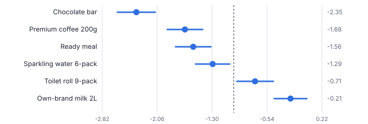
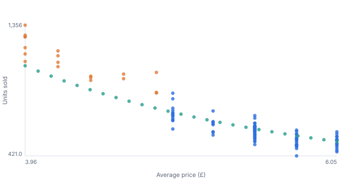
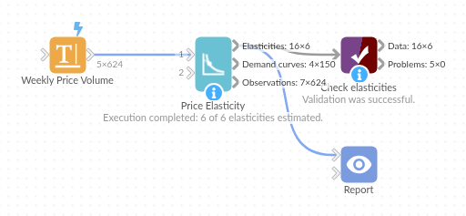

# Price Elasticity

*Omniscope custom block · Analytics*

**How much volume do you lose for a 5% price rise, product by product? Price elasticities from your own sales history, with confidence intervals, revenue impact and demand curves.**

**Python** · pandas, numpy · nothing extra to install

## The problem it solves

Pricing decisions are often made on instinct, or on a single percentage applied to every product. In reality some products barely react to price and others are highly sensitive, and the difference is worth real money: a small price rise on an inelastic line adds revenue, the same rise on an elastic line loses it.

Price Elasticity estimates the elasticity for every product from historical price and volume, controls for drivers such as promotions, and states what a price change would do to volume and revenue, with the uncertainty attached.

- **6** products estimated at once
- **-1.68** premium coffee: elastic
- **-0.71** toilet roll: inelastic, a price rise adds revenue
- **-2.16 → -1.68** coffee elasticity without vs with the promotion control

### How it works

- Choose the price and volume fields and the products (or segments) to estimate separately.
- Optionally add control drivers such as a 0 / 1 promotion flag, so promotional uplift is not mistaken for price sensitivity.
- Each product gets a log-log regression: the elasticity with confidence interval and p-value, R squared and the observed price range.
- The block translates the elasticity into the volume and revenue effect of a price change you choose, and outputs a demand curve over the observed price range.

## What goes in

### Weekly price and volume

Two years of synthetic weekly average price and units for six grocery products, with promotion weeks flagged.

| Week | Product | Average Price | Units Sold | On Promotion |
|---|---|---|---|---|
| 2024-01-01 | Own-brand milk 2L | 1.38 | 3825 | 0 |
| 2024-01-08 | Own-brand milk 2L | 1.1 | 5395 | 1 |
| 2024-01-15 | Own-brand milk 2L | 1.16 | 5790 | 1 |
| 2024-01-22 | Own-brand milk 2L | 1.52 | 3792 | 0 |
| 2024-01-29 | Own-brand milk 2L | 1.3 | 4037 | 0 |
| 2024-02-05 | Own-brand milk 2L | 1.45 | 3700 | 0 |

*624 rows in the sample file.*

## The options

| Option | Demo setting | What it does |
|---|---|---|
| Price field | `Average Price` | Price for each observation, such as the average price in a week. |
| Volume field | `Units Sold` | Units sold (or another quantity). |
| Estimate separately for each | `Product` | For example Product, or Product and Region. |
| Control drivers (optional) | `On Promotion` | Numeric drivers to hold constant, such as a 0 / 1 promotion flag. |
| Price change to evaluate (%) | `5.0` | Used for the volume and revenue effect columns. |
| Confidence level | `0.95` | For the confidence interval on each elasticity. |

## What comes out

### Elasticities

| Product | Observations | Elasticity | CI Low | CI High | P Value | R Squared | Revenue Change For +5% Price | Interpretation |
|---|---|---|---|---|---|---|---|---|
| Chocolate bar | 104 | -2.349 | -2.613 | -2.086 | 0 | 0.922 | -0.064 | Elastic: a 5% price rise loses about 11% of volume and 6.4% of revenue. |
| Own-brand milk 2L | 104 | -0.214 | -0.44 | 0.012 | 0.063 | 0.693 | 0.039 | No reliable price effect found in this data. |
| Premium coffee 200g | 104 | -1.677 | -1.922 | -1.432 | 0 | 0.911 | -0.032 | Elastic: a 5% price rise loses about 8% of volume and 3.2% of revenue. |
| Ready meal | 104 | -1.562 | -1.807 | -1.317 | 0 | 0.895 | -0.027 | Elastic: a 5% price rise loses about 7% of volume and 2.7% of revenue. |
| Sparkling water 6-pack | 104 | -1.293 | -1.53 | -1.057 | 0 | 0.882 | -0.014 | Elastic: a 5% price rise loses about 6% of volume and 1.4% of revenue. |
| Toilet roll 9-pack | 104 | -0.706 | -0.958 | -0.453 | 0 | 0.74 | 0.014 | Inelastic: a 5% price rise loses about 3% of volume but raises revenue by about 1.4%. |

### Demand curve (premium coffee, first points)

| Product | Price | Predicted Volume | Predicted Revenue |
|---|---|---|---|
| Premium coffee 200g | 3.96 | 1,065.40 | 4,218.97 |
| Premium coffee 200g | 4.05 | 1,027.24 | 4,157.31 |
| Premium coffee 200g | 4.13 | 991.21 | 4,097.84 |
| Premium coffee 200g | 4.22 | 957.16 | 4,040.43 |
| Premium coffee 200g | 4.31 | 924.94 | 3,984.97 |
| Premium coffee 200g | 4.4 | 894.42 | 3,931.36 |

*Products to the left of the dashed line (elasticity -1) are elastic: price rises cost revenue. Synthetic data.*

*Weekly observations (blue: normal weeks, orange: promotion weeks) with the fitted demand curve (green).*

## Where it pays off

### Grocery and retail: Range pricing

Find the inelastic lines where a small price rise adds margin, and the elastic ones where price investment drives volume.

### E-commerce and travel: Dynamic pricing inputs

Estimate elasticity per route, category or season as an input to pricing rules and revenue management.

### Consumer goods: Promotion planning

Separate promotional uplift from everyday price sensitivity to plan promotions that pay back.

### Utilities, subscriptions and public transport: Tariff changes

Estimate the likely volume and revenue effect of a tariff change from past changes, with the uncertainty shown.

*Use cases describe typical scenarios and are illustrative.*

## Why do this in Omniscope

- **The whole range re-estimated together.** Weekly aggregation and the regression for every product sit in one workflow, so a refreshed sales extract re-estimates all products on the same settings, with the minimum-observations rule applied to each.
- **Uncertainty checked by the tests.** They recover a known elasticity exactly, compare the p-values and confidence intervals with an independent statistics library, and confirm that the promotion control removes the promotion bias.
- **Curve and evidence side by side.** The demand curves and the observations with fitted volumes are outputs too, so a report can show a product's curve, its weekly points and its interval together, filtered to the products in question.
- **A model you can extend.** Control drivers are an option; the log-log model is in the block's script if your pricing team wants another term, such as the price of a substitute product.

## How it fits into an Omniscope workflow

Sales and prices (Database) → Aggregate (weekly per product) → **Price Elasticity** → Report

Aggregate transactions to one row per product per week with average price and units first. Add promotion or distribution fields as controls.

Show elasticities with their intervals in a Report, and use the demand curves to explore price scenarios.

## In one step

One block estimates every product at once and turns coefficients into business answers.

## Try it

1. Open the demo project (`demo.iox` on the demo server, or import `demo.ioz` from this folder): two years of weekly prices and units for six products, with promotion weeks flagged.
2. The question: if we put every price up 5%, what happens to revenue? It depends on the product.
3. Open Price Elasticity: price, volume, per Product, control for On Promotion. Run it.
4. Look at the chart: chocolate and coffee are elastic, toilet roll inelastic (a 5% rise adds about 1.4% revenue), milk shows no reliable effect in this data.
5. Note the promotion control: without it, coffee looks more sensitive (-2.16) than with it (-1.68), because promotion weeks combine lower prices with higher volume.

## Running in Omniscope

*The demo project's workflow: the sample data, the block, and a Validate data check on its output.*

<!--language-->
## Language and libraries

Python. It uses pandas and numpy, plus the Python standard library (math).

pandas and numpy are part of Omniscope's Docker Python image, and the block was run in both host mode and Docker mode on an Omniscope server, with the same results. It needs nothing else installed.
<!--/language-->

## Tested

The demo workflow runs without errors on an Omniscope server and produces 6 records in Elasticities, 150 in Demand curves and 624 in Observations. Its automated tests cover normal data, empty input, wrong types and large input.
