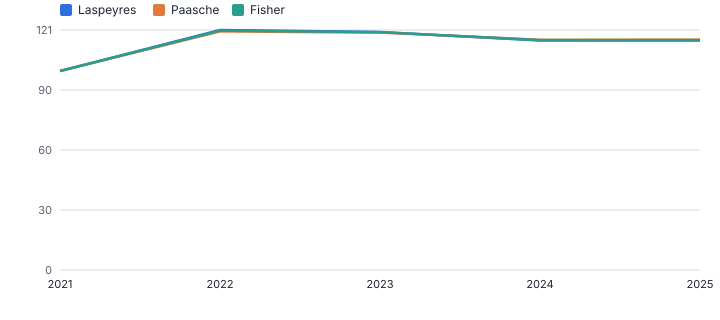
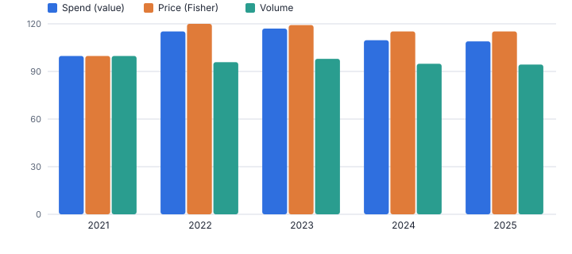
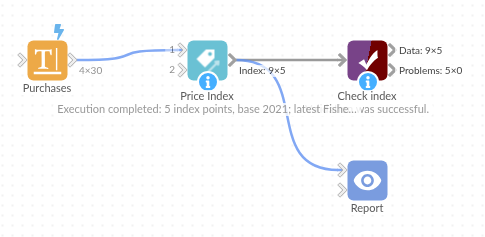

# Price Index

*Omniscope custom block · Analytics*

**Build your own price index (Laspeyres, Paasche, Fisher) from item prices and quantities, and split spend growth into price and volume.**

**Python** · pandas, numpy · nothing extra to install

## The problem it solves

Published inflation figures rarely match what a business actually buys or sells. Procurement and finance teams want their own cost index: how much have prices for our basket risen, and how much of the spend increase is price versus volume?

This block computes the standard index formulas from item prices and quantities per period, with a value index and the implied volume index alongside.

- **6** items in the basket (invented)
- **116** Fisher index in 2025 (2021 = 100)
- **109** spend index
- **95** implied volume index

### How it works

- Connect rows with an item, a period, a unit price and a quantity (several rows per item and period are combined).
- Choose the base period (default: the first) and optionally a group for one index each.
- Output: per period, the Laspeyres, Paasche and Fisher indices, value and volume indices, items compared and missing.

## What goes in

### Purchases

Invented prices and quantities, 2021 to 2025.

| Year | Item | Unit Price (GBP) | Quantity |
|---|---|---|---|
| 2021 | Cardboard boxes | 0.813 | 50104 |
| 2021 | Pallets | 9.064 | 2237 |
| 2021 | Stretch film | 14.036 | 902 |
| 2021 | Diesel (litres) | 1.421 | 61490 |
| 2021 | Labels (thousand) | 6.622 | 1233 |
| 2021 | Tape (rolls) | 1.901 | 8370 |

*30 rows in the sample file.*

## The options

| Option | Demo setting | What it does |
|---|---|---|
| Item field | `Item` | Identifies an item whose price is tracked. |
| Period field | `Year` | The period of each price and quantity, such as Year. |
| Unit price field | `Unit Price (GBP)` | Price paid per unit. |
| Quantity field | `Quantity` | Units bought, used to weight the items. |
| Base period | `(first)` | Default: the first period. |

## What comes out

### Index

| Period | Items Compared | Items Missing | Laspeyres | Paasche | Fisher | Value Index | Implied Volume Index | Fisher Change From Previous |
|---|---|---|---|---|---|---|---|---|
| 2021 | 6 | 0 | 100 | 100 | 100 | 100 | 100 |  |
| 2022 | 6 | 0 | 120.60 | 119.91 | 120.25 | 115.52 | 96.06 | 0.2 |
| 2023 | 6 | 0 | 119.59 | 119.35 | 119.47 | 117.27 | 98.16 | -0.01 |
| 2024 | 6 | 0 | 115.31 | 115.70 | 115.50 | 109.87 | 95.12 | -0.03 |
| 2025 | 6 | 0 | 115.26 | 115.77 | 115.52 | 109.22 | 94.55 | 0 |

*Laspeyres and Paasche stay within a point of each other: the mix of purchases changed little (invented data).*

*Prices are up about 16% on 2021 but spend only 9%: volume fell by about 5% (invented data).*

## Where it pays off

### Procurement: Own cost index

How much prices of the goods and services you buy have risen, compared with published indices and contract escalators.

### Retail and pricing: Selling price index

Average price movement across the range, separated from mix and volume.

### Finance: Price and volume variance

Split year-on-year spend or revenue change into price and volume at basket level.

### Public sector: Unit cost tracking

Cost indices for frequently bought items, per directorate or supplier.

*Use cases describe typical scenarios and are illustrative.*

## Why do this in Omniscope

- **Index and restated values in one run.** The Fisher column feeds Inflation Adjustment in the same workflow, so a new purchase extract updates the index and every value restated with it.
- **Coverage shown each period.** Each period lists the items compared and the items missing, so a basket that thins out is visible next to the index itself; the three index formulas are covered by the tests.
- **One index per supplier or category.** The group and base period are options, and the formulas are a short script in the block, where a chained index could be added.

## How it fits into an Omniscope workflow

Purchase or sales lines → **Price Index** → Inflation Adjustment (use the index) → Report

Aggregate lines to item and period, or let the block combine them; Price-Volume-Mix Bridge gives the item-level revenue bridge.

Use the Fisher column as the index table for Inflation Adjustment.

The index feeds Inflation Adjustment directly in the workflow, so a new purchase extract updates the indices and everything adjusted by them in one run.

## In one step

Laspeyres, Paasche and Fisher indices, plus value and volume indices.

## Try it

1. Open the demo project (`demo.iox` on the demo server, or import `demo.ioz` from this folder): invented purchase prices and quantities for six items.
2. The question: how much have our packaging and transport costs really gone up?
3. Run the block with 2021 as the base.
4. Look at the index: Fisher 116 in 2025; spend 109; volume 95.
5. Note how close Laspeyres and Paasche are: the mix barely shifted, so the choice of formula matters little for this basket.

## Running in Omniscope

*The demo project's workflow: the sample data, the block, and a Validate data check on its output.*

<!--language-->
## Language and libraries

Python. It uses pandas and numpy.

pandas and numpy are part of Omniscope's Docker Python image, and the block was run in both host mode and Docker mode on an Omniscope server, with the same results. It needs nothing else installed.
<!--/language-->

## Tested

Run on an Omniscope server, the demo workflow finished without errors (5 records in Index). Automated tests also cover the index formulas on known values, groups and the base period, the sample data, and bad options.
