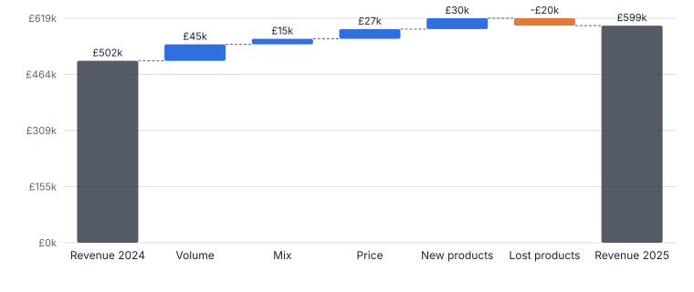
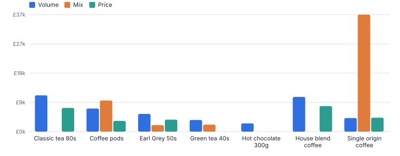
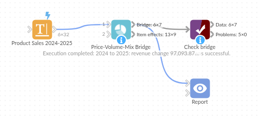

# Price-Volume-Mix Bridge

*Omniscope custom block · Analytics*

**Why did revenue change? Volume, mix, price, new and lost products, item by item, adding up exactly to the change, with the waterfall the board expects.**

**Python** · pandas, numpy · nothing extra to install

## The problem it solves

"Revenue is up 9%" is the start of a conversation, not the end. Was it price rises, selling more, selling a richer mix, or a new product covering for a discontinued one? Answering properly needs a price-volume-mix decomposition per product, which is easy to get subtly wrong in a spreadsheet so that the pieces no longer add up.

Price-Volume-Mix Bridge does it per item (and per region if you like), with new and lost products separated, and the effects reconciling exactly to the revenue change.

- **£97k** revenue change 2024 to 2025, fully explained
- **£27k** from price
- **£15k** from mix (shift to dearer coffee)
- **£30k** from the new oat drink

### How it works

- Choose the period field and the two periods, the item level (product or SKU), the volume and revenue fields, and optional groups.
- Volume effect: change in total units at base mix and base prices. Mix effect: change in each item's share of units, at base prices. Price effect: price change on current units.
- Items sold in only one period are reported as new or lost products instead of distorting price and mix.
- The bridge output is ready for a waterfall chart; the item output shows where each effect comes from.

## What goes in

### Product sales by year and region

Synthetic units and revenue for nine hot-drink products in 2024 and 2025; the oat drink is new in 2025 and decaf coffee was discontinued.

| Year | Region | Product | Category | Units | Revenue |
|---|---|---|---|---|---|
| 2024 | North | Classic tea 80s | Tea | 22836 | 54872.95 |
| 2024 | South | Classic tea 80s | Tea | 27178 | 65441.18 |
| 2025 | North | Classic tea 80s | Tea | 23504 | 59799.56 |
| 2025 | South | Classic tea 80s | Tea | 28133 | 71829.16 |
| 2024 | North | Earl Grey 50s | Tea | 9338 | 26963.43 |
| 2024 | South | Earl Grey 50s | Tea | 10845 | 31672.29 |
| 2025 | North | Earl Grey 50s | Tea | 10110 | 31224.39 |
| 2025 | South | Earl Grey 50s | Tea | 12681 | 38730.77 |

*32 rows in the sample file.*

## The options

| Option | Demo setting | What it does |
|---|---|---|
| Period field | `Year` | For example Year, or a field with values such as FY24 / FY25. |
| Item field | `Product` | The level at which price and mix are measured, such as Product or SKU. |
| Volume field | `Units` | Units, kilograms, contracts... |
| Revenue field | `Revenue` | Revenue for the item in the period; price is revenue divided by volume. |
| Base period value | `(first: 2024)` | Empty = the first value of the period field. |
| Current period value | `(last: 2025)` | Empty = the last value of the period field. |

## What comes out

### Bridge

| Step | Value | Bar Start | Bar End | Share Of Change |
|---|---|---|---|---|
| Base revenue | 501,629.37 | 0 | 501,629.37 |  |
| Volume | 45,425.63 | 501,629.37 | 547,055.00 | 0.468 |
| Mix | 15,368.65 | 547,055.00 | 562,423.66 | 0.158 |
| Price | 26,750.73 | 562,423.66 | 589,174.39 | 0.276 |
| New products | 29,825.46 | 589,174.39 | 618,999.85 | 0.307 |
| Lost products | -20,276.61 | 618,999.85 | 598,723.24 | -0.209 |
| Current revenue | 598,723.24 | 0 | 598,723.24 |  |

### Item effects

| Item | Status | Volume 2024 | Volume 2025 | Price 2024 | Price 2025 | Volume Effect | Mix Effect | Price Effect | New / Lost Effect |
|---|---|---|---|---|---|---|---|---|---|
| Classic tea 80s | Continuing | 50,014 | 51,637 | 2.41 | 2.55 | 11,354.14 | -7,449.83 | 7,410.29 | 0 |
| Coffee pods 10s | Continuing | 23,936 | 29,235 | 3.2 | 3.32 | 7,230.42 | 9,731.24 | 3,349.18 | 0 |
| Decaf coffee 227g | Lost | 5,096 | 0 | 3.98 |  | 0 | 0 | 0 | -20,276.61 |
| Earl Grey 50s | Continuing | 20,183 | 22,791 | 2.91 | 3.07 | 5,533.50 | 2,043.27 | 3,742.67 | 0 |
| Green tea 40s | Continuing | 14,740 | 16,965 | 2.62 | 2.62 | 3,643.62 | 2,184.49 | -30.08 | 0 |
| Hot chocolate 300g | Continuing | 8,810 | 7,667 | 3.1 | 3.09 | 2,575.84 | -6,117.06 | -60.45 | 0 |
| House blend coffee 227g | Continuing | 30,362 | 27,521 | 3.79 | 4.08 | 10,851.78 | -21,611.58 | 7,983.57 | 0 |
| Oat drink 1L | New | 0 | 16,185 |  | 1.84 | 0 | 0 | 0 | 29,825.46 |
| Single origin coffee 227g | Continuing | 7,607 | 14,525 | 5.9 | 6.2 | 4,236.34 | 36,588.12 | 4,355.56 | 0 |

*The revenue bridge: each bar is one effect, and they add up exactly to the 2025 revenue (synthetic data).*

*Where the gains come from, product by product.*

## Where it pays off

### Consumer goods and retail: Annual and monthly revenue bridges

Explain revenue or gross margin movements to the board by category, separating pricing, volume, mix and range changes.

### B2B and distribution: Customer and price reviews

Per customer or region, show how much of growth came from price increases versus volume, to test pricing discipline.

### SaaS and subscriptions: Plan mix

Bridge recurring revenue between periods: more seats (volume), richer plans (mix), price uplifts, new and churned products.

### Hospitality: Menu performance

Separate covers (volume), menu mix and price changes in revenue per site.

*Use cases describe typical scenarios and are illustrative.*

## Why do this in Omniscope

- **Next year's bridge needs no edits.** With the base and current periods left empty, the block compares the first and last values of the period field, so when the new year's sales arrive the bridge moves on by itself.
- **Effects that reconcile exactly.** The tests check that volume, mix, price, new and lost effects add up to the revenue change, by region as well as in total, so the waterfall never needs a balancing bar.
- **Your house definitions.** The item level is an option, and the volume, mix and price formulas are in the block's Python if your finance team values the mix effect differently.

## How it fits into an Omniscope workflow

Sales (Database) → Aggregate (period, product) → **Price-Volume-Mix Bridge** → Report (waterfall)

Feed transactions or pre-aggregated sales with a period field. Choose the item level carefully: mix is measured between items, price within them.

Chart the bridge as a waterfall (bar start / end columns) and show item effects in a table for drill-down.

The bridge is computed from the same sales data that feeds the rest of the report, and its effects reconcile exactly to the total change, so the waterfall and the drill-down table always agree.

## In one step

The standard volume, mix and price decomposition, with new and lost items handled and an exact reconciliation.

## Try it

1. Open the demo project (`demo.iox` on the demo server, or import `demo.ioz` from this folder): two years of sales by product.
2. The question: revenue rose by £97k; how much was price, how much volume, how much the new product?
3. Open the bridge block: period Year, item Product, volume Units, revenue Revenue. Run it.
4. Look at the waterfall: volume added £45k, price £27k and mix £15k; the oat drink launch (£30k) more than covered discontinuing decaf.
5. Look at the item effects: which products moved mix, and that everything reconciles to the penny.

## Running in Omniscope

*The demo project's workflow: the sample data, the block, and a Validate data check on its output.*

<!--language-->
## Language and libraries

Python. It uses pandas and numpy.

pandas and numpy are part of Omniscope's Docker Python image, and the block was run in both host mode and Docker mode on an Omniscope server, with the same results. It needs nothing else installed.
<!--/language-->

## Tested

The demo workflow runs without errors on an Omniscope server and produces 7 records in Bridge and 9 in Item effects. Its automated tests cover normal data, empty input, wrong types and large input.
