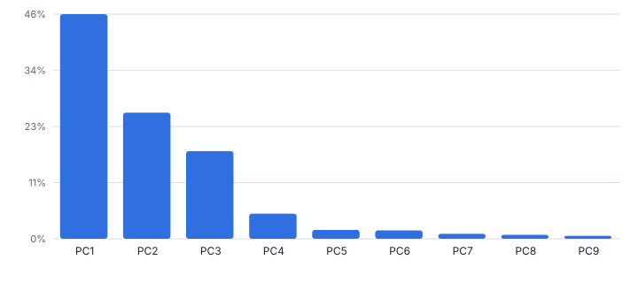
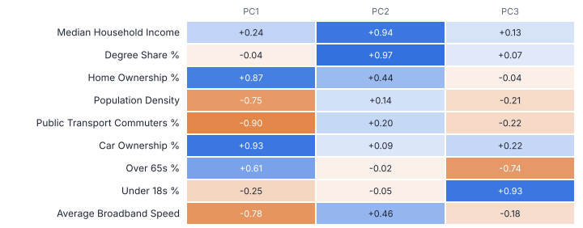
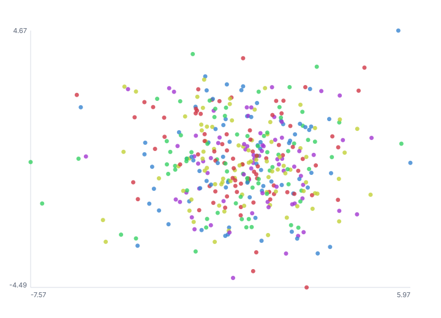
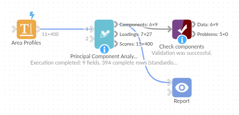

# Principal Component Analysis

*Omniscope custom block · Analytics*

**Summarise many correlated measures with a few components: explained variance, loadings, scores per row and a flag for unusual profiles.**

**Python** · pandas, numpy · nothing extra to install

## The problem it solves

Nine census measures for 400 areas, forty survey questions, thirty product attributes: many fields that largely say the same few things. Charts and models get crowded, and indices built by hand weight things arbitrarily.

This block finds the underlying components, says how much each explains, which fields drive each one, and gives every row a score on each, ready for score plots, segmentation or simpler models.

- **9** census-style measures per area (synthetic)
- **3** components kept (eigenvalue above 1)
- **89%** of the variance explained by those three
- **400** areas scored

### How it works

- Connect data and choose the numeric fields (or leave empty for all).
- Keep the default standardised PCA when fields are in different units; choose a fixed number of components or let the block decide.
- Outputs: the components with explained variance, the loadings with correlations and a label of the main fields, and the rows with their scores.

## What goes in

### Area profiles

400 synthetic small areas built from three hidden dimensions.

| Area Code | Region | Median Household Income (GBP k) | Degree Share % | Home Ownership % | Population Density (per sq km) | Public Transport Commuters % | Car Ownership % | Over 65s % | Under 18s % | Average Broadband Speed (Mbps) |
|---|---|---|---|---|---|---|---|---|---|---|
| A5000 | Wales | 39.23 | 29.36 | 68.19 | 895.15 | 11.71 | 87.06 | 17.24 | 22.85 | 65.05 |
| A5001 | Midlands | 32.13 | 23.49 | 60.93 | 157.77 | 10.66 | 81.41 | 16.87 | 22.18 | 54.58 |
| A5002 | Scotland | 62.39 | 48.33 | 102.28 | 130.34 | 4.17 | 107.02 | 21.95 | 19.36 | 46.3 |
| A5003 | Wales | 18.41 | 11.48 | 69.55 | 303.68 | 6.76 | 81.52 | 27.35 | 14.42 | 50.94 |
| A5004 | South | 37.17 | 42.65 | 55.15 | 2109.89 | 15.96 | 71.36 | 11.39 | 23.5 | 86.29 |
| A5005 | Wales | 31.39 | 28.95 | 50.96 | 2688.36 | 30.2 | 64.41 | 15.43 | 25.32 | 76.75 |

*400 rows in the sample file.*

## The options

| Option | Demo setting | What it does |
|---|---|---|
| Numeric fields | `(all numeric)` | Leave empty to use every numeric field. |
| Standardise fields (correlation PCA) | `On` | Scales each field to unit variance first, so fields in large units do not dominate. Untick for covariance PCA. |
| Components to keep | `0 (automatic)` | 0 = automatic. |

## What comes out

### Components

| Number | Component | Eigenvalue | Variance Share | Cumulative Share | Kept |
|---|---|---|---|---|---|
| 1 | PC1 | 4.103 | 0.456 | 0.456 | Yes |
| 2 | PC2 | 2.307 | 0.256 | 0.712 | Yes |
| 3 | PC3 | 1.601 | 0.178 | 0.89 | Yes |
| 4 | PC4 | 0.46 | 0.051 | 0.941 | No |
| 5 | PC5 | 0.163 | 0.018 | 0.959 | No |
| 6 | PC6 | 0.151 | 0.017 | 0.976 | No |
| 7 | PC7 | 0.092 | 0.01 | 0.986 | No |
| 8 | PC8 | 0.071 | 0.008 | 0.994 | No |
| 9 | PC9 | 0.052 | 0.006 | 1 | No |

### What each component is

| Component | Main Fields Of Component |
|---|---|
| PC1 | +Car Ownership %, -Public Transport Commuters %, +Home Ownership % |
| PC2 | +Degree Share %, +Median Household Income (GBP k), +Average Broadband Speed (Mbps) |
| PC3 | +Under 18s %, -Over 65s %, -Public Transport Commuters % |

### Scores (first rows)

| Area Code | Region | PC1 | PC2 | PC3 | Unexplained Distance |
|---|---|---|---|---|---|
| A5000 | Wales | 0.871 | 0.332 | 1.001 | 0.556 |
| A5001 | Midlands | 0.728 | -0.874 | 0.859 | 0.396 |
| A5002 | Scotland | 4.333 | 3.348 | 0.631 | 1.373 |
| A5003 | Wales | 1.977 | -2.358 | -2.173 | 0.637 |
| A5004 | South | -1.465 | 1.11 | 1.236 | 0.801 |
| A5005 | Wales | -2.415 | -0.156 | 0.769 | 1.261 |
| A5006 | South | -2.295 | -0.169 | 0.859 | 0.596 |
| A5007 | Scotland | 1.447 | 2.167 | -2.25 | 0.732 |

*Three components stand out; the rest is mostly noise (synthetic data).*

*PC1 contrasts car ownership with public transport (rural to urban), PC2 is affluence, PC3 the age profile.*

*Each area placed by its first two scores; regions overlap because the data has no regional pattern.*

## Where it pays off

### Public sector and property: Area classification

Summarise census or local indicators into a few dimensions for profiling and clustering neighbourhoods.

### Market research: Survey dimensions

Reduce many attitude questions to a few underlying themes and score each respondent.

### Retail: Store and product profiles

Find the main ways stores or products differ, then cluster them on the scores.

### Finance and manufacturing: Indices and monitoring

Build a composite index from correlated KPIs, and use the unexplained distance to flag unusual profiles.

*Use cases describe typical scenarios and are illustrative.*

## Why do this in Omniscope

- **Scores ready for clustering.** The scores are ordinary data, so PC1 and PC2 can be plotted in a report or passed to the KMeans block in the same workflow, and a refreshed extract re-scores every area.
- **Identical results on unchanged data.** Each component's largest loading is made positive, so a re-run gives the same scores and signs; the tests check the eigenvalues against the correlation matrix and the reproducible signs.
- **Loadings you can report.** Variance shares and loadings, with a label of each component's main fields, come out as tables, and the unexplained distance flags the rows the kept components describe poorly.
- **Retention rule in view.** Automatic selection uses eigenvalues above 1 or a variance target; another rule could be written into the block's numpy script.

## How it fits into an Omniscope workflow

Data → **Principal Component Analysis** → KMeans (public block) or Report (score plot)

Feed numeric measures; the Correlation Matrix block shows the relationships first.

Plot PC1 against PC2 in a Report, or cluster on the scores with the public KMeans block.

The repeatable signs mean a re-run on unchanged data gives the same scores, so anything built on them, such as clusters from the KMeans block, stays stable between refreshes.

## In one step

PCA with loadings, labels, scores and signs that stay the same from run to run.

## Try it

1. Open the demo project (`demo.iox` on the demo server, or import `demo.ioz` from this folder): 400 synthetic areas with nine measures.
2. The question: what are the few things that really distinguish these areas?
3. Run the block with defaults: standardised, automatic number of components.
4. Look at the scree and loadings: three components explain 89%; read them as rural, affluent, older.
5. Look at the score plot, and the unexplained distance as a way to find areas that do not fit the pattern.

## Running in Omniscope

*The demo project's workflow: the sample data, the block, and a Validate data check on its output.*

<!--language-->
## Language and libraries

Python. It uses pandas and numpy.

pandas and numpy are part of Omniscope's Docker Python image, and the block was run in both host mode and Docker mode on an Omniscope server, with the same results. It needs nothing else installed.
<!--/language-->

## Tested

The demo workflow completed without errors on an Omniscope server (9 records in Components, 27 in Loadings and 400 in Scores). Automated tests check normal data, empty input, wrong types and large input.
