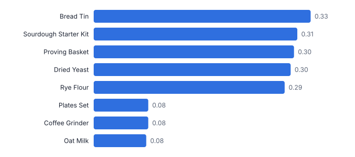
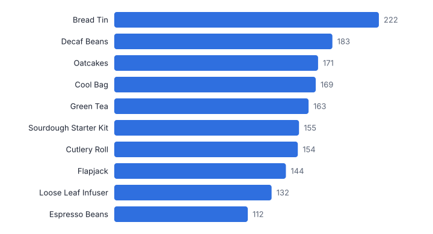
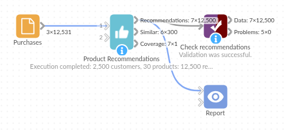

# Product Recommendations

*Omniscope custom block · Analytics*

**"Customers who bought this also bought", turned into a ranked, explained list of new products for every customer, from plain purchase history.**

**Python** · pandas, numpy · nothing extra to install

## The problem it solves

Cross-sell emails, next-best-offer lists and "you may also like" panels need product recommendations, but recommendation engines are usually a separate system. Item-to-item collaborative filtering, the approach popularised by large online retailers, needs only who bought what.

This block computes product-to-product similarity from purchases, scores every product a customer has not bought, and explains each recommendation with the purchase behind it.

- **2,500** customers (synthetic)
- **30** products scored
- **12,500** recommendations, five per customer
- **Every one** with a "because you bought" reason

### How it works

- Connect purchases with a customer and a product (orders or lines; repeats are ignored).
- Choose how many recommendations per customer and similar products per product, the minimum customers per product and the shrinkage.
- Outputs: recommendations per customer, similar products per product, and coverage.

## What goes in

### Purchases

12,531 synthetic purchases of 31 products by 2,500 customers with taste themes; one product, bought only once, is left out by the minimum-customers rule.

| Customer ID | Order ID | Product |
|---|---|---|
| CU30000 | OR543468 | Flask |
| CU30000 | OR205670 | Ginger Biscuits |
| CU30000 | OR541985 | Ginger Biscuits |
| CU30001 | OR475955 | Sourdough Starter Kit |
| CU30001 | OR541992 | Bread Tin |
| CU30001 | OR325817 | Rye Flour |

*12,531 rows in the sample file.*

## The options

| Option | Demo setting | What it does |
|---|---|---|
| Customer field | `Customer ID` |  |
| Product field | `Product` |  |
| Recommendations per customer | `5` |  |
| Minimum customers per product | `5` |  |
| Shrinkage | `10` | 0 = none; 10 down-weights pairs bought together by few customers. |

## What comes out

### Recommendations (three customers)

| Customer ID | Rank | Recommended Product | Score | Because You Bought | Similarity To That Product | Products Bought |
|---|---|---|---|---|---|---|
| CU30000 | 1 | Cutlery Roll | 0.399 | Flask | 0.325 | 2 |
| CU30000 | 2 | Picnic Blanket | 0.398 | Flask | 0.321 | 2 |
| CU30000 | 3 | Cool Bag | 0.382 | Flask | 0.299 | 2 |
| CU30000 | 4 | Plates Set | 0.361 | Flask | 0.298 | 2 |
| CU30000 | 5 | Reusable Cups | 0.359 | Flask | 0.296 | 2 |
| CU30001 | 1 | Dried Yeast | 0.997 | Sourdough Starter Kit | 0.311 | 4 |
| CU30001 | 2 | Bread Flour | 0.994 | Bread Tin | 0.326 | 4 |
| CU30001 | 3 | Proving Basket | 0.981 | Bread Tin | 0.326 | 4 |
| CU30001 | 4 | Chai Blend | 0.498 | Teapot | 0.3 | 4 |
| CU30001 | 5 | Loose Leaf Infuser | 0.49 | Teapot | 0.328 | 4 |
| CU30002 | 1 | Loose Leaf Infuser | 1.247 | Green Tea | 0.334 | 4 |
| CU30002 | 2 | Earl Grey | 1.159 | Green Tea | 0.305 | 4 |
| CU30002 | 3 | Oatcakes | 0.324 | Teapot | 0.103 | 4 |
| CU30002 | 4 | Filter Coffee | 0.3 | Chai Blend | 0.086 | 4 |
| CU30002 | 5 | Dark Chocolate | 0.292 | Chai Blend | 0.09 | 4 |

### Similar to Bread Flour

| Product | Similar Product | Similarity | Customers Who Bought Both | Customers Who Bought Product | Rank |
|---|---|---|---|---|---|
| Bread Flour | Bread Tin | 0.326 | 120 | 333 | 1 |
| Bread Flour | Sourdough Starter Kit | 0.306 | 114 | 333 | 2 |
| Bread Flour | Proving Basket | 0.301 | 112 | 333 | 3 |
| Bread Flour | Dried Yeast | 0.296 | 108 | 333 | 4 |
| Bread Flour | Rye Flour | 0.287 | 107 | 333 | 5 |
| Bread Flour | Plates Set | 0.082 | 35 | 333 | 6 |
| Bread Flour | Coffee Grinder | 0.082 | 35 | 333 | 7 |
| Bread Flour | Oat Milk | 0.079 | 34 | 333 | 8 |

*The baking products cluster together because the same customers buy them (synthetic data).*

*Recommendations spread across the range rather than always pushing the best sellers.*

## Where it pays off

### E-commerce: Personalised emails

Five products per customer for the next newsletter, each with the purchase that explains it.

### Retail: Product page panels

"You may also like" lists from the similar-products output, refreshed nightly.

### B2B and wholesale: Account cross-sell

Products similar accounts buy that this account does not, for the sales team's call list.

### Media and services: Content and add-ons

Titles, courses or add-ons based on what similar users took up.

*Use cases describe typical scenarios and are illustrative; the sample data is synthetic.*

## Why do this in Omniscope

- **Orders in, mailing list out.** Order lines, recommendations, the join to customer details and the export run as one workflow, so each send uses the latest orders, and RFM Segmentation upstream can choose who gets one.
- **Each suggestion explained.** Every recommendation names the purchase behind it and its similarity, and a coverage output counts customers, the data's products (scored plus left out, adding up to the total) and products recommended; the tests check the cosine similarities on a known case.
- **Similarity you can tune.** Shrinkage, minimum customers and list lengths are options; the scoring is a short numpy script in the block, so weighting recent purchases more heavily is an edit there.

## How it fits into an Omniscope workflow

Order lines → **Product Recommendations** → Join (customer details) → Export to the email platform

Feed order lines; RFM Segmentation or Customer Lifetime Value can choose which customers to target.

Join recommendations to customer details and export; use the similar-products output for product pages.

Order lines, recommendations, customer details and the export all sit in one workflow, so the lists sent to the email platform are rebuilt from the latest orders each time it runs.

## In one step

Explained, per-customer recommendations from item similarity in one block.

## Try it

1. Open the demo project (`demo.iox` on the demo server, or import `demo.ioz` from this folder): synthetic purchases from a food and kitchen shop.
2. The question: what should we put in each customer's next email?
3. Run the block: five products per customer, each with the reason.
4. Look at the similar products for Bread Flour: the baking theme emerges from purchases alone.
5. Join to customers and export; set minimum customers higher to avoid recommending rarely bought products.

## Running in Omniscope

*The demo project's workflow: the sample data, the block, and a Validate data check on its output.*

<!--language-->
## Language and libraries

Python. It uses pandas and numpy.

pandas and numpy are part of Omniscope's Docker Python image, and the block was run in both host mode and Docker mode on an Omniscope server, with the same results. It needs nothing else installed.
<!--/language-->

## Tested

Run on a real Omniscope server:

- The demo workflow ran without errors (recommendations: 12500 records, similarProducts: 300 records, coverage: 1 records).

The block is also covered by automated tests (normal data, empty input, wrong types, large input).
