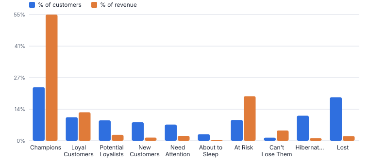
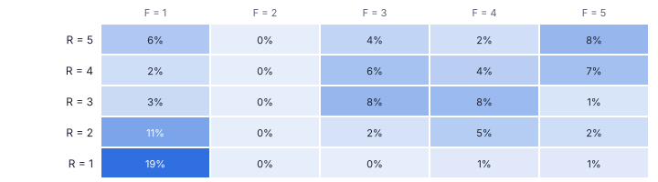
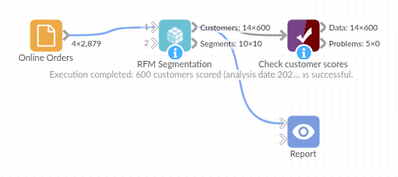

# RFM Segmentation

*Omniscope custom block · Analytics*

**From raw orders to named customer segments in one block: Champions, Loyal, At Risk, Lost and six more, each with recency, frequency and spend scores and a suggested action.**

**Python** · pandas, numpy · nothing extra to install

## The problem it solves

CRM and e-commerce teams want to know who their best customers are, who is drifting away and who is already gone. RFM (recency, frequency, monetary value) is a common first answer, but building it means aggregating orders per customer, computing percentile scores, combining them and mapping them to segments, typically a chain of several blocks.

RFM Segmentation does all of it from the transactions table, and adds a segment summary that shows where the revenue sits and what to do about each group.

- **600** customers scored from 2,879 orders
- **23% → 55%** Champions: share of customers vs revenue
- **54** At Risk customers holding 19% of revenue
- **10** named segments with suggested actions

### How it works

- Choose the customer, order date and order value fields (and order ID if one order spans several rows).
- Recency is measured to the day after the latest order, or to an analysis date you set; frequency counts orders; monetary sums spend.
- Each measure is scored 1 to 5 by percentile (5 is best; tied customers share the lower score), giving an RFM score such as 543.
- Customers are placed in ten segments from the recency score and the average of the frequency and monetary scores.
- The segment summary gives customers, revenue, shares and averages per segment, with a description and suggested action.

## What goes in

### Online orders (one row per order)

2,879 synthetic orders from 600 customers over two years.

| Order ID | Customer ID | Order Date | Order Value |
|---|---|---|---|
| ORD-001498 | CUS-0319 | 2023-11-01 | 68.78 |
| ORD-002485 | CUS-0527 | 2023-11-01 | 111.63 |
| ORD-000655 | CUS-0144 | 2023-11-01 | 46.92 |
| ORD-001370 | CUS-0292 | 2023-11-02 | 20.9 |
| ORD-002191 | CUS-0463 | 2023-11-02 | 216.49 |
| ORD-000766 | CUS-0167 | 2023-11-02 | 153.15 |

*2,879 rows in the sample file.*

## The options

| Option | Demo setting | What it does |
|---|---|---|
| Customer field | `Customer ID` | Identifies a customer. |
| Order date field | `Order Date` | Date of each order, for recency. |
| Order value field | `Order Value` | Value of each order, summed for the monetary score. |
| Order ID field (optional) | `Order ID` | Frequency counts distinct order IDs. Leave empty to count rows (one row per order). |
| Score bands | `5` | 5 gives scores 1 to 5 (quintiles). |
| Analysis date | `(empty: day after last order)` | Recency is measured to this date, such as 2025-12-31. Leave empty for the day after the latest transaction. |

## What comes out

### Customer scores (top customer of each segment)

| Customer ID | Recency (days) | Frequency | Monetary | R Score | F Score | M Score | RFM Score | Segment |
|---|---|---|---|---|---|---|---|---|
| CUS-0575 | 29 | 15 | 908.34 | 5 | 5 | 5 | 555 | Champions |
| CUS-0304 | 280 | 10 | 1,523.60 | 3 | 5 | 5 | 355 | Loyal Customers |
| CUS-0425 | 422 | 15 | 1,698.05 | 2 | 5 | 5 | 255 | At Risk |
| CUS-0474 | 26 | 2 | 146.05 | 5 | 3 | 3 | 533 | Potential Loyalists |
| CUS-0390 | 484 | 11 | 1,437.56 | 1 | 5 | 5 | 155 | Can't Lose Them |
| CUS-0186 | 269 | 2 | 124.81 | 3 | 3 | 3 | 333 | Need Attention |
| CUS-0459 | 7 | 1 | 79.61 | 5 | 1 | 3 | 513 | New Customers |
| CUS-0581 | 397 | 1 | 88.43 | 2 | 1 | 3 | 213 | Hibernating |
| CUS-0362 | 328 | 1 | 38.42 | 3 | 1 | 2 | 312 | About to Sleep |
| CUS-0426 | 515 | 1 | 87.56 | 1 | 1 | 3 | 113 | Lost |

### Segment summary

| Segment | Customers | Share Of Customers | Share Of Revenue | Average Recency (days) | Average Frequency | Average Monetary | Suggested Action |
|---|---|---|---|---|---|---|---|
| Champions | 139 | 0.232 | 0.546 | 42.45 | 11.56 | 790.33 | Reward them; early access, referrals, reviews. |
| Loyal Customers | 61 | 0.102 | 0.123 | 236.43 | 5.574 | 406.24 | Upsell and loyalty schemes; ask for feedback. |
| Potential Loyalists | 53 | 0.088 | 0.025 | 61.15 | 2.264 | 96.34 | Membership or loyalty offers; recommend related products. |
| New Customers | 48 | 0.08 | 0.014 | 22.79 | 1 | 56.92 | Onboarding, welcome series, second-purchase incentive. |
| Need Attention | 42 | 0.07 | 0.021 | 247.81 | 2.5 | 100.71 | Limited-time offers based on past purchases. |
| About to Sleep | 17 | 0.028 | 0.003 | 313.94 | 1 | 32.77 | Reactivate with popular products and reminders. |
| At Risk | 54 | 0.09 | 0.193 | 388.20 | 7.167 | 717.17 | Personal win-back campaign; find out what changed. |
| Can't Lose Them | 8 | 0.013 | 0.044 | 487.62 | 9.625 | 1,114.38 | Win them back with your best offer; talk to them. |
| Hibernating | 65 | 0.108 | 0.011 | 400.02 | 1 | 33.57 | Low-cost reactivation; otherwise do not over-invest. |
| Lost | 113 | 0.188 | 0.02 | 586.61 | 1 | 35.7 | Exclude from expensive campaigns; occasional reactivation. |

*Champions are under a quarter of customers but over half of revenue; At Risk customers still hold a fifth of it (synthetic data).*

*The recency / frequency grid behind the segments: each cell is the share of customers.*

## Where it pays off

### E-commerce and retail: Lifecycle campaigns

Send win-back offers to At Risk and Can't Lose Them, onboarding journeys to New Customers and VIP perks to Champions, refreshed every week from the order feed.

### Subscription and SaaS: Churn early warning

Score accounts on recency of activity or renewal, frequency of use and revenue to find high-value accounts going quiet before they cancel.

### B2B distribution: Account prioritisation

Give sales teams a ranked list per territory: Champions to protect, At Risk accounts to call this week, Hibernating ones to hand to marketing.

### Charities and membership: Donor segmentation

Apply RFM to donations to time appeals, upgrade regular givers and re-engage lapsed supporters.

*Use cases describe typical scenarios and are illustrative.*

## Why do this in Omniscope

- **Segments follow the order feed.** Each scheduled run measures recency to the day after the latest order, so customers move from Champions towards At Risk as they stop buying, with no list to update by hand.
- **Your own segments as a formula.** The R, F and M scores stay in the output, so a segment of your own is a formula field that filters every view in the report; rows with a missing customer or an unreadable date are skipped and counted rather than failing the run, as the tests check.
- **Names and actions you can rewrite.** The ten segments, their descriptions and suggested actions are a list in the block's script, with the placement rule in a short function beside it.

## How it fits into an Omniscope workflow

Orders (Database) → **RFM Segmentation** → Join (customer details) → Report / Email output

Feed it the order lines straight from the database. Join the customer scores back to customer details for contact lists, or to the orders for segment-level trend charts.

Schedule the workflow so segments refresh automatically; to track movement between segments month by month, keep each run's customer scores (for example by appending them to a database table).

## In one step

The whole RFM workflow, with the scores exposed so analysts can still define their own segments.

## Try it

1. Open the demo project (`demo.iox` on the demo server, or import `demo.ioz` from this folder): two years of online orders, one row per order.
2. The question: who are our best customers, and who should get a win-back campaign this week?
3. Open RFM Segmentation: customer, date, value and order ID. Nothing else to set. Run it.
4. Look at the segment summary: Champions are 23% of customers and 55% of revenue; 54 At Risk customers still hold 19% of revenue.
5. Look at the customer scores and note the suggested action per segment: ready for an export to the email platform.

## Running in Omniscope

*The demo project's workflow: the sample data, the block, and a Validate data check on its output.*

<!--language-->
## Language and libraries

Python. It uses pandas and numpy, plus the Python standard library (math).

pandas and numpy are part of Omniscope's Docker Python image, and the block was run in both host mode and Docker mode on an Omniscope server, with the same results. It needs nothing else installed.
<!--/language-->

## Tested

On an Omniscope server the demo workflow ran cleanly: 600 records in Customer scores and 10 in Segment summary. The automated tests check normal data, empty input, wrong types and large input.
