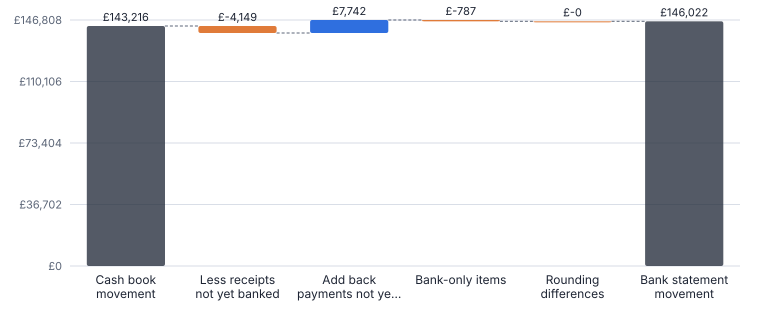
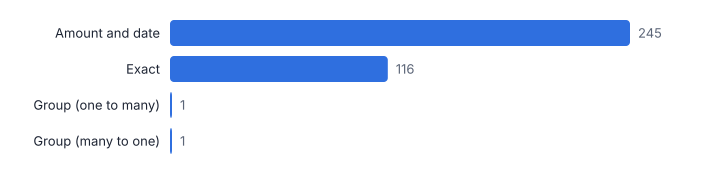
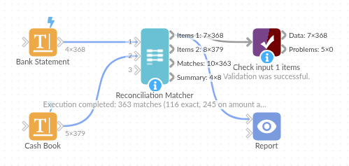

# Reconciliation Matcher

*Omniscope custom block · Analytics*

**Match two ledgers one-to-one on amount, reference and date, with tolerances and group matches, and get the reconciling items on each side.**

**Python** · pandas, numpy · nothing extra to install

## The problem it solves

Bank reconciliations, supplier statement reconciliations and card settlement checks all come down to the same job: pair up the items on two lists and explain what is left. Exact joins miss items whose dates differ by a day or whose references are typed differently; manual ticking takes hours at every month end.

This block matches in passes, from exact to tolerant, always one-to-one and best match first, finds remittances that cover several invoices, and returns both lists with match IDs and rules, so the reconciling items are what is left to review.

- **363** matches from 368 bank lines and 379 journals
- **4 + 14** reconciling items left (bank-only + cash book)
- **301** cash book items an exact amount-and-date join would leave unmatched
- **7** 1p rounding differences matched within tolerance and listed

### How it works

- Connect one side to input 1 (for example the bank statement) and the other to input 2 (the cash book).
- Choose the amount field on each side, and optionally the date and reference fields; set the amount tolerance and the date window.
- Optionally choose fields that must agree (account, currency), flip the sign of input 2, and switch group matching on or off.
- Outputs: both inputs with Match Status, Match ID and Match Rule; one row per match with amounts, difference and date gap; and a summary.

## What goes in

### Input 1: bank statement

Invented October statement, 368 lines.

| Statement Line | Value Date | Narrative | Amount |
|---|---|---|---|
| 1 | 2025-10-01 | REF INV40226 | 584.83 |
| 2 | 2025-10-01 | REF INV40295 | 1800.41 |
| 3 | 2025-10-01 | BACS PO7732 | -432.29 |
| 4 | 2025-10-02 | INV-40133 | 1766.4 |
| 5 | 2025-10-02 | INV-40143 | 672.51 |
| 6 | 2025-10-02 | REF INV40234 | 728.91 |

*368 rows in the sample file.*

### Input 2: cash book

Invented cash book, 379 journals.

| Journal | Type | Posting Date | Reference | Amount (GBP) |
|---|---|---|---|---|
| J50000 | Receipt | 2025-10-01 | INV-40133 | 1766.4 |
| J50001 | Receipt | 2025-10-01 | INV-40143 | 672.51 |
| J50002 | Receipt | 2025-10-01 | INV-40162 | 376.37 |
| J50003 | Receipt | 2025-10-01 | INV-40168 | 373.02 |
| J50004 | Receipt | 2025-10-01 | INV-40226 | 584.83 |
| J50005 | Receipt | 2025-10-01 | INV-40234 | 728.91 |

*379 rows in the sample file.*

## The options

| Option | Demo setting | What it does |
|---|---|---|
| Amount | `Amount` | Amount of each item in input 1. |
| Date (optional) | `Value Date` | Date of each item in input 1, for the date window. |
| Reference (optional) | `Narrative` | Reference or narrative in input 1, compared with input 2's. |
| Amount | `Amount (GBP)` | Amount of each item in input 2. |
| Date (optional) | `Posting Date` | Date of each item in input 2. |
| Reference (optional) | `Reference` | Reference in input 2. |
| Amount tolerance | `0.01` | For example 0.01 for rounding differences. |
| Date window (days) | `3` | Maximum days between matched items. |
| Input 2 amounts | `Same sign as input 1` | Choose Opposite when one side records as negative what the other records as positive. |
| Match groups with the same reference | `On` | One item against several that add up to it. |

## What comes out

### Matches (examples of each non-exact rule)

| Match ID | Rule | Items In 1 | Items In 2 | Amount 1 | Amount 2 | Difference | Date Difference (days) | Reference 1 | Reference 2 |
|---|---|---|---|---|---|---|---|---|---|
| 117 | Amount and date | 1 | 1 | 584.83 | 584.83 | 0 | 0 | REF INV40226 | INV-40226 |
| 118 | Amount and date | 1 | 1 | 1,800.41 | 1,800.41 | 0 | 0 | REF INV40295 | INV-40295 |
| 119 | Amount and date | 1 | 1 | -432.29 | -432.29 | 0 | 0 | BACS PO7732 | PO7732 |
| 363 | Group (many to one) | 2 | 1 | 1,800 | 1,800 | 0 | -0.5 | CASH DEP 1120 | CASH-DEP-1120 |
| 362 | Group (one to many) | 1 | 3 | 2,500 | 2,500 | 0 | -2 | ACME REMIT 0931 | ACME-REMIT-0931 |

### Unmatched in the cash book (not yet on the statement)

| Journal | Type | Posting Date | Reference | Amount (GBP) | Match Status |
|---|---|---|---|---|---|
| J50022 | Receipt | 2025-10-02 | INV-40253 | 815.40 | Unmatched |
| J50070 | Receipt | 2025-10-06 | INV-40105 | 330.85 | Unmatched |
| J50158 | Payment | 2025-10-12 | PO7722 | -654.31 | Unmatched |
| J50159 | Payment | 2025-10-12 | PO7741 | -156.27 | Unmatched |
| J50204 | Receipt | 2025-10-16 | INV-40142 | 213.95 | Unmatched |
| J50210 | Receipt | 2025-10-16 | INV-40327 | 862.89 | Unmatched |
| J50227 | Payment | 2025-10-17 | PO7760 | -1,602.35 | Unmatched |
| J50264 | Payment | 2025-10-20 | PO7779 | -1,857.24 | Unmatched |
| J50305 | Receipt | 2025-10-23 | INV-40290 | 104.16 | Unmatched |
| J50338 | Payment | 2025-10-26 | PO7703 | -1,700.13 | Unmatched |
| J50349 | Receipt | 2025-10-27 | INV-40216 | 971.52 | Unmatched |
| J50358 | Receipt | 2025-10-28 | INV-40179 | 850.63 | Unmatched |
| J50371 | Payment | 2025-10-28 | PO7798 | -1,406.48 | Unmatched |
| J50378 | Payment | 2025-10-31 | DD-LEASE | -365 | Unmatched |

### Unmatched on the statement (bank-only items)

| Statement Line | Value Date | Narrative | Amount | Match Status |
|---|---|---|---|---|
| 158 | 2025-10-13 | CARD CHARGES | -118.42 | Unmatched |
| 241 | 2025-10-20 | RETURNED ITEM | -640 | Unmatched |
| 366 | 2025-10-31 | ACCOUNT FEE | -32.5 | Unmatched |
| 367 | 2025-10-31 | INTEREST | 4.17 | Unmatched |

*The reconciliation statement built from the outputs: every difference between the two totals is accounted for by unmatched items and rounding.*

*Most items need the tolerant pass: references are typed differently and the bank clears one to three days later (illustrative data).*

## Where it pays off

### Finance: Bank reconciliation

Statement against cash book every day or month end, with the unmatched items forming the reconciliation statement.

### Accounts payable: Supplier statement reconciliation

A supplier's statement against the purchase ledger, finding missing invoices, credit notes and payments in transit.

### Retail and hospitality: Card and cash settlements

Card processor settlements against till takings by site, with fees and chargebacks left as reconciling items.

### Shared services: Intercompany matching

One entity's receivables against another's payables, with entity and currency fields that must agree.

*Use cases describe typical scenarios and are illustrative.*

## Why do this in Omniscope

- **Both ledgers in one scheduled run.** The statement and the cash book are loaded, matched and the unmatched items emailed from the same workflow, so the month-end list of reconciling items needs no copying between files.
- **The audit trail is data.** Every match keeps its ID and rule (exact, amount and date, or group) with the difference and date gap, so a reviewer can filter to the tolerant matches; the tests cover the date window, the sign flip and group matches both ways.
- **Passes you can add to.** Tolerance, date window and must-agree fields are options; the passes are in the block's script, where a further pass, such as matching on a cleaned narrative, can be written.

## How it fits into an Omniscope workflow

Bank statement (file or bank API) → Cash book (ERP database) → **Reconciliation Matcher** → Report / Email output (unmatched items)

Load both sides on a schedule; Data Cleansing upstream can tidy narrative text, though the block already ignores spaces, punctuation and case in references.

Email the unmatched items to the finance team and keep the match output as the audit trail of what was matched and by which rule.

Both sides are loaded, cleaned and matched in the same workflow, and the unmatched items go to the finance team from that same run; the match rules are open to read in the block's source if an auditor asks how a pair was matched.

## In one step

Tolerant one-to-one and group matching, with the rule behind each match recorded.

## Try it

1. Open the demo project (`demo.iox` on the demo server, or import `demo.ioz` from this folder): an invented October bank statement and cash book.
2. The question: what is left to explain at month end?
3. Open the block: amounts, dates and references on each side, 0.01 tolerance, 3-day window. Run it.
4. Look at the summary: 363 matches, of which 116 on the Exact rule (same amount and reference, within the date window); the rest needed the amount-and-date or group passes.
5. Look at the unmatched lists: 14 cash book items not yet cleared and 4 bank charges and items. Those are the reconciliation statement.

## Running in Omniscope

*The demo project's workflow: the sample data, the block, and a Validate data check on its output.*

<!--language-->
## Language and libraries

Python. It uses pandas and numpy, plus the Python standard library (re).

pandas and numpy are part of Omniscope's Docker Python image, and the block was run in both host mode and Docker mode on an Omniscope server, with the same results. It needs nothing else installed.
<!--/language-->

## Tested

The demo workflow completed without errors on an Omniscope server (368 records in Input 1 items, 379 in Input 2 items, 363 in Matches and 8 in Summary). Automated tests check normal data, empty input, wrong types and large input.
