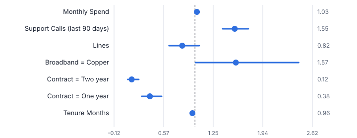
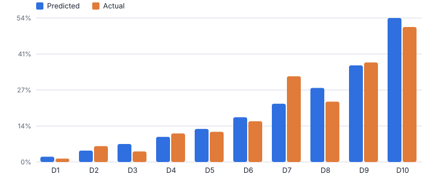
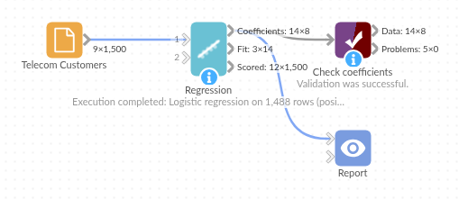

# Regression

*Omniscope custom block · Analytics*

**Linear and logistic regression with the statistics people expect: coefficients, p-values, confidence intervals, odds ratios, collinearity checks, fit measures and scored rows.**

**Python** · pandas, numpy · nothing extra to install

## The problem it solves

Regression is one of the most used techniques in analytics: to explain what drives a number, to score customers, or to check a hypothesis. Analysts need more than predictions: standard errors, p-values and confidence intervals they can put in front of a manager.

This block fits linear or logistic regression, dummy-codes text fields, reports the standard statistics and collinearity (VIF), and scores every row. The tests check the results against reference values from statsmodels.

- **1,488** customers in the fit (12 with missing spend left out)
- **0.77** AUC of the churn model
- **0.12** odds ratio for a two-year contract vs monthly
- **0.83** R-squared of the linear model for monthly spend

### How it works

- Connect data, choose the target and the predictors (numbers or text). Automatic picks logistic for a yes / no target, linear otherwise.
- For logistic, optionally set the positive class and the classification threshold; set the confidence level for intervals.
- Outputs: coefficients (with odds ratios for logistic), fit statistics, and the input rows scored with prediction or probability.

## What goes in

### Telecom customers

1,500 synthetic customers with contract, usage, spend and churn.

| Customer ID | Region | Contract | Broadband | Lines | Tenure Months | Support Calls (last 90 days) | Monthly Spend | Churned |
|---|---|---|---|---|---|---|---|---|
| T100000 | North | Monthly | Copper | 3 | 3 | 0 | 43.98 | Yes |
| T100001 | Midlands | Monthly | Fibre | 3 | 50 | 2 | 65.22 | No |
| T100002 | Midlands | Monthly | Fibre | 3 | 30 | 1 | 60.0 | No |
| T100003 | North | One year | Copper | 2 | 46 | 0 | 44.3 | Yes |
| T100004 | Wales | Monthly | Fibre | 3 | 19 | 1 | 60.01 | No |
| T100005 | Wales | Monthly | Fibre | 4 | 10 | 1 | 65.12 | Yes |

*1,500 rows in the sample file.*

## The options

| Option | Demo setting | What it does |
|---|---|---|
| Target field | `Churned` | The value to explain: a number (linear) or a yes / no outcome (logistic). |
| Predictor fields | `Tenure Months, Contract, Broadband, Lines, Support Calls (last 90 days), Monthly Spend` | Numbers or text (text is dummy-coded). |
| Model | `Automatic` | Automatic chooses logistic for a two-value target and linear otherwise. |
| Confidence level | `0.95` | For the coefficient confidence intervals. |

## What comes out

### Coefficients (logistic: Churned = Yes)

| Term | Coefficient | Std Error | t or z | P Value | Odds Ratio | Odds Ratio CI Low | Odds Ratio CI High | VIF | Significant |
|---|---|---|---|---|---|---|---|---|---|
| (Intercept) | -1.647 | 0.4474 | -3.682 | 0.0002 | 0.1925 | 0.0801 | 0.4628 |  | Yes |
| Tenure Months | -0.0359 | 0.0041 | -8.657 | 0 | 0.9647 | 0.9569 | 0.9726 | 1.202 | Yes |
| Contract = One year | -0.9752 | 0.1821 | -5.355 | 0 | 0.3771 | 0.2639 | 0.5389 | 1.094 | Yes |
| Contract = Two year | -2.081 | 0.2955 | -7.042 | 0 | 0.1248 | 0.0699 | 0.2227 | 1.152 | Yes |
| Broadband = Copper | 0.4485 | 0.2252 | 1.991 | 0.0464 | 1.566 | 1.007 | 2.435 | 2.35 | Yes |
| Lines | -0.1941 | 0.1281 | -1.516 | 0.1296 | 0.8235 | 0.6407 | 1.059 | 4.136 | No |
| Support Calls (last 90 days) | 0.4385 | 0.0584 | 7.507 | 0 | 1.55 | 1.383 | 1.739 | 1.007 | Yes |
| Monthly Spend | 0.0266 | 0.012 | 2.213 | 0.0269 | 1.027 | 1.003 | 1.051 | 5.754 | Yes |

### Fit

| Statistic | Value | Text |
|---|---|---|
| Model |  | Logistic regression (maximum likelihood) |
| Positive class |  | Yes |
| Rows used | 1488 |  |
| Rows left out (missing values) | 12 |  |
| Coefficients | 8 |  |
| Positive share | 0.1929 |  |
| Log-likelihood | -611 |  |
| Null log-likelihood | -729.7 |  |
| McFadden pseudo R-squared | 0.1627 |  |
| Likelihood-ratio chi-square | 237.4 |  |
| Likelihood-ratio p-value | 1.352e-47 |  |
| AIC | 1238 |  |
| AUC | 0.7745 |  |
| Accuracy at threshold 0.5 | 0.8199 |  |

### Linear model for Monthly Spend (same block, numeric target)

| Term | Coefficient | Std Error | P Value | CI Low | CI High | Significant |
|---|---|---|---|---|---|---|
| (Intercept) | 31.35 | 0.5224 | 0 | 30.32 | 32.37 | Yes |
| Tenure Months | 0.1307 | 0.0076 | 0 | 0.1158 | 0.1456 | Yes |
| Contract = One year | 0.6888 | 0.3723 | 0.0645 | -0.0414 | 1.419 | No |
| Contract = Two year | -3.734 | 0.4101 | 0 | -4.538 | -2.929 | Yes |
| Broadband = Copper | -14.15 | 0.3169 | 0 | -14.77 | -13.53 | Yes |
| Lines | 9.354 | 0.1376 | 0 | 9.084 | 9.624 | Yes |
| Support Calls (last 90 days) | 0.1587 | 0.1289 | 0.2184 | -0.0941 | 0.4115 | No |

*Longer contracts and tenure cut the odds of churn; each support call raises them (synthetic data).*

*The model ranks customers well: churn in the top decile is 51%, against 1% in the bottom decile (synthetic data).*

## Where it pays off

### Telecoms, utilities and subscriptions: Churn drivers and scores

Which factors raise the odds of leaving, with confidence intervals, and a churn probability per customer for retention campaigns.

### Retail and pricing: What drives sales

Store or product sales against price, promotion, footfall and season, with the size and significance of each effect.

### Financial services: Credit and propensity models

Default or take-up probability with odds ratios that can be explained and documented.

### Operations and HR: Explaining variation

Delivery times, defect rates or absence against their drivers, with collinearity flagged.

*Use cases describe typical scenarios and are illustrative.*

## Why do this in Omniscope

- **Refitted on every extract.** Predictor preparation, a held-out set from Partition, fitting and scoring run in one workflow, so a new customer extract is refitted and rescored with the same settings.
- **Statistics checked against reference values.** The tests compare the coefficients and standard errors of both the linear and the logistic model with reference values from an established statistics library.
- **Probabilities next to the drivers.** The scored customers sit in the same report as the odds-ratio table, so the retention team can sort by churn probability beside the factors that drive it.
- **Model code you can change.** Dummy coding, VIF and the logistic fit are numpy code in the block; change the reference level or add an interaction term there.

## How it fits into an Omniscope workflow

Customer data → Field Organiser (derived fields) → **Regression** → Report (coefficients, scores)

Prepare predictors upstream (for example tenure in months from a start date); use Stratified Sample or Partition to hold out a test set.

Show the coefficient table with odds ratios and the scored customers sorted by probability in a Report.

## In one step

Linear and logistic models with full statistical output.

## Try it

1. Open the demo project (`demo.iox` on the demo server, or import `demo.ioz` from this folder): 1,500 synthetic telecoms customers with churn.
2. The question: what drives churn, how sure are we, and who is most likely to leave next?
3. Open the block: target Churned, predictors tenure, contract, broadband, lines, support calls, spend. Run it.
4. Look at the coefficients: a two-year contract has an odds ratio of 0.12; each support call 1.55. AUC 0.77.
5. Switch the target to Monthly Spend: the same block gives a linear model with R-squared and confidence intervals.

## Running in Omniscope

*The demo project's workflow: the sample data, the block, and a Validate data check on its output.*

<!--language-->
## Language and libraries

Python. It uses pandas and numpy, plus the Python standard library (math).

pandas and numpy are part of Omniscope's Docker Python image, and the block was run in both host mode and Docker mode on an Omniscope server, with the same results. It needs nothing else installed.
<!--/language-->

## Tested

The demo workflow completed without errors on an Omniscope server (8 records in Coefficients, 14 in Fit and 1,500 in Scored rows). Automated tests check normal data, empty input, wrong types and large input.
