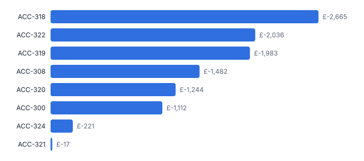
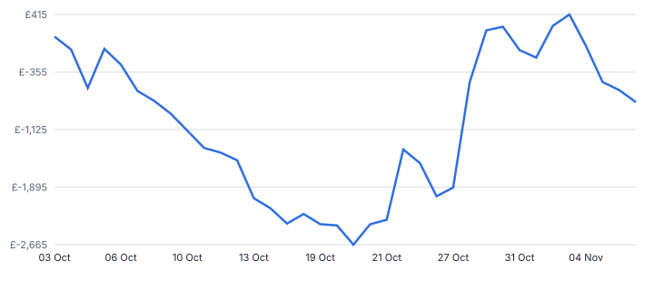
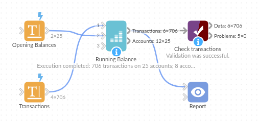

# Running Balance

*Omniscope custom block · Analytics*

**Running balances per account from opening balances and transactions, with the lowest point, days below zero or a limit, and average daily balance.**

**Python** · pandas, numpy · nothing extra to install

## The problem it solves

Credit control, treasury and loyalty teams need more than the closing balance: when did the account go overdrawn, how low did it go, for how many days, and what was the average balance. A running sum per account answers part of it; the rest needs daily balances.

This block adds the balance after every transaction and summarises each account, starting from opening balances when you have them.

- **25** accounts (invented)
- **706** transactions
- **8** accounts that went below zero
- **-£2,665** lowest balance reached

### How it works

- Connect transactions (account, date, amount with money in positive) to input 1 and, optionally, opening balances to input 2.
- Set a limit (for example an overdraft limit) and the as-of date for the daily figures.
- Outputs: the transactions with the balance after each, and a summary per account, lowest balance first.

## What goes in

### Input 1: transactions

| Account | Date | Amount (GBP) | Type |
|---|---|---|---|
| ACC-300 | 2025-10-01 | -146.51 | Payment |
| ACC-300 | 2025-10-02 | 54.120000000000005 | Receipt |
| ACC-300 | 2025-10-02 | -62.54 | Payment |
| ACC-300 | 2025-10-04 | -95.92 | Payment |
| ACC-300 | 2025-10-05 | 385.61600000000004 | Receipt |
| ACC-300 | 2025-10-06 | -322.72 | Payment |

*706 rows in the sample file.*

### Input 2: opening balances

| Account | Opening Balance (GBP) |
|---|---|
| ACC-300 | 2702.14 |
| ACC-301 | 3771.2 |
| ACC-302 | 4575.85 |
| ACC-303 | 2164.54 |
| ACC-304 | 3836.84 |
| ACC-305 | 3030.84 |

*25 rows in the sample file.*

## The options

| Option | Demo setting | What it does |
|---|---|---|
| Account | `Account` | Identifies the account each transaction belongs to. |
| Date | `Date` | Date of each transaction. |
| Amount (in positive, out negative) | `Amount (GBP)` | Money in as positive, money out as negative. |
| Account | `Account` | Account in the opening balances table, matched to input 1. |
| Opening balance | `Opening Balance (GBP)` | Balance before the first transaction. |

## What comes out

### Accounts (lowest balance first)

| Account | Opening Balance | Transactions | Total In | Total Out | Closing Balance | Lowest Balance | Lowest On | Days Below Zero | Average Daily Balance | First Date | Last Date |
|---|---|---|---|---|---|---|---|---|---|---|---|
| ACC-318 | 281.13 | 36 | 4,770.02 | 5,809.60 | -758.45 | -2,665.28 | 2025-10-21 | 43 | -965.86 | 2025-10-03 | 2025-11-18 |
| ACC-322 | -293.31 | 30 | 3,662.49 | 4,524.61 | -1,155.43 | -2,036.41 | 2025-10-21 | 47 | -1,150.24 | 2025-10-03 | 2025-11-18 |
| ACC-319 | -295.29 | 15 | 1,378.41 | 3,065.75 | -1,982.63 | -1,982.63 | 2025-10-13 | 46 | -1,765.28 | 2025-10-02 | 2025-11-18 |
| ACC-308 | 2,773.95 | 38 | 2,981.77 | 7,238.14 | -1,482.42 | -1,482.42 | 2025-11-03 | 21 | 274.05 | 2025-10-02 | 2025-11-18 |
| ACC-320 | 704.31 | 18 | 730.73 | 2,679.42 | -1,244.38 | -1,244.38 | 2025-10-20 | 43 | -812.94 | 2025-10-01 | 2025-11-18 |
| ACC-300 | 2,702.14 | 38 | 3,759.18 | 7,573.52 | -1,112.20 | -1,112.20 | 2025-11-05 | 18 | 624.24 | 2025-10-01 | 2025-11-18 |
| ACC-324 | -81.1 | 16 | 3,912.04 | 2,184.52 | 1,646.42 | -221.37 | 2025-10-04 | 4 | 1,139.40 | 2025-10-03 | 2025-11-18 |
| ACC-321 | 1,137.56 | 40 | 5,629.38 | 6,783.48 | -16.54 | -16.54 | 2025-11-13 | 6 | 1,068.20 | 2025-10-01 | 2025-11-18 |
| ACC-315 | 2,202.62 | 24 | 3,007.88 | 5,202.94 | 7.56 | 7.56 | 2025-10-14 | 0 | 279.23 | 2025-10-02 | 2025-11-18 |
| ACC-317 | 3,453.33 | 41 | 6,812.92 | 7,800.74 | 2,465.51 | 840.68 | 2025-10-20 | 0 | 2,591.61 | 2025-10-03 | 2025-11-18 |

*Accounts that dipped furthest (invented data).*

*The balance path of the account that went lowest.*

## Where it pays off

### Banking: Overdraft monitoring

Days overdrawn and days over the arranged limit per account, with the lowest point.

### Finance: Customer account balances

Running sales ledger balances per customer for credit control.

### Loyalty: Points balances

Running points balances from earn and burn transactions.

### Treasury: Average balances

Average daily balance per account for interest and cash pooling.

*Use cases describe typical scenarios and are illustrative.*

## Why do this in Omniscope

- **Latest load, latest overdrafts.** The balances come from the workflow that loads the transactions, and the accounts below the limit can go to the credit team by Email output on every run.
- **Balances you can trace.** Every transaction carries its balance after, so an account's lowest point and days below zero lead back to the rows behind them, and same-day transactions keep their input order, so a re-run gives the same path.
- **Open to an interest rule.** Opening balances come from a second input such as a period-end table; an interest accrual on the daily balances would be a few more lines of the block's pandas.

## How it fits into an Omniscope workflow

Transactions → Opening balances → **Running Balance** → Report / Email output (accounts below zero)

Stock Run-Out Projection does the same forward-looking for stock; Reconciliation Matcher checks the transactions against the bank.

Send accounts with days below the limit to the credit team.

## In one step

Running and daily balances, with overdraft figures per account.

## Try it

1. Open the demo project (`demo.iox` on the demo server, or import `demo.ioz` from this folder): invented account transactions and opening balances.
2. The question: which accounts went overdrawn, how deep and for how long?
3. Run the block: balance after each transaction and the account summary.
4. Look at the 8 accounts below zero and the balance chart for the lowest one.
5. Set an overdraft limit to see days beyond it.

## Running in Omniscope

*The demo project's workflow: the sample data, the block, and a Validate data check on its output.*

<!--language-->
## Language and libraries

Python. It uses pandas and numpy.

pandas and numpy are part of Omniscope's Docker Python image, and the block was run in both host mode and Docker mode on an Omniscope server, with the same results. It needs nothing else installed.
<!--/language-->

## Tested

The demo workflow ran without errors on an Omniscope server, giving 706 records in Transactions and 25 in Accounts. Automated tests cover balances, days below zero and average daily balance on known values, a limit, the sample data, and bad options.
