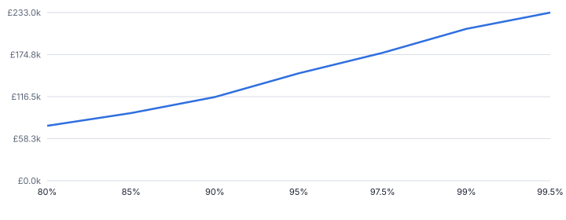
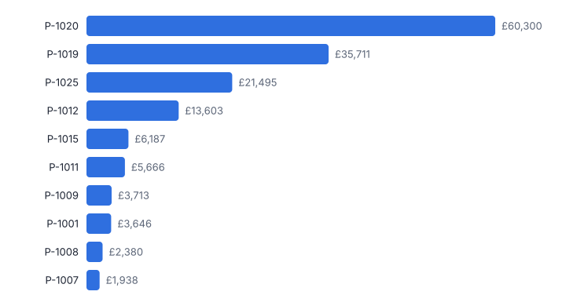
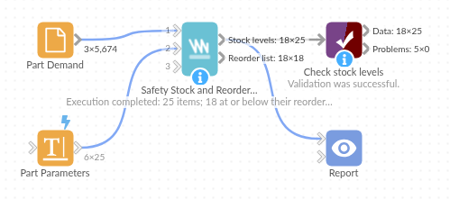

# Safety Stock and Reorder Point

*Omniscope custom block · Analytics*

**Safety stock, reorder points, order-up-to levels and EOQ for every item, from demand history and lead times, for the service level you choose, with today's reorder list.**

**Python** · pandas, numpy · nothing extra to install

## The problem it solves

Too much stock ties up cash and space; too little loses sales and stops production lines. Rules of thumb such as "two weeks' cover" ignore how variable each item's demand and lead time are, so steady items get too much buffer and erratic ones too little.

This block applies the standard inventory formulas per item: demand variability (with zero-demand periods counted), lead-time variability, the service level target, and produces the levels and a reorder list from current stock.

- **25** parts with levels set
- **18** parts at or below reorder point now
- **£166.8k** safety stock value at 95% (98% for selected parts)
- **+57%** extra safety-stock value to go from 95% to 99.5% service

### How it works

- Connect demand history (item, date, quantity) and, optionally, an item table with lead time, its variability, unit cost, stock on hand and service-level overrides.
- Choose the period (day, week, month), the default service level, lead time and review period, and the ordering cost and holding rate for EOQ.
- Demand is summed per period with zero-demand periods included; safety stock combines demand and lead-time variability.
- Outputs: levels per item, and a reorder list of items at or below their reorder point with suggested order quantities.

## What goes in

### Input 1: part demand

A year of synthetic daily orders for 25 parts, some steady, some lumpy.

| Order Date | Part Number | Quantity |
|---|---|---|
| 2024-11-04 | P-1001 | 3 |
| 2024-11-05 | P-1001 | 3 |
| 2024-11-06 | P-1001 | 1 |
| 2024-11-07 | P-1001 | 1 |
| 2024-11-09 | P-1001 | 2 |
| 2024-11-10 | P-1001 | 1 |

*5,674 rows in the sample file.*

### Input 2: part parameters

| Part Number | Lead Time (weeks) | Lead Time Std Dev (weeks) | Unit Cost | Stock On Hand | Target Service Level |
|---|---|---|---|---|---|
| P-1001 | 3.0 | 0.58 | 216.08 | 27 |  |
| P-1002 | 2.0 | 0.16 | 23.63 | 67 |  |
| P-1003 | 2.0 | 0.08 | 81.36 | 7 |  |
| P-1004 | 2.0 | 0.53 | 12.24 | 42 |  |
| P-1005 | 3.0 | 0.21 | 35.44 | 201 | 0.98 |
| P-1006 | 1.0 | 0.04 | 85.78 | 16 |  |

*25 rows in the sample file.*

## The options

| Option | Demo setting | What it does |
|---|---|---|
| Item field | `Part Number` | Identifies the item, such as a part number. |
| Date field | `Order Date` | Date of each demand record; demand is summed per period. |
| Quantity field | `Quantity` | Quantity demanded or shipped. |
| Cost per order | `40` | For EOQ. 0 = no EOQ. |
| Demand period | `Week` | Lead times and review periods are in this unit. |
| Target service level | `0.95` | 0.95 = 95% chance of no stock-out per replenishment cycle. |
| Review period (periods) | `1.0` | Time between stock reviews, for the order-up-to level. |

## What comes out

### Stock levels (first ten parts)

| Part Number | Average Demand | Demand Std Dev | Lead Time | Service Level | Safety Stock | Reorder Point | Order-Up-To Level | EOQ | Stock On Hand | Status | Suggested Order |
|---|---|---|---|---|---|---|---|---|---|---|---|
| P-1001 | 13.19 | 3.95 | 3 | 0.95 | 16.88 | 56.45 | 70.85 | 31.87 | 27 | Below reorder point | 43.85 |
| P-1002 | 13.19 | 3.56 | 2 | 0.95 | 8.99 | 35.37 | 50.31 | 96.38 | 67 | OK | 0 |
| P-1003 | 2.37 | 1.86 | 2 | 0.95 | 4.33 | 9.06 | 12.4 | 21.99 | 7 | Below reorder point | 5.4 |
| P-1004 | 23.69 | 4.64 | 2 | 0.95 | 23.31 | 70.69 | 95.6 | 179.47 | 42 | Below reorder point | 53.6 |
| P-1005 | 28.42 | 4.93 | 3 | 0.98 | 21.4 | 106.67 | 137.37 | 115.52 | 201 | OK | 0 |
| P-1006 | 15.98 | 4.1 | 1 | 0.95 | 6.82 | 22.8 | 41.55 | 55.68 | 16 | Below reorder point | 25.55 |
| P-1007 | 4.81 | 2.47 | 6 | 0.95 | 12.87 | 41.72 | 47.15 | 23.05 | 11 | Below reorder point | 36.15 |
| P-1008 | 6.27 | 2.71 | 3 | 0.95 | 10.09 | 28.9 | 36.1 | 21.03 | 6 | Below reorder point | 30.1 |
| P-1009 | 29.19 | 5.68 | 2 | 0.95 | 21.76 | 80.15 | 111.26 | 53.36 | 109 | OK | 0 |
| P-1010 | 14.02 | 3.7 | 2 | 0.98 | 17.27 | 45.31 | 60.93 | 47.88 | 37 | Below reorder point | 23.93 |

### Reorder list

| Part Number | Stock On Hand | Reorder Point | Cover (periods) | Suggested Order |
|---|---|---|---|---|
| P-1020 | 3 | 915.30 | 0 | 1,067.46 |
| P-1017 | 1 | 50.2 | 0 | 71.1 |
| P-1013 | 5 | 17.5 | 0.9 | 19.4 |
| P-1025 | 57 | 384.24 | 1 | 415.45 |
| P-1008 | 6 | 28.9 | 1 | 30.1 |
| P-1019 | 135 | 550.51 | 1 | 607.54 |
| P-1006 | 16 | 22.8 | 1 | 25.6 |
| P-1012 | 36 | 127.48 | 1 | 139.54 |
| P-1004 | 42 | 70.7 | 1.8 | 53.6 |
| P-1022 | 52 | 77.8 | 1.9 | 54.2 |

*The cost of service: each extra point of service level costs more safety stock than the last (synthetic data).*

*A few erratic, long-lead-time parts hold most of the safety-stock value.*

## Where it pays off

### Manufacturing and MRO: Spare parts and components

Set reorder points for thousands of parts from consumption history and supplier lead times, and review the most expensive buffers first.

### Retail and wholesale: Store and DC replenishment

Order-up-to levels per SKU and location for weekly review cycles, with higher service levels for key lines.

### Healthcare: Medical supplies

High service levels for critical consumables, with lead-time variability from suppliers included.

### E-commerce: Purchase planning

EOQ and reorder points per product to plan purchase orders and quantify the cash tied up in safety stock.

*Use cases describe typical scenarios and are illustrative.*

## Why do this in Omniscope

- **Item master changes flow through.** A new lead time or service level in the item master shows in the next scheduled reorder list, and ABC Classification upstream can set the service level by class.
- **Empty weeks counted as zero.** Weeks with no demand count in the variability, so lumpy parts are not under-buffered; the tests check the formulas, the zero weeks, and that safety stock rises with the service level.
- **Formulas on one page.** Safety stock, reorder point, order-up-to level and EOQ are a page of Python in the block, where a different demand distribution for slow movers could be used.

## How it fits into an Omniscope workflow

Orders / consumption → Item master (lead times, costs, stock) → **Safety Stock and Reorder Point** → Email output (reorder list)

Connect demand history and the item master; schedule daily or weekly. ABC Classification upstream can set service levels by class (for example 98% for A items).

Email the reorder list to buyers, and show safety-stock value by class in a Report.

## In one step

The standard formulas, applied per item with zero-demand periods and lead-time variability handled.

## Try it

1. Open the demo project (`demo.iox` on the demo server, or import `demo.ioz` from this folder): a year of orders for 25 parts plus a parameters table with lead times, costs and stock.
2. The question: what should each reorder point be, and what needs ordering today?
3. Open the block: map demand and parameter fields, weekly periods, 95% service level. Run it.
4. Look at the levels, then the reorder list (18 parts below their reorder point with order quantities).
5. Look at the service-level curve: the cost of going from 95% to 99.5%, which sets how much safety stock is worth holding.

## Running in Omniscope

*The demo project's workflow: the sample data, the block, and a Validate data check on its output.*

<!--language-->
## Language and libraries

Python. It uses pandas and numpy, plus the Python standard library (math).

pandas and numpy are part of Omniscope's Docker Python image, and the block was run in both host mode and Docker mode on an Omniscope server, with the same results. It needs nothing else installed.
<!--/language-->

## Tested

The demo workflow runs without errors on an Omniscope server and produces 25 records in Stock levels and 18 in Reorder list. Its automated tests cover normal data, empty input, wrong types and large input.
