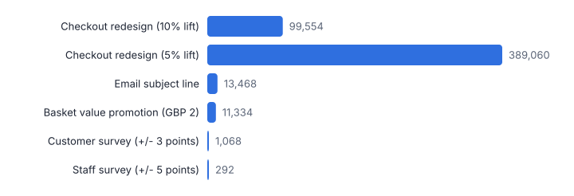
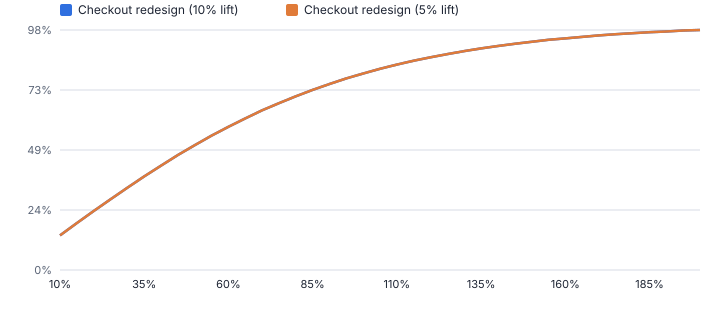
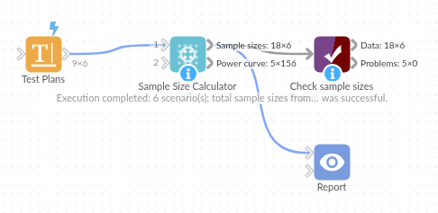

# Sample Size Calculator

*Omniscope custom block · Analytics*

**How big does the test need to be? Sample sizes and power for A/B tests on rates or averages and for survey margins of error, with days needed at your traffic.**

**Python** · pandas, numpy · nothing extra to install

## The problem it solves

Tests are often stopped when the result looks good, or run for an arbitrary two weeks. Both lead to false wins and missed effects. The size needed depends on the baseline, the smallest effect worth detecting and the traffic, and small effects need far more data than intuition suggests.

This block turns a table of planned tests into sample sizes per group, days needed and power curves, using the standard normal-approximation formulas (checked in the tests against the same formulas written out independently).

- **99,554** visitors to detect a 10% lift on 3.2% conversion
- **3.9x** as many to detect a 5% lift
- **6 vs 22** days at 18,000 visitors a day
- **292** responses for +/- 5 points from 1,200 staff

### How it works

- Optionally connect a table of scenarios (Scenario, Type, Baseline, Effect, Relative Effect, SD, Margin, Population, Daily Traffic and so on); without it, the options describe one scenario.
- Set the significance level, power, one or two-sided test and group ratio; any column a scenario row gives overrides the option.
- Outputs: sample sizes per scenario with days needed, and power curves for the two-group tests.

## What goes in

### Test plans

Six illustrative plans: A/B tests on rates and means, and two surveys.

| Scenario | Type | Baseline | Effect | Relative Effect | SD | Margin | Population | Daily Traffic |
|---|---|---|---|---|---|---|---|---|
| Checkout redesign (10% lift) | PROPORTION | 0.032 | 0.10 | Yes |  |  |  | 18000 |
| Checkout redesign (5% lift) | PROPORTION | 0.032 | 0.05 | Yes |  |  |  | 18000 |
| Email subject line | PROPORTION | 0.21 | 0.02 | No |  |  |  | 40000 |
| Basket value promotion (GBP 2) | MEAN | 46.5 | 2 | No | 38 |  |  | 9000 |
| Customer survey (+/- 3 points) | SURVEY | 0.5 |  |  |  | 0.03 |  |  |
| Staff survey (+/- 5 points) | SURVEY | 0.5 |  |  |  | 0.05 | 1200 |  |

*6 rows in the sample file.*

## The options

| Option | Demo setting | What it does |
|---|---|---|
| Significance level | `0.05` | Chance of calling a difference real when it is not; 0.05 is usual. |
| Power | `0.8` | Chance of detecting the effect if it is there; 0.8 is usual. |
| Test | `Two-sided` | Two-sided detects a change in either direction; one-sided only the expected direction, and needs fewer records. |
| Group 2 size relative to group 1 | `1.0` | 1 = equal groups. |

## What comes out

### Sample sizes

| Scenario | Type | Baseline | Target | Absolute Effect | Relative Effect | Standard Deviation | Margin Of Error | Population | Sample Size Group 1 | Sample Size Group 2 | Total Sample Size | Daily Traffic | Days Needed |
|---|---|---|---|---|---|---|---|---|---|---|---|---|---|
| Checkout redesign (10% lift) | PROPORTION | 0.032 | 0.0352 | 0.0032 | 0.1 |  |  |  | 49777 | 49777 | 99554 | 18,000 | 6 |
| Checkout redesign (5% lift) | PROPORTION | 0.032 | 0.0336 | 0.0016 | 0.05 |  |  |  | 194530 | 194530 | 389060 | 18,000 | 22 |
| Email subject line | PROPORTION | 0.21 | 0.23 | 0.02 | 0.0952 |  |  |  | 6734 | 6734 | 13468 | 40,000 | 1 |
| Basket value promotion (GBP 2) | MEAN | 46.5 | 48.5 | 2 | 0.043 | 38 |  |  | 5667 | 5667 | 11334 | 9,000 | 2 |
| Customer survey (+/- 3 points) | SURVEY | 0.5 |  | 0.03 |  |  | 0.03 |  | 1068 |  | 1068 |  |  |
| Staff survey (+/- 5 points) | SURVEY | 0.5 |  | 0.05 |  |  | 0.05 | 1,200 | 292 |  | 292 |  |  |

*Halving the lift you want to detect roughly quadruples the sample needed (illustrative plans).*

*Stopping at half the required size leaves only 51% power: most real effects of that size would be missed.*

## Where it pays off

### E-commerce and digital: A/B test planning

How long a checkout, pricing or page test must run at current traffic, before it starts.

### Marketing: Campaign tests

Holdout and test cell sizes for email, direct mail or offers, by expected response rate.

### Market research and HR: Survey sample sizes

Responses needed for a margin of error, including small populations such as staff surveys.

### Operations: Process trials

Orders or units needed to detect a change in an average such as handling time or basket value.

*Use cases describe typical scenarios and are illustrative.*

## Why do this in Omniscope

- **Test plans kept as a table.** Each planned test is a row in the workflow, so changing a baseline or the daily traffic recalculates every plan and its days needed, and the A/B Test results can later sit beside the plan in the same report.
- **Formulas checked twice.** The tests compare the sample sizes with the same formulas written out independently, and check that each option moves the size in the expected direction.
- **More designs can be added.** The normal-approximation formulas for proportions, means and survey margins are written out in the block, ready for a design with more than two groups to be added beside them.

## How it fits into an Omniscope workflow

Test plans (Data Table or spreadsheet) → **Sample Size Calculator** → Report (plan table, power curves) → A/B Test (after the test)

Keep planned tests in a table; the A/B Test block analyses the results once the test has run.

Chart Power against Total Sample Size for each plan to show the cost of stopping early.

## In one step

Sample size and power for the common designs, per scenario, with days needed.

## Try it

1. Open the demo project (`demo.iox` on the demo server, or import `demo.ioz` from this folder): a table of six planned tests and surveys.
2. The question: how long must the checkout test run, and is a 5% lift realistic to detect?
3. Run the block: every plan gets its sample size and days needed.
4. Look at the two checkout plans: 6 days for a 10% lift, 22 days for a 5% lift.
5. Look at the power curve: why stopping early, when the result looks good, is a bad idea.

## Running in Omniscope

*The demo project's workflow: the sample data, the block, and a Validate data check on its output.*

<!--language-->
## Language and libraries

Python. It uses pandas and numpy, plus the Python standard library (math, re).

pandas and numpy are part of Omniscope's Docker Python image, and the block was run in both host mode and Docker mode on an Omniscope server, with the same results. It needs nothing else installed.
<!--/language-->

## Tested

The demo workflow runs without errors on an Omniscope server and produces 6 records in Sample sizes and 156 in Power curve. Its automated tests cover the formulas against independently written versions, the direction each option moves the size, a scenarios table with power curves, and bad inputs.
