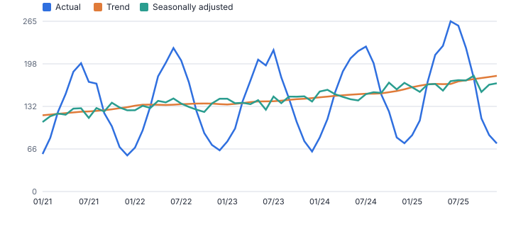
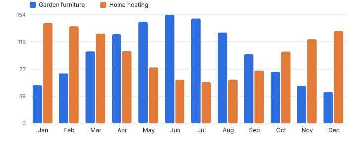
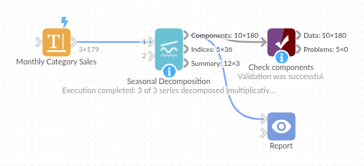

# Seasonal Decomposition

*Omniscope custom block · Analytics*

**How much of a change is the season, and how much is real? Trend, seasonal pattern and leftovers for every series, with seasonally adjusted figures and seasonal indices.**

**Python** · pandas, numpy · nothing extra to install

## The problem it solves

"Sales up 30% on last month" means little for a seasonal business: garden furniture always jumps in spring and falls in autumn. To judge performance, planners need the trend and the seasonally adjusted series; to plan stock and staff, they need the seasonal indices.

Seasonal Decomposition splits each series into trend, seasonal and residual components, returns seasonally adjusted values and seasonal indices, and scores how strong the seasonality and trend are, per category, store or region.

- **3** categories decomposed at once
- **0.99** seasonality strength, garden furniture (0 to 1)
- **Jun / Dec** peak and trough month
- **+52%** underlying trend over five years

### How it works

- Choose the date and value fields, the series fields and the data frequency; the season length is set automatically (12 for monthly data) or by you.
- Choose additive (seasonal effect in units) or multiplicative (seasonal effect in percent; suits growing series).
- The trend is a centred moving average (extended to the ends if you wish); seasonal indices are the average detrended value per season.
- Outputs: components per period, seasonal indices per season, and a summary with seasonality and trend strength, peak and trough, trend change and residual spread.

## What goes in

### Monthly sales by category

Five years of synthetic monthly sales for garden furniture, home heating and kitchenware (one month missing, interpolated).

| Month | Category | Sales (£k) |
|---|---|---|
| 2021-01-01 | Garden furniture | 58.3 |
| 2021-02-01 | Garden furniture | 83.4 |
| 2021-03-01 | Garden furniture | 123.8 |
| 2021-04-01 | Garden furniture | 151.7 |
| 2021-05-01 | Garden furniture | 186.2 |
| 2021-06-01 | Garden furniture | 199.4 |

*179 rows in the sample file.*

## The options

| Option | Demo setting | What it does |
|---|---|---|
| Date field | `Month` | Date of each value. |
| Value field | `Sales (£k)` | The series to decompose, such as monthly sales. |
| Series (optional) | `Category` | One decomposition per combination of these fields, such as Category. |
| Model | `Multiplicative (seasonal effect in %)` | Multiplicative when the seasonal swing grows with the level; additive when it stays the same size. |
| Data frequency | `Monthly` | Spacing of the data, which sets the default season length. |
| Extend the trend to the ends | `On` | Fill the first and last half-season of the trend with a straight-line continuation. |

## What comes out

### Summary

| Category | Model | Season Length | Periods | Status | Seasonality Strength | Trend Strength | Peak Season | Trough Season | Trend Change | Residual Std Dev | Interpolated Periods |
|---|---|---|---|---|---|---|---|---|---|---|---|
| Garden furniture | Multiplicative | 12 | 60 | OK | 0.987 | 0.816 | Jun | Dec | 0.517 | 0.049 | 0 |
| Home heating | Multiplicative | 12 | 60 | OK | 0.986 | 0.377 | Jan | Jul | -0.093 | 0.038 | 0 |
| Kitchenware | Multiplicative | 12 | 60 | OK | 0.906 | 0.701 | Dec | May | 0.231 | 0.04 | 1 |

### Components (garden furniture, first months)

| Category | Period | Season | Value | Trend | Seasonal | Residual | Seasonally Adjusted | Is Interpolated |
|---|---|---|---|---|---|---|---|---|
| Garden furniture | 2021-01 | Jan | 58.3 | 118.53 | 0.54 | 0.912 | 108.04 | No |
| Garden furniture | 2021-02 | Feb | 83.4 | 119.61 | 0.713 | 0.978 | 116.98 | No |
| Garden furniture | 2021-03 | Mar | 123.80 | 120.70 | 1.021 | 1.005 | 121.29 | No |
| Garden furniture | 2021-04 | Apr | 151.70 | 121.79 | 1.27 | 0.981 | 119.44 | No |
| Garden furniture | 2021-05 | May | 186.20 | 122.88 | 1.444 | 1.049 | 128.95 | No |
| Garden furniture | 2021-06 | Jun | 199.40 | 123.97 | 1.542 | 1.043 | 129.35 | No |
| Garden furniture | 2021-07 | Jul | 170.40 | 124.55 | 1.489 | 0.919 | 114.45 | No |
| Garden furniture | 2021-08 | Aug | 167.70 | 125.44 | 1.292 | 1.035 | 129.78 | No |

### Seasonal indices (garden furniture)

| Category | Season Number | Season | Seasonal Index | Effect |
|---|---|---|---|---|
| Garden furniture | 1 | Jan | 0.54 | -46.0% vs trend |
| Garden furniture | 2 | Feb | 0.713 | -28.7% vs trend |
| Garden furniture | 3 | Mar | 1.021 | +2.1% vs trend |
| Garden furniture | 4 | Apr | 1.27 | +27.0% vs trend |
| Garden furniture | 5 | May | 1.444 | +44.4% vs trend |
| Garden furniture | 6 | Jun | 1.542 | +54.2% vs trend |
| Garden furniture | 7 | Jul | 1.489 | +48.9% vs trend |
| Garden furniture | 8 | Aug | 1.292 | +29.2% vs trend |
| Garden furniture | 9 | Sep | 0.982 | -1.8% vs trend |
| Garden furniture | 10 | Oct | 0.735 | -26.5% vs trend |
| Garden furniture | 11 | Nov | 0.529 | -47.1% vs trend |
| Garden furniture | 12 | Dec | 0.445 | -55.5% vs trend |

*Seasonally adjusted sales follow the trend; the swings in the actuals are mostly the season (synthetic data).*

*Seasonal indices: garden furniture peaks in early summer, home heating in winter.*

## Where it pays off

### Retail: Performance net of season

Report seasonally adjusted sales per category so a weak June for garden furniture is visible even though June is its best month.

### Supply chain: Seasonal stock and staffing

Use the seasonal indices to phase purchase orders, warehouse staffing and promotions through the year.

### Utilities and energy: Demand patterns

Separate weather-driven seasonal demand from the underlying trend in consumption per customer segment.

### Public sector and healthcare: Service demand

Decompose A&E attendances, calls or applications to plan winter pressure and spot genuine changes in demand.

*Use cases describe typical scenarios and are illustrative.*

## Why do this in Omniscope

- **Components arrive as fields.** Trend, seasonal, residual and seasonally adjusted values are data, so they can be filtered, joined to targets and charted beside the actuals in the same report, with Time Series Forecast as the next block.
- **Gaps declared, not hidden.** Missing periods are interpolated and flagged, and duplicate dates summed; the tests check that known components are recovered and that multiplicative indices average one.
- **A method you can swap.** The classical centred moving average is a few lines of the block's script; a different trend smoother could replace it there.

## How it fits into an Omniscope workflow

Sales (monthly) → Time Series Filler (if gaps) → **Seasonal Decomposition** → Time Series Forecast / Report

Aggregate to one row per period and series first (or let the block sum duplicate dates). For gappy data, Time Series Filler can make the calendar complete.

Chart actual, trend and seasonally adjusted lines in a Report; use the indices output for planning, and native Time Series Forecast when you need the future.

Gap filling, decomposition and forecasting are neighbouring blocks in one workflow, and the components arrive as data fields you can filter, join and chart like any others.

## In one step

Gives the components as data, not just a chart, for many series at once.

## Try it

1. Open the demo project (`demo.iox` on the demo server, or import `demo.ioz` from this folder): five years of monthly sales for three categories.
2. The question: garden furniture sales more than halved from July to October 2025. Should we worry?
3. Open Seasonal Decomposition: date, value, series Category, multiplicative. Run it.
4. Look at the chart: the seasonally adjusted line is flat-to-rising: the fall was the season. The seasonal indices give the pattern to plan around.
5. Look at the summary: seasonality strength close to 1 for garden furniture and home heating, weaker for kitchenware, which has a December spike.

## Running in Omniscope

*The demo project's workflow: the sample data, the block, and a Validate data check on its output.*

<!--language-->
## Language and libraries

Python. It uses pandas and numpy.

pandas and numpy are part of Omniscope's Docker Python image, and the block was run in both host mode and Docker mode on an Omniscope server, with the same results. It needs nothing else installed.
<!--/language-->

## Tested

The demo workflow ran without errors on an Omniscope server, giving 180 records in Components, 36 in Seasonal indices and 3 in Summary. Automated tests cover normal data, empty input, wrong types and large input.
