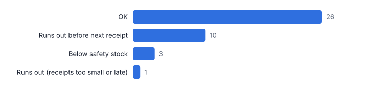
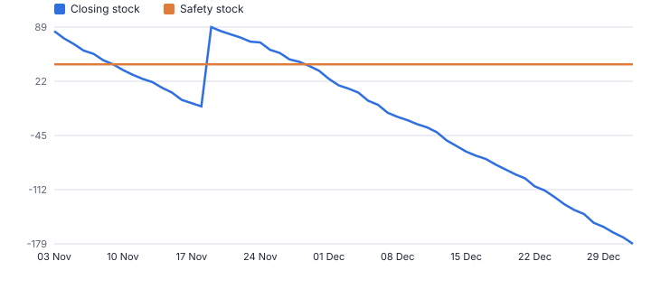
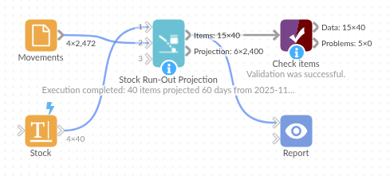

# Stock Run-Out Projection

*Omniscope custom block · Analytics*

**Project every item's stock day by day from on-hand, demand and open purchase orders, and see what runs out, when, and whether the next delivery is in time.**

**Python** · pandas, numpy · nothing extra to install

## The problem it solves

Days of cover on a dashboard ignores the purchase orders already on their way and the shape of demand. Buyers need the date each item runs out, given what is due in, and the shortfall to cover.

This block runs a daily stock projection per item from stock on hand, dated demand (or a steady daily rate) and dated receipts, and lists the items in order of urgency.

- **40** parts projected 60 days ahead (illustrative)
- **11** run out within the horizon
- **10** run out before their next purchase order arrives
- **3** dip below safety stock only

### How it works

- Connect items with stock on hand (and optionally safety stock and a daily demand) to input 1.
- Connect dated movements to input 2 with item, date, quantity and type; types such as PO or receipt are receipts, anything else is demand.
- Choose the start date and horizon. Outputs: one row per item with run-out date, shortfall and status, and the daily projection.

## What goes in

### Input 1: stock

| SKU | Description | On Hand | Safety Stock |
|---|---|---|---|
| SKU-2100 | Part 1 | 191 | 51 |
| SKU-2101 | Part 2 | 425 | 53 |
| SKU-2102 | Part 3 | 1234 | 131 |
| SKU-2103 | Part 4 | 231 | 56 |
| SKU-2104 | Part 5 | 206 | 64 |
| SKU-2105 | Part 6 | 1072 | 148 |

*40 rows in the sample file.*

### Input 2: movements

Invented daily forecast demand and purchase orders for 40 parts.

| SKU | Date | Quantity | Type |
|---|---|---|---|
| SKU-2100 | 2025-11-03 | 5 | Forecast |
| SKU-2100 | 2025-11-04 | 10 | Forecast |
| SKU-2100 | 2025-11-05 | 3 | Forecast |
| SKU-2100 | 2025-11-06 | 4 | Forecast |
| SKU-2100 | 2025-11-07 | 8 | Forecast |
| SKU-2100 | 2025-11-08 | 11 | Forecast |

*2,472 rows in the sample file.*

## The options

| Option | Demo setting | What it does |
|---|---|---|
| Item field | `SKU` | Identifies the item, such as a SKU. |
| Stock on hand | `On Hand` | Units on hand at the start date. |
| Safety stock (optional) | `Safety Stock` | Level to keep in reserve; days below it are flagged. |
| Item field | `SKU` | Item of each movement, matched to input 1. |
| Date | `Date` | Date of each demand or receipt. |
| Quantity | `Quantity` | Units in each movement. |
| Type (optional) | `Type` | Receipts vs demand; without it all movements are demand. |
| Horizon (days) | `60` | Number of days to project. |

## What comes out

### Parts that run out

| SKU | Stock On Hand | Safety Stock | Average Daily Demand | Run-Out Date | Days Until Run-Out | Next Receipt | Shortfall | Status |
|---|---|---|---|---|---|---|---|---|
| SKU-2136 | 86 | 43 | 6.2 | 2025-11-16 | 13 | 2025-11-19 | 179 | Runs out before next receipt |
| SKU-2110 | 328 | 153 | 22.5 | 2025-11-18 | 15 | 2025-11-21 | 65 | Runs out before next receipt |
| SKU-2134 | 246 | 100 | 14.6 | 2025-11-19 | 16 | 2025-12-12 | 345 | Runs out before next receipt |
| SKU-2121 | 127 | 49 | 6.8 | 2025-11-20 | 17 | 2025-12-14 | 161 | Runs out before next receipt |
| SKU-2131 | 260 | 94 | 13.5 | 2025-11-23 | 20 | 2025-11-25 | 19 | Runs out before next receipt |
| SKU-2103 | 231 | 56 | 8.8 | 2025-11-28 | 25 | 2025-12-02 | 25 | Runs out before next receipt |
| SKU-2116 | 261 | 67 | 9.6 | 2025-11-30 | 27 | 2025-12-04 | 35 | Runs out before next receipt |
| SKU-2135 | 629 | 149 | 22.1 | 2025-11-30 | 27 | 2025-12-02 | 45 | Runs out before next receipt |
| SKU-2107 | 466 | 119 | 17 | 2025-12-01 | 28 | 2025-12-18 | 292 | Runs out before next receipt |
| SKU-2130 | 741 | 127 | 18.5 | 2025-12-11 | 38 | 2025-12-22 | 187 | Runs out before next receipt |
| SKU-2104 | 206 | 64 | 9.4 | 2025-12-13 | 40 | 2025-11-24 | 194 | Runs out (receipts too small or late) |

*Most parts are fine; the list starts with the ones that need action (illustrative data).*

*The projection for the most urgent part: stock falls below zero before the next receipt.*

## Where it pays off

### Manufacturing: Material shortages

Parts that will run out before the next delivery, with the shortfall, for expediting or re-planning production.

### Retail and wholesale: Out-of-stock risk

Products at risk across stores or warehouses, given forecast sales and inbound transfers.

### Healthcare: Supplies and medicines

Critical items that would fall below safety stock before replenishment arrives.

### Field service: Spare parts vans and depots

Days until each depot runs out of each part, given planned jobs and transfers.

*Use cases describe typical scenarios and are illustrative.*

## Why do this in Omniscope

- **Stock, forecast and orders meet.** Stock on hand, Holt-Winters Forecast demand and open purchase orders come together in one workflow, so the run-out dates reflect today's extract and the expedite list can go out by email each day.
- **The urgent parts first.** Items that run out before their next receipt head the list, then late or too-small receipts; the tests cover those cases, unknown items and parts that only dip below safety stock.
- **Your own movement types.** The words that mark a receipt are an option; the day-by-day projection is plain pandas in the block if, for example, goods need a day to be booked in.

## How it fits into an Omniscope workflow

Stock on hand (ERP) → Forecast (Holt-Winters Forecast) + open POs → **Stock Run-Out Projection** → Email output (expedite list)

Feed stock from the ERP, demand from Holt-Winters Forecast or open orders, and receipts from open purchase orders; Safety Stock and Reorder Point sets the safety stock.

Email the items that run out before their next receipt to the buyers daily.

## In one step

A daily stock projection that ends in run-out dates and a status per item.

## Try it

1. Open the demo project (`demo.iox` on the demo server, or import `demo.ioz` from this folder): 40 invented parts with stock, forecast demand and purchase orders.
2. The question: what will we run out of in the next two months, and is anything on its way in time?
3. Run the block: run-out dates, shortfalls and a status per part, most urgent first.
4. Look at the 10 parts that run out before their next purchase order, and the projection chart for the first.
5. Change the start date or horizon to plan further ahead.

## Running in Omniscope

*The demo project's workflow: the sample data, the block, and a Validate data check on its output.*

<!--language-->
## Language and libraries

Python. It uses pandas and numpy, plus the Python standard library (re).

pandas and numpy are part of Omniscope's Docker Python image, and the block was run in both host mode and Docker mode on an Omniscope server, with the same results. It needs nothing else installed.
<!--/language-->

## Tested

The demo workflow ran without errors on an Omniscope server, giving 40 records in Items and 2,400 in Projection. Automated tests cover run-out before a receipt, dips below safety stock, receipt words, unknown items and late receipts, the sample data, bad inputs and large input.
